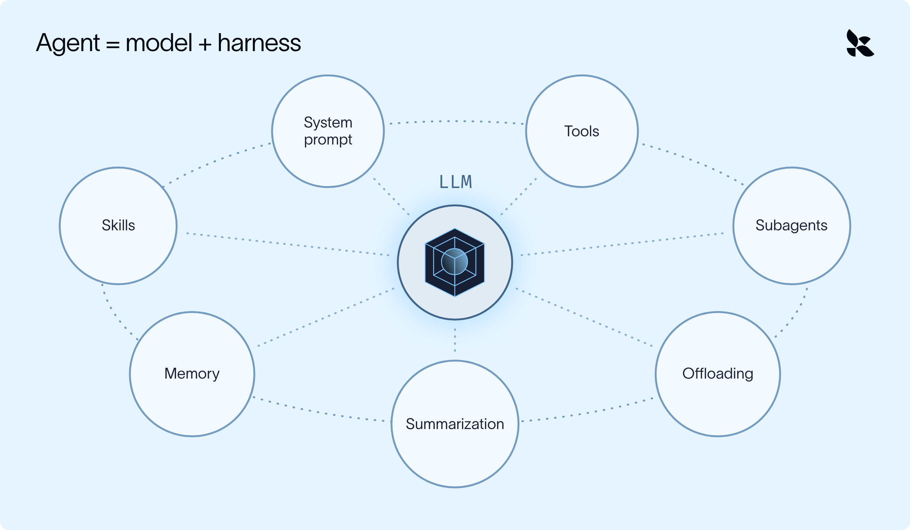
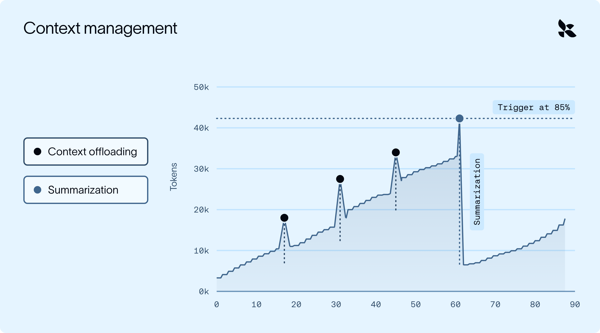
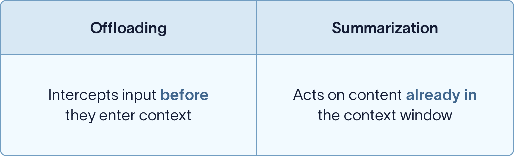
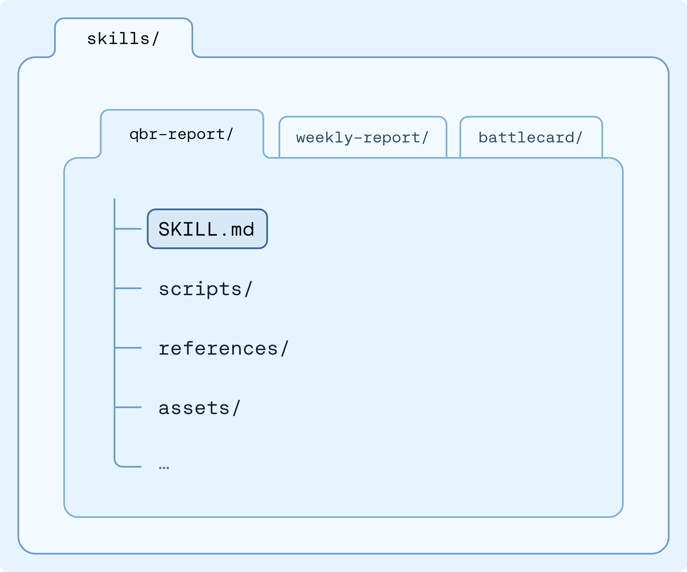
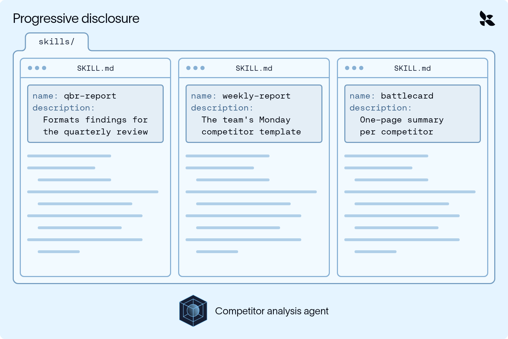
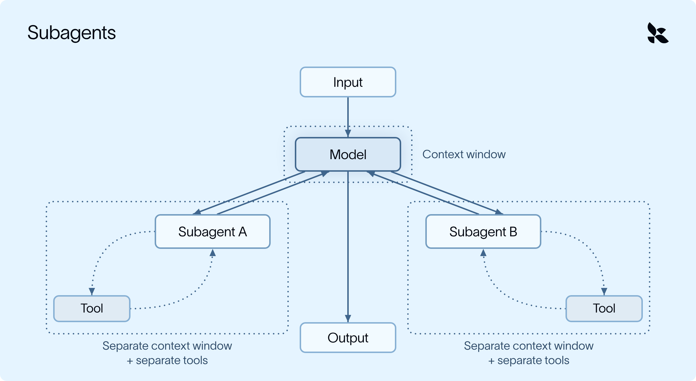

# Context Engineering with Deep Agents: How To Remember Without Keeping Everything In Context

> **来源**: [https://www.langchain.com/blog/context-engineering-deep-agents-remember](https://www.langchain.com/blog/context-engineering-deep-agents-remember)  
> **作者**: Jess Weng | **发布时间**: 2026-10-14T17:00:00+00:00  
> **深度调研**: [查看专题调研报告](research.md)  
> **标签**: 上下文工程, Agent架构, 长程任务可靠性, 中间件

---

## AI 导读

针对长程 Agent 执行复杂任务时因历史与工具输出堆积导致推理精度下降的“上下文腐化”问题，本文提出了基于中间件架构的五大上下文工程方案：通过文件系统自动卸载超大工具输出与对话、在达到 85% 阈值时触发可追溯的历史摘要压缩、利用技能渐进式披露按需加载指令、通过子代理在独立窗口隔离高噪音子任务，以及基于标准 Markdown 文件实现可跨模型复用的长期记忆。方案在不丢失原始信息的前提下动态精简主模型上下文，显著提升了长程 Agent 运行的可靠性与经济性。

---

## 原文整理

## Key Takeaways

- "Context rot" happens as long-running agents build up more context than the model can hold, resulting in accuracy drops.
- Deep Agents, LangChain's open source agent harness, uses five techniques to move context *out* of the active window (without deleting it) to prevent context rot.
- An agent's memory in Deep Agents is stored as plain files in storage you control, so you can switch models or providers while keeping everything it has learned.

If you've ever crammed for an exam the night before, you know the feeling: the more you study, the more the early chapters start to slip.

Agents have the same problem. As they take on longer tasks, they take on more and more information (instructions, tool results, files etc.); eventually this becomes far too much [context](https://docs.langchain.com/oss/python/langchain/context-engineering) to comfortably fit in a model's *context window*. The more history, noise, and tool output a model carries, the worse its accuracy and reasoning tend to get.

In the world of agent engineering, we call this [context rot](https://news.ycombinator.com/item?id=44308711#44310054). This blog covers techniques to manage your agent’s context window and how the Deep Agents harness uses a concept called middleware to inject them into your agent’s run.


### Understanding context engineering techniques

To simplify, an agent is just a model with a harness around it.



The context engineering techniques at the agent’s disposal to address context rot primarily fall into two categories:

- Preventing unnecessary information from *entering* the context window
- Managing and filtering what’s *already in* the context window

The harness applies these methods strategically to get the model **the right context at the right time** for the given task.

Now wiring up a harness that does this *well* is easier said than done, and requires a lot of work (maybe too much work if you are the kind of person who crams for exams the night before).

[Deep Agents](https://www.langchain.com/deep-agents) is LangChain’s open source harness. It wraps the model of your choice with techniques that move context *out* of the active window (into files, summaries, or a separate agent), so that the main agent carries only what it needs (and can recover the raw data if needed later):

1. **Offloading:** large tool results and user messages are saved to the filesystem, and the model sees a preview.
2. **Summarization:** when the conversation nears the context limit, older messages are condensed into a summary.
3. **Skills:** task know-how loads only when the model decides it's relevant.
4. **Subagents:** noisy work runs in a separate context window, and only the result comes back.
5. **Long-term memory:** what the agent learns is saved to a file that carries over to the next conversation.


## Applying context engineering to common use cases

Let’s see how the techniques above can be applied in a real-world use case: a competitive analysis agent. Every Monday, this agent researches five competitors and writes a report in the team's template. A single run looks something like this:

1. Pull a market data export for Company A (tens of thousands of rows)
2. Search the news, read a few articles, and take notes
3. Repeat for Companies B through E
4. Draft the report, revise it based on your feedback, and format it

By step 4, the agent has carried five raw exports, dozens of search results, and two stale drafts through every model call. Most of it is irrelevant for formatting the final report.

Retrieval methods ([RAG](https://docs.langchain.com/oss/python/deepagents/rag), or filesystem search) help the agent pull in *only* what it needs, but that still only solves half the problem. Even a precise agent accumulates unnecessary messages, tool results, and intermediate work, so the harness also has to manage what's already in and around the context window.


## How to implement these techniques: middleware

An agent runs in a loop: the model decides what to do, calls a tool, reads the result, and repeats until the task is done. [Middleware](https://docs.langchain.com/oss/python/langchain/middleware/overview) is code that plugs into specific points in that loop: such as before the agent starts, around each model call, or around each tool call.

- At each point it can read the context and change it before the next step runs.
- Every context engineering technique in this post is a piece of middleware hooked into one of those points.  
  - Most of this is built in, so you don't need to write any middleware to use these techniques (unless you want to customize something specific).


## Offloading: keeping it out the context window

Our agent doesn’t always need to see *all* the data that’s returned from every tool call or human message, especially if it’s a large volume.

For example, each pull\_market\_report tool call returns a full data export (thousands of rows); however, the agent only needs a few numbers from it, so the model can be restricted to only see those rows.


FilesystemMiddleware runs every time a tool is called:

1. When a tool result exceeds roughly 20,000 tokens, the full result is written to /large\_tool\_results/{tool\_call\_id} before it enters the conversation.
2. The model sees only a short preview (the first and last few lines) plus the file path.
3. When the agent later needs Company B's quarterly revenue, it pages through the file with read\_file.

Oversized user/human messages, like a pasted call transcript, get the same treatment at a higher threshold (50,000 tokens) and are saved to /conversation\_history/.


## Summarization: compacting what's already there

Try as we may to offload verbose tool calls, context will gradually begin to pile up over a long run (e.g. five companies' worth of searches, notes, and drafts). Summarization can be used to condense our agent’s entire context window into a summary of what has transpired so far, to allow it to continue on with its research tasks.



- The spikes are large tool results/human messages arriving; offloading swaps each one for a short preview before the model sees it, so context only grows by a little.
- Summarization handles the slow climb: once usage hits 85%, older messages are condensed into a summary and context drops back down.

SummarizationMiddleware checks token usage right before each model call:

1. Once usage crosses a threshold (85% of the model's context window by default), a separate LLM call condenses older messages into a single summary
2. Older messages are removed from the context window while the most recent messages are kept verbatim.
3. The model now sees the summary first, then the recent messages (so nothing recent gets paraphrased).

Two important details:

- **It's recoverable.** The summarized messages are written to /conversation\_history/{session\_id}.md. If the agent needs a detail from Company A's research while drafting, it can read it back.
- **It cycles.** As the run continues, usage climbs again, and the next summary includes the previous one.

**You can also summarize when the topic changes**, not just at a certain token threshold. It can be helpful to customize the summarization prompt.



Our post on [context management for Deep Agents](https://www.langchain.com/blog/context-management-for-deepagents) covers both in more detail.

## Skills: load information only when it's needed

Say your sales team has a specific format for quarterly business reviews. The agent only needs those instructions once a quarter, so keeping them in the system prompt means paying for them (in tokens and response time) on every call. Instead, you can package this information as a skill.

A skill is a folder of instructions (with optional scripts and reference docs) that give an agent what it needs for a specialized task.



The agent sees a short description up front and loads the full instructions for qbr-report only when a QBR comes up (other tasks never carry them).

Skills load context in layers, so the window stays small until something is actually relevant. This is called progressive disclosure: the model sees a “menu” up front and pulls in the full recipe when it needs it, so ten skills cost about as much context as ten one-liners.



You point the agent at your skills, and SkillsMiddleware uses two hooks:

1. Before the agent starts, it scans the skills folder and reads only the header of each SKILL.md.
2. On every model call, it adds those names and descriptions to the system prompt.

The full instructions enter context only when the model decides a skill is relevant (and reads it with a read\_file tool), so our agent researches without the template and only loads it once it's time to format a QBR.


## Subagents: isolate the noisy work

Offloading effectively combats oversized results, but subagents are a good design choice for work you already *know* will be noisy (like researching a company across dozens of searches and pages). The subagent does that work in its own context window and returns only the final result so that the main agent never sees the “noise”.



SubAgentMiddleware allows us to customize the system prompt and tools available to our subagents.

```
market_researcher = {
    "name": "market-researcher",
    "description": "Researches a company and returns the 3 most notable developments.",
    "system_prompt": "Use pull_market_report, then return 3 short bullet points. Do not return the raw report.",
    "tools": [pull_market_report],
}
agent = create_deep_agent(model=model, subagents=[market_researcher])
```
In our case, the main agent hands each company to the market-researcher subagent.

The researcher subagent reads the full report in its own context and returns just three bullets, so the main agent only sees these three bullets (not even a preview of the raw report). Additionally, since subagent tasks tend to be small and well scoped, they can often run on a cheaper model and in parallel.


## Long-term memory: persist across conversations

By the end, your agent will have learned a lot. Some of it useful, some of it not.

Say you tell your agent, "Use bullet points in the summary, not paragraphs." Without memory, you could be repeating that every week. In Deep Agents, long-term memory is a markdown file. You point the agent at it with one argument, and MemoryMiddleware handles the rest:

1. **Load:** the file is read at the start of a run.
2. **Inject:** its contents are added to the system prompt on every model call.
3. **Update:** when the agent learns something worth keeping, like your formatting preference, it updates the file.


## Swap the model, keep the memory

Deep Agents is provider agnostic, and that carries through to memory. Because memory is a plain file in your own store (not something a provider holds onto), you can point the same backend at a different model:

```
agent = create_deep_agent(
    model="openai:gpt-6",  # different provider, same memory
    memory=["/memories/AGENTS.md"],
    backend=backend,
    store=store,
)
```
Next week, a different model could read the same file and still write the summary in bullets.

## Context engineering strategies to keep in mind

Whether you build on Deep Agents, use another harness, or build one yourself, here are some things to look out for:

- **Large inputs should be offloaded, not truncated.** Truncation is lossy; offloading keeps it retrievable.
- **Compaction should be recoverable.** After summarization, the agent can still get back the detail it needs.
- **Know-how should load on demand.** Instructions for every task in the system prompt cost context on every call.
- **Noisy work should be isolated.** Subagents with their own context keep the main agent focused.
- **You should own the memory.** Memory in storage you control survives a model or provider switch.
- **Defaults should be customizable.** Thresholds that suit one task rarely suit every task.

## Try it

`uv add deepagents`
Want to learn more from a live instructor? I'll be covering this on November 3rd: Register [HERE](https://events.langchain.com/register/agent-memory-101-context-engineering/)!

**To go deeper on context engineering, check out our free, self-paced Deep Agents course on LangChain Academy.**
