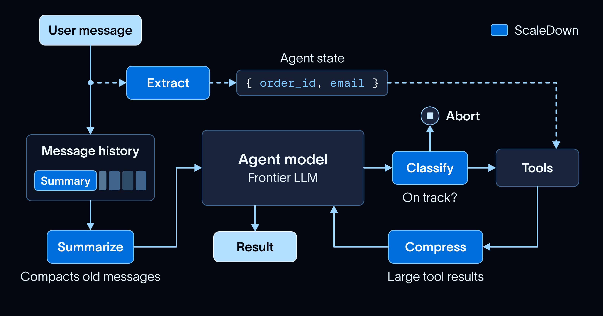
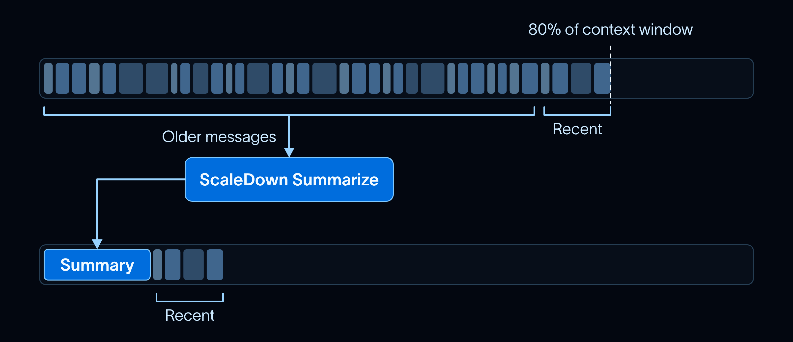
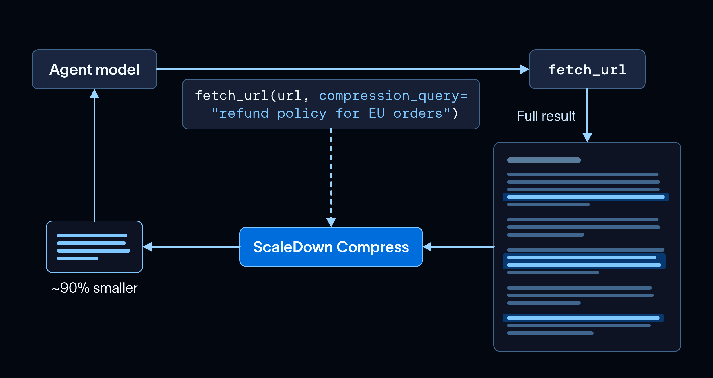

# Building Long-Running Agents with ScaleDown and Deep Agents

> **来源**: [https://www.langchain.com/blog/building-long-running-agents-with-scaledown-and-deep-agents](https://www.langchain.com/blog/building-long-running-agents-with-scaledown-and-deep-agents)  
> **作者**: Sydney Runkle Srimanth Tangedipalli Neal Patel | **发布时间**: 2026-10-13T11:55:00+00:00  
> **深度调研**: [查看专题调研报告](research.md)  
> **标签**: 长程Agent, 上下文管理, 熔断机制, 中间件架构

---

## AI 导读

本文介绍了在 LangChain 和 Deep Agents 中构建长程 Agent 的上下文工程与可靠性实现方案。核心方案是通过专用约束解码模型（CDM）替代通用大模型处理高频上下文决策，利用中间件机制实现四大能力：在历史达到阈值时触发自动总结并保留失败回退、在工具调用中通过压缩参数裁剪冗余返回以避免注意力涣散、在对话中低延迟抽取结构化实体，以及在模型输出后通过状态分类实现防循环与漂移的熔断机制。结论表明，在长程 Agent 架构中采用“通用大模型负责规划推理，专用模型负责高频上下文管理”的分层设计，能显著降低运行延迟与成本并增强长程运行的稳定性。

---

## 原文整理

## Key Takeaways

- Building long-running agents takes constant context management, and making those decisions with a frontier LLM is slow and expensive. ScaleDown’s constrained decoding models (CDMs) make them faster and cheaper.
- `langchain-scaledown` makes it easy to use ScaleDown models in your agent, and ships with middleware for summarization, tool result compression, and extraction.
- ScaleDown is now supported in the LangSmith LLM Gateway, so its calls are traced and count toward your spend and rate limits.

Building long-running agents comes down to the art of context management: deciding which information goes into the context window, and when. That means summarizing old history, compacting large tool results, and extracting the right data from long inputs. Each of those steps is a decision. Historically we’ve made them with LLMs, which is slow and expensive at the volume a long-running agent needs.

To make those decisions faster and cheaper, we now have a [langchain-scaledown](https://docs.langchain.com/oss/python/integrations/middleware/scaledown) integration and [support in the LangSmith LLM Gateway](https://docs.langchain.com/langsmith/llm-gateway-direct-model-access#choose-a-provider-path) for [ScaleDown](https://scaledown.ai/)’s constrained decoding models (CDMs). Where a general-purpose LLM writes any string one token at a time, a CDM is trained for one task and only returns answers that task allows, like a label from your list or spans of the input. That lets it be much smaller, faster, and cheaper: ScaleDown reports its models are 200x faster and 467x cheaper than frontier models on these narrow tasks.

The integration ships with three [middlewares](https://docs.langchain.com/oss/python/langchain/middleware/overview) for [LangChain](https://docs.langchain.com/oss/python/langchain/agents) and [Deep Agents](https://docs.langchain.com/oss/python/deepagents/overview): one summarizes old history, one compresses large tool results, and one extracts structured data from the conversation. In this post, we cover what ScaleDown’s models are and how to use them to *scale down* your agent’s context.

## What models does ScaleDown offer?

ScaleDown has four models, each trained for a single task, so each can be far more efficient than a general-purpose LLM:

- [**Summarize**](https://docs.scaledown.ai/api-reference/summarize-overview) writes a short summary of long text.
- [**Compress**](https://docs.scaledown.ai/api-reference/compress-overview) cuts a block of context down to the parts relevant to a question.
- [**Extract**](https://docs.scaledown.ai/api-reference/extract-overview) pulls the fields you describe out of text, each with a confidence score and its position in the source.
- [**Classify**](https://docs.scaledown.ai/api-reference/classify-overview) scores text against labels you define and returns a probability for each. You can decide whether to return a natural language reason for why the classification was made.



Every model takes up to **1M tokens** of input, so a full contract, a long policy page, or an hour of agent history fits in one call with no chunking. They’re also **multimodal**: Extract, Summarize, and Classify take images and scanned PDFs directly in addition to unstructured text, so a screenshot or a scanned invoice works as an input.

On [ScaleDown's own benchmarks](https://docs.scaledown.ai/benchmarks/providers), measured against the average of GPT-5.5, GPT-5.4 Mini, and GPT-5.4 Nano on [public datasets](https://docs.scaledown.ai/benchmarks/methodology), Summarize is 41x cheaper and 2.7x faster, and Compress is 138x cheaper and 1.8x faster, while scoring higher on accuracy for both.

If you’ve used a decision model like [Jev](https://www.langchain.com/blog/building-a-harness-with-jev), ScaleDown Classify will feel familiar: both return a typed answer with a probability. Jev takes [text only, up to 32K tokens](https://docs.typesafe.ai/models) of state per question. Classify takes up to 1M tokens, images included, and [adds a one-sentence reason](https://docs.scaledown.ai/api-reference/classify) to each decision. When an agent routes a ticket or stops a run based on a label, the reason tells you why, which makes the agent easier to debug.

## *Summarizing* message history

Long-running agents need summarization because their history eventually outgrows the context window. A coding agent that has been working for an hour has dozens of file reads and tool outputs in its history, most of which it no longer needs verbatim. Summarizing them with another frontier model call adds cost and latency every time the history fills up.



[ScaledownSummarizationMiddleware](https://docs.langchain.com/oss/python/integrations/middleware/scaledown#summarization) replaces Deep Agents’ built-in [summarization middleware](https://docs.langchain.com/oss/python/deepagents/context-engineering#summarization). It takes the same `trigger` and `keep` options to decide when to summarize and which recent messages to keep, and ScaleDown writes the summary:

```
from deepagents import create_deep_agent
from langchain_scaledown import ScaledownSummarizationMiddleware
agent = create_deep_agent(
    model="openai:gpt-6-sol",
    tools=[run_tests],
    middleware=[
        ScaledownSummarizationMiddleware(
            "openai:gpt-6-sol",  # the agent’s model, used for its context window
            trigger=("fraction", 0.8),
            keep=("fraction", 0.1),
        ),
    ],
)
```
The agent keeps its own model for planning and writing code. Only the summary moves to ScaleDown, which by default returns the same sections as LangChain’s summary prompt (intent, summary, artifacts, and next steps). If a ScaleDown call fails, the middleware leaves history as is and the agent keeps running. The same middleware works with LangChain’s `create_agent`.

## *Compressing* tool results

Long-running agents call a lot of tools, and every large result stays in context for the rest of the run. A fetched web page can run to tens of thousands of characters when the agent only needs one paragraph of it. Every later step pays for those tokens again, and the agent gets worse at staying on task as its [context](https://docs.langchain.com/oss/python/langchain/context-engineering) fills up.



[ScaledownToolCompressionMiddleware](https://docs.langchain.com/oss/python/integrations/middleware/scaledown#tool-result-compression) adds an optional `compression_query` parameter to your tools. When the model only needs part of a result, it fills in `compression_query` on the tool call, for example `"refund policy for EU orders"`. The middleware strips it before the tool runs, then ScaleDown compresses the output to the relevant parts before the model sees it:

```
from deepagents import create_deep_agent
from langchain_scaledown import ScaledownToolCompressionMiddleware
agent = create_deep_agent(
    model="openai:gpt-6-luna",
    tools=[search_docs, fetch_url],
    middleware=[ScaledownToolCompressionMiddleware(tools=["fetch_url"])],
)
```
Your tools don’t change, so this works with any tool, including [MCP tools](https://docs.langchain.com/oss/python/langchain/mcp). In [this trace](https://smith.langchain.com/public/81ea1429-91de-471d-aba0-2767e0c11c80/r/01a13127-d221-7c31-9b72-c852d4f17185), ScaleDown cut a long docs page by almost 90% before the model saw it. The compressed result starts with a note like this one, so the model can call the tool again without `compression_query` if it needs the full page:

```
[Compressed by ScaleDown for "refund policy for EU orders":
 18,402 -> 3,110 chars.
 Call this tool again without `compression_query` for the full output.]
```
## *Extracting* structured data

Agents constantly pull specific values out of what they read, like an ID, a date, or a field the next tool call needs. That extraction sits inside the agent loop, so it has to be fast enough not to add latency to every turn, and exact enough that a tool can use the value as is.

For example, before a support agent can file a ticket, it needs the order number, the error message, and the customer’s email. The main model could fill those in as tool arguments, but it may paraphrase an error code or mistype an email address instead of copying it exactly.

[ScaledownExtractionMiddleware](https://docs.langchain.com/oss/python/integrations/middleware/scaledown#extraction) hands this step to ScaleDown. You describe each field in plain language, and Extract copies the value from the text. A field can also be a set of labels, which ScaleDown answers with Classify, so the ticket can be routed by issue type. Before the first model call of a run, the middleware sends the user’s messages to Extract and saves the fields to agent state under `scaledown_extraction`, where your tools can read them:

```
from deepagents import create_deep_agent
from langchain.tools import ToolRuntime, tool
from langchain_scaledown import ScaledownExtractionMiddleware
ticket = ScaledownExtractionMiddleware(
    entities={
        "order_id": "Order number the customer mentions",
        "error_message": "Exact error message or code the customer saw",
        "customer_email": "Customer's email address",
        "issue_type": {
            "labels": [
                {"name": "billing", "rubric": "Is this about a charge, refund, or payment?"},
                {"name": "technical", "rubric": "Is this about a bug or something not working?"},
                {"name": "account", "rubric": "Is this about login, password, or account settings?"},
            ]
        },
    },
    context_chars=0,  # skip evidence snippets to keep state small
)
@tool
def file_ticket(runtime: ToolRuntime) -> str:
    """File a support ticket with the details gathered so far."""
    fields = runtime.state.get("scaledown_extraction", {}).get("fields", {})
    return crm.create_ticket(**fields)  # your ticketing system
agent = create_deep_agent(model="openai:gpt-6-sol", tools=[file_ticket], middleware=[ticket])
```
Extract only reads the user’s messages, never the agent’s replies, so every value is something the customer actually said. With a [checkpointer](https://docs.langchain.com/oss/python/langgraph/persistence), extraction re-runs each turn, so the record fills in as the customer adds detail. For *"Order A-1042 failed with ERR\_PAYMENT\_DECLINED. I already tried a different card."*, the fields come back as:

```
{
    "order_id": "A-1042",
    "error_message": "ERR_PAYMENT_DECLINED",
    "customer_email": None,  # not mentioned yet
    "issue_type": "billing",
}
```
## *Classifying* drift

An agent decides its next step based on its current state, like whether the task is done or whether the last tool call worked. Classifying that state happens on every turn, so it needs to be cheap and fast.

One state worth catching in long-running agents is drift: looping on the same failing tool call, or getting stuck in an unproductive cycle. There’s no prebuilt middleware for this, but you can call any ScaleDown model from your own [custom middleware](https://docs.langchain.com/oss/python/langchain/middleware/custom). Here’s a circuit breaker that runs after every model call, sends the history to ScaleDown Classify, and stops the run when it’s off track:

```
import os
import requests
from deepagents import create_deep_agent
from langchain.agents.middleware import after_model
from langchain_core.messages import AIMessage, get_buffer_string
LABELS = [
    {"name": "progressing", "rubric": "Is the agent making new progress on the user's task?"},
    {"name": "looping", "rubric": "Is the agent repeating the same steps without new results?"},
    {"name": "drifting", "rubric": "Is the agent working on something the user did not ask for?"},
]
@after_model(can_jump_to=["end"])
def circuit_breaker(state, runtime):
    result = requests.post(
        "https://api.scaledown.xyz/classify",
        headers={"x-api-key": os.environ["SCALEDOWN_API_KEY"]},
        json={"text": get_buffer_string(state["messages"]), "labels": LABELS},
    ).json()
    label = result["top_label"]
    if label != "progressing" and result["scores"][label] > 0.8:
        return {"jump_to": "end", "messages": [AIMessage(f"Stopped: {result['reasoning']}")]}
    return None
agent = create_deep_agent(model="openai:gpt-6-sol", tools=[run_tests], middleware=[circuit_breaker])
```
Classify returns a probability for each label, so you choose how confident it has to be before the breaker trips. Its one-line reason shows up in the final message, so you can see why the run stopped. A gentler version doesn’t end the run on the first trip: it adds the reason to the conversation as a nudge to change course, and only stops if the agent drifts again.

These four sections show a few places ScaleDown’s models fit, and the list isn’t exhaustive. You can mix and match them, like running extract /  summarize on long tool results, or classification for runtime model routing. Check out [ScaleDown Cookbooks](https://docs.scaledown.ai/cookbooks/overview) to see other ways to use CDMs models across different types of data.

## ScaleDown in the LangSmith LLM Gateway

The [LangSmith LLM Gateway](https://docs.langchain.com/langsmith/llm-gateway) lets you call models across providers with one LangSmith API key, traces every call, and enforces your [spend](https://docs.langchain.com/langsmith/llm-gateway-spend-policies) and [rate limits](https://docs.langchain.com/langsmith/llm-gateway-rate-limit-policies). ScaleDown is now one of its [direct model access providers](https://docs.langchain.com/langsmith/llm-gateway-direct-model-access#choose-a-provider-path), at the `/scaledown` path.

An admin adds your ScaleDown key to the workspace’s [provider secrets](https://docs.langchain.com/langsmith/llm-gateway-admin-setup) as `SCALEDOWN_API_KEY` once. Then point `langchain-scaledown` at the gateway and authenticate with your LangSmith key:

```
export SCALEDOWN_BASE_URL="https://gateway.smith.langchain.com/scaledown"
export SCALEDOWN_API_KEY="$LANGSMITH_API_KEY"
```
Each ScaleDown call then shows up as a [LangSmith trace](https://docs.langchain.com/langsmith/observability) and counts toward the same limits as your other model calls.

## When not to use ScaleDown

Keep a general-purpose LLM for open-ended generation, like writing code, drafting replies, and planning. This follows the "cheap by default, frontier on exception" approach from our [Jev posts](https://www.langchain.com/blog/building-prod-with-jev-and-langgraph): use a large general-purpose LLM for the hard parts, and specialized models for the high-volume steps around it.

ScaleDown is fast and cheap enough to run on every turn, so your agent can make the structured decisions that context management depends on without slowing down the main loop or paying frontier prices for them. In a long-running agent, those decisions happen on almost every turn, so the savings add up fast.

## Get started

[Install the integration](https://docs.langchain.com/oss/python/integrations/middleware/scaledown#installation) and [set your ScaleDown API key](https://docs.langchain.com/oss/python/integrations/middleware/scaledown#credentials):

```
uv pip install -U langchain-scaledown
export SCALEDOWN_API_KEY="..."
```
New [ScaleDown](https://scaledown.ai/) accounts get [50M free tokens](https://docs.langchain.com/oss/python/integrations/middleware/scaledown#setup). The [ScaleDown integration docs](https://docs.langchain.com/oss/python/integrations/middleware/scaledown) cover the configuration options for each middleware. Give `langchain-scaledown` a try, and let us know what you think on the [LangChain forum](https://forum.langchain.com/), [X](https://x.com/LangChain), or [GitHub](https://github.com/scaledown-team/langchain-scaledown/issues).
