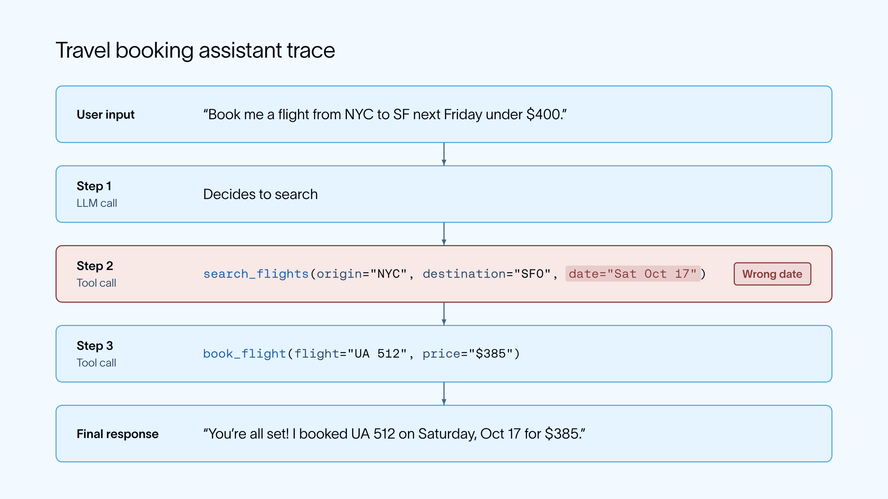
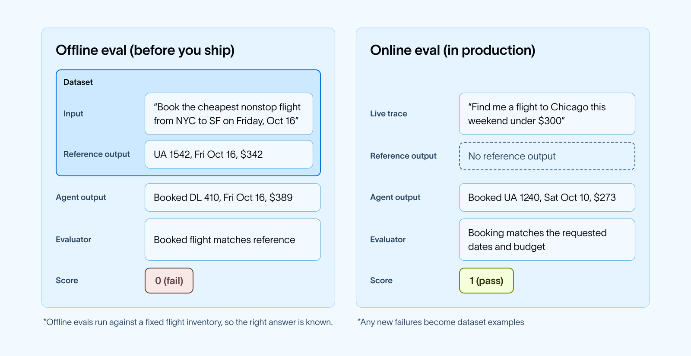
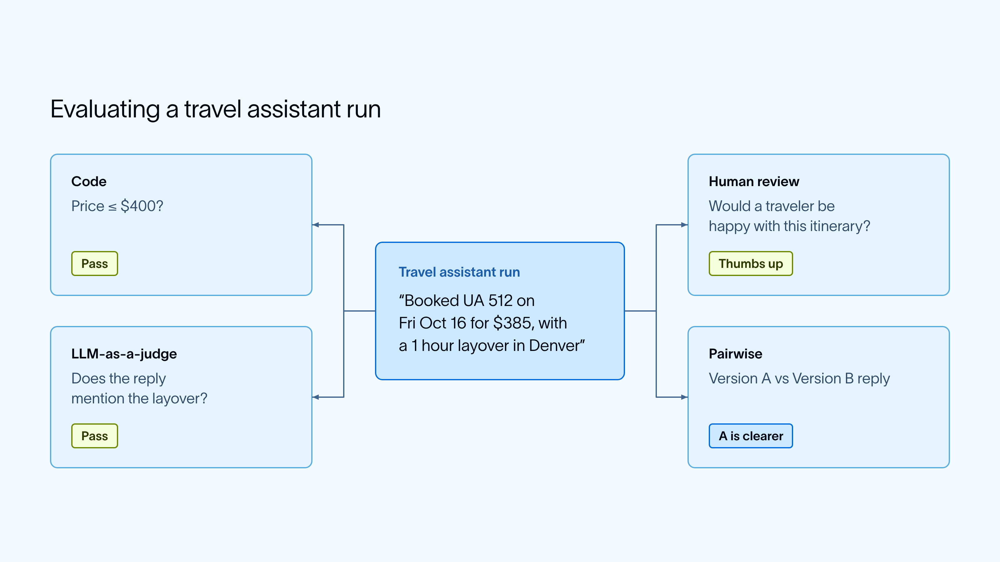
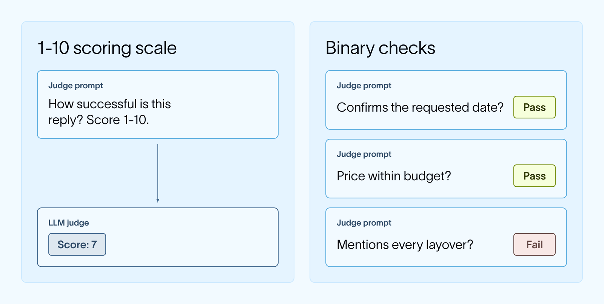
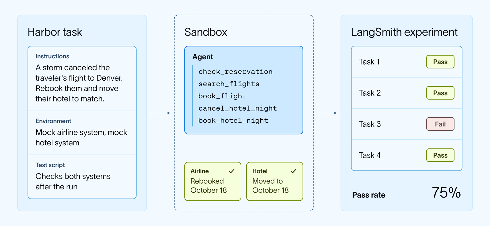
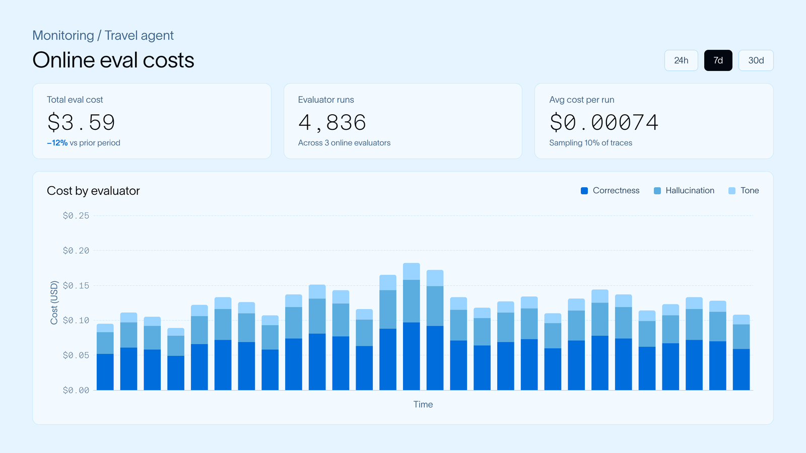
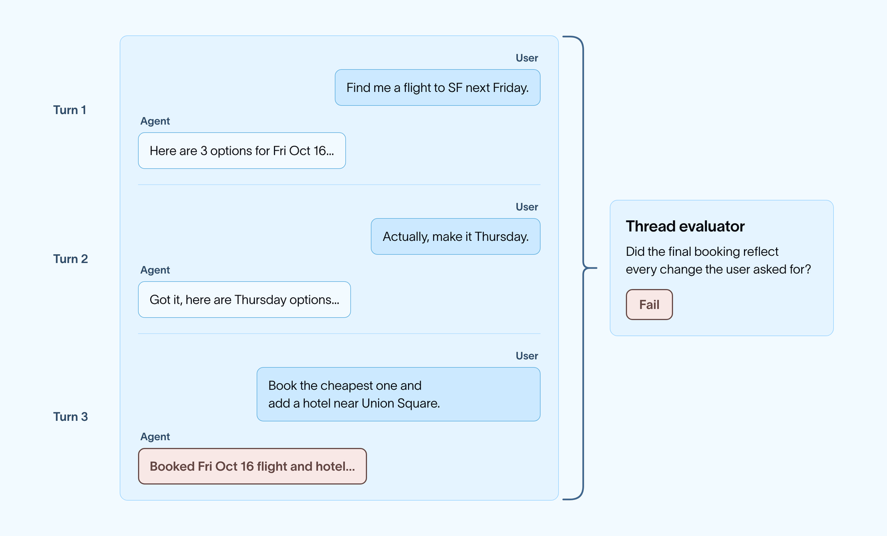

# The Most Common Questions About Agent Evals, Answered

> **来源**: [https://www.langchain.com/blog/common-questions-about-agent-evals](https://www.langchain.com/blog/common-questions-about-agent-evals)  
> **作者**: Divya Santhanam | **发布时间**: 2026-10-15T19:00:00+00:00  
> **深度调研**: [查看专题调研报告](research.md)  
> **标签**: Agent评测, 可靠性工程, LLM裁判, 沙箱测试

---

## AI 导读

文章阐述了保障 Agent 系统可靠性的核心评测方案：结合代码确定性检查、LLM 裁判与人工复核，从小规模真实 trace 数据集建立基准；针对多步交互与环境变更 Agent，通过追踪完整执行轨迹并在隔离容器沙箱中检验最终环境状态（如运行测试套件）来判定成败；在生产监控中通过采样过滤与低成本模型控制开销。文章指出 Agent 评测不能仅依赖最终文本输出匹配，必须从单步、整条轨迹与环境副作用多维度验证系统可靠性。

---

## 原文整理

## Key Takeaways

- **Evals score your agent's runs so you can check that it behaves the way you expect.** To get started, pick one behavior, build a small dataset from real traces, and run a baseline. Use offline evals before you ship and online evals in production, and turn new failures into dataset examples.
- **Use code evaluators where you can, LLM judges where you can't, and human review to check both.** For agents that take many steps, evaluate full threads, trajectories, and final state.
- **Benchmarks like Terminal-Bench are offline evals with longer tasks and their own environments.** Harbor runs them and logs the results to LangSmith experiments.

As you build and ship an agent, you’ll need a way to check that it behaves the way you expect, both in development and once real users start relying on it.

In traditional software, the same inputs produce the same outputs, so a unit test can check for an exact result. Agents are harder to test for a few reasons:

- **Outputs vary between runs**, even for the same request
- **More than one answer can be correct**, so checking for an exact match falls short
- **The agent chooses its own steps**, so a correct output can still come from a “wrong” path. For example, an agent might call a tool it doesn't need or take an action without user permission.

Agent evals are the solution. They score your agent’s runs with checks that account for these variations. Similar to the agents they evaluate, these tests are not one-size-fits-all, and the best suite of evals depends on the team, their product, and what they want to optimize for.

Over the past few years of working on [LangSmith](https://smith.langchain.com), LangChain’s platform for agent engineering, our team has encountered a *lot* of different eval questions. This blog walks through some of the most common questions on how to get started with agent evals and the different types of evals you can use in your workflows.

## Where should we start?

Every eval starts with understanding what your agent actually does. A trace is a record of one run of your agent, including its inputs, outputs, and every model and tool call in between. Read through a sample of its traces to see how it handles requests and where it goes wrong. What you find tells you what to test first. Start small.

1. **Pick a behavior you care about.** For example, for a travel assistant, a behavior could be whether it books the date and price range the user asked for.
2. **Build a small dataset from traces.** A dataset is a collection of examples, and each example is a single test case with an input and often an expected output. Ten to twenty examples of a behavior is enough to start, and in LangSmith you can add traces to a dataset straight from the tracing view. If your agent isn't in production yet, have your team or a small group of trusted design partners test it out (dogfooding) and work from those traces.
3. **Run a baseline.** Run your current agent against the dataset and save the result as an experiment. An experiment contains the results of running one version of your agent on a dataset, along with the scores from your evaluators. You’ll compare the performance of future versions of your agent with this experiment.
4. **Add new failures as you find them.** Each failure you see in production or while testing becomes a new example.

Continue adding failures to your dataset and you have an improvement loop. Find a failure, add it to your dataset, improve the agent, and rerun. As you identify more agent behaviors to evaluate, you'll expand your eval suite following the same pattern as above.

## What's the difference between offline and online evals?

Evals can and should run before you ship a change and after your agent is live. Before shipping, evals can tell you whether a change made the agent better or worse. After shipping, evals can tell you how the agent is performing with real users.

**Offline evals** run your agent against a dataset *before* you ship a change. You choose the example inputs, and you can also include expected outputs (also called reference outputs). Using your dataset, you can compare experiment results across agent versions. They’re best used to test a new prompt, model, or tool, and to catch regressions before they reach users.

Benchmarks like [Terminal-Bench](https://www.tbench.ai/) are also offline evals, built on a fixed set of tasks so you can compare agents, models, or versions. Harbor runs them and logs the results to LangSmith experiments, which we cover in more detail below.

**Online evals** score real production traces *as they come in*. There's usually no reference output to compare against, so they rely on code checks and LLM judges that can grade a run on its own. They’re best used to monitor quality and find the problems your dataset missed.

You need both, and they feed into each other. Failures that online evals flag become new examples in your offline dataset.

There are a few ways to [build a dataset](https://docs.langchain.com/langsmith/manage-datasets) for offline evals in LangSmith. You can write examples from scratch, add runs from your existing traces, send over runs your team reviewed in an [annotation queue](https://docs.langchain.com/langsmith/annotation-queues), upload a CSV or JSONL file, or generate synthetic examples from a few you already have.

As your eval suite grows, you'll need to decide whether to add examples to an existing dataset or start a new one. As a rule of thumb:

- Keep examples in the **same dataset** when they test the same behavior with the same evaluators, so experiments stay comparable over time.
- Create a **new dataset** when the inputs look different (like single requests vs full conversations), when you need different evaluators, or when the dataset serves a different purpose, like a small set that runs on every pull request vs a larger one you run before a release.

Within a single dataset, you can also use splits to run a subset of examples.

## What are the different types of agent evaluators?

An evaluator is the logic that scores a run. There are four common types. Most teams start with one or two and add more over time.

- **Code evaluators** check things deterministically, like whether the booked price is under the user's budget. They're fast, cheap, and consistent, though their need for deterministic inputs and outputs limit their usefulness.
- **LLM-as-a-judge** uses a model to grade things code can't, like whether the assistant's reply clearly confirms the flight details.
- **Human review** has your team or subject matter experts score runs directly. It's slower, but it's the best signal for subjective quality and for checking your other evaluators. It’s often used on a smaller sample to then inform an LLM evaluator’s judgement.
- **Pairwise evaluators** compare two outputs side by side and pick the better one, which is useful when you're choosing between two prompts or models.

Any of these evaluators can be pointed at different parts of an agent’s run. An eval might score:

- **A single step.** Ex. Whether `search_flights` was called with the right date.
- **The final response.** Ex. Whether the reply confirms the flight the agent actually booked.
- **A full conversation.** Ex. Whether the final booking reflects every change the user asked for across several turns
- **The end state of an environment.** Ex. The booking records in a mock booking system after the agent runs in its own container. Benchmarks often use this setup, and you’ll sometimes hear these called containerized evals.

## Can you trust an LLM judge?

An LLM judge uses a model to grade outputs that are difficult to check with code, like whether an answer is supported by the retrieved documents. Judges are flexible, but they can be inconsistent and drift from your team's judgement. A few habits make them reliable:

- **Compare the judge with human scores.** Have someone on your team grade a sample of runs and check where the judge disagrees. Adjust the judge's prompt or examples until they line up. [Annotation queues](https://docs.langchain.com/langsmith/annotation-queues) in LangSmith make this easy. Our [LLM-as-a-judge docs](https://docs.langchain.com/langsmith/llm-as-judge) walk you through this.
- **Ask narrow questions.** In our travel agent example, asking "Does the reply mention every layover?" is easier to judge than "Is this a good reply?"
- **Define a precise scoring scale.** A binary pass or fail, or a small set of labeled categories, is far more reproducible than scoring on a 1-10 scale. A judge may have a hard time distinguishing between a score of 6 vs 7.

## Are evals the same as benchmarks?

A benchmark is a type of offline eval composed of a set of tasks. A task is a single test case in a benchmark, including instructions, an environment in a container, and a test script that scores the result. As agents become more capable, a simple LLM judge or code-based eval often isn't enough. Agents can now execute code, edit files, and interface with services. To model this multi-step behavior, benchmarks set up isolated infrastructure in containers. This lets developers test agent behavior offline the same way the agent will work in production.

Benchmarks differ from simpler LLM judges and code-based evals in a few ways:

- **Tasks involve more steps.** To complete a single task, an agent might install packages, edit files, and run commands across dozens of tool calls.
- **Each task comes with an environment.** Agents can now take actions in environments like a sandbox with a code repo, files, and tools. Every task ships with its own isolated environment for the agent to work in.
- **Scoring checks what the agent did.** A test script inspects the state of the environment after the run, like whether the tests pass or the right file exists. You can still review the trace, but the score comes from the actions the agent took and the state it left behind.

For our travel assistant, a benchmark task might give the agent a mock booking system and a request such as "A storm canceled the traveler's flight to Denver. Rebook them and move their hotel to match." Once the agent finishes, the test script would check the booking records in the database.

[Harbor](https://github.com/harbor-framework/harbor) is an open source eval harness that provides the scaffolding for testing on these longer tasks. It's the framework that powers Terminal-Bench, and you can use the same task format to build a benchmark for your own agent. With the LangSmith integration, each Harbor run is logged as a LangSmith experiment. Harbor builds a container for each task, and you can use LangSmith traces to make each environment closer to what your agent sees in production. Benchmark results then sit alongside the rest of your evals, and you can open any run to see the full trace next to its score.

We used this setup to [improve Deep Agents on Terminal-Bench 2.0](https://www.langchain.com/blog/improving-deep-agents-with-harness-engineering) by reviewing traces to find failure modes and then changing the harness. We also used it to build [IssueBench](https://www.langchain.com/blog/issuebench-how-we-evaluate-engine), a benchmark for LangSmith Engine. Each IssueBench task gives Engine a batch of traces and scores whether it groups the correct ones into the right issue clusters.

Building a benchmark for your own agent follows the same steps as the evals above, with a few changes:

- **Collect tasks from traces.** Find failures in LangSmith traces, then turn each one into a Harbor task with its own environment, like a mock booking system populated with a user’s reservations.
- **Define what “good” looks like.** Create LLM judges or code-based evals that score based on your rubric.
- **Hill climb on the score.** Run the agent and use the scores to A/B test changes. You can set up an agent loop that runs through this process for you. It would make edits to your agent, rerun the benchmark, and keep or revert each change, similar to Andrej Karpathy’s [autoresearch](https://github.com/karpathy/autoresearch) loop from a few months ago.

## How can you evaluate production traffic without high costs?

Offline evals run on a fixed dataset, so their cost is predictable. Online evals run on live traffic, so if an LLM judge scores every trace, your eval costs grow with every new user. To keep them affordable:

- **Sample and filter.** [Online evaluators](https://docs.langchain.com/langsmith/online-evaluations-llm-as-judge) in LangSmith can score a percentage of traffic, or only traces that match a filter like negative user feedback.
- **Use code checks where you can.** Checking whether the booking matches the requested date, or whether the agent searched before booking, costs almost nothing.
- **Use a cheaper judge.** In our [Jev-as-a-Judge](https://www.langchain.com/blog/jev-agent-evals-langsmith) experiment, Jev from TypeSafe AI matched human labels on every pass/fail decision and cost $0.34 in total, compared with $28.17 for Claude Sonnet 4.6.

Online eval costs are saved over time in LangSmith, so teams can monitor their spending.

## Do you have to build your own agent evals?

No, especially when you’re evaluating for common agent issues. A good place to start is with our [prebuilt LLM evaluator templates in LangSmith](https://www.langchain.com/blog/reusable-langsmith-evaluator-templates) for typical checks like hallucination or PII leakage. Add one to a dataset or tracing project and edit its prompt to fit your agent, like telling the judge our travel assistant should never book outside the user's budget.

Our open source [agentevals](https://github.com/langchain-ai/agentevals) package also has prebuilt evaluators for an agent's messages and tool calls. They can compare the tools your agent called against a reference list, or ask an LLM judge whether the steps made sense.

You can also reuse an offline evaluator across datasets and run it as an online evaluator on production traces (only works if the evaluator does not require a reference output).

For evals specific to your agent, the [Eval Engineering Skill](https://www.langchain.com/blog/towards-automating-eval-engineering) runs in coding agents like Claude Code or Codex, reads your repo and traces, and writes runnable evals with you.

[LangSmith Engine](https://docs.langchain.com/langsmith/engine) can also write evals for you automatically by pulling from production traces. When it identifies an issue cluster, it turns the failing traces into dataset examples and writes their reference outputs as [assertions](https://docs.langchain.com/langsmith/assertions), such as “Books a flight on the date the user requested.”

## How do you evaluate multi-turn conversations?

Many agents work across several turns. For example, a user might ask our travel assistant for flights, change the date, then add a hotel. Each turn can look fine on its own while the conversation as a whole goes wrong.

To evaluate conversations in LangSmith, pass a thread ID in your trace metadata so each turn is grouped into a [thread](https://docs.langchain.com/langsmith/threads). A thread is a sequence of traces from the same conversation. From there you can attach online evaluators that score a whole thread once the conversation ends, with questions like "Did the final booking reflect every change the user asked for?" or "Did the user have to repeat themselves?" LangSmith also shows each thread as a [trajectory](https://www.langchain.com/blog/langsmith-trajectories-tracing), with every message and tool call listed once, in order.

For offline evals, you can store full conversations as examples in a dataset, or simulate the user with an LLM so you can test how the agent handles a conversation from start to finish.

## How do you evaluate an agent beyond its final output?

Agents take many steps, so the final answer only shows part of what happened. Beyond the final response, you may want to check:

- **The path**, meaning the sequence of messages and tool calls the agent produced.
- **The final state**, such as the booking record our travel agent created, a file it wrote, or a change it made to a repo.

As your production agents become increasingly more complex, you may need a dedicated eval harness. Specifically, when the agent's work is the change it makes to an environment. Say a coding agent is asked to fix a bug. An LLM judge can read the agent's reply, but the reliable check is to run the repo's tests after the agent finishes. For that to work, every test run needs its own clean copy of the repo so runs don't affect each other. Harbor sets this up for you. You can run agents built with [Deep Agents](https://www.langchain.com/deep-agents) in [LangSmith Sandboxes](https://www.langchain.com/langsmith/sandboxes) and log each run, along with its trace, to a LangSmith experiment. Learn more in [Harbor x LangChain](https://www.langchain.com/blog/unified-stack-for-evaluating-agents).

## Can you trace and evaluate an agent in LangSmith if it's not built using LangChain, LangGraph, or Deep Agents?

Yes! LangSmith is framework agnostic, so you can trace and evaluate an agent built with any framework, or with no framework at all. There are a few ways to send traces:

- **Framework integrations.** LangSmith has [integrations](https://docs.langchain.com/langsmith/integrations) for popular agent frameworks like the [OpenAI Agents SDK](https://docs.langchain.com/langsmith/trace-with-openai-agents-sdk), [Claude Agent SDK](https://docs.langchain.com/langsmith/trace-claude-agent-sdk), and more.
- **Model provider wrappers.** If you call a model provider directly, wrap the client for [OpenAI](https://docs.langchain.com/langsmith/trace-openai) or [Anthropic](https://docs.langchain.com/langsmith/trace-anthropic) and each model call is traced.
- **The `@traceable` decorator.** Add it to your own functions, like the travel assistant's flight search tool, to [trace any step](https://docs.langchain.com/langsmith/annotate-code) of your agent.

Once your traces are in LangSmith, evals work the same way for any framework. You can add traces to a dataset, run offline experiments by passing your agent to the [SDK’s](https://docs.langchain.com/langsmith/evaluate-llm-application) `evaluate()` function, and attach online evaluators to production traffic.

## How do you move off an existing eval stack?

You don't have to start over. Most of what you've already built carries over to LangSmith:

- **Datasets.** Upload existing test cases as a CSV or JSONL file, or create them with the SDK.
- **Code evaluators.** Existing scoring functions usually need only small changes to run as LangSmith evaluators. If your evals already run as tests, the [pytest](https://docs.langchain.com/langsmith/pytest) and [Vitest](https://docs.langchain.com/langsmith/vitest-jest) integrations let you keep that setup.
- **LLM judges.** Paste your existing judge prompt into an LLM-as-a-judge evaluator in the UI, or keep it in code.
- **Tracing.** LangSmith works with any framework, so you can send traces from your current agent without rewriting it.

## How do you report results?

Offline experiments show whether each release improved. Online eval dashboards show how performance holds up in production over time. In LangSmith, you can directly compare experiment results and create custom dashboards for metrics such as token cost, latency, and evaluator scores over time. A benchmark gives you a stable score to compare models or agent versions across releases.

## Next

If you want to go deeper, read [How We Build Evals for Deep Agents](https://www.langchain.com/blog/how-we-build-evals-for-deep-agents), try the [LangSmith evaluation quickstart](https://docs.langchain.com/langsmith/evaluation-quickstart), or check out our LangChain Academy course on [LangSmith Essentials](https://academy.langchain.com/courses/quickstart-langsmith-essentials).

Prefer a live instructor? I’ll be hosting a virtual workshop on agent evals on October 28, 2026. Register [here](https://events.langchain.com/register/762756f4-4344-4760-b4b9-a07dd63e76af/)!
