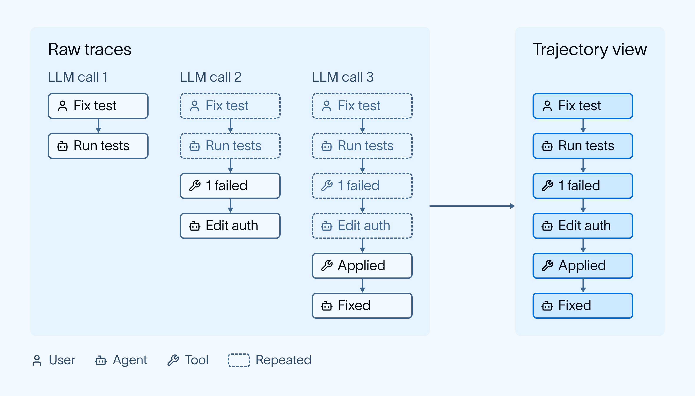
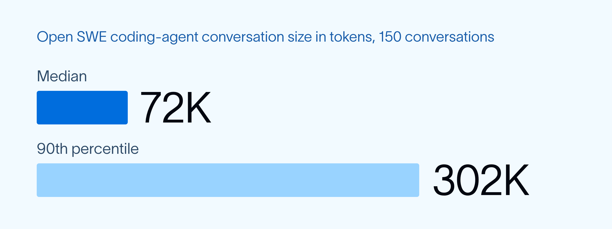
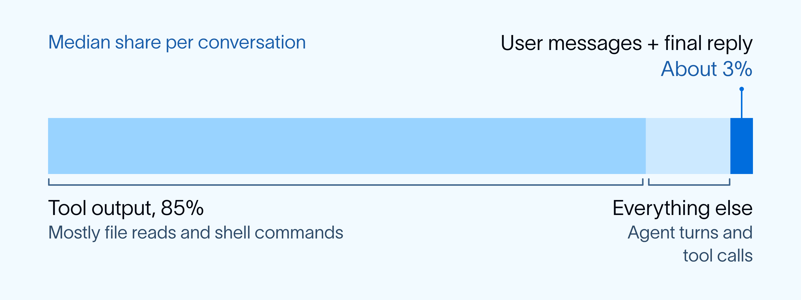
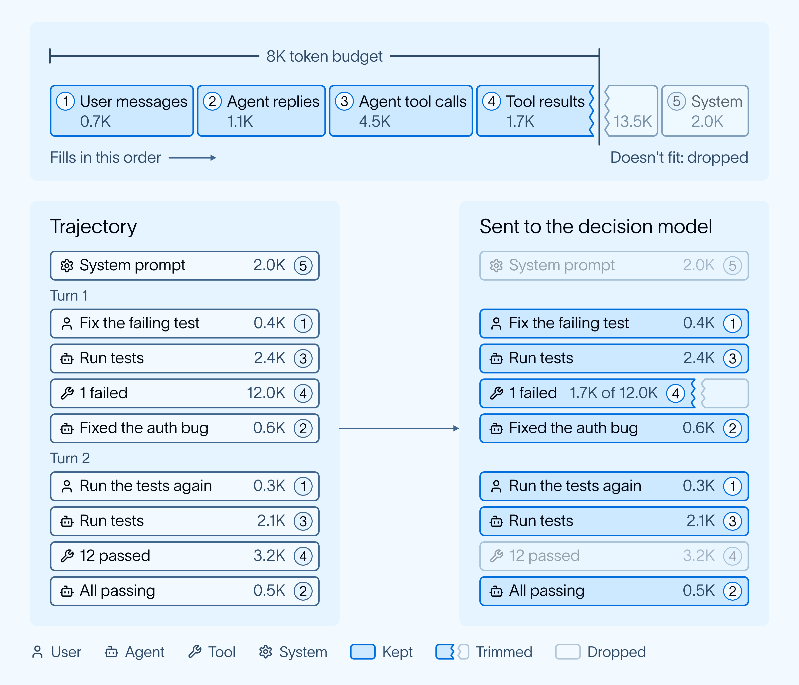
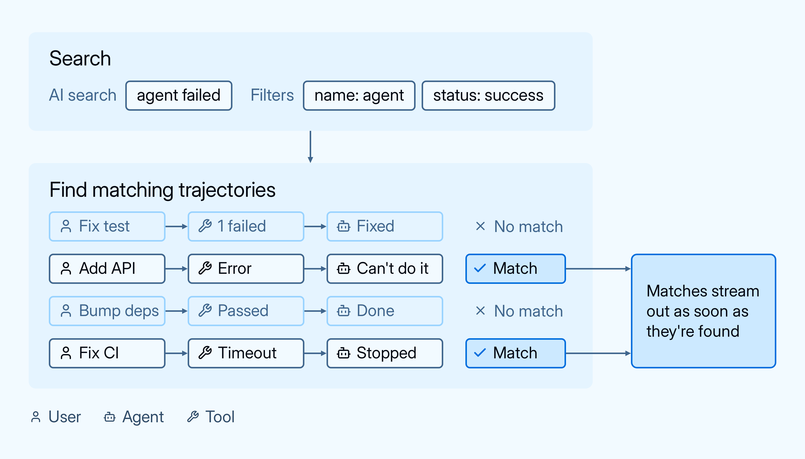

# Search agent traces by behavior with AI Search in LangSmith

> **来源**: [https://www.langchain.com/blog/agent-traces-ai-search-langsmith](https://www.langchain.com/blog/agent-traces-ai-search-langsmith)  
> **作者**: Arjun Natarajan Eugene Yurtsev Suraj Vathsa | **发布时间**: 2026-10-13T13:00:00+00:00  
> **标签**: Agent可观测性, Trace分析, 轨迹标准化, 可靠性评估

---

## AI 导读

文章介绍了 LangSmith 为解决 Agent 运行轨迹（Trace）难以检索与调试的问题而构建的 AI Search 方案。针对 Agent Trace 异构多样、历史上下文重复以及向量检索丢失细微语义等痛点，系统通过 SmithDB 将多源 Trace 归一化为去重的会话轨迹（Trajectory），按优先级分配 Token 预算以容纳核心交互，并结合预过滤与快速决策模型并行推理，实现了以自然语言高效检索 Agent 行为与异常执行模式。

---

## 原文整理

## Key Takeaways

- AI Search now enables users to find conversations based on semantic understanding of traces, like "did the user get frustrated?" or "did PII leak?"
- Describe a behavior in plain language, and a fast decision model reads traces and returns the ones where it happened.
- LangSmith uses [trajectories](https://www.langchain.com/blog/langsmith-trajectories-tracing) to normalize traces, reduce context bloat, and deliver query results fast.

Agent [traces](https://www.langchain.com/blog/traces-start-agent-improvement-loop) are large, multimodal, and information-dense. They capture key details such as user inputs, how agents respond, and logic failures. That makes traces uniquely valuable for understanding user behavior and improving agent performance, but traditional data platforms weren’t built for large, unstructured payloads like this.

To make trace data useful, teams need infrastructure that can support the full lifecycle: ingest and store high-volume runs, query traces flexibly, and turn them into views for debugging, product analysis, and operational workflows like annotations. That’s why we built SmithDB, the database purpose-built for trace data in [LangSmith](https://smith.langchain.com/), and more recently [Custom Apps](https://www.langchain.com/blog/langsmith-custom-apps), which let teams create tailored views on top of their traces.

Today, we’re adding **AI Search**, a new way to query traces using natural language.

## Why we built AI Search

Each trace contains user inputs, agent reasoning, tool calls, and responses, all the information required to understand where agents are performing well and where they fail. Teams using LangSmith often mine their agent traces to discover examples for an eval [dataset](https://docs.langchain.com/langsmith/manage-datasets) or conversations for a reviewer in an [annotation queue](https://docs.langchain.com/langsmith/annotation-queues).

However, discovering the right traces can be cumbersome. Questions like "did PII leak?" or "did the user get frustrated?" don't map cleanly to a single trace attribute like tags or metadata, and cannot be answered by full-text search either. They require an understanding of the trace contents. Until now, that meant setting up an evaluator ahead of time or going through traces manually.

That's why we built AI Search. You describe the behavior you're looking for, and LangSmith returns the traces where it happened. This enables you to find needle-in-haystack traces and search for troublesome patterns ad hoc.

## What you can search for

You can search for anything that shows up in the content of a trace. You might look for an agent that said it finished a task but didn't, a user who seemed frustrated or pushed back on an answer, a request to a model that leaked PII, or someone trying to cancel their subscription. Product teams can search for "requests for integrations we don't support", "competitor mentioned", or "users confused about onboarding" and see where the product falls short, in users' own words.

AI Search also works alongside the filters you already use, so a search can run only on traces that errored, or only with a specific tag.

## How we built it

### Why a model reads every trace

Vector search is the usual way to search by meaning instead of exact words. It turns your query and each trace into an embedding, a short list of numbers that captures what the text is about. Then it returns the traces whose embeddings are closest to your query's. That works well for topic search, like finding conversations about billing. But an embedding packs a whole trace into one small vector, and that compression is lossy. Important details related to your query can get lost. A trace where the agent did the work successfully and one where it only said it did can end up with nearly the same embedding. Telling them apart takes a model that reads the actual words of the trace along with your question, so it can reason about what happened.

Until recently, doing that at search time was too slow and too expensive. Fast decision models changed that. They answer one narrow question about an input quickly and cheaply enough to run at scale. AI Search pairs decision model inference with [SmithDB](https://www.langchain.com/blog/introducing-smithdb), our data layer for agent observability. As traces arrive, SmithDB turns them into trajectories. When you run a search, your filters narrow the candidates, and the decision model checks each remaining trajectory against your description.

### Traces are large and come in many formats

Traces come from many sources: the OpenAI and Anthropic SDKs, LangChain, LangGraph, the Vercel AI SDK, OpenTelemetry, and more. Each records messages a little differently. Traces also repeat themselves. Agents often re-send the conversation history with every LLM call, so the first message shows up again in every call after it.

SmithDB turns these traces into a [trajectory](https://www.langchain.com/blog/langsmith-trajectories-tracing) for each session. A trajectory is a distilled view of the agent's work: each message, tool call, and tool result, listed once. SmithDB builds it as traces arrive and puts every supported format into the same shape.

AI Search analyzes trajectories instead of raw traces. Because every format has the same trajectory shape, one search works across agents built on different SDKs. Removing the repeat messages reduces context bloat, so searches run faster. A trajectory also covers the whole session, so if you search for "the user tried to cancel", the model sees what the user asked, what the agent did, and how the conversation ended.

### Trajectories are still long

Removing duplicates helps, but agent trajectories are still long. To get a sense of how long, we sampled 150 random conversations from [Open SWE](https://github.com/langchain-ai/open-swe), the open source coding agent the LangChain team uses every day. Each task runs in its own sandbox with shell access and can hand work off to subagents, so the conversations get big.

A couple of them ran past a million tokens, even in a sample this small. Searching for a rare behavior means reading through a lot of conversations, so AI Search regularly runs into ones that size and can't read every token.

Most questions don't need all of those tokens, though. Many questions are about what the user asked and how the agent replied. In the median conversation, about 2K of its 72K tokens came from the user's messages and the agent's replies. About 85% was tool output, mostly file reads and shell commands.

Each trajectory gets a fixed token budget, filled in priority order. User messages and the agent's replies to the user go in first. The rest of the budget goes to everything else: intermediate AI messages (the agent's reasoning and tool calls), tool results, and system messages. If the next message only partly fits, it's trimmed to fill the budget, and anything after it is dropped.

### Searches have to stay fast at scale

SmithDB is built to ingest and scan large volumes of agent trace data. When you run a search, your structured filters narrow the candidates first. The decision model then checks each remaining trajectory against your description, many in parallel. While the model checks one batch of trajectories, SmithDB is already fetching and preparing the next batch. Matches are streamed back as they're found, so you don't wait for the full scan.

### What's next

We're still learning which questions people ask most. The hardest conversations to classify are the ones with subtle differences. Telling "the user gave up" apart from "the user got what they needed and left" can come down to a couple of turns in a long trajectory. We want to see whether a model tuned on traces tells them apart more reliably.

The token budget works well when the answer is found in what the user and agent said. Other questions need different evidence. An agent ignoring a tool error only shows up in the tool results. We're exploring ways to pick context based on the question, and signals that show when the model is unsure, so it can take a second pass with more context.

We'd also like to go past a plain list of matches by grouping similar results or summarizing what they have in common.

## Get started

AI Search is in public beta on [LangSmith Cloud](https://smith.langchain.com/) in the GCP US, EU, and APAC regions, at no additional cost. Org admins can turn it on in settings, and it then shows up on the tracing page. The [AI Search docs](https://docs.langchain.com/langsmith/filter-traces#search-with-ai) have the details. Let us know what you search for.
