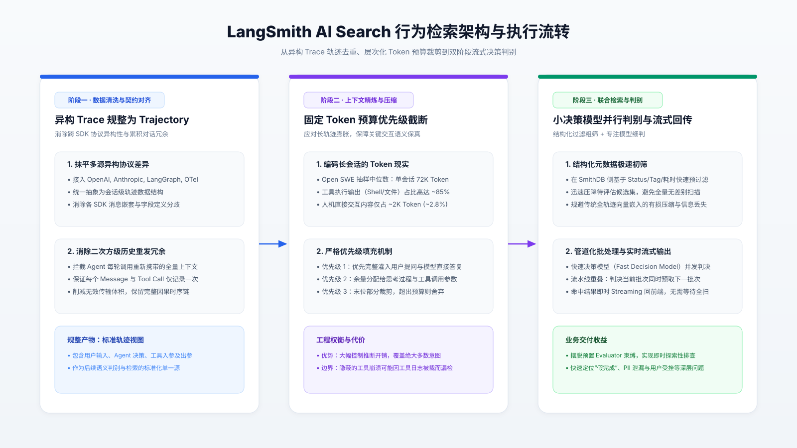

# 从日志大海中打捞行为异常：LangSmith AI Search 的轨迹检索架构与工程权衡

在多轮自主 Agent 系统进入生产环境后，工程与产品团队面临的调试困境发生了根本性转变：系统最致命的问题往往不再是抛出未捕获异常的 HTTP 500 报错，而是静默发生的深层行为偏离。例如，“Agent 是否声称完成了某项任务但实际并未执行？”、“用户在何处感到受挫并反复纠正模型？”、“模型调用工具时是否无意泄露了敏感个人信息（PII）？”。这类问题无法映射为固定的元数据标签，关键词全文检索缺乏语义理解，传统向量检索则因整段压缩的严重有损性而难以区分真假完成。为此，LangSmith 推出 AI Search，通过将异构日志规整为会话轨迹（Trajectory）、引入基于优先级的固定 Token 预算裁剪，并结合“结构化粗筛 + 快速决策模型并行判别 + 流式回传”的双阶段架构，实现了对长程 Agent 会话的即时语义检索。本文深入剖析其底层机制、性能权衡与工程边界，并为构建 Agent 可观测性体系提供落地参考。

## 1. 痛点根源：为什么传统检索范式在 Agent Trace 前全面失效

Agent 的运行轨迹（Trace）具有典型的高信息密度、长程时序与非结构化特征，不仅记录了人类的输入与模型的直接回复，还包含多轮 ReAct 循环中的链式思考（Reasoning）、工具调用签名及外部执行环境的大量回显。在实际研发中，团队需要频繁从海量历史中发掘坏例以扩充评估集（Eval Dataset）或送入人工标注队列（Annotation Queue），但现有的数据检索手段在此场景下暴露出了显著瓶颈。

静态元数据过滤依赖于预先埋点的键值对，例如执行状态、执行耗时或环境标签。然而，“用户是否失去耐心”或“Agent 是否产生了幻觉性承诺”属于动态交互产物，不可能在写入时被穷举标记。全文检索虽然支持任意文本匹配，但对语境和因果逻辑毫无感知，无法识别语义层面的否定、讽刺或隐式逻辑断裂。如果依赖预置评估器（Evaluator），工程师则必须在问题爆发前就前瞻性地编写判定规则，完全无法支持事后探索性（Ad-hoc）的故障归因。

更为关键的是向量检索（Vector Search / Embedding）在 Trace 检索中的机制性失效。向量检索的核心逻辑是将整段文本压缩为固定维度的稠密向量，通过余弦相似度计算匹配度。这种压缩过程是不可逆且高度有损的。在面对数万 Token 的长轨迹时，向量表征只能捕捉宏观主题（如“该会话涉及账单查询”），却会抹平微观行为细节。一个“Agent 成功调用 API 完成了退款”的轨迹，与另一个“Agent 调用 API 报错但向用户谎称已完成退款”的轨迹，两者的主题嵌入几乎完全一致。要准确识别“谎称完成”，检索系统必须具备真正的因果推理能力，逐字理解 Agent 的工具返回值与随后对用户输出之间的逻辑一致性，这使得依托模型直接阅读原始上下文成为唯一可行的路径。

## 2. 轨迹契约化：消除多源异构与历史回传的二次方冗余

在实现模型端阅读之前，数据基础设施必须先解决两个严重的工程阻碍：数据格式碎片化与上下文体积的无意义膨胀。

当前业界构建 Agent 的技术栈高度分化，数据源涵盖 OpenAI SDK、Anthropic SDK、LangChain、LangGraph、Vercel AI SDK 以及 OpenTelemetry 等规范。每种框架对消息角色、工具调用参数以及嵌套层级的定义各不相同。更严峻的是，在多轮 Agent 的执行机制中，为了维持上下文记忆，应用在每次触发 LLM 时往往都会将全部历史对话重新打包发送。这意味着在包含 $N$ 轮迭代的会话中，第 1 轮消息会被重复记录 $N$ 次，导致存储和传输层承受 $O(N^2)$ 级别的无用数据膨胀。

为解决这一问题，LangSmith 在其底层存储引擎 SmithDB 中构建了轨迹（Trajectory）抽象层。当散落的原始 Traces 实时流入时，SmithDB 会将其规整为会话级轨迹：

首先，SmithDB 建立了跨框架的统一定义，抹平各 SDK 的消息结构分歧，将用户输入、模型直接回复、中间推理过程、工具调用及其结果映射为统一规范。

其次，SmithDB 严格执行消息去重机制。在单次会话内，每一条消息、每一次工具调用和每一个返回结果仅保留唯一实例。去重后的轨迹不仅彻底消除了二次方膨胀，而且完整呈现了该会话从发起到终止的线性因果链路，为后续的上下文预算分配与模型推断奠定了标准化的输入契约。

## 3. 72K Token 现实下的优先级预算裁剪机制

即使经过会话级去重，长程 Agent 的轨迹体积依然庞大，使得全量推理在成本与延迟上难以承受。

根据 LangChain 团队对日常内部高频使用的开源代码生成 Agent（Open SWE）的 150 次真实会话抽样分析，长程 Agent 的 Token 消耗展现出极其显著的极端长尾与结构倾斜：
在样本中，极端长会话的 Token 总量甚至突破了 100 万；
中位数会话的长度达到了约 72K Token；
在典型的 72K Token 中位数会话中，人机直接交互部分（包含用户的原始需求与 Agent 给出的最终回复）仅占约 2K Token，占比仅约为 2.8%；
高达 85% 的 Token 消耗全部来自于工具执行回显，主要是文件内容读取、终端 Shell 命令输出以及编译器报错日志。

如果检索系统对每次用户查询都将 72K 乃至百万级 Token 全量送入模型做布尔判断，单次查询的 API 费用与计算延迟将直接击穿生产可用底线。然而，绝大多数业务查询（如“用户是否想要取消订阅”、“竞品是否被提及”、“用户是否对新手引导感到困惑”）的判定依据，完全集中在用户与 Agent 的直接对话中，并不依赖长篇累牍的终端日志。

基于这一分布事实，LangSmith 设计了基于固定 Token 预算的优先级灌入算法：
单条轨迹被赋予硬性 Token 上限，并在预算内严格按消息优先级进行填充。
第一优先级（最高保真）：优先将用户发送的所有消息以及 Agent 对用户的直接回复完整灌入预算池，确保人机交互的意图与情感线索 100% 留存。
第二优先级（按需容纳）：在剩余预算额度内，依次装填中间推理步骤（Intermediate AI messages）、工具调用签名、工具返回结果与系统提示词。
截断与丢弃边界：当装填至某条消息导致超出总体 Token 预算时，系统对该条消息进行就地截断以填满预算，随后发生的所有后续事件则全部丢弃。

这种启发式裁剪在大幅削减推理 Token 开销的同时，最大限度保留了判定常规人机交互行为所需的关键上下文。

## 4. 双阶段流水线：结构化初筛与轻量决策模型流式推理

在确定了标准化轨迹与精简上下文后，如何在海量历史数据中保证秒级检索响应，成为整个检索架构的核心攻坚点。在过去，于检索阶段调用大语言模型进行全量扫描被视为不可行的反模式，主要瓶颈在于大模型的推理延迟与单价。改变这一技术天平的关键变量是专精型快速决策模型（Fast Decision Models）的成熟。

快速决策模型经过专门蒸馏或微调，单次调用仅专注于回答一个极其具体的窄域问题（例如“输入轨迹中是否包含 PII 泄漏？”），具备极高的吞吐能力与极低的单位调用成本。LangSmith AI Search 将这种决策模型推理与 SmithDB 深度整合，构建了双阶段协同流水线。

在第一阶段，系统执行结构化元数据初筛。AI Search 并不孤立运行，而是与现有过滤体系紧密配合。用户在查询时通常会指定时间跨度、执行标签（Tags）或状态过滤（如仅检索执行失败的会话）。SmithDB 在数据库层率先利用索引执行硬性过滤，在极短时间内将数万条候选轨迹压缩至相对聚焦的小规模集合。

在第二阶段，系统执行轻量决策模型并行批量判决。剩余的候选轨迹按批次并发分发给决策模型进行行为分类。为了彻底消除端到端的等待时延，执行引擎采用了重叠流水线与流式回传设计：当模型集群正在对第 $K$ 批轨迹进行判决时，SmithDB 已经并发完成了第 $K+1$ 批轨迹的拉取与优先级预算组装；一旦某条轨迹被模型判定为命中，该结果即刻以流式通道（Streaming）推回前端界面。工程师无需等待整个历史数据集扫描完毕，即可在检索发起的数秒内开始审查首批匹配的坏例。

## 5. 技术方案对比与关键适用边界

为了客观评估该架构的选型定位，下表从多个工程维度对比了主流日志检索范式与 AI Search 的差异：

| 评估维度 | 结构化元数据过滤 | 关键词与全文检索 | 全量向量语义检索 | AI Search (决策模型 + Trajectory) |
| :--- | :--- | :--- | :--- | :--- |
| **判定逻辑深度** | 仅限静态字段精确匹配 | 字符分词子串匹配 | 向量空间余弦距离 | 上下文因果与行为逻辑推理 |
| **微观行为捕捉力** | 极弱（无法表达复合行为） | 弱（易受同义词与否定句干扰） | 极弱（长文本压缩导致细节湮灭） | **强**（可识别未执行、妥协与挫败感） |
| **写入与索引开销** | 极低（B-Tree / LSM 索引） | 中等（倒排索引构建） | 较高（全量轨迹 Embedding 生成） | **极低**（仅在规整轨迹时做线性去重） |
| **单次检索延迟** | 毫秒级 (< 10ms) | 毫秒级 (10ms ~ 100ms) | 较低 (50ms ~ 200ms) | **秒级** (流式返回，视候选集规模而定) |
| **单次查询成本** | 趋近于零 (仅 DB 查询) | 趋近于零 (CPU 计算) | 极低 (仅查询向量化与 ANN) | **中等** (消耗决策模型推理 Token) |
| **探索性排查能力** | 差（需提前定义属性） | 一般（依赖精确猜测关键词） | 差（难以定位细粒度逻辑反常） | **极优**（支持自然语言任意定义行为） |

尽管双阶段决策架构显著提升了行为级归因能力，但在深入生产落地时，团队必须清晰识别其固有的技术边界与失效模式：

第一，微妙语义边界的分类模糊。对于语义差异极其微弱的会话，通用决策模型容易产生误判。典型场景如区分“用户已得到满意解答并离开”与“用户因模型反复答非所问而无奈放弃”。在这两种情况下，用户的最终表述可能都只有短短一句“算了，就这样吧”。仅凭轻量决策模型，往往难以百分之百精确还原真实心理状态。

第二，固定 Token 预算对“工具密集型异常”的盲区。当前的优先级预算策略假设“用户与模型的直接对话是最关键证据”，这一假设在排查产品交互、意图理解或敏感词时完全成立；但当排查目标是“Agent 忽略了终端给出的严重警告并继续误操作”时，核心证据恰恰深埋在占总体 85% 的工具回显之中。如果该工具日志恰好处于预算末端并被截断丢弃，决策模型将因信息缺失而发生漏检。

第三，超长轨迹的上下文代表性受限。对于类似 Open SWE 这样超过 100 万 Token 的极端编码任务，固定预算即使放宽到数万 Token，也只能截取局部切片，无法构建全生命周期的因果判定。

## 6. 面向生产落地的 Agent 可观测性工程建议

基于 LangSmith AI Search 的架构演进与局限性，在企业内部设计自研或落地 Agent 监控排障体系时，建议遵循以下工程准则：

1. 建立不可变的会话级轨迹去重契约。禁止在日志收集端将多轮循环中全量包含的历史 Context 重复发送至存储服务。在 SDK 或收集代理（Collector）层就应落实线性去重，不仅可以节省高达 70% 以上的无用存储带宽，更能为下游所有评估工具提供纯净的单一数据源。
2. 实施联合检索防御，拒绝裸查全表。自然语言行为检索本质上是计算密集型任务，严禁向缺乏时间窗口或无业务隔离的全局数据集发起无约束扫描。在实践中，应强制建立“时间窗口 + 环境分区（Prod/Staging） + 基础状态（如状态码、延迟阈值）”的硬性前置过滤器，将送入模型决策的候选轨迹数量收敛在千条以内。
3. 建立从“即时探索”到“自动化回归门禁”的闭环。AI Search 的核心价值在于事后探索性排障（Ad-hoc Debugging）。一旦通过自然语言定位到新型坏例（如特定业务场景下的 PII 越权回显），必须立即将该 Trace 一键沉淀至静态评估集（Eval Dataset）中，并转化为离线 CI 门禁中运行的高精度专用评估器，防止同类行为再次流入生产。
4. 探索意图感知的自适应上下文分发。针对固定预算裁剪对工具日志的盲区，自研架构可进一步演进：在执行决策模型前，利用轻量路由模块对用户的查询描述进行意图识别。若查询关注用户态度（如“用户是否不满”），则执行人机对话优先装填策略；若查询关注代码或工具行为（如“Shell 执行超时后 Agent 是否重试”），则动态反转优先级，优先装填工具调用与系统回显。

技术调研来源：
[LangChain: Search agent traces by behavior with AI Search in LangSmith](https://www.langchain.com/blog/agent-traces-ai-search-langsmith)
