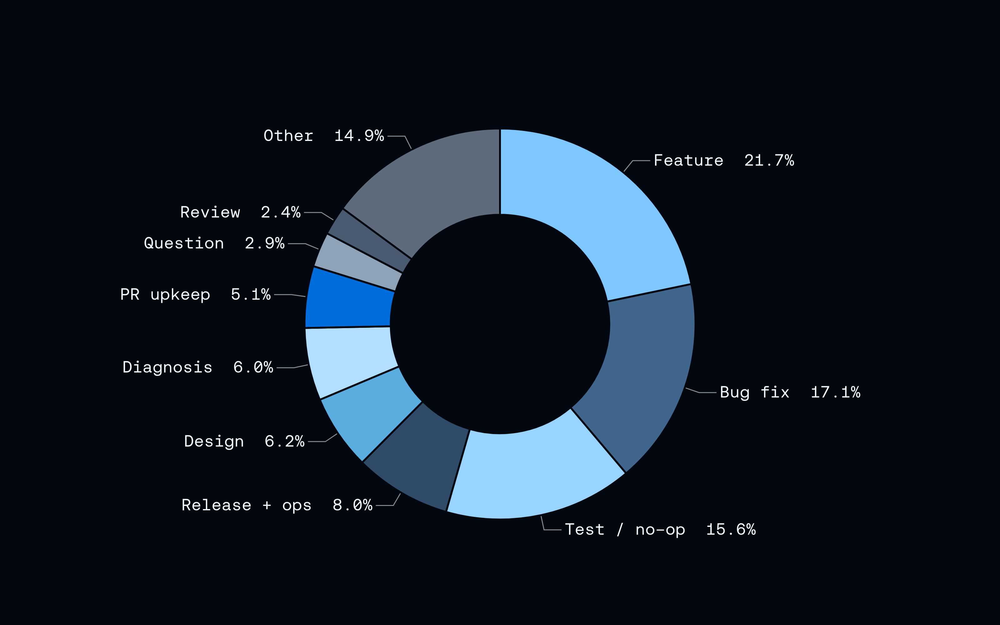
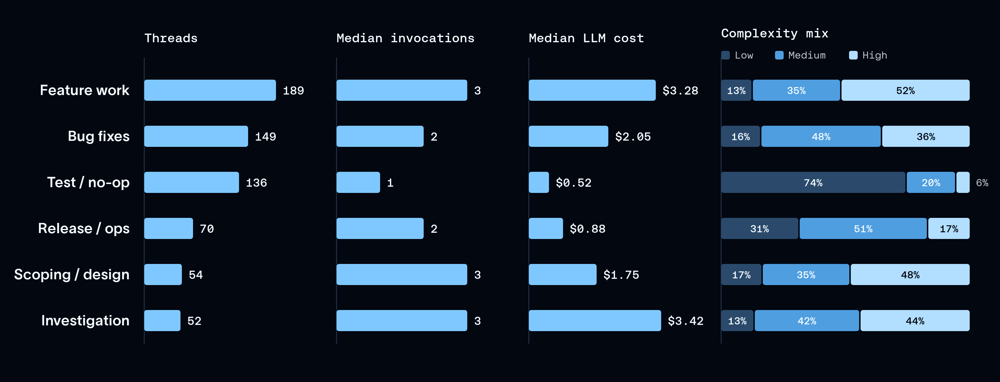
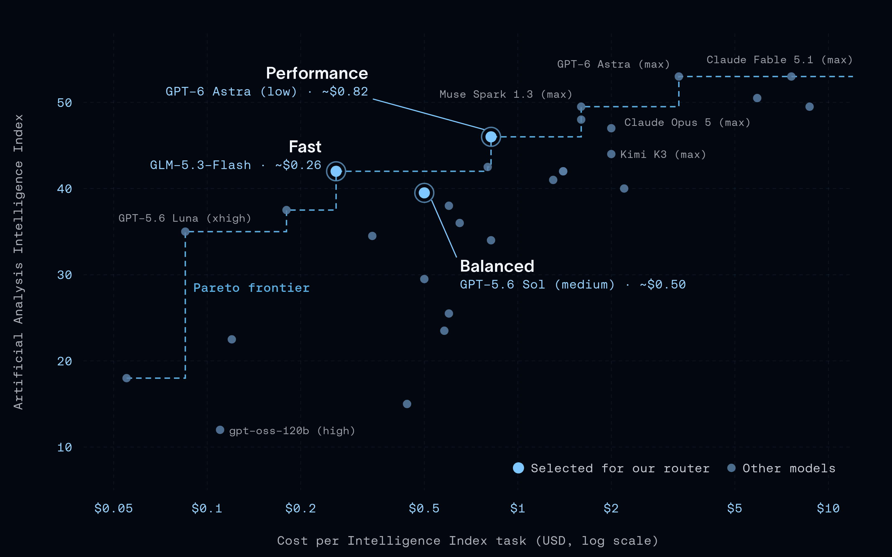
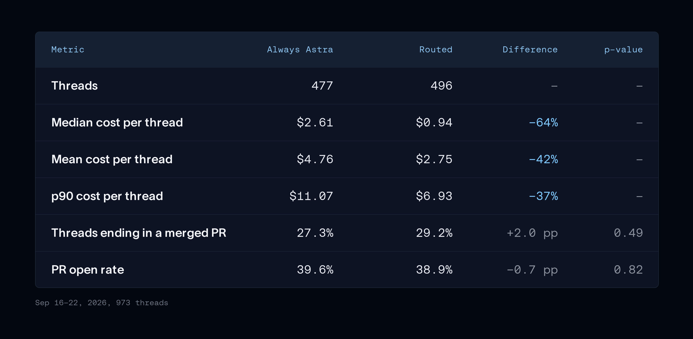
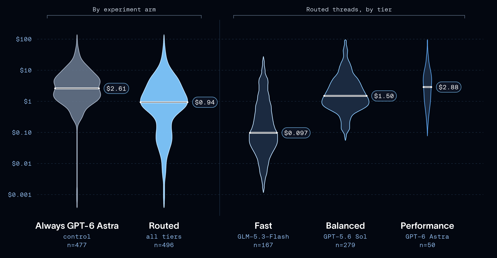

# How to Build a Model Router in the Harness

> **来源**: [https://www.langchain.com/blog/how-to-build-a-model-router-in-the-harness](https://www.langchain.com/blog/how-to-build-a-model-router-in-the-harness)  
> **作者**: Sydney Runkle Eugene Yurtsev | **发布时间**: 2026-10-01T17:00:00+00:00  
> **深度调研**: [查看专题调研报告](research.md)  
> **标签**: Agent架构, 模型路由, 成本优化, 可靠性评测

---

## AI 导读

针对 Agent 全量调用前沿模型导致成本过高的问题，文章提出了在 Agent Harness 中间件而非外部网关中构建模型路由器的方案。该方案利用 Harness 内置的领域与任务上下文，将请求分流至 Fast（GLM-5.3-Flash）、Balanced（GPT-5.6 Sol）与 Performance（GPT-6 Astra）三层梯队。通过 973 组真实生产会话的 A/B 测试验证，该方案在不显著影响 PR 合并率（29.2% vs 27.3%）与交付质量的前提下，使单任务中位数成本降低 64%。结论表明模型路由应紧密结合 Agent Harness 上下文与端到端任务结果闭环（如 PR 合并），并指出了子代理路由与对话中途重路由等演进方向。

---

## 原文整理

## Key Takeaways

- **Many tasks don't need frontier intelligence.** In our experiments, model routing cut median cost per coding task by 64% compared with the baseline, with no noticeable change in quality.
- **An effective model router belongs in the harness, not a generic gateway.** Choosing the right model requires domain and task context that the harness already assembles, and a gateway typically lacks.
- **Effective router design is rooted in observability and evals.** It requires an understanding of an agent's task space, model performance research, and clear success criteria.

Frontier LLMs continue to be expensive. As agents become ubiquitous and operate at massive scale, this is cost prohibitive. Luckily, most agents don't need frontier-level intelligence for every task. Model labs even say so: Anthropic's [guide to choosing a model](https://platform.claude.com/docs/en/about-claude/models/choosing-a-model) notes that "for many applications, starting with a faster, more cost-effective model like Claude Haiku 4.5 can be the optimal approach."

Past a certain point, you hit diminishing returns: a more capable model adds little quality while cost and latency keep climbing. A good agent has [model-harness-task fit](https://www.langchain.com/blog/how-to-build-a-custom-agent-harness): the right model with the right context for a given task. A **model router** picks that model for each task. We believe that routing decision **belongs in the agent harness**, not a generic gateway, because choosing the right model requires the same domain and task context the harness already assembles and that a gateway typically lacks.

We felt this pain recently at LangChain as our monthly coding agent spend started to climb rapidly. Hearing the same concern from customers, we set out to build an effective model router for [Open SWE](https://github.com/langchain-ai/open-swe), our open source coding agent. Compared to our previous baseline of always using a top-tier frontier model, it cut median cost per thread by 64% with no measurable change in quality. This post covers how we built the router, what we learned, and how you can get started building model routing into your agents.

## Step 1: understand the tasks

Our test bed was [Open SWE](https://github.com/langchain-ai/open-swe), which our engineers use from Slack and a web UI to ask questions about our codebases and request code changes. Before building a router, we needed to understand the types of tasks that developers use Open SWE for. We pulled [thread-level](https://docs.langchain.com/langsmith/threads) data from [LangSmith](https://www.langchain.com/langsmith/observability) traces: the kinds of requests coming in, plus the cost and turn count of each thread (as approximate measures of complexity). We did the exploration in [LangSmith Custom Apps](https://www.langchain.com/blog/langsmith-custom-apps), with a small interface built directly on top of the Open SWE traces.

We took a week of interactive threads and labeled each one by task type using an LLM classifier. [LangSmith Insights](https://docs.langchain.com/langsmith/insights) can also do this kind of grouping across your traces for you. Code changes dominated: new features (22%) and bug fixes (17%) were the two largest groups, followed by test or no-op runs (16%). Categories are heuristics based on each thread's title and metadata.

We also investigated how agent trace characteristics differed based on task type. We discovered that threads associated with feature work investigations tended to be longer, with higher cost and median turn count. Threads associated with testing and release procedures tended to be relatively short and inexpensive.

In order to judge “complexity”, we used both total cost and invocation as signals: cost tracks complexity fairly directly, since bigger tasks use more tokens, while invocations are more nuanced, since a high count can mean a harder task or a model that needed follow-ups to accomplish the task.

At the time of data collection, all of the Open SWE threads were being routed through a top-tier frontier model. The above data suggested that many of the tasks Open SWE handled might not require frontier intelligence, given the range of complexities.

This variation in task complexity gave us a hypothesis worth testing: a router could infer a task’s type and difficulty from the initial request and send it to a cheaper or faster model without degrading outcomes.

## Step 2: understand the models

The [Artificial Analysis Intelligence Index](https://artificialanalysis.ai/evaluations/artificial-analysis-intelligence-index) scores models on a common set of tasks and reports the cost per task, so you can plot them all on one curve of intelligence against cost. The Pareto frontier is the set of models that are the cheapest and smartest.

[Artificial Analysis Intelligence Index](https://artificialanalysis.ai/evaluations/artificial-analysis-intelligence-index), as of Sep 9, 2026.

We decided on three models along the curve, each with a different balance of cost, speed, and intelligence:

- **Fast:** GLM-5.3-Flash (xhigh)
- **Balanced:** GPT-5.6 Sol (medium)
- **Performance:** GPT-6 Astra (low)

We selected models from different providers, and the fast tier is an open model. GLM-5.3-Flash sits on the Pareto frontier next to closed models, one more sign that [open models have crossed a threshold](https://www.langchain.com/blog/open-models-have-crossed-a-threshold). LangChain is model agnostic, with a generic [model interface](https://docs.langchain.com/oss/python/langchain/models) that works the same across [providers](https://docs.langchain.com/oss/python/integrations/providers/overview), so when a better model lands, swapping it in is a one-line change to the router.

## Step 3: build the router in the harness

With the task mix mapped and three tiers picked, we then need to match the tasks to models by reading each incoming request and sending it to the cheapest tier that's able to address it successfully. In LangChain, that decision fits naturally in [middleware](https://docs.langchain.com/oss/python/langchain/middleware/custom), which can swap the model an agent calls without changing anything else about the agent (see [dynamic model selection](https://docs.langchain.com/oss/python/langchain/models#dynamic-model-selection)).

The [router in Open SWE](https://github.com/langchain-ai/open-swe/blob/main/openswe/middleware/model_selection.py) runs on the thread’s first human message. It has three parts:

- **A base prompt:** tells the classifier its job: pick the least expensive model likely to complete the task.
- **Criteria per tier:** a short, plain-language description of the work each tier should take.
- **A classifier model:** reads the request and picks a tier according to the criteria and prompt.

A general benchmark is only a starting point. Write each tier's criteria from two sources: your own task analysis, and what each provider says its models are best at. We combined the task breakdown from step 1 with the provider guides for [GPT-5.6 Sol](https://developers.openai.com/api/docs/guides/prompt-guidance-gpt-5p6), [GPT-6 Astra](https://developers.openai.com/api/docs/guides/latest-model), and [GLM-5.3-Flash](https://docs.z.ai/guides/llm/glm-5.3-flash) to write the base prompt and the criteria for each tier.

Those criteria are written for Open SWE's task set, so the router is deeply coupled to the tasks Open SWE handles. **That’s why it belongs in the harness,** which already has the agent’s task-specific context (its prompt, tools, and domain knowledge) that a generic gateway lacks.

Our first version used an LLM with [structured output](https://docs.langchain.com/oss/python/langchain/structured-output), prompted with the user's request. The classifier now runs on [Jev](https://typesafe.ai/blog/introducing-system-one-models-and-jev), a newly released decision model, which made classification almost 50× faster. See how we did this in [*Building a Harness with Jev*](https://www.langchain.com/blog/building-a-harness-with-jev).

The router picks a model once, at the start of each thread, and that model is used for the whole thread. The natural objection is: what if a thread changes topic or complexity mid-flight? Though not addressed in this naive router design, we cover mid-flight routing in the “what’s next” section below.

## Step 4: track task outcomes

The value in a router is lower cost, but only if quality doesn't regress. A router has to get two things right: the chosen model needs to be able to complete the task, and it should be the cheapest, fastest model that can. That means you need a way to track task outcomes. There are two ways to do this:

1. [Offline evals](https://docs.langchain.com/langsmith/evaluation) run the router against a fixed dataset, so you can compare versions safely and repeatably. The catch is the dataset: it has to look like your real traffic and be graded on what your users care about. For a coding agent, that means PR quality and reviewability, which are hard to grade offline.
2. An A/B test splits live threads between the router and a single-model baseline and compares them on a success metric you can measure for every thread. The live traffic is naturally a representative dataset, but the downside here is that users are subjected to a potentially non-optimal router.

We ran A/B tests with two outcome signals:

- **Merged PRs:** Open SWE now records every PR it opens and whether it's merged or closed. Merged PRs per thread became our main success metric.
- **User feedback:** we added thumbs up and down to Open SWE, so users could rate any thread, including questions that never produce a PR. Each rating is [logged as feedback](https://docs.langchain.com/langsmith/attach-user-feedback) on the thread's LangSmith trace.

We tracked both in a [LangSmith Custom App](https://docs.langchain.com/langsmith/custom-apps). Merged PRs were the stronger signal. Feedback was sparse, since only a small share of threads get rated, but it's where we heard about routing mistakes, like the ones quoted in the first test below.

## The experiment

Our first A/B test compared the router against always using our strongest model: half of threads went through the router, and half always used GPT-6 Astra, across 973 threads in total.

Quality didn't measurably change. 29.2% of routed threads ended in a merged PR vs. 27.3% of control (*p* = 0.49). PR open rates were also flat (38.9% vs. 39.6%, *p* = 0.82).

Cost dropped a lot. The median routed thread cost $0.94 vs. $2.61 on control, 64% less. The mean dropped 42% and the p90 dropped 37%, so the savings weren't just a few cheap outliers.

Most requests didn't need the strongest model. Of routed threads, 56% went to balanced, 34% to fast, and only 10% to performance. The cost ladder between tiers is steep: the median thread cost $0.097 on fast, $1.50 on balanced, and $2.88 on performance, a 30× spread.

User feedback pointed the same way. When a simple request ran on GPT-6 Astra, engineers flagged the overspend directly with comments like: "pretty expensive for this query" and "this request should not have been routed to the performance model."

💡 This result isn't surprising, given the control was our most expensive model. But it's a change a lot of agents would benefit from: many over-rotate on quality and end up overspending. Especially for agents with a diverse set of tasks, routing can drive cost down.

We also tested the router against the opposite control: half of threads went through the router, and half always used the fast model. We ended this test within a day, before it could produce statistically meaningful results. Engineers flagged problems with the fast-only arm almost immediately, and it was disrupting their productivity due to low output quality.

## What's next

This implementation of a model router is a proof of concept that serves as a foundation for building an optimal router. Here are a few areas we could explore to improve:

- **Benchmarking the router on** [**DeepSWE**](https://hub.harborframework.com/datasets/datacurve/deep-swe/latest) **or other coding benchmarks**, so we can [evaluate](https://docs.langchain.com/langsmith/evaluate-llm-application) routing decisions against a controlled baseline instead of relying on A/B testing on production traffic alone.
- **Model selection for** [**subagents**](https://docs.langchain.com/oss/python/deepagents/subagents)**.** Right now subagents pick their model independently of the router. Routing subagents too, especially on longer-running tasks, could cut costs further.
- **Re-routing mid-thread.** When a new message differs enough from earlier ones, like a question that turns into a bug fix, a model change might pay off. The cost is the prompt cache: switching models throws it away, so the new model re-reads the thread at full price. For async agents that cost is often negligible, since the cache often expires anyways between human turns when the TTL is short (like 5 minutes).
- **Refining the routing criteria** with more signals, such as mining for user sentiment in traces: finding threads where users are frustrated, which can mean the task needed a stronger model.

## Getting started

If you're adding routing to your own agent, here's where we'd start:

1. **Understand the tasks.** Your [traces](https://www.langchain.com/langsmith/observability) hold the real record of what your agent is asked to do, and [LangSmith Insights](https://docs.langchain.com/langsmith/insights) helps you find the patterns in them, so you can see the task mix before you pick tiers.
2. **Understand the models.** Pick a few models along the cost-intelligence curve, informed by modern benchmarks. LangChain's [model interface](https://docs.langchain.com/oss/python/langchain/models) works across providers, so you can swap models at any time without having to re-engineer your application.
3. **Build the router in the harness.** Treat routing as context engineering, analogous to classical feature engineering: decide what information the router should see in order to make the best decision about model fit given your agent's domain.
4. **Track task outcomes.** Put measures of success in place before you route: [evals](https://docs.langchain.com/langsmith/evaluation), [online evaluators](https://docs.langchain.com/langsmith/online-evaluations), or [user feedback on traces](https://docs.langchain.com/langsmith/attach-user-feedback). If building an eval dataset is too costly or difficult, an A/B test on live traffic works well.

The right model for a task keeps changing as new models, open-weight ones included, keep landing on the frontier. Because LangChain is model agnostic, picking up those gains means swapping a tier, not rebuilding your agent.

To add routing to your own agent, you can add our newly released [model routing middleware](https://docs.langchain.com/oss/python/integrations/providers/typesafe#model-routing). Give it your base prompt, model tiers, and the criteria for each, and it picks a model at the start of every thread. We’d love your feedback on [X](https://x.com/LangChain?lang=en) or LangChain GitHub [issues](https://github.com/langchain-ai/langchain/issues).

### Further reading

### Acknowledgements

Thanks to [Mason Daugherty](https://x.com/masondrxy), [Kevin Frank](https://x.com/KevinBFrank), and [Harrison Chase](https://x.com/hwchase17) for their thoughtful feedback on this post. Also thanks to the OpenSWE team who supported this experiment!
