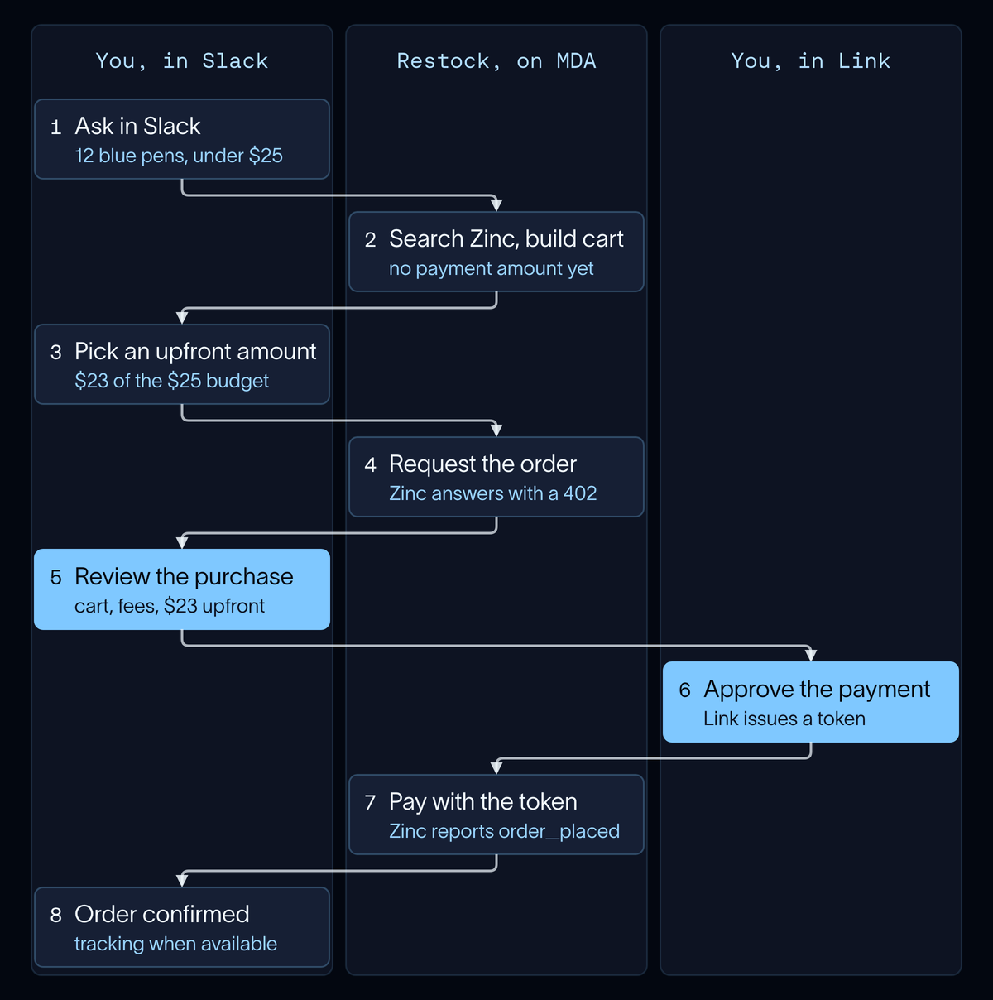
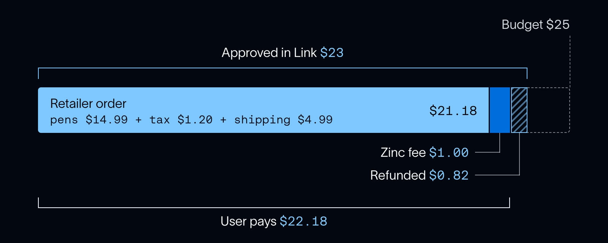

# Agents that can pay: building Restock with Stripe's Link and Managed Deep Agents

> **来源**: [https://www.langchain.com/blog/agents-that-can-pay-with-stripe-link](https://www.langchain.com/blog/agents-that-can-pay-with-stripe-link)  
> **作者**: Srimanth Tangedipalli Sydney Runkle Nathan Drezner | **发布时间**: 2026-10-08T15:55:00+00:00  
> **深度调研**: [查看专题调研报告](research.md)  
> **标签**: AI Agent, 工程可靠性, 安全与沙箱, 支付协议, Human-in-the-Loop

---

## AI 导读

本文详细介绍了基于 LangChain Managed Deep Agents 与 Stripe Link 构建的办公采购 Agent（Restock）的技术实现方案，重点解决 Agent 在真实支付场景中面临的凭据安全、预算可控性与执行不可逆等工程可靠性挑战。方案通过 MPP（机器支付协议）进行标准化 HTTP 交互，结合 Zinc 电商 API，构建了四重保障机制：凭证隔离（模型完全不接触支付密钥，临时令牌在沙箱中即用即焚）、预算封顶与 402 预估费用挑战、强制人工介入审查（Slack 中断机制，确保模型无法伪造审批），以及结算后的自动退还差额机制。实践结论表明，涉及资金流动的 Agent 必须将权限控制和预算限制固化在模型无法触及的确定性代码与协议中，才能在保证可用性的同时实现生产级可靠性。

---

## 原文整理

## Key Takeaways

- **Restock is a sample agent that pays for real purchases.** It runs in Slack on Managed Deep Agents, finds products, builds a cart, and checks out through an API that supports the [Machine Payments Protocol](https://mpp.dev/overview) (MPP).
- **Payments stay safe and within budget.** Link, Stripe's consumer wallet, handles the payment, so the agent never sees a card number. The user approves a spend request up to a set amount, and the agent can't spend above it.
- **Build your own agent that can pay.** Start from [Restock's sample code](https://github.com/langchain-samples/restock-agent), and let us know what you build.

Agents are already good at finding things to buy. Paying is harder: it moves real money, needs credentials the model should never see, and is hard to undo.

To show how to build an agent that pays, we built Restock, a sample office-supply agent that runs in Slack on [Managed Deep Agents](https://docs.langchain.com/langsmith/python/managed-deep-agents-overview). It searches real products, builds a cart, and pays through [Link](https://link.com), Stripe's consumer wallet, which gives agents the safest way to pay.

This post follows one request from the first message to the confirmed order:

We're running low on pens. Can you find a 12-pack of blue ink pens for the office, under $25 altogether?

Restock orders the pens for $22.18, fees included. Prices in this post are illustrative.

## Choosing how to pay

An agent can pay by driving the retailer's checkout in a browser, but that's fragile. Pages change, sites block automated checkouts, and payment details have to be entered without exposing them to the model.

An API that supports the [Machine Payments Protocol](https://mpp.dev/overview) (MPP) avoids that: it tells the agent exactly what to pay and accepts the payment directly. The tradeoff is coverage, since the agent can only buy through MPP-enabled APIs. That list is growing, with tool aggregators like Apify and Mercator joining vertical ones like [Zinc](https://www.zinc.com) for retail. Restock uses Zinc, but the pattern doesn't depend on it.

## How the pieces fit

Restock is built from four pieces:

- [**Link**](https://docs.stripe.com/agentic-commerce/agents/link-agent-wallet) holds the user's payment methods and asks them to approve payments.
- **MPP**, the [Machine Payments Protocol](https://mpp.dev/overview), defines the payment exchange over HTTP. The merchant responds with `402 Payment Required` and payment instructions, and the client retries with a payment credential.
- **Zinc** searches products and places retailer orders through its [MPP order API](https://www.zinc.com/docs/v2/api-reference/agent/create-order).
- [**Managed Deep Agents**](https://docs.langchain.com/langsmith/python/managed-deep-agents-overview) **(MDA)** hosts the agent and handles Slack, human review, credentials, and saved state.

## Search and cart

We wrote [custom tools](https://docs.langchain.com/langsmith/python/managed-deep-agents-tools) for Zinc search, the cart, and payment, plus the instructions that shape the conversation. MDA handles the rest, including saving conversations and orders, so someone can come back days later and ask about the same pens. Here's the layout and a trimmed agent definition:

`restock-agent/`

├── agent.py            # the agent: model + tools

├── instructions.md     # how Restock talks and when it uses each tool

├── tools/restock.py    # the tools the model can call

├── restock/            # Zinc, Link wallet, cart and order storage

└── sandbox/setup.sh    # installs the Link CLI in the sandbox

`agent = define_deep_agent(`

name="restock",

model=ChatOpenAI(model=os.environ.get("OPENAI\_MODEL", "gpt-5.6-sol")),

tools=\[

search\_restock\_products,     # Zinc search

prepare\_restock\_order,       # save the cart

set\_restock\_payment\_amount,  # upfront amount, within the budget

request\_restock\_payment,     # Slack review, then Link approval

wait\_for\_restock\_approval,

check\_restock\_order,         # order status from Zinc

\],

)

For the pens request, Restock searches Zinc with a Zinc API key and a funded search account (search isn't paid through Link). The user picks a 12-pack, and Restock saves the cart without a payment amount.

## Setting the upfront amount

Restock treats the $25 budget as a ceiling, not an amount to charge. Tax and shipping aren't known from a product listing, and the total only settles once the retailer order is placed. So Restock asks the user how much to pay upfront, anywhere up to $25. Zinc takes that amount when the order goes in, pays the retailer out of it, and refunds the rest.

For the pens, the user picks $23. Zinc keeps a $1 base fee, which leaves a $22 retailer allowance for the item, tax, and shipping. Optional fees, like Zinc's email order updates, can shrink it further, so before the review, Restock requests the order without payment and reads the actual fees from Zinc's `402 Payment Required` challenge.

## Keeping credentials out of the model

The model never handles the secrets that pay for the order. The Link session lives in a [user-owned](https://www.langchain.com/blog/langsmith-managed-deep-agents-whats-new) MDA [Connection](https://docs.langchain.com/langsmith/python/managed-deep-agents-connections), so each person's wallet stays theirs. The delivery address, notification email, and Zinc API key sit in agent-owned Connections. The Link CLI runs the login inside MDA's [managed sandbox](https://docs.langchain.com/langsmith/python/managed-deep-agents-sandboxes). A small helper keeps the saved session in the user's Connection and places it in the sandbox only while a command runs. Connecting Link doesn't approve a purchase, and later conversations reuse the session.

## Reviewing the purchase in Slack

Before anything is paid, the user reviews the cart, office label, fees, and upfront amount in Slack. The delivery address stays private. Restock raises an [interrupt](https://docs.langchain.com/langsmith/python/managed-deep-agents-agent-owned-interrupts) for this review, so the run stays paused until the user clicks Approve or Reject in Slack. Nothing the model writes into a tool call can approve it.

## Paying with Link over MPP

Next, Restock posts a Link approval link in the Slack thread for exactly the amount in Zinc's challenge, the same $23. The user approves it on the Link website, which is the wallet's own consent to pay.

Once Link approves, Restock sends the paid request to Zinc with a Link [shared payment token](https://docs.stripe.com/agentic-commerce/concepts/shared-payment-tokens) as the credential, and Zinc processes the payment through Stripe. [pympp](https://github.com/tempoxyz/pympp) handles the MPP formatting.

The payment tool reads the token from a private sandbox file, deletes it after use, and returns only a public summary to the model. The token doesn't enforce cart details on its own, so the tool also checks the order against what the user reviewed and confirms the approval is still fresh.

## Confirming the order

The retailer order comes to $21.18 ($14.99 for the pens, $1.20 tax, $4.99 shipping), inside the $22 allowance. The user pays $22.18 including Zinc's fee, and Zinc refunds the other $0.82.

Restock confirms in Slack once Zinc reports `order_placed`, and shares tracking when the retailer ships. Beyond the illustrative prices, we ran Restock end to end on a hosted deployment: a live order reached `order_placed`, and the expected refund came through.

## Get started

The code is at [langchain-samples/restock-agent](https://github.com/langchain-samples/restock-agent), and its [README](https://github.com/langchain-samples/restock-agent#quickstart) walks through setup and deployment step by step. MDA's [Slack setup guide](https://docs.langchain.com/langsmith/python/managed-deep-agents-channels-slack) covers connecting the Slack app.

Restock is a sample: it supports US delivery and USD only, one office per deployment, and payment from the requester's own wallet.

Restock has three modes. Set `RESTOCK_MODE` to choose one, and try them in order:

1. **Rehearsal** (`rehearsal`): fictional products and a simulated approval. Needs an OpenAI API key and a LangSmith workspace with Managed Deep Agents access.
2. **Link test approval** (`link-test`): real Zinc search and a real Link approval, with no purchase. Adds a Link wallet, a Zinc API key, a funded Zinc search account, and delivery details.
3. **Live purchase** (`live`): a real payment and a real retailer order.

The pattern carries over to any agent that spends money. Let the agent search and build the cart, keep the spending limit and the approvals in code the model can't touch, and count an order as placed only when the merchant says so.

Give Restock a try. Let us know what you think, and share what you build on top of it!
