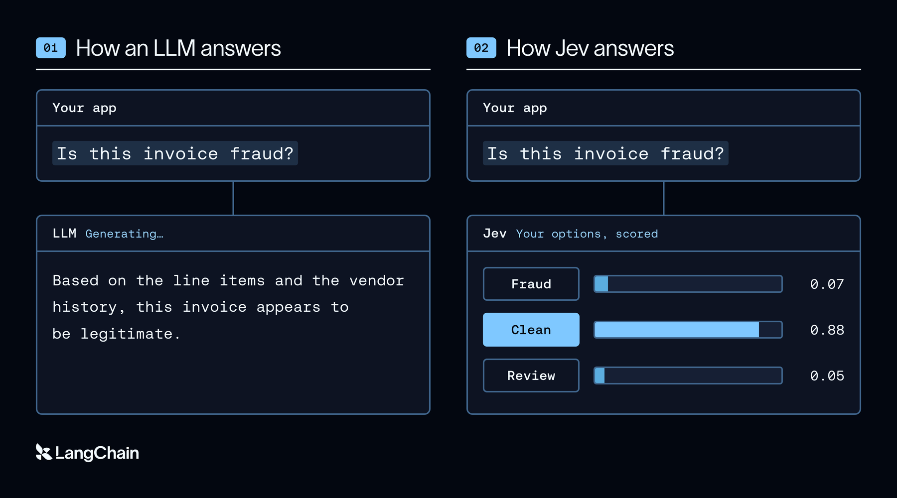
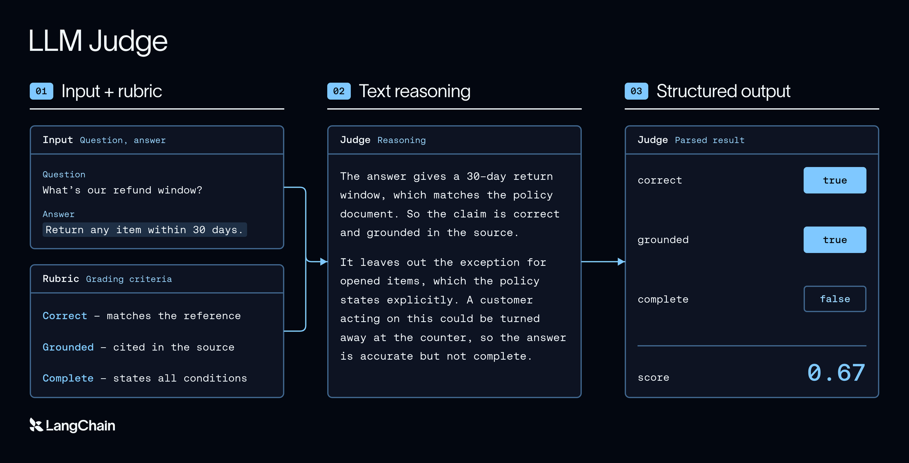
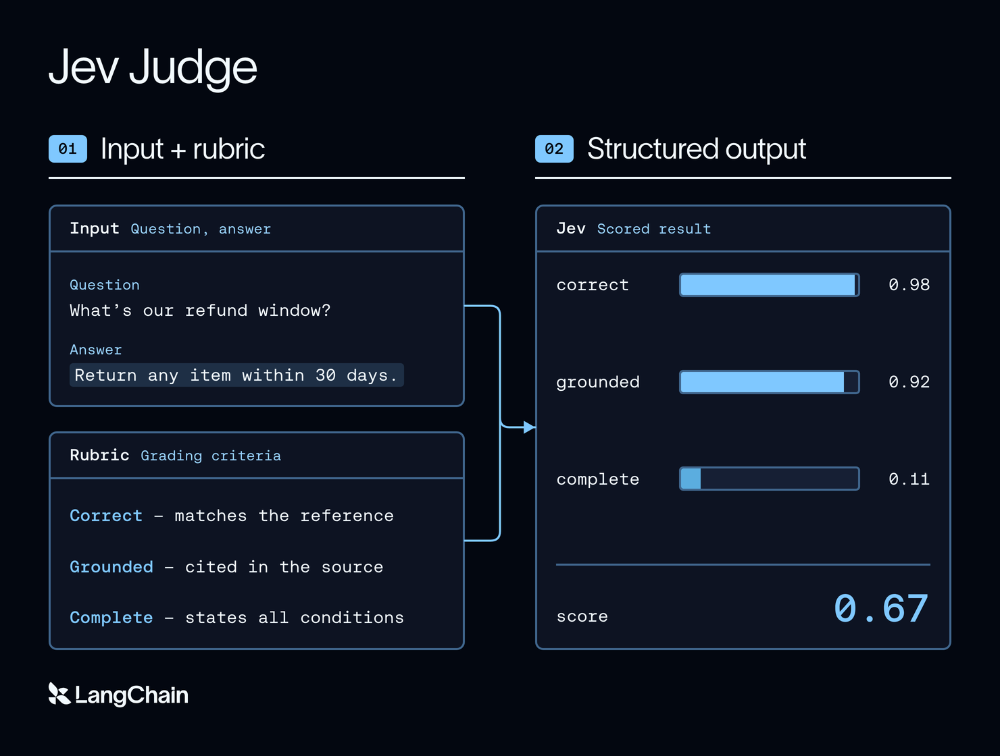
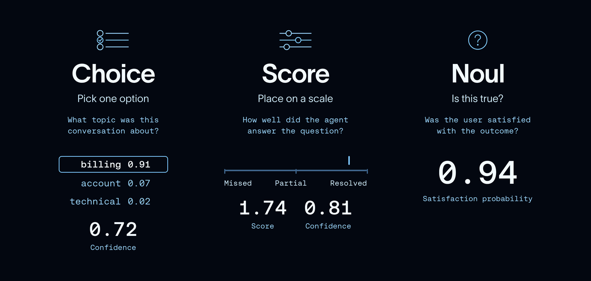
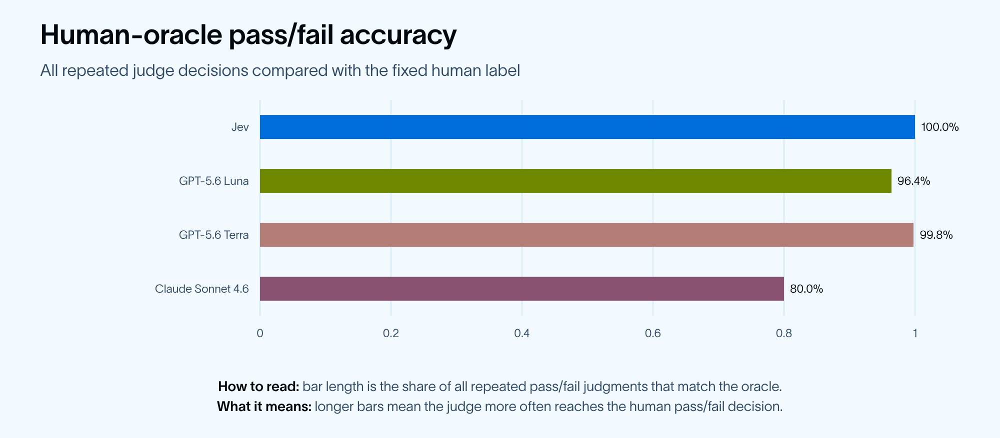
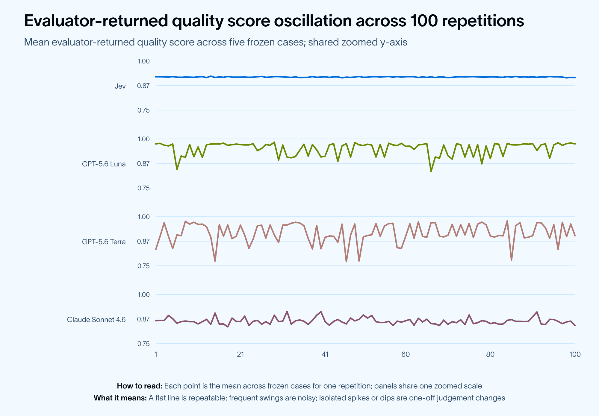
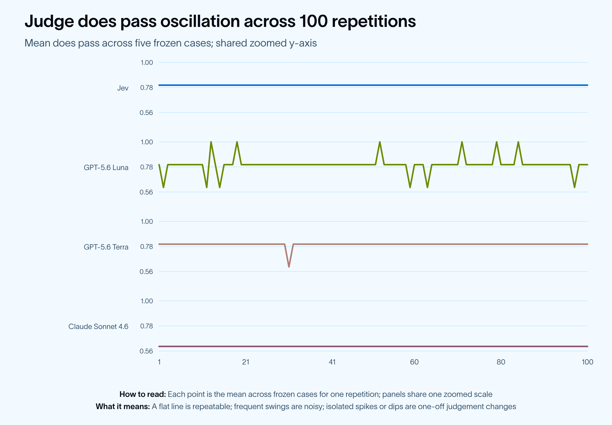
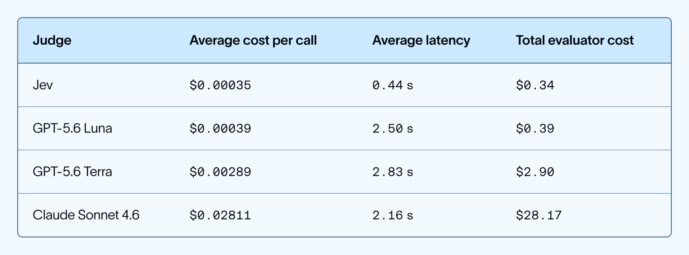
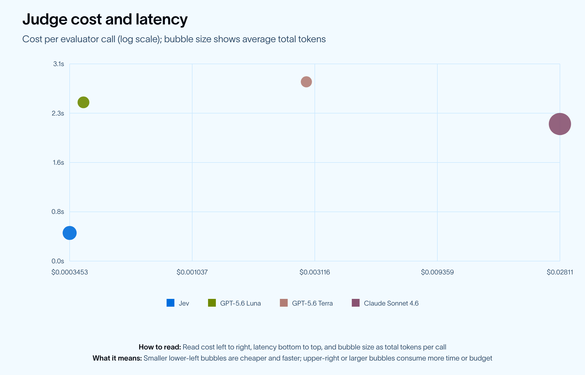
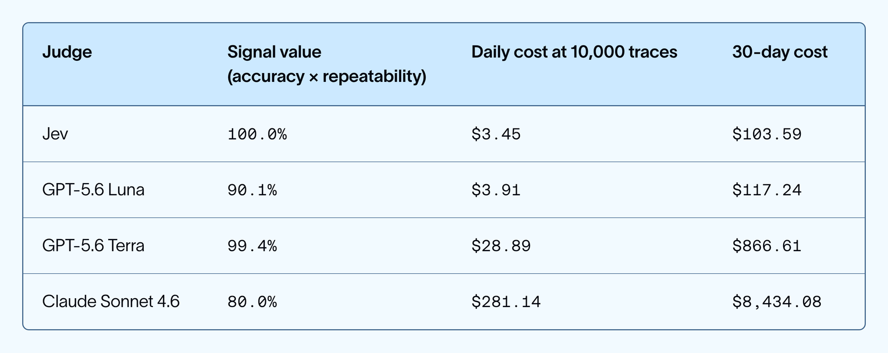

# Can Jev Be a Better Agent Evaluator?

> **来源**: [https://www.langchain.com/blog/jev-agent-evals-langsmith](https://www.langchain.com/blog/jev-agent-evals-langsmith)  
> **作者**: Daniel Shea Seán Roche | **发布时间**: 2026-09-20T17:00:00+00:00  
> **深度调研**: [查看专题调研报告](research.md)  
> **标签**: Agent评测, LLM-as-a-Judge, 可靠性工程, LangSmith

---

## AI 导读

核心方案：引入直接输出类型化决策结果与置信度的 System One 模型（Jev）替代基于文本生成的传统 LLM 裁判（LLM-as-a-judge），结合 Deep Agents 与 LangSmith 搭建 Agent trace 固定回放与自动化评估流水线。解决的问题：传统代码规则评估适用场景过窄，而生成式 LLM 裁判具备非确定性、高方差、高延迟与高成本等工程缺陷，严重制约了生产环境中全量 trace 实时监控与持续回归评测。主要结论：实验表明该类型化决策模型在二元判定准确率上与人工 Oracle 完全一致（500/500），连续评分方差显著优于主流大模型（较 Claude Sonnet 4.6 降低 92 倍，较 GPT-5.6 系列降低 433~913 倍），且单次评测耗时仅 0.44 秒、成本降低数个数量级（$0.00035/次），为大规模在线与离线 Agent 可靠性评估提供了高信噪比的新路径；但应用仍需防范系统性偏见放大并保持人工核验。

---

## 原文整理

## Key Takeaways

- **Jev is a fundamentally different kind of evaluator.** It returns typed answers directly instead of generating text like an LLM judge.
- **Jev was dramatically more consistent on continuous scoring.** Its quality-score variance was 92–913x lower than GPT-5.6 Luna, Terra, and Claude Sonnet 4.6.
- **Jev was also the fastest and cheapest.** It averaged 0.44s and $0.00035/call ($0.34 total vs. $28.17 for Claude).
- **The results are promising, but early.** Despite this being a narrow test, Jev's performance points to a compelling new direction for agent evals.

Today, agent evals come in two flavors: code-based and LLM-as-judge. Both have their own limitations: code-based evaluators can only be used for a narrow set of problems with set inputs, while LLM judges can be slow, expensive, and unreliable. With the popular release of [TypeSafe AI’s Jev](https://typesafe.ai/blog/introducing-system-one-models-and-jev), we wanted to see whether the “System One” model might be a new third form of agent evaluator, and the impact it could have on agent engineering.

## What is Jev?

Jev is a new model released by TypeSafe AI. Jev is actually not a traditional LLM; it doesn’t generate text. It’s what the TypeSafe AI team calls a “System One” model:

📖 System One models are a class of AI models built to make fast, structured decisions that software can use directly. A System One model evaluates a [**state**](https://docs.typesafe.ai/concepts/state) and returns typed answers and probabilities.

According to TypeSafe AI, this makes Jev faster and cheaper than LLMs, up to **200x faster inference and 400x lower cost** than comparable LLMs on classification tasks.

*If you want to learn more about building agents with Jev, we're hosting a livestream with the TypeSafe AI team on Tuesday, Sep 22nd:* [*https://events.langchain.com/webinar/building-a-harness-with-jev/*](https://events.langchain.com/webinar/building-a-harness-with-jev/)

## Why might Jev be a good agent evaluator?

Agent evals today are either code-based or LLM-as-a-judge, each with its own set of benefits, limitations, and tradeoffs.

Code-based evaluation has existed for as long as code has. Cheap, quick, and reliable, its main disadvantage is in its narrower abilities. Given a traditional function’s need for set deterministic inputs, its ability to evaluate the stochastic world of agent behavior is limited. For example, while a traditional function *could* evaluate whether an agent called a tool in its first run, it would have a harder time evaluating if the agent then used the tool result to successfully answer the user’s question. In an open-ended task, there can be several valid ways to use the same tool result, so encoding every acceptable answer as deterministic logic quickly runs into the narrow-scope limitation of code-based evaluation.

Enter [LLM-as-a-judge](https://docs.langchain.com/langsmith/llm-as-judge), which uses an LLM to reason through the unstructured input of an agent’s trace and score it. An LLM judge can accept the question, trace, and evidence as unstructured input, then use a prompt to evaluate whether the response addressed the user’s request.

As any agent engineer will attest though, the LLM judge is not a perfect solution. They are inherently non-deterministic systems, which are not a solid foundation for a trustworthy testing apparatus. They are also slower and more expensive to run than traditional code-based evaluation.

Agent evaluation is a decision task: given an agent’s state and behavior, assign a score that provides feedback. Jev is designed for this pattern. It evaluates typed questions against structured state and returns typed answers with probabilities. Autoregressive models, on the other hand, reach a judgment through token-by-token generation. In our experiment, that decision-first design coincided with lower latency, lower cost, and lower variance.

Jev supports three types of questions:

- `Choice` selects one option and returns probabilities and confidence
  - Example: “Which search outcome best describes this run?”
  - Response: One of `searched_appropriately`, `searched_unnecessarily`, or `failed_to_search`, plus probabilities and confidence

- `Score` rates an answer against an ordered rubric and returns probabilities and confidence``
  - ``Example: “How useful is the answer?”
  - Response: A rubric score from `1` (unhelpful) to `5` (highly useful), plus probabilities and confidence

- `Noul` returns the probability that a yes/no judgment is true
  - Example: “Is the final answer grounded in the retrieved evidence?”
  - Response: A `float` from `0.0` to `1.0`, where `1.0` means fully grounded

Multiple atomic questions can be evaluated in parallel against the same state.

Comparing judges is difficult when the agent behavior, retrieved data, or trace context changes between runs. [Deep Agents](https://www.langchain.com/deep-agents) and [LangSmith](https://www.langchain.com/langsmith-platform?utm_campaign=evergreen_langsmith_branded_cv&utm_campaign_id=23553472535&utm_ad_group_id=198810166528&utm_ad_id=797108559068&utm_network=g&utm_term=langsmith&utm_campaign=evergreen_evaluation_cv&utm_source=google&utm_medium=cpc&hsa_acc=7906965105&hsa_cam=23553472535&hsa_grp=198810166528&hsa_ad=797108559068&hsa_src=g&hsa_tgt=kwd-2174781825802&hsa_kw=langsmith&hsa_mt=e&hsa_net=adwords&hsa_ver=3&gad_source=1&gad_campaignid=23553472535&gbraid=0AAAAA-PkietYkJqgIHVlwo2UlqyTQ7bGY&gclid=Cj0KCQjw5bjVBhCiARIsAJzMVnS-CMMHOqW_r5uwOa8HniET34GlYQuRJpCxQuzo5bk9U1THPps3chsaApDfEALw_wcB) let us capture a single agent run as a dataset and replay it across each model.

## Evaluation with Jev

In order to put Jev to the test, we needed an agent to score. We built a target agent with Deep Agents, our open source agent harness. We then defined a test set as a LangSmith dataset so each evaluator ran against the same questions and expected behavior. The test set consists of five weather requests:

.png>)

For each example in the dataset, we captured the weather agent’s response and stored the full output as a fixed example in LangSmith. Each judge evaluated the five captured runs with two signals: quality, a continuous score; and does\_pass, a binary decision.

.png>)

To measure correctness separately from repeatability, we had a human reviewer label each fixed response against the same rubric. Using the human reviewers labels as the oracle score enabled a richer analysis on the affects of precision and correctness on overall evaluator effectiveness.

Accuracy measures agreement with the human oracle. Variance measures whether a judge reaches the same judgment consistently on identical agent behavior. Lower variance does not automatically mean higher accuracy: a judge can still be consistently wrong. But when a judge is accurate, ***lower variance makes that accuracy more dependable in production***.

We compared Jev with GPT-5.6 Luna, GPT-5.6 Terra, and Claude Sonnet 4.6, calculating per-case variance across 100 repetitions and agreement with the human oracle.

## Evaluation Results

### Accuracy

Using the human reviewer’s labels as the oracle for this comparison, we calculated accuracy for the binary pass/fail decision.

For the binary `does_pass` score, Jev matched the oracle on all 500 repeated decisions. Terra matched on 99.8% of decisions, Luna on 96.4%, and Claude on 80.0%.

### Precision

Accuracy tells us whether a judge agreed with the human oracle. Precision asks whether it produces the same quality score when the agent behavior is unchanged. We measured precision with the observed variance of each judge’s scores.

Jev had the lowest observed mean per-case variance: `0.0000149`. Luna was `433×` higher, Terra was `913×` higher, and Claude was `92×` higher.

This experiment cannot tell us why Jev’s scores varied less. One hypothesis is that the models are optimized for different kinds of output. TypeSafe describes Jev as a decision model trained to return calibrated probabilities and typed answers, while an autoregressive LLM judge generates text before the evaluator maps that output into a score. That difference may make Jev a better fit for this bounded evaluation task, but the result is observational, not evidence that its training objective caused the lower variance.

.png>)

### Cost and latency

Low cost means running agent evaluations at scale can be practical. When evaluator calls are expensive, teams have to decide between coverage and their budget. At $0.00035 per call in this experiment, Jev makes that tradeoff less severe. Teams can afford more repeated judgments and more frequent regression checks. This matters even more for online evaluation, where lower per call cost lets teams run more judges across a larger share of production traces, producing a denser feedback signal.

## Online evals unlocked at scale

For a production agent that produces 10,000 traces per day, the observed per-call costs translate into a meaningful operating difference.

To account for whether a low-cost call is useful, we define **signal value** as binary oracle agreement multiplied by binary repeatability. Repeatability is the chance that two independent calls on the same trace return the same verdict. This rewards judges that are both accurate and stable, while penalizing a judge that is consistently wrong.

A high-signal, low cost judge like Jev could unlock better value in online evaluators. Teams could generate feedback on more production traces, spot changes in quality sooner, and set alerts when that feedback starts to trend in the wrong direction.

## A new type of agent evals

Today, every agent eval carries a tradeoff. Score more agent runs, evaluate more dimensions, or test more changes, and the cost of your testing grows. That pushes teams to evaluate less that they would like.

In our experiment, a Jev judgment cost $0.00035. In addition to its low cost, Jev offered high accuracy and low variance, meaning the judge results were reliable and high-signal. A quality judge at that price means builders can evaluate each agent run against several focused criteria, measure every agent change, and repeat judgments when confidence matters.

This matters because building great agents requires substantial testing and monitoring. The more often you evaluate an agent, the more useful feedback enters the development cycle.

We still need to see whether the results in this experiment carry over to other agents and production workflows. Additionally, low cost can amplify mistakes - a consistently wrong evaluator can produce bad feedback at scale. Engineers still need to incorporate human review and judge alignment into their workflows.

The new System One style of models could make high quality evaluation abundant. That can speed up the entire agent development lifecycle. Agent engineers can turn more traces into feedback, catch regressions sooner, and move faster as they build, test, monitor, and deploy agents. The unlock is not just cheaper evals, but a tighter feedback loop for building reliable agents.

## Reproducibility

This project’s GitHub repository is available [here](https://github.com/danielgshea/jev-as-a-judge).

We ran the LLM judges through LangSmith Gateway: GPT-5.6 Luna, GPT-5.6 Terra, and Claude Sonnet 4.6. We accessed Jev through langchain-typesafe==0.0.1a2.

For reproducibility, the run used Deep Agents 0.7.15, LangChain OpenAI 1.6.2, LangSmith 0.12.6, and Tavily Python 0.8.3. We did not set temperature, top-p, seed, or max tokens for the LLM judges, so each provider’s defaults applied. The Jev service version was not available in the experiment metadata.

## Want to learn more?

If you want to learn more about building agents with Jev, LangChain is hosting a [livestream with the TypeSafe AI](https://events.langchain.com/webinar/building-a-harness-with-jev/) team on Tuesday, Sep 22nd.
