# Revamping Skills in Deep Agents

> **来源**: [https://www.langchain.com/blog/revamping-skills-in-deep-agents](https://www.langchain.com/blog/revamping-skills-in-deep-agents)  
> **作者**: Sydney Runkle | **发布时间**: 2026-10-07T19:00:00+00:00  
> **标签**: Agent架构, 上下文工程, 工具绑定, Prompt Cache

---

## AI 导读

针对生产环境中技能库规模膨胀带来的上下文冗余与调度问题，LangChain 对 Deep Agents 的 Skills 架构进行了工程升级。核心方案采用渐进式披露（Progressive Disclosure），将工具绑定至特定技能以实现按需加载与基于运行时的权限隔离；通过应用层 Pinning 预置技能指令以跳过首轮探测轮次并维持 Prompt Cache；并通过重置元数据支持长会话中的技能热重载。该方案有效降低了 Token 开销与调用延迟，提升了 Agent 在生产环境中的确定性与可靠性。

---

## 原文整理

## Key Takeaways

- **You can now bind tools to skills.** Tool schemas stay out of context until the agent reads the skill they're bound to, and on models that accept new tools mid-conversation, adding them keeps the prompt cache intact.
- **Apps can pin skills at runtime**, so the instructions are in context before the first model call, with no `read_file` round trips.
- **Skills can reload mid-thread**, so a long-running agent picks up added, edited, or deleted skills without starting a new thread.

Skills are one of the best ways to give an agent domain knowledge. A [skill](https://agentskills.io/home) is a folder of instructions, scripts, and reference files that teaches an agent how to do things, like prepping for a customer meeting or reviewing call transcripts the way your sales team does. Agent Skills are an [open standard](https://agentskills.io/specification) that works with any model and is [supported by dozens of agent products](https://agentskills.io/clients). You also don't have to be technical to write one: at its core, a skill is a markdown file.

Skills work because of *progressive disclosure*. The agent sees only each skill's name and description up front, and reads the full instructions only when a task needs them. That keeps context small, and [context engineering](https://www.langchain.com/blog/context-engineering-for-agents) is the key to building effective agents.

As usage scales, what teams need from skills is changing. We're seeing enterprise skill registries grow to thousands of skills, shared across teams and agents. We've revamped [skills support in Deep Agents](https://docs.langchain.com/oss/python/deepagents/skills) to address some common requests:

- **Binding tools to skills:** tools bound to a skill load only when the agent reads that skill.
- **Pinned skills:** when a user explicitly requests a skill, like `/meeting-prep`, your app can load it before the next model call.
- **Skill reloading:** a long-running thread can pick up new or changed skills without starting over.

## How skills work

A skill is a directory with a `SKILL.md` file: YAML frontmatter with a `name` and `description`, followed by the instructions the agent follows. A skill can also bundle supporting files under `scripts/`, `references/`, and `assets/` ([spec](https://agentskills.io/specification)).

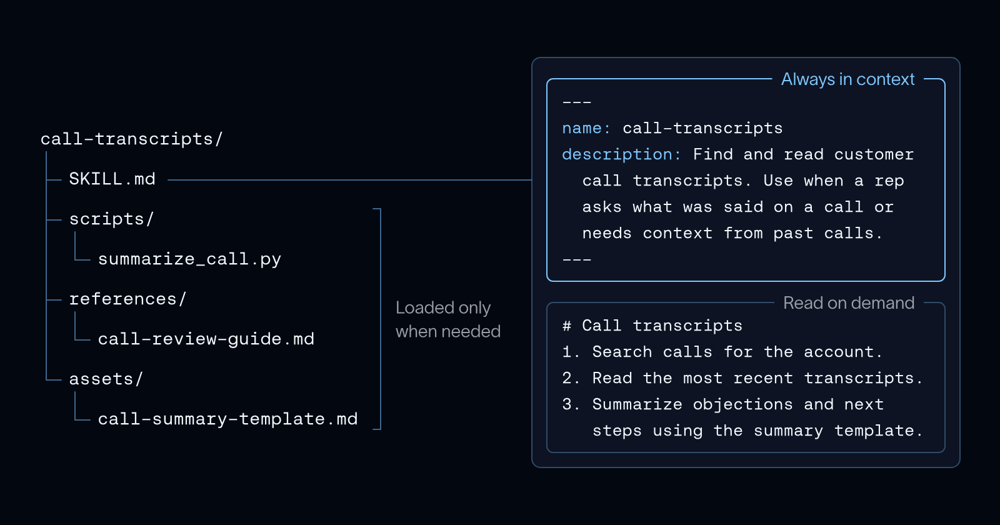

Throughout this post, we'll use [our GTM agent](https://www.langchain.com/blog/how-we-built-langchains-gtm-agent) as a running example. It's built on [Deep Agents](https://docs.langchain.com/oss/python/deepagents/overview), and its library of more than 50 skills covers a sales rep's recurring work, like `meeting-prep`, `call-transcripts`, and `competitive-intel-card`.

1. **Discovery.** At startup, the agent sees each skill's `name` and `description` in its system prompt.
2. **Activation.** When a task matches a skill, the agent reads the full `SKILL.md` with `read_file`.
3. **Execution.** The agent follows the instructions, and reads scripts or reference files only when they call for them.

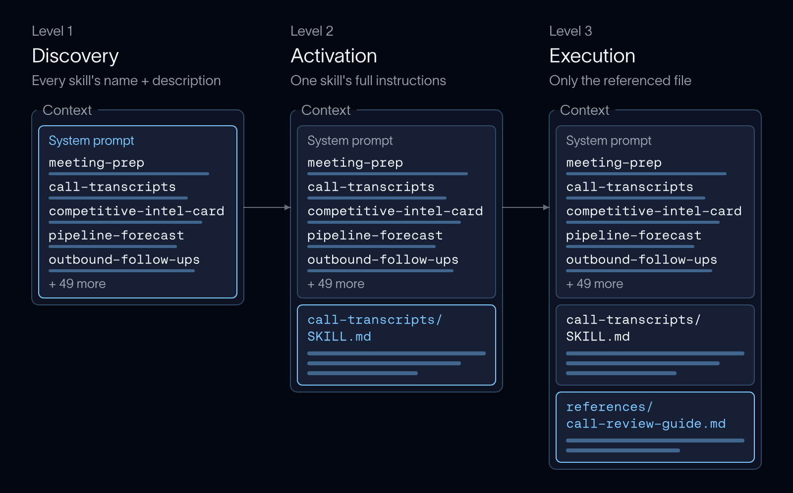

Until a skill is used, it costs one line in the system prompt, so a library can hold references to an abundance of skills without crowding context. Now let's jump into the enhancements we made in Deep Agents.

## Binding tools to skills

Skills often tell an agent how to use specific tools, and some tools only work well once the agent has read those instructions. Until now, skills and tools were disclosed separately. You could keep tool schemas out of context with [tool search](https://docs.langchain.com/oss/python/langchain/middleware/built-in#provider-tool-search), but nothing tied a tool to the skill that explains it: the agent could find and call a tool without reading its skill, or read the skill and still have to search for its tools.

Now you can [bind tools to a skill](https://docs.langchain.com/oss/python/deepagents/skills#add-tools-to-skills), so a skill and its tools are disclosed together. A bound tool isn't added to context until the agent reads its skill, and a call to it before then fails as an unknown tool. That keeps context lean, and it means the agent has read how to use a tool before it can call it. In our [GTM agent](https://www.langchain.com/blog/how-we-built-langchains-gtm-agent), `call-transcripts` explains how to search calls and read transcripts, so it's the natural place to bind those tools.

List the tools in the skill's frontmatter under `metadata.include_tools`:

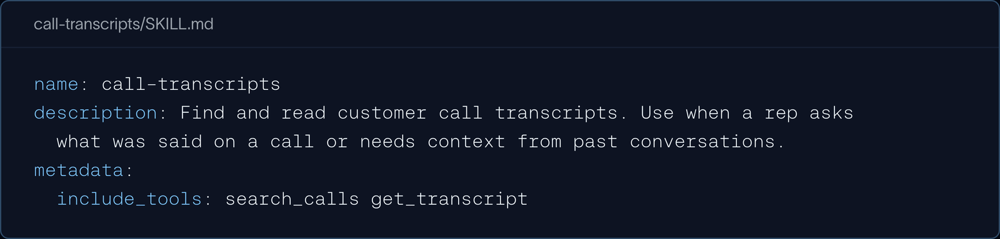

Pass those tools to [`SkillsMiddleware`](https://reference.langchain.com/python/deepagents/middleware/skills/SkillsMiddleware) instead of the agent:

![Python: create\_deep\_agent with SkillsMiddleware(tools=\[search\_calls, get\_transcript\])](https://cdn.prod.website-files.com/65c81e88c254bb0f97633a71/6ac685ec12d594b851fc85e7_code-02-skills-middleware.png)

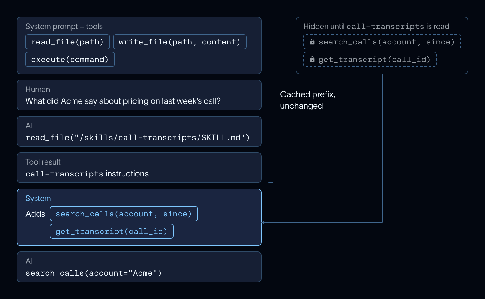

Adding tools partway through a conversation used to mean editing the request's tool list, which invalidates the prompt cache. [Anthropic](https://platform.claude.com/docs/en/build-with-claude/mid-conversation-system-messages) and [OpenAI](https://developers.openai.com/api/docs/guides/tools-tool-search) now let newer models accept tools mid-conversation, so on those models, Deep Agents adds a skill's bound tools right after the skill is read and the cached prefix stays intact ([Anthropic](https://docs.langchain.com/oss/python/integrations/chat/anthropic#change-tools-mid-conversation) and [OpenAI](https://docs.langchain.com/oss/python/integrations/chat/openai#add-tools-mid-conversation) integration docs). On other models, the tools are appended to the request as before.

A list covers most skills. For more control, a skill can list a label instead of tool names, and a function you pass to `SkillsMiddleware` turns each label into tools. That lets you:

- **Disclose a whole tool group**, like every tool on an MCP server, under one name, without listing each tool in the skill.
- **Gate tools on runtime permissions.** The function receives the graph's runtime, so it can check who the user is and return only the tools they're allowed to use.

Here, `call-transcripts` gets every tool on the calls MCP server, and `pipeline-forecast` gets CRM tools, but only managers can update the forecast:

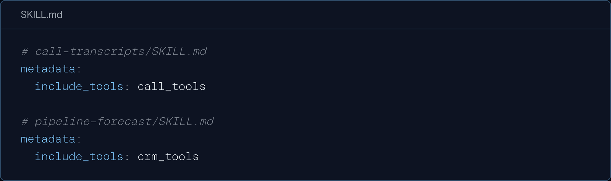

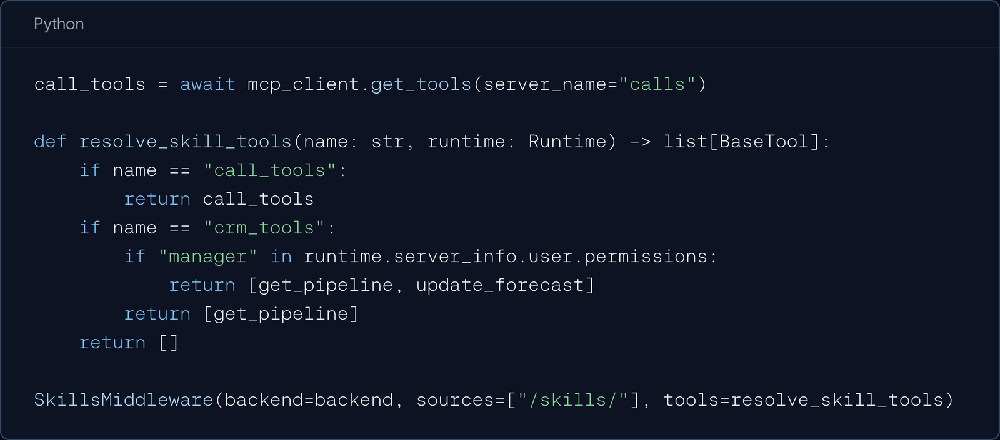

See [Add tools to skills](https://docs.langchain.com/oss/python/deepagents/skills#add-tools-to-skills) for more.

## Pinned skills

Sometimes the user already knows which skill they want. In our GTM agent, a rep can type `/meeting-prep for my Acme call tomorrow`. Without pinning, the model sees only the skill's description and has to read it. That adds a round trip before the work starts, and the model isn’t guaranteed to load the right skill. With [pinned skills](https://docs.langchain.com/oss/python/deepagents/skills#pin-skills), your app finds the skill names in the message (or parses from a UI) and passes them in `pinned_skills`, and the middleware adds each skill's instructions to the conversation before the next model call. Deep Agents doesn't parse messages itself, so you choose the syntax:

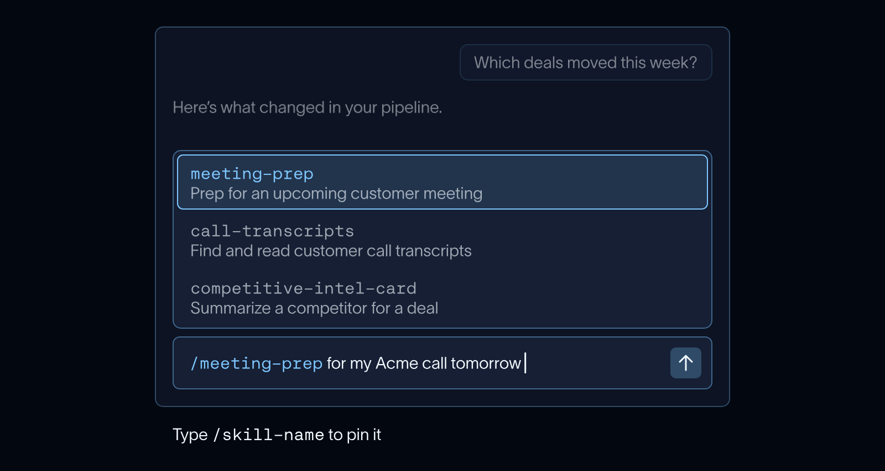

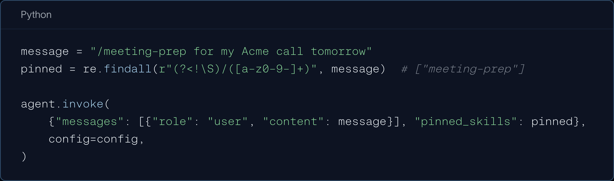

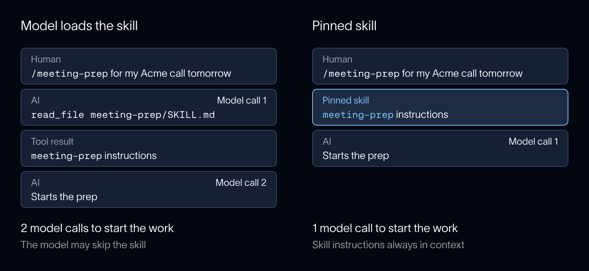

That cuts latency and makes behavior more predictable: the instructions are guaranteed to be in context, and a pinned skill's bound tools come with it. Each pinned skill is added once as a tagged message, so earlier messages never change, the prompt cache stays valid, and a chat UI can show the skill as a label instead of its full text.

## Reloading skills mid-thread

Skills are loaded at the start of every thread and are kept in agent state, so every later turn reuses the same set of skills. You can now [invalidate this list](https://docs.langchain.com/oss/python/deepagents/skills#reload-skills) by setting `skills_metadata` to `None` when invoking the agent. If a teammate adds a `competitive-intel-card` skill to the library, the application can choose to invalidate the list of skills and the next run will rescan every source:

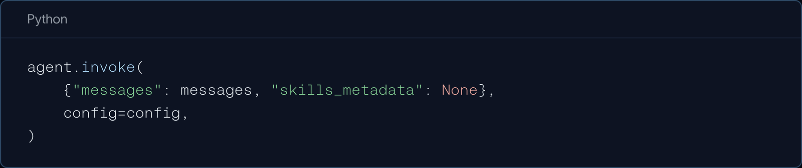

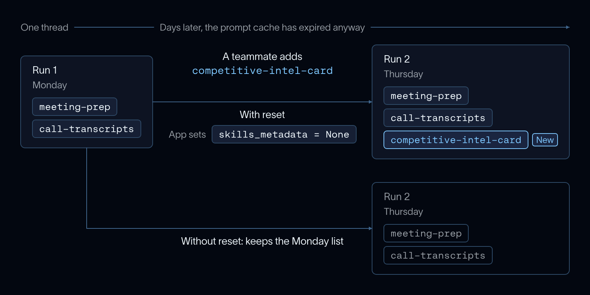

A reload that finds new skills changes the system prompt, which invalidates the prompt cache. For a thread that has sat idle, that cost is usually already paid: provider caches typically expire within minutes to an hour of inactivity ([Anthropic](https://platform.claude.com/docs/en/build-with-claude/prompt-caching), [OpenAI](https://developers.openai.com/api/docs/guides/prompt-caching)), so the cache is cold by the time the rep comes back.

Because the reset is just run input, you can also hand control to users. For example, a `/reload` command on the client side:

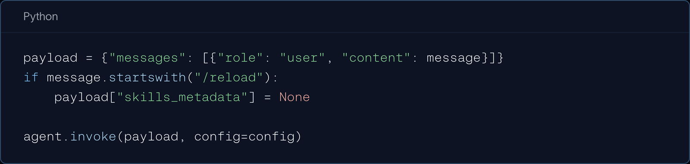

You can also reset from `update_state` or from middleware, so your app controls when a skills reload occurs. See [Reload skills](https://docs.langchain.com/oss/python/deepagents/skills#reload-skills).

## Get started

Skills are the industry standard mechanism for giving an agent organized domain knowledge. These updates make them easier to run at scale: tools load only when a skill needs them, the skills a workflow needs load up front, and long-running threads stay current as your library changes. And because skills are an open standard, the ones your team writes work across models and agents.

All of these are available in the latest `deepagents`. Read the [skills docs](https://docs.langchain.com/oss/python/deepagents/skills) to get started, and let us know what you think via [GitHub issues](https://github.com/langchain-ai/deepagents/issues), the [forum](https://forum.langchain.com), or on [X](https://x.com/LangChain).

### Acknowledgements

Thanks to [Rich Scarrott](https://x.com/riscarrott) for leading development of these new features and to [Hunter Lovell](https://x.com/huntlovell) for feature and blog review!
