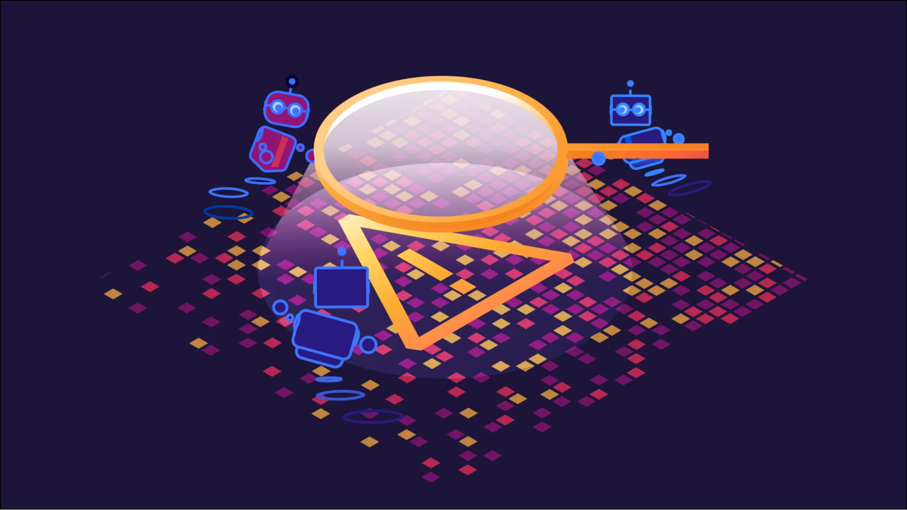
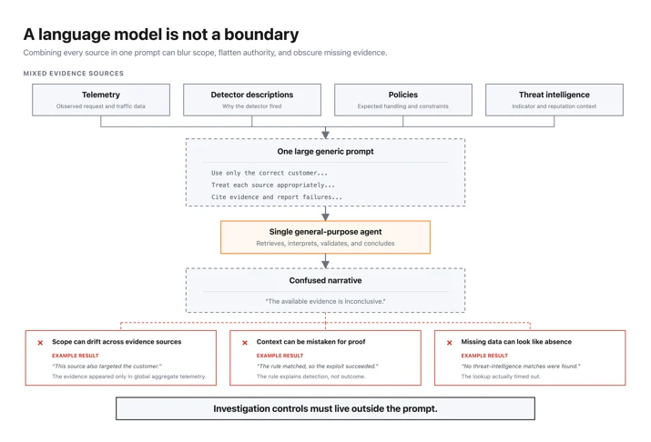
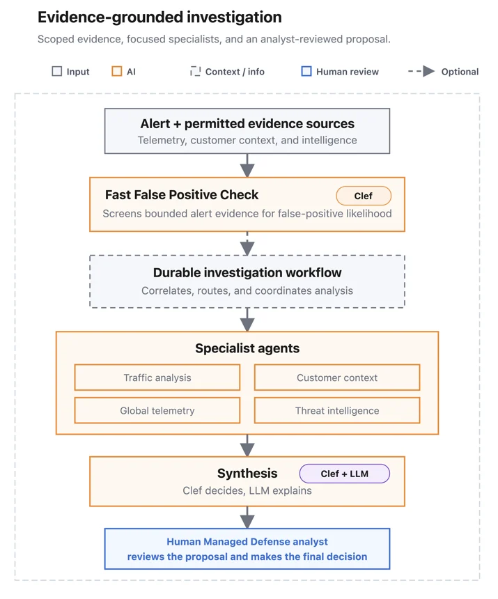
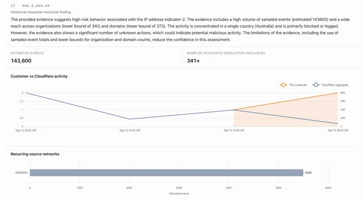
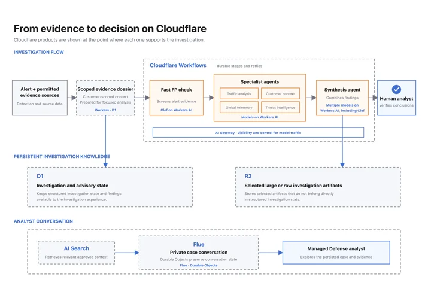
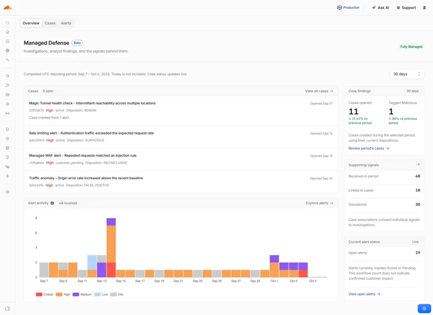

# Building an evidence-grounded agentic security operations harness on Cloudflare

> **来源**: [https://blog.cloudflare.com/agentic-security-operations](https://blog.cloudflare.com/agentic-security-operations)  
> **作者**: Blake Darché | **发布时间**: 2026-10-07T16:30:36.761000+00:00  
> **标签**: AI Agent, 工程可靠性, 安全运营, 确定性流水线, 证据核验

---

## AI 导读

针对安全运营中海量告警导致的分析过载与单 Agent 的幻觉和越权问题，Cloudflare 提出了基于证据锚定的多 Agent 架构治理方案。核心方案包括：前置由确定性代码执行固定侦查工作流固化证据快照；利用轻量决策模型与规则提前过滤高频噪声；由协调 Agent 并行调度流量分析、客户上下文、全局遥测及威胁情报四个专职 Agent；最终由合成 Agent 在应用层强制核验引用有效性并限制输出词表，输出供人工审核的处置建议。方案有效解决了 Agent 的范围漂移与失败状态丢失问题，在保障租户隐私与严格人工介入的前提下大幅提升了告警处置可靠性与效率。

---

## 原文整理

# Building an evidence-grounded agentic security operations harness on Cloudflare

Security alerts rarely arrive one at a time. A single alert can cause a spike across the environment, requiring a human analyst to decide which alerts are related and what they mean. When multiple arrive at the same time, it can quickly overwhelm even a seasoned security analyst. Enter the alert paradox. Now, our built-in, multi-AI-agent security operations harness can handle more of this work at Cloudflare scale.

Our [<u>Cloudflare Managed Defense</u>](https://www.cloudflare.com/managed-defense/) AI agent harness speeds up the process of gathering data, connecting and aggregating detections, and accounting for missing sources while new alerts continue to arrive. To further analyze context, we make use of the [<u>OpenAI Daybreak Defense Network</u>](https://openai.com/daybreak/partners/) and our partnership with Anthropic. Cloudflare uses approved OpenAI Daybreak and Anthropic models, including GPT-5.6 Cyber and Mythos, for deeper model-backed analysis. Initial analysis and scoring is done with [<u>Clef</u>](https://blog.cloudflare.com/clef-decision-models/), Cloudflare’s open-source decision model.

Collecting evidence to understand what each alert means requires a lot of time. Even in a highly sophisticated Security Information and Event Management (SIEM), too much is still left for a human to review. Human analysts must gather data, connect and aggregate detections, and account for missing sources while new alerts continue to arrive.

Think about every time a human analyst reviews an alert: "Which should we silence? Which action should we take? Which alert should we ignore? Which should we resolve as false positives? Which should we resolve as true positives? Which should trigger our incident team?" We address this predicament with our AI agent strategy. Our approach reduces all of those questions and gives Managed Defense Analysts a quick and consolidated view, directly providing insight into related alerts, admitted evidence, visible gaps, and recommended next steps. The result: cutting back on the time needed to analyze, and creating a hyper focus on actually getting security alerts resolved and mitigations deployed.

## Why a single agent fails

Our first prototype showed the limits of one general-purpose agent. We provided the AI agent the whole investigation. It produced useful analysis, but it also hallucinated claims the evidence did not support. Telemetry, detector descriptions, policies, and threat intelligence were flattened into one prompt, which caused their distinct roles to merge together.

We saw three recurring problems with our first single-shot AI agent harness:

- **Context became authority**. A detection is a hypothesis, not proof that an exploit succeeded or an attack occurred. A broad AI agent can blur that distinction.
- **Scope drifted.** An AI agent can query the wrong account, time range, or source. You can’t rely on a language model prompt to be a boundary.
- **Failure disappeared.** If a lookup times out, the result may not distinguish "not checked" from "checked and not found."

To address these challenges we moved evidence collection and scope enforcement into application code, before model analysis begins.

## Recon first, inference second

It's tempting to put an AI agent at every step. The front half of our harness has none.

Before we even call inference, deterministic code runs a fixed set of reconnaissance workflows with versioned API calls. It collects the customer's identity, detection history, traffic baseline, enforcement outcome, and network observations. Each piece of data is stored with its source, version, and timestamp.

Cloudflare sees both the request and the action applied to it. That lets the investigation connect the behavior that triggered an alert with both the control that fired and its outcome.

The fixed recon snapshot also makes evaluation reproducible. If AI agents fetch their own data, two runs may disagree because their inputs changed. Here, the same snapshot can be replayed, so differences between specialist AI agents’ findings come from interpretation rather than retrieval.

## Filter noise early

Most alerts are not incidents. The same rule often fires repeatedly on a known traffic pattern, and paging Managed Defense Analysts every time makes it easier to miss a real security incident.

We needed a lightweight triage model to compare each alert with its reconnaissance data: Has this event been detected for the customer before? What did Managed Defense Analysts decide previously? Does the traffic look consistent with normal human behavior? Alerts scored with a high likelihood to be false positives skip analysis by the specialist AI agents.

[<u>Clef</u>](https://blog.cloudflare.com/clef-decision-models/), running on Workers AI, was the perfect fit for this type of fast agentic reasoning.

Known high-volume noise is deterministically classified as passive when it arrives. It remains available as context but does not enter the active queue.

## Specialist AI agents handle the investigation

For alerts that need deeper review, a coordinator AI agent runs four specialist AI agents in parallel:

- **Traffic analysis** reviews request behavior, historical changes, and enforcement.
- **Customer context** reviews earlier alerts, dispositions, and Managed Defense Analysts’ decisions.
- **Global telemetry** compares the activity with privacy-preserving Internet-wide signals.
- **Threat intelligence** checks indicators already admitted to the alert or case.

A synthesis AI agent combines their typed findings into one advisory; it can’t fetch new evidence or choose a classification outside the approved vocabulary. Keeping each task narrow makes unsupported claims easier to catch, and recommendations easier to audit.

## Global context without customer data

A security tool knows what happened inside the environment it is deployed in, but little about the world beyond it. Cloudflare compares an alert with patterns seen across its global network.

For example, an IP may be targeting one site, scanning thousands of sites, or appearing for the first time. Those patterns carry different weights. To preserve customer privacy, the global telemetry specialist works only with aggregates; it never receives another customer's individual records or identity.

This view combines features from Cloudflare's [<u>CDN</u>](https://www.cloudflare.com/products/cdn/), [<u>WAF</u>](https://www.cloudflare.com/products/waf/), [<u>DDoS</u>](https://www.cloudflare.com/products/ddos/), [<u>Turnstile</u>](https://www.cloudflare.com/products/turnstile/), [<u>Rate Limiting</u>](https://www.cloudflare.com/products/rate-limiting/), and [<u>Cloudforce One threat intelligence</u>](https://www.cloudflare.com/cloudforce-one/services/threat-intelligence/). The synthesis AI agent weighs both global reputation and customer history. This ensures a globally common pattern can still be used on a per-customer basis, but does not automatically imply a widespread campaign for all customers.

## History is evidence

Every evaluation is conscious of what came before it: the alert, the pattern, and which customer. The recon dossier records the alert's own track record including how many times this service alert has fired, how many of those were dispositioned as false positives, and what the Managed Defense Analyst concluded. An attack pattern that has been benign every time your Managed Defense Analysts have seen it is a very different object from the first sighting of something new, and the specialist AI agents are told which one they are looking at. Approved background context is retrieved from previous alerts and cases, so yesterday's conclusions are carried into today's decision, instead of being rebuilt from scratch.

Our system aggregates related alerts into a consolidated case. In each case, we store evidence, findings, and recommendations. Our system deterministically joins and correlates this data, but we leave it to a Managed Defense Analyst to confirm the actual scope. Over time, a case can connect network, application, and Zero Trust evidence together, while tracking the source of the evidence for additional context and reference purposes.

## From evidence to decision

Before analysis, the system creates a versioned evidence package with the subject, scope, time anchor, admitted evidence, policy versions, sources, and coverage gaps. Specialists must cite items in that package. Application code checks that every citation exists, belongs to the investigation, and supports the attached claim. Invalid findings are corrected or recorded as limitations.

We lean on Clef a second time to score our evidence. Is the collected evidence enough for a decision? Does any of our collected evidence contradict? Based on this evidence, Clef picks from a deterministically reduced list of attack classifications and dispositions.

Cloudflare's developer platform runs this process. Application code on Workers admits evidence and validates results; [<u>Workflows</u>](https://developers.cloudflare.com/workflows/) coordinates each stage and saves completed work before the next begins, so a failed stage reuses evidence and findings that already passed validation instead of starting over. [<u>D1</u>](https://developers.cloudflare.com/d1/) keeps investigation and advisory state, [<u>R2</u>](https://developers.cloudflare.com/r2/) holds bounded context and evidence artifacts. Case-chat state persists in [<u>Durable Objects</u>](https://developers.cloudflare.com/durable-objects/), uses [<u>Flue</u>](https://flueframework.com/), and is enriched with [<u>AI Search</u>](https://developers.cloudflare.com/ai-search/).

Finally, an LLM-powered agent produces an advisory report using terms that Managed Defense Analysts already work with: affected surface, enforcement outcome, relevant controls, and next step. Managed Defense Analysts can inspect evidence, investigate further, revise the recommendation, or group alerts into a case. Application code fixes the customer scope before any model sees results, and gives each specialist only the evidence it needs. The model never receives authority to cross tenant boundaries or act for the Managed Defense Analysts.

## Handling incomplete evidence

At network scale, a source will sometimes fail. A comparison may time out, metadata may be missing, or a threat intelligence lookup may return no match. The system keeps evidence already collected and records the gap.

The advisory distinguishes three states:

- Not checked
- Checked, with no matching result
- Checked, with evidence supporting absence

If global telemetry is unavailable, the system can describe what is unusual for the customer but cannot say whether the pattern is widespread. When the evidence is insufficient, it makes no classification or disposition recommendation.

## Remediation

A useful recommendation should lead to a solution, rather than a ticket. The advisory might suggest a rate limiting rule for an abusive path, a WAF custom rule for a signature, or a DDoS protection change. For fully managed customers, Managed Defense Analysts can apply the suggested rules; other customers will receive their recommendations in the dashboard and through their chosen alert path.

In the end, the Managed Defense Analyst remains responsible for the decision and any mitigation. Each alert and case includes the evidence behind the AI agent’s recommendation, which empowers the Managed Defense Analyst to reach a conclusion by accepting or updating the AI agent’s advice.

## What comes next

Managed Defense Analysts remain responsible for judgment. The AI agent harness handles more of the repetitive work: assembling investigations, connecting related events, and showing the evidence behind each recommendation. Over the next few quarters, we plan to add a Custom Managed level with more flexibility for each organization.

We also plan to explore continuous AI agents that monitor Cloudflare traffic and surface patterns that fixed rules and thresholds may miss.

The early beta is available in [<u>Cloudflare Managed Defense</u>](https://www.cloudflare.com/managed-defense/) for eligible application-security alerts and cases. If you already use Cloudflare WAF, DDoS protection, Magic Transit, or [<u>another supported product</u>](https://www.cloudflare.com/managed-defense/), talk to your enterprise account team about adding Managed Defense.
