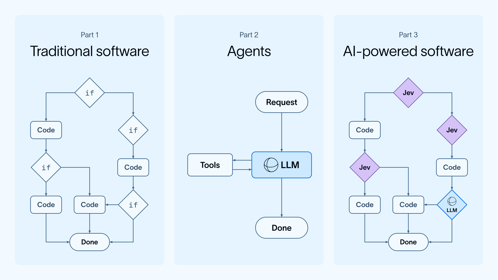
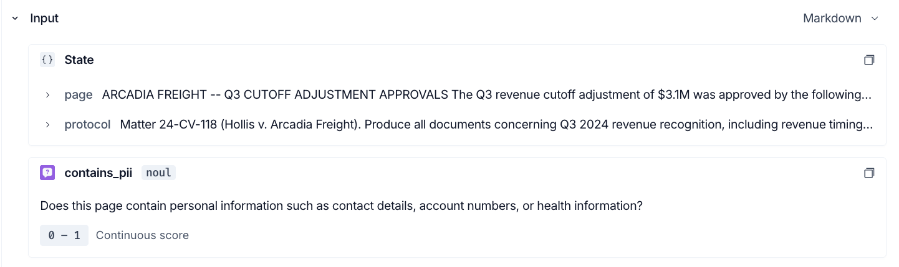
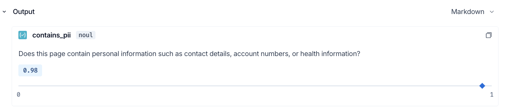

# Building Production Agents with Jev and LangGraph

> **来源**: [https://www.langchain.com/blog/building-prod-with-jev-and-langgraph](https://www.langchain.com/blog/building-prod-with-jev-and-langgraph)  
> **作者**: Sydney Runkle Hunter Lovell | **发布时间**: 2026-09-25T18:30:00+00:00  
> **标签**: Agent工程化, LangGraph, 系统可靠性, 决策模型, 混合架构

---

## AI 导读

文章探讨了如何结合专用决策模型（Jev）与流程编排框架（LangGraph）构建可靠且高效的生产级 Agent。针对传统前沿 LLM 在 Agent 流程中面临的成本高、高延迟与非确定性痛点，提出由确定性代码和图拓扑掌控工作流，仅在离散语义决策点调用轻量决策模型，并建立置信度阈值向大模型回退的混合分层架构；同时依托 LangGraph 的状态持久化（Checkpointing）与中断机制保障 Agent 运行的容错性与人机协同能力，实现高吞吐、低延迟且可观测的工业级 Agent 系统。

---

## 原文整理

Last week, [TypeSafe AI](https://typesafe.ai/) released Jev, a new kind of model. Unlike traditional LLMs, Jev doesn't generate text. It makes decisions your code can act on directly, for what TypeSafe calls [AI-powered software](https://docs.typesafe.ai/concepts/how-to-build-with-system-one), where "code owns the workflow and AI handles narrow, structured decisions." TypeSafe sums up its philosophy as building "[prod, not god](https://typesafe.ai/manifesto)."

As frontier LLMs have gotten more capable, we've started treating them like god, reaching for them for any task with fuzzy inputs: prose generation, document extraction, search, ranking, research, classification, and more. Unfortunately, god is expensive, and slow. You pay for that generality on every call, even when all you needed was a yes or no.

That's why Jev's launch drew so much attention. On narrow decision tasks, like the routing and classification steps many agents are built around, TypeSafe's benchmarks show Jev running up to [200x faster and 400x cheaper](https://typesafe.ai/blog/introducing-system-one-models-and-jev) than leading LLMs.

TypeSafe's approach felt almost nostalgic to us at LangChain. Our mission is to make agents useful and ubiquitous, and our open source ecosystem has evolved as the model landscape has, but at every step we've come back to the same two questions: how do we get models to make useful decisions, and how do we act on those decisions reliably?

**LangGraph is our answer to both questions.** We built it from what we've learned helping thousands of companies put AI into production, and it lets you combine model-driven decisions with deterministic code in systems that are reliable and observable. **Jev gives those systems a faster, cheaper way to make decisions.** In this post, we'll cover how to build "prod, not god" with Jev and LangGraph.

## **Jev for decisions**

Jev takes one capability out of the frontier LLM bundle, judgment, and makes it a primitive too cheap to measure. It's what TypeSafe calls a **system one** model, or more commonly called [a decision model.](https://x.com/Mappletons/status/2101560333441610133) You give it state and a set of questions, and it returns typed answers with probabilities.

TypeSafe's [docs](https://docs.typesafe.ai/concepts/how-to-build-with-system-one#three-software-architectures) lay out three ways to build software. Traditional software is made of explicit logic, with every branch written out by hand and auditable, but rigid as a result. Agents swung the other way: one model juggles decisions at every step, and control flow moves out of code and into prompts. AI-powered software takes the middle path. Code keeps the structure and handles exact computation, and a model sits only at the branches that need semantic judgment.

A few properties help Jev qualify as a component of production [systems](https://docs.typesafe.ai/concepts/how-to-build-with-system-one#what-makes-system-one-composable):

- **Structured:** answers come back as typed answers with probabilities, so code can predictably branch on results
- **Parallel:** you can ask many questions about the same state at once
- **Fast:** decisions are cheap enough to make many of them in a single run
- **Self consistent:** system one is designed to return stable answers across repeated evaluations.

💡 Jev's consistency is a welcome change from the non-determinism of LLMs. Ask an LLM the same question across runs and you can get different answers. Jev is designed to [return the same answer](https://docs.typesafe.ai/cookbooks/consistency_noul_cookbook) for the same input. In an early [Jev-as-a-judge experiment](https://www.langchain.com/blog/jev-agent-evals-langsmith), its scores barely moved across 100 repeated runs, far less than any LLM judge we tested.

For example, this video helps you visualize how Jev works differently from an LLM. The task here is determining whether or not an input contains various types of PII:

Real applications make a multitude of decisions, each intricately dependent on previous choices. Once decisions are this cheap, the challenge becomes orchestrating them, and that's what LangGraph is for.

## LangGraph for orchestration

We've been helping teams build systems around LLMs for years, and nearly every one runs into the same two problems:

1. **Managing context is hard.** For a model to make the right decision, its context window needs "[just the right information for the next step](https://x.com/karpathy/status/1937902205765607626)." That information is fuzzy, and it changes as the application runs.
2. **Model-driven systems still need to be reliable.** They have to survive failures, support human intervention, and make every step observable.

Existing frameworks addressed parts of these problems, but none solved both without restricting how people build. So we built [LangGraph](https://docs.langchain.com/oss/python/langgraph/overview). It's now downloaded 60M+ times a month and used by many of the Fortune 50 companies building with AI.

### State as context

A LangGraph application is built from three pieces. **Nodes** are units of work: plain code, a model call, a tool call, or an entire subgraph. **State** is the information nodes read and update. **Edges** decide which node runs next, either along a fixed path or dynamically based on the current state.

Any graph can also be a node in a larger graph, so small, tested pieces compose into larger systems. TypeSafe's [manifesto](https://typesafe.ai/manifesto) makes the same bet about intelligence: small, legible primitives are what let complex systems stay trustworthy.

As the graph runs, each step's results accumulate in state. That state becomes the context for every later step, and it also determines which nodes run next.

Instead of [packing domain knowledge into prompts](https://x.com/DavidKPiano/status/2101730719248629964), you [encode it in the topology of the graph](https://www.langchain.com/blog/deep-agents-vs-langchain-vs-langgraph): which decisions get made, in what order, and what state each one sees. That's how software gets to branch on intent and common sense, as TypeSafe puts it. The judgment comes from a model, but the flow stays in code you can inspect and test.

### A reliable runtime

As the TypeSafe manifesto [argues](https://typesafe.ai/manifesto), you only let a component run unattended once it's reliable, and only build on it once you can inspect, test, and constrain it. LangGraph handles that in the runtime:

- [Durable execution](https://docs.langchain.com/oss/python/langgraph/durable-execution): model-driven steps are nondeterministic, so the same input can lead a model to a different call and send the run down a different path. Restarting from scratch after a failure is worse than slow, since the rerun might not retrace the same path. Checkpointing persists state at every step, so a failed run resumes with the decisions it already made
- [Human in the loop](https://docs.langchain.com/oss/python/langgraph/interrupts): when a step needs review before the system acts, interrupts let you pause, approve, and pick up where you left off
- Observability: a model-driven step doesn't do the same thing every time, so you need traces in [LangSmith](https://smith.langchain.com/) to see what was decided and why

None of this is specific to LLMs. Jev still takes in unstructured text context and returns a judgment, so it needs the same guarantees, and a graph gives them to every node automatically.

.png>)

## **Example: document review for discovery**

In litigation, a company has to review every page before producing (handing over) documents to the other side, and a single matter can run to hundreds of thousands of pages. Most of that review is the same bounded judgment call made over and over, which makes it a natural fit for Jev.

For each page, Jev answers three questions in one request, and each answer maps to a route in the graph:

1. Is this page responsive to the request? If not, it's set aside.
2. Does it contain personal information? If so, an LLM redacts the PII.
3. Might it be privileged? If so, it goes to `attorney_review`, which pauses the graph for a human in the loop.

Anything left is ready to hand over. Here's a quick demo of the flow (in practice, pages are processed in parallel):

Jev handles every classification, and the graph escalates only when a page needs more: to an LLM for redaction, or to an attorney for a privilege call.

We [ran the same graph](https://gist.github.com/sydney-runkle/a632ba4ea0b2b72501dfa4b6ab2a7d8a) with [Jev handling classification](https://smith.langchain.com/o/495db4ef-0b85-4f00-8deb-326a2ec006ec/projects/p/b2f66933-4452-445c-a97c-1c913e439a80/trace/01a0d541-4b20-7843-af41-0ab221a9800a/run/01a0d541-4b20-7843-af41-0ab221a9800a?start_time=2026-09-24T21%3A10%3A21.216332Z) and with [Sonnet as the judge](https://smith.langchain.com/o/495db4ef-0b85-4f00-8deb-326a2ec006ec/projects/p/b2f66933-4452-445c-a97c-1c913e439a80/trace/01a0d541-600c-7f41-b20e-d2eb5c15cd3e/run/01a0d541-600c-7f41-b20e-d2eb5c15cd3e), and Jev was 5–6x faster on the classification step across trials. Both runs are traced in LangSmith, so you can open any page and see which route it took and the probabilities behind it. LangSmith also has dedicated views for decision models like Jev, showing the inputs and calibrated outputs for each decision:

## This is the great unbundling of intelligence

For the last three years, most agents have routed everything through one frontier LLM. [Jaya Gupta](https://x.com/JayaGup10/status/2101799427145183571) calls what comes next "the Great Unbundling of Intelligence": those capabilities get pulled apart, and each goes to the cheapest model that can handle it. Jev pulls out judgment, returning structured decisions instead of generated text. Once the pieces are separate, something has to stitch them back together by routing each step and deciding when to escalate. That's the job of the runtime.

Browser automation shows what this looks like in practice. A browser agent reads a page and decides what to do next: click a button, fill a field, scroll. That sounds open-ended, but at any given moment a page offers only a finite set of interactive elements, so the next action is really a choice from a list.

Browserbase [rebuilt Stagehand's `act()`](https://www.browserbase.com/blog/what-is-jev) around this idea. Stagehand marks the interactive elements on the page, Jev picks the action type and the best candidate element, and anything below a 0.7 confidence threshold falls back to an LLM. In early testing, median `act()` latency dropped from 1.97 seconds to 0.46 seconds, about 4.3x faster.

Jev doesn't fully replace an LLM for most use cases. It handles the bounded choices it's confident about and hands everything else to an LLM. That's the shift Gupta describes from "frontier by default and optimize later" to "cheap by default, frontier on exception." We expect to see more of this pattern: decision models making fast, cheap calls wherever the action space is constrained, with an LLM reserved for open-ended reasoning and the cases the smaller model isn't sure about.

Developers are already moving this way. As one told us this week, "I'm basically converting every agent we have right now into a workflow powered by Jev."

## Getting started

- Learn how the LangGraph runtime works in [3 years of graph engineering with LangGraph](https://www.langchain.com/blog/3-years-of-graph-engineering-with-langgraph)
- See how Jev fits into an agent harness, including model routing and auto mode classifiers, in [Building a harness with Jev](https://www.langchain.com/blog/building-a-harness-with-jev)
- Monitor and evaluate your agents with [LangSmith](https://www.langchain.com/langsmith/observability)

## Acknowledgements

Written by [Sydney Runkle](https://x.com/sydneyrunkle) and [Hunter Lovell](https://x.com/huntlovell).

Thanks to [Kevin Frank](https://x.com/KevinBFrank), [Harrison Chase](https://x.com/hwchase17), [Eugene Yurtsev](https://x.com/veryboldbagel), and [Nathan Drezner](https://x.com/ndrezn) for their reviews and thoughts.
