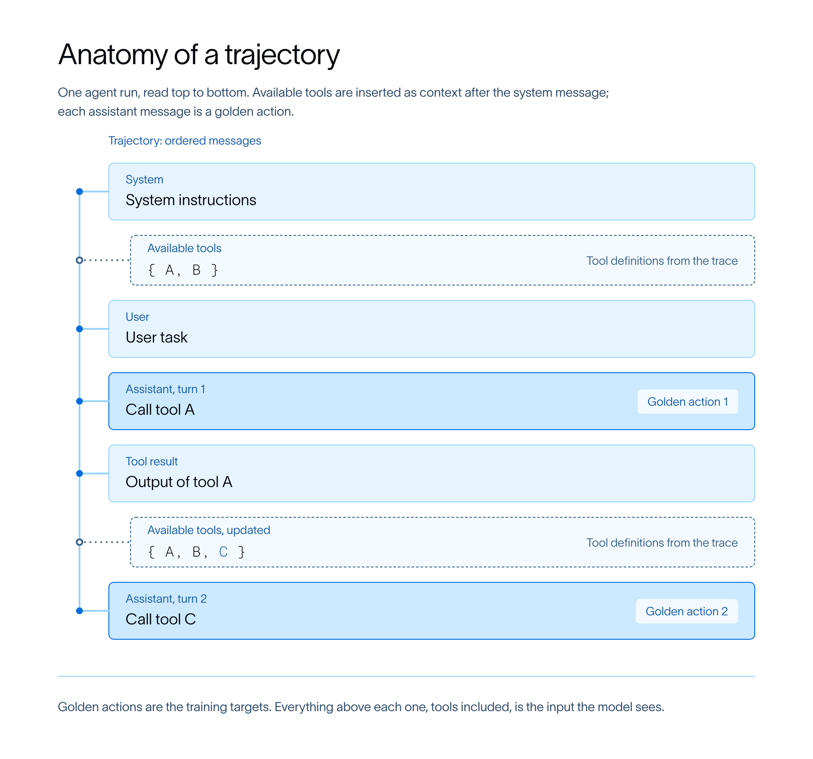
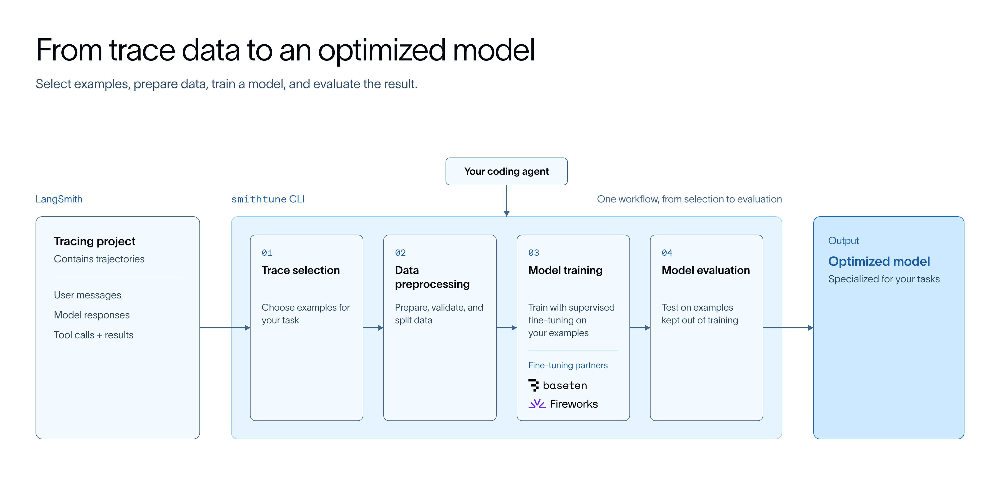

# Introducing LangSmith Fine-Tuning

> **来源**: [https://www.langchain.com/blog/langsmith-fine-tuning](https://www.langchain.com/blog/langsmith-fine-tuning)  
> **作者**: Ankush Gola Jake Broekhuizen Vivek Trivedy | **发布时间**: 2026-09-24T14:00:00+00:00  
> **标签**: Agent工程实现, 监督微调, 轨迹重放评估, 工具调用优化, LangSmith

---

## AI 导读

文章介绍了通过 LangSmith Fine-Tuning CLI（smithtune）利用 Agent 轨迹数据对模型进行监督微调（SFT）的端到端工程实践。该方案针对复杂 Agent 长期运行中工具可用上下文动态变化的特点，完整记录模型各轮次上下文以解决训练对齐问题，建立了拉取轨迹、Agent 委员会审查过滤、LoRA 微调和轨迹重放评估的流水线。实践证明，针对高频重复任务，高质量轨迹微调能使专业模型达到匹敌前沿大模型的表现并减少近 30% 的模型与工具调用开销；同时文章强调应优先进行 Harness 工程优化，在存在固定模式且有成功轨迹时再采用 SFT。

---

## 原文整理

## Key Takeaways

- Use the LangSmith Fine-Tuning CLI and skill - `smithtune` - to leverage agent trajectories stored in LangSmith to a fine-tuned model in one end-to-end workflow
- In addition to driving training, the `smithtune` CLI handles evaluating the fine-tuned model and uploads eval results to LangSmith for easy analysis
- We partnered with [Fireworks](https://fireworks.ai/) & [Baseten](https://www.baseten.co/) to create a seamless link between LangSmith trajectories and creation of a dataset for fine-tuning both the platforms

Today we're launching LangSmith Fine-Tuning and `smithtune`, a CLI that helps teams turn [LangSmith trajectories](https://www.langchain.com/blog/langsmith-trajectories-tracing) into custom fine-tuned models for their agents. It handles the entire fine-tuning process from one CLI: dataset creation and preparation from LangSmith trajectories, training with Fireworks or Baseten, and evaluation with LangSmith. You can run `smithtune` directly or work with your coding agent to run commands and inspect the results.

`smithtune`  is built for post-training models. It currently supports supervised fine-tuning (SFT) which trains a model using examples of good behavior. You give the model inputs/outputs and it learns by updating model weights to imitate that behavior. LangSmith trajectory data is designed to support SFT, and `smithtune` helps turn these trajectories into useful training data.

This gives teams a way to train specialized models without building the data pipeline by hand. A model trained on your examples can often perform as well as or better than a general purpose frontier model on specified tasks, often at lower cost and latency.

[Try LangSmith Fine-Tuning on GitHub](https://github.com/langchain-ai/smithtune) and have your coding agent drive the fine-tuning process end to end by installing the `smithtune` [skill from the repository](https://github.com/langchain-ai/smithtune/blob/main/src/smithtune/skills/smithtune/SKILL.md).

*One of the biggest drivers of fine-tuning gains is data selection. With the launch of `smithtune`, it’s easier to connect that loop — from curated production traces in LangSmith to managed training and a served model on Fireworks. Teams can move seamlessly from data to training to deployment without standing up infrastructure along the way. That’s the path we’re excited to be building with LangChain.*

– Pranav Jain, Product Lead at Fireworks

*`smithtune's` integration with Baseten Loops makes it seamless for teams to go from data collection to running fine-tuning experiments in minutes. Builders are able to continuously collect and curate better data to produce better models over time with the fully managed training infrastructure that Loops provides so they can focus on designing for their biggest customer use-cases.* 

– Aaron Ellis-Bloor, Applied Researcher at Baseten

## Agent trajectories and post-training

Before diving into the capabilities `smithtune` provides, let’s first discuss agent trajectories.

A trajectory is an ordered sequence of messages, tool calls, and tool results that shows how an agent worked through a task. [LangSmith](https://www.langchain.com/langsmith-platform) assembles this sequence from a trace or thread, brings supported message formats into a common representation, preserves tool definitions, and removes duplicated history.

LangSmith trajectory format was designed with post-training in mind. For SFT, the student model needs the exact context the teacher model had when it produced a successful result. In complex long-running agents, tool availability context often changes as the agent works (for example, [deferred tool loading](https://www.anthropic.com/engineering/advanced-tool-use)), and a naive export of the final message list loses that nuance. LangSmith's trajectory format records precisely what the model saw at every turn, so smithtune can pair each action with its true context.

`smithtune` uses trajectories throughout the workflow. You curate successful example trajectories, prepare them for your chosen model, and train on their recorded responses and tool calls. Trajectories kept out of the training split provide the context and reference actions for evaluation.

## Step-by-step walkthrough

### Build your dataset

A dataset contains ‘golden’ trajectories that a target model will fit to. This data is the foundation for supervised fine-tuning.

There are a few key stages when creating a dataset with `smithtune` :

1. **Pull Dataset:** `smithtune` pulls trajectories from a LangSmith tracing project to a local directory `DIR`, with optional filters.
2. **Label Traces:** `smithtune` works with humans (and their agents) to identify characteristics of “good” traces, create a rubric to based on this, and then sends a council of agents to review and filter trajectories that are good candidates for SFT
3. **Store a persistent dataset:** `smithtune` makes sure that any data used for training can be audited later as a persistent artifact.  It uploads the agreed on set of golden trajectories to a LangSmith dataset for training and evaluation.

Along the way `smithtune` handles details such as:

- making sure trajectories are compatible with a chosen model by filtering traces that are beyond a given sequence length
- splitting data into train/val/tests splits for downstream evaluation

### Train a model

Before committing to training, `smithtune plan` helps humans review their settings such as the selected model, the number of training examples, and hyperparameters like the learning rate, batch size, and epochs.

You can adjust these settings before running `smithtune train` to start the fine-tuning job.  `smithtune` submits the job to [Fireworks managed SFT](https://docs.fireworks.ai/fine-tuning/fine-tuning-models) or [Baseten Loops](https://www.baseten.co/blog/introducing-the-baseten-loops-sdk/) which support LoRA training on your prepared trajectories. There's no GPU provisioning or training infrastructure to manage on your side.  During training, `smithtune` also checks performance on the validation set and selects the saved checkpoint with the lowest validation loss.

### Evaluate the result

After training completes, run `smithtune evaluate` to compare the selected checkpoint with the base model.

`smithtune` uses a built-in replay evaluation to test the base vs fine-tuned model. Models are evaluated on being able to complete actions from a golden trajectory and a judge scores those predictions against the true recorded examples.

The CLI returns a LangSmith comparison link, with results appearing as evaluation progresses. You can compare scores, inspect individual responses and tool choices, and see where fine-tuning helped or introduced regressions.

### Deploy your model

If you’re happy with your evaluation results, use `smithtune deploy` to serve your tuned model and connect it to your application.

If the results aren’t what you were looking for, refine your dataset or adjust the training settings, then train and evaluate again. You can review the comparison in LangSmith with your coding agent to identify which responses or tool choices need more work.

## Results from running this in practice

To assess the quality of our `smithtune` flow, we applied it to two highly used agents at LangChain:

- [Engine](https://www.langchain.com/langsmith/engine) analyzes agent traces to find failures and group related issues. Using a stripped-down version of one of the agents in Engine, we tested whether SFT could improve its ability to identify and organize those problems.
- [OpenSWE Review](https://github.com/langchain-ai/open-swe) reviews code changes in our real-world repositories. We tested whether SFT could preserve review quality while reducing the work needed to find bugs.

### Engine: higher task performance through specialization

We curated a set of good trajectories and used them to fine-tune base Kimi K3. The base Kimi model was already strong, but we had exhausted our ability to push it or GPT-5.6 Sol further via harness engineering. The fine-tuned model scored well above both base Kimi and GPT-5.6 Sol on a subset of IssueBench, our internal benchmark for issue detection and grouping.

### OpenSWE Review: similar quality with fewer calls

We also evaluated Qwen-3.8-27B on an internal evaluation set of real pull requests used to measure code-review quality and bug detection. In this comparison, SFT raised F1 from **48.9% to 53.7%**, while using **29.8% fewer model calls** and **29.4% fewer tool requests**.

An earlier, less selective training set reduced the F1 score after SFT. We then went back to our data curation pipeline and added a review stage for each Trace, looking to oversample traces where agents thought potential issues actually existed.

The practical opportunity is similar review quality with fewer model and tool calls. This means a cheaper outcome per review and a faster time-to-review per PR.

## Considerations for post-training

### When SFT makes sense

SFT is especially useful when your application performs repeated tasks and you have examples of how it should behave. Look for consistent patterns you want the model to learn, such as following workflows, using tool results to decide what to do next, and verifying its work.

We recommend that teams start with harness engineering to understand if a better [harness](https://www.langchain.com/blog/the-anatomy-of-an-agent-harness) gives good performance. If agents still make recurring mistakes on tasks, and you have trajectories that show how to correctly do that task, then SFT is a great candidate to try.

### Data selection

We consistently find that the most successful post-training runs come from investing time into data selection for training.  `smithtune` explicitly helps users look at their data with agents and we find that having domain experts work with agents to review traces for SFT improves the chances of successful post-training runs

## Getting started with LangSmith Fine-Tuning

LangSmith Fine-Tuning is now available in Public Beta. To get started, you’ll need:

- A [LangSmith account](https://smith.langchain.com/) with traces from your agent
- An API key for [Fireworks](https://fireworks.ai/) or [Baseten](https://www.baseten.co/)
- [The `smithtune` CLI](https://github.com/langchain-ai/smithtune)

Try `smithtune` on GitHub, and let us know what you want to see next. We’d love your feedback as we keep improving fine-tuning workflows in LangSmith.
