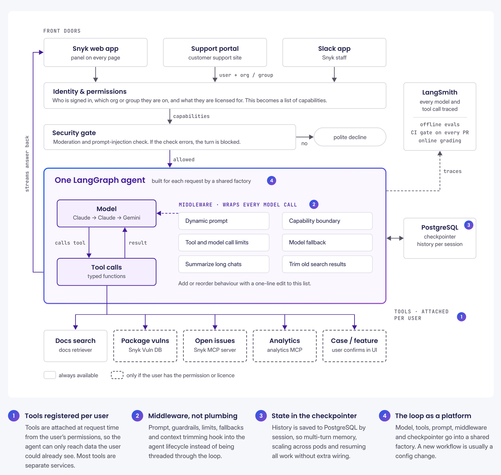

# How Snyk Turned an Internal Support Agent into a Customer Feature

> **来源**: [https://www.langchain.com/blog/how-snyk-turned-an-internal-support-agent-into-a-customer-feature](https://www.langchain.com/blog/how-snyk-turned-an-internal-support-agent-into-a-customer-feature)  
> **作者**: Oliver Armstrong | **发布时间**: 2026-10-08T22:31:00+00:00  
> **标签**: LangGraph, Agent架构, Agent可靠性与评测, 权限控制

---

## AI 导读

文章介绍了 Snyk 将内部客服支持 Agent（Snyk Assist）升级为面向客户的核心产品功能的工程实践。针对客服规模化瓶颈及安全平台对可靠性、权限控制的高标准要求，团队采用统一的 LangGraph 运行时支撑多端接入，通过中间件解耦上下文管理与 Guardrails，基于用户身份在请求时动态挂载工具微服务，并利用 PostgreSQL Checkpointer 管理多轮会话状态；同时构建了覆盖离线测试、CI 门禁与在线评估的双层 LangSmith 评测体系。上线后累计处理逾 6 万次查询，实现超过 85% 的工单分流率，验证了分阶段发布与严密评测闭环在保障企业级 Agent 可靠性方面的有效性。

---

## 原文整理

## Key Takeaways

- **We started with a real customer pain point.** Snyk Assist was built to make it easier for customers to get fast, accurate answers without having to search across docs, support content, and account systems.****
- **We treated trust and access control as core product requirements.** Because Snyk is a security platform, the agent was designed to stay within a user’s permissions and to prove it was safe, reliable, and correct before broader rollout.****
- **We built it to be useful, measurable, and scalable.** A single LangGraph runtime powers multiple surfaces, while LangSmith evaluations help the team catch regressions, improve responses, and keep shipping with confidence.

Snyk is an AI Security Platform. Its platform finds and fixes vulnerabilities in code, open source dependencies, containers and cloud configuration, and they sit inside the places developers already work: the IDE, the pull request, and the pipeline.

We build security products for developers, which means our customers ask hard, specific questions. They want answers about vulnerabilities, account context, support issues and product behavior, often in the middle of real work. Before Snyk Assist, this information was spread across product documentation, support articles, release notes, learning content and account data. Finding the right one usually meant reading several pages or filing a ticket and waiting.

Snyk Assist is a conversational agent built on LangChain and LangGraph with observability managed in LangSmith. It helps customers find answers in plain language and can take action on their behalf. It can look up open issues, check a package for known vulnerabilities, open a support case from the conversation, or log a feature request when we don’t yet support the requested workflow they need.

It began as an internal tool for our own support team. In September 2026, we moved it into the core Snyk product, where every paying customer can access it.

In this post, we share how we built Snyk Assist, from the original internal support use case to the customer-facing product experience. We also cover the architecture behind it, including how we handled permissions, state, guardrails, and evaluation as we scaled it.

## The challenge: support that didn’t scale, and a high bar for shipping AI

Our support team handles thousands of cases every couple of weeks. Each one had to be read, classified by product, severity and owner, and routed to the right place. This presented a scaling challenge as customer inquiries grew. An agent was the obvious fix, but because we build security software, anything we put in front of customers needs to meet the same standards we expect from the rest of our product. We needed to prove three things: that the agent answered correctly, refused what it should refuse, and never returned anything the user wasn’t already allowed to see.

*“The hard part of building agents isn't what the model can do, it's proving the agent actually works. We run every change through evals in LangSmith, and if it doesn't clear the bar, it doesn't ship."*

*—Bailey Millns, AI Engineer, Snyk*

Rather than launch directly inside the product, we started by testing internally with our own team. This approach ensured that any initial errors remained within Snyk rather than impacting paying customers. It also allowed us to safely test riskier features and observe the agent's behavior before a broader rollout.

This internal phase enabled us to establish our operating model using LangSmith before introducing customer-facing features. Every trace from these early sessions fed directly into our evaluation sets, giving us a strong understanding of how the agent would perform by the time we launched it in the support portal.

**Phase 1: internal tooling**

For roughly a year, Snyk Assist ran as an internal tool for the customer support team as both a case triage and a virtual agent, with Snyk staff as the only users. Internally testing the agent enabled us to surface edge cases that didn’t show up in offline testing and the feedback loop was measured in hours rather than release cycles.

**Phase 2: the support portal**

In April 2026 we launched Snyk Assist to customers in our support portal. At that stage, it could greet users by name, understand account context, run a health check on login, and raise a ticket any time of day without waiting for a human to step in.

**Phase 3: the core product**

On 1 September 2026, Snyk Assist moved into the core Snyk product, alongside our new navigation, as a panel at the top bar of every page, for every paying customer.

We kept the same agent runtime through each phase. The only thing that changed was the surface in front of it.

## One runtime, many front doors

Snyk Assist is a single LangGraph agent behind several surfaces: a Slack app, a web app and direct API access, all routed through the same secured framework.

We chose LangChain because of its extensive community, robust ecosystem, and status as the industry standard for building agents.

*“LangChain had the largest community and ecosystem by far, and was quickly becoming the de facto standard for building agents. “*

*—Jada Ross, AI Engineer, Snyk*

Operating as a small team, we wanted a single runtime so we could fix bugs, ship features, and handle incident responses from one place. This simplicity enabled us to scale quickly without fragmenting our architecture.

Additionally, using LangChain’s middleware instead of building a custom solution provided defined integration points for context, guardrails, and model fallbacks. This setup allows us to update or reorder functionality with simple, one-line edits rather than extensive code rewrites.

Here are the four design decisions that made the system practical to run in production:

1. **Tools as typed functions, registered per user**. We attach tools at request time based on the permissions the signed-in user actually has. That means the agent can only access data the user could already see. Most tools are separate microservices, which lets us scale them independently and add capability without changing the agent loop.
2. **Middleware instead of plumbing.** Context management, guardrails and model fallbacks hook into defined points in the agent lifecycle instead of being threaded through the loop by hand. Adding or reordering behaviour only requires a one-line change to a list, not a full rewrite.
3. **State handled by the checkpointer.** Conversation history is persisted in PostgreSQL and keyed by session, so multi-turn memory, scaling across pods, and resuming a conversation all work without extra wiring.
4. **The loop as an internal platform**. Because an agent is just a model, tools, a prompt, middleware and a checkpointer, a shared factory returns the compiled graph and each team supplies its own configuration. Most new workflows are a config change rather than a new architecture.

*“From a development POV, LangChain gave us a batteries-included agent abstraction so we could focus on the impact and capability of our agent, instead of reinventing orchestration, tool-calling, streaming, and state.”*

*—Matt Jarvis, Director of AI Engineering, Snyk*

## How we evaluate every change

Every model call, tool call and decision point has been traced in LangSmith from the first day of development. That trace became the basis for how we ship.

We use two layers of evaluation.

**Offline evaluation** runs sets of test questions in LangSmith. The first is real questions with known good answers, marked by a second model, so we can tell quickly if a prompt or model change made the answer quality worse. The second is an automated red-teaming exercise where people try to trick the agent into ignoring instructions or handing over secrets.

**CI as a gate** means every pull request runs the real agent against those suites and blocks on agreed thresholds committed to the repo.

**Online evaluation** grades every production run with a scheduled job. We check two things: was this about Snyk and did the response answer it? Those grades give us a measured deflection rate rather than an estimate. We also categorise each question by product area, topic, language ecosystem and error type, giving product managers a live map of where customers are struggling.

**Closing the loop** happens inside our coding agents through the LangSmith MCP server. When we find a bad trace, we can investigate it and turn it into a dataset without leaving the IDE.

Because every step is traced in LangSmith, we can test changes against real questions, catch regressions before they ship, and turn bad traces into new datasets quickly. That gives us a faster feedback loop and makes it much easier to ship with confidence.

## The impact: fewer tickets, faster answers

Since Snyk Assist went live to customers in April 2026:

- **60,000+ queries handled**
- **500+ customer accounts**
- **85%+ of sessions resolved without a support ticket, saving the support team hundreds of hours**
- **250+ cases auto-detected by the agent and escalated straight to the right team**

Every conversation gets graded and categorized, so we can see which parts of the product create the most confusion. That helps us improve documentation.

## Key takeaways and what’s next

Snyk Assist began as a tool for Snyk’s own support team. Today, it has handled more than 60,000 customer queries and resolves over 85% of sessions without creating a support ticket.Since September, Snyk Assist has been part of the product itself, available on every page alongside the work customers are already doing. We want it to be a useful part of the Snyk experience for every customer.

Link: [https://docs.snyk.io/navigate-the-snyk-web-ui#snyk-assist](https://docs.snyk.io/navigate-the-snyk-web-ui#snyk-assist)
