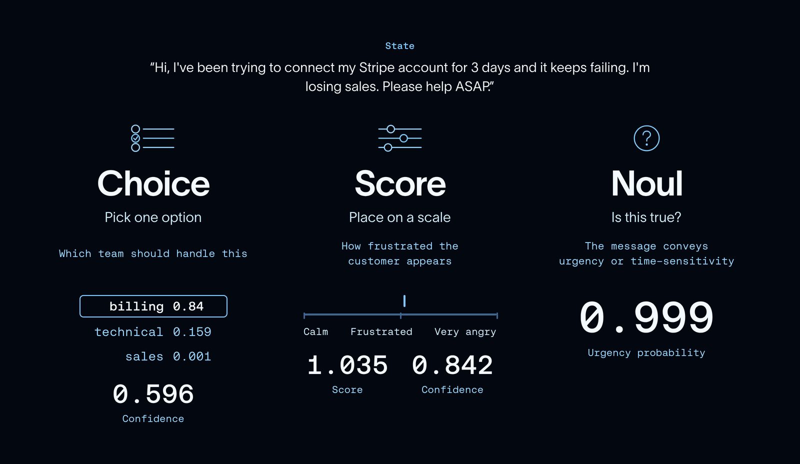

# What Is Jev? A Guide to TypeSafe AI’s System One Model

> **来源**: [https://www.langchain.com/blog/building-a-harness-with-jev](https://www.langchain.com/blog/building-a-harness-with-jev)  
> **作者**: Sydney Runkle Hunter Lovell | **发布时间**: 2026-09-18T00:15:00+00:00  
> **标签**: Agent架构, LangChain, 模型路由, 安全护栏

---

## AI 导读

文章介绍了 TypeSafe AI 推出的非生成式 System One 模型 Jev，旨在解决传统 Agent 循环中频繁调用 LLM 导致的延迟高、成本大及工具执行潜在不可靠问题。通过接收状态并并行评估结构化问题输出类型化概率，Jev 能以 LangChain 中间件形式嵌入 Agent 流程，实现根据任务复杂度动态路由底层模型，以及在工具执行前拦截高风险操作。该方案体现了生成模型负责推理生成、轻量判别模型负责快速决策与安全护栏的 Agent 工程协作架构。

---

## 原文整理

Agents run in a loop: an LLM decides what to do, a tool executes, a model evaluates the results, and then continues in that loop until the task is complete.

Agents and LLMs were initially difficult to integrate into software applications, which depend on structured data and predictable interfaces. Two primitives emerged that made this much easier:

- [**Tool calling**](https://openai.com/index/function-calling-and-other-api-updates/) let models make structured requests and receive structured results.
- [**Structured outputs**](https://www.youtube.com/watch?v=yj-wSRJwrrc) let models return restructured results.

But even with those in place, the agent loop is still **slow** and **costly**: every decision requires another model call.

Enter, [Jev](https://x.com/CompleteSkeptic/status/2099925682726002904). Jev is a new model [released from TypeSafe AI](https://typesafe.ai/blog/introducing-system-one-models-and-jev). The company reports up to **200x faster inference and 400x lower cost** than comparable LLMs on classification tasks.

This post covers how Jev works, where it fits into the agent loop, and how to use it with LangChain.

## All about Jev

Jev is actually not a traditional LLM, it doesn’t generate text. It’s what the TypeSafe AI team calls a System One model:

📖 System One models are a class of AI models built to make fast, structured decisions that software can use directly. A System One model evaluates a [**state**](https://docs.typesafe.ai/concepts/state) and returns typed answers and probabilities.

It’s trained using [reinforcement learning for calibrated decisions (RLCD)](https://typesafe.ai/blog/introducing-system-one-models-and-jev). Your code uses those results to guide what an agent does next, without a full chat LLM call for each decision.

To invoke a Jev model, you send it a **state** (the context) and **questions** about that state. Here’s a single-question version of the support-ticket example in [their docs](https://docs.typesafe.ai/introduction/quickstart):``

```
{
  "model": "jev-latest",
  "state": "Hi, I've been trying to connect my Stripe account for 3 days and it keeps failing. I'm losing sales. Please help ASAP.",
  "questions": {
    "is_urgent": {
      "type": "noul",
      "instructions": "The message conveys urgency or time-sensitivity"
    }
  }
}
```
The docs’ example gives this urgency answer, shown here without the rest of the response:``

```
{
  "is_urgent": {
    "type": "noul",
    "noul": 0.999
  }
}
```
That’s a 99.9% probability that the message is urgent, which your application can use to prioritize the ticket.

There are three types of supported [questions](https://www.youtube.com/watch?si=L1qd4LT9W-W67mar&t=216&v=2Bs0Ink_-Uo&feature=youtu.be):



- **Choice:** Pick from a set of options. Returns a probability for each option and an overall confidence score.
- **Score:** Rate an input against ordered levels, such as low, medium, and high. Returns a continuous score, the underlying distribution, and a confidence value.
- **Noul:** Answer a yes-or-no question. Returns the probability that a statement is true.

One key feature here is that you can ask multiple questions about the same state in one request.

💡 System One models evaluate every question in a request in parallel. Adding questions barely changes the response time and costs only the tokens for the extra questions, which are cheap.

For an example of asking multiple questions about a support ticket, see the [TypeSafe Quickstart](https://docs.typesafe.ai/introduction/quickstart#request-body).

In sum, unlike traditional LLMs, Jev is neither constrained by text generation or sequential decision making!

## How to Use Jev with LangChain

LangChain's provider agnostic model is well suited for supporting Jev alongside thousands of other integrations and model providers.

The [LangChain integration](https://docs.langchain.com/oss/python/integrations/providers/typesafe#quickstart) exposes Jev through `TypeSafeClassifier`. You pass your state and questions to `.invoke()`, and get classification results rather than a chat response.

Install `langchain-typesafe` and set your `TYPESAFE_API_KEY`, then make a call:``

```
from langchain_typesafe import Noul, TypeSafeClassifier
classifier = TypeSafeClassifier()
response = classifier.invoke({
    "state": (
        "The deploy failed twice and customers are seeing 500s. "
        "Can someone look now?"
    ),
    "questions": {
        "urgent": Noul(
            instructions="Does this need attention right now?"
        ),
    },
})
urgency = response.nouls["urgent"].noul
```
The state can be text, structured data, or LangChain messages. That makes it straightforward to call Jev from a node or middleware hook using the context your agent already has.

You can build this into custom middleware or tools!

## Use Cases

Jev isn’t a drop-in replacement for an LLM. It doesn’t generate text, but it can handle classification tasks we often use LLMs for today, without the same latency and cost. That makes it a promising complement to the model driving your agent: use an LLM for open-ended reasoning and generation, and Jev for fast, structured decisions along the way.

### **Model routing**

A simple lookup doesn’t need the same model as a difficult debugging task. [Model-routing middleware](https://docs.langchain.com/oss/python/integrations/providers/typesafe#model-routing) lets Jev assess the request and choose a model based on criteria you define, so fast and inexpensive for straightforward tasks, more capable for complex ones.``

```
from langchain.agents import create_agent
from langchain_typesafe.experimental.middleware import (
    ModelChoice,
    ModelRouterMiddleware,
)
router = ModelRouterMiddleware(
    choices={
        "fast": ModelChoice(
            model="openai:luna",
            criteria="Direct lookups, extraction, and localized changes.",
        ),
        "powerful": ModelChoice(
            model="openai:sol",
            criteria="Architecture and high-stakes decisions.",
        ),
    },
    instructions="Choose the least costly model that can complete the task.",
)
agent = create_agent("openai:gpt-5.6-luna", middleware=[router])
```
``The router selects a model from the latest user message and uses it throughout the run. The probabilities and confidence remain available in agent state, too.

### **Auto Mode**

Agents are still inherently untrustworthy. An agent can receive bad instructions (either naturally or from a motivated enough attacker) which can persuade it into taking actions we didn’t want it to.

Coding harnesses like claude, codex, cursor have shipped some kind of way to classify dangerous actions *before* they’re taken which has slowly helped to build trust in agents. Up until now, this classifier step has been locked away in the closed source parts of the harness.

Now that a cheap and performant classifier model exists, we can take the same pattern and adopt it to all agents!``

```
from langchain.agents import create_agent
from langchain_typesafe.experimental.middleware import (
    AutoModeMiddleware,
)
guardrail = AutoModeMiddleware(tools=["bash"])
agent = create_agent("openai:gpt-5.6-luna", middleware=[guardrail])
```
``[AutoModeMiddleware](https://docs.langchain.com/oss/python/integrations/providers/typesafe#tool-risk-gating) uses Jev to check tool calls for risky decisions it may take, and block calls before the tool executes.

## Get Started!

We're pretty thrilled about Jev and the possibilities that come with it. A few cool projects that we’ve seen already: [Kyle Jeong](https://x.com/kylejeong/status/2100622054945095934) from Browserbase is powering browser use agents for fractions of a cent, [Jarrod Watts](https://x.com/jarrodwatts/status/2100356151468585346) built a live trading agent, and [Ryan Vogel](https://x.com/ryanvogel/status/2100042788851101842) is doing email triage at scale.

New models drop every week at this point, but this one had a pretty outsized response. We’re excited to see what you build with LangChain and Jev.

Let us know what you think on the [forum](https://forum.langchain.com/), tag us on [X](https://x.com/LangChain?lang=en) and share what you’re building, or engage with [LangChain issues](https://github.com/langchain-ai/langchain)!
