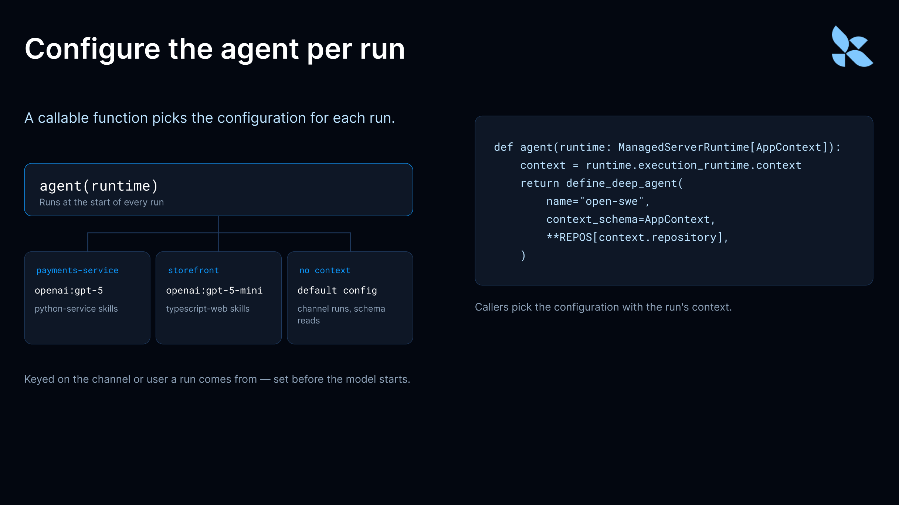

# What's New in Managed Deep Agents: schedules, per-run configuration, and Slack reactions

> **来源**: [https://www.langchain.com/blog/managed-deep-agents-schedules-per-run-configuration-slack](https://www.langchain.com/blog/managed-deep-agents-schedules-per-run-configuration-slack)  
> **作者**: Nathan Drezner | **发布时间**: 2026-10-07T18:30:00+00:00  
> **深度调研**: [查看专题调研报告](research.md)  
> **标签**: AI Agent, 工程实现, 动态配置, 任务调度

---

## AI 导读

本文介绍了 LangChain Managed Deep Agents v0.9 的核心工程特性：1）Schedules SDK，支持 Agent 在对话中自主创建单次或周期性 Cron 定时任务；2）按运行动态配置（Per-run configuration），允许单次部署根据上下文（如渠道或仓库）在模型执行前动态加载对应的模型、Instructions、Skills 和 MCP 服务器，解决多场景重复部署与大模型非确定性工具选择问题；3）Slack 消息 Reaction 机制，优化长耗时推理的用户交互反馈。核心结论在于：在 Runtime 启动前依据上下文静态约束 Agent 工具集，比单纯依赖 Prompt 指导更具确定性与可靠性。

---

## 原文整理

## Key Takeaways

- **Agent-created schedules:** agents can set up reminders and recurring tasks from a conversation.
- **Per-run configuration:** one deployment can pick its model, skills, and tools for each run.
- **Slack reactions:** agents acknowledge messages before they reply.

Today we're releasing Managed Deep Agents v0.9, with new capabilities that let agents schedule their own follow-ups, reconfigure themselves on every run, and react to Slack messages.

These updates make it easier to build internal agents that live in Slack or your own channels and work more like teammates.

## Let agents schedule their own work

The [new Schedules SDK](https://docs.langchain.com/langsmith/python/managed-deep-agents-schedules#create-schedules-at-runtime) lets agents create reminders, follow-ups, and recurring tasks mid-conversation, so they can handle requests like "Remind me about this tomorrow."

The agent creates the schedule itself during a conversation, the schedule runs as the person who asked using their set of permissions and connections, and results come back to the same channel.

Create a schedule from inside a run:

`await schedules.create(owner={"type": "user"}, cron="0 9 * * 1-5", timezone="America/Los_Angeles", prompt="Write the daily digest.")`
It’s most useful behind a tool, so your agent’s users can create, list, update, and delete schedules just by chatting. Here’s a reminder tool:

```
from langchain.tools import tool
from managed_deepagents import schedules
@tool
async def remind_me(prompt: str, cron: str, timezone: str = "UTC") -> str:
    """Run a prompt for the current user on a cron schedule."""
    item = await schedules.create(
        owner={"type": "user"},
        cron=cron,
        timezone=timezone,
        prompt=prompt,
    )
    return f"Created schedule {item['id']}."
```
The agent passes a prompt and a cron expression, and each time the cron fires, LangSmith starts a new run with that prompt. Schedules inherit the channel they were created in, so results post back where the request came from: a weekday reminder requested in Slack posts a new message to that conversation on every run. One-time schedules (`at` instead of `cron`) reply in the original thread, which suits follow-ups like "check on this deploy in an hour."

## Configure agents per run

An agent can now be configured dynamically [per run](https://docs.langchain.com/langsmith/python/managed-deep-agents-agent-definition#select-configuration-per-run). Set up the agent as a callable function: it receives the [runtime](https://docs.langchain.com/langsmith/python/managed-deep-agents-runtime) at the start of each run and returns a `define_deep_agent` definition, choosing the model, instructions, skills, MCP servers, and sandbox for that run.

Instead of maintaining a near-copy of the same agent for every team or repo, you run one deployment. This enables your deployment to operate more flexibly, in which a single agent deployment can be customized for different teams or use cases based on the context, such as the channel or user that originates the request.



Say one internal Slack agent serves several teams. Your agent function can check which channel a run came from and load billing skills for finance, or an incident-response MCP server for the platform team. That’s different from instructions telling the model when to use a skill: the configuration is set before the model runs, so the agent never sees skills or MCP tools outside its configuration. That keeps its context small, doubles as access control, and lets you pick the model itself, which the model can’t do.

In general, it prevents non-deterministic outputs where the model is tasked with choosing the toolkit in cases where we know exactly what set of tools should be available to the agent.

The same idea works for a coding agent that loads different skills and a cheaper or more capable model for each repository:

```
# agent.py: one coding agent, configured per repo at the start of each run
from dataclasses import dataclass
from managed_deepagents import ManagedServerRuntime, define_deep_agent
REPOS = {
    "payments-service": {
        "model": "openai:gpt-5",
        "instructions": "Python service. Run pytest before opening a PR.",
        "skills": ["./skills/python-service"],
    },
    "storefront": {
        "model": "openai:gpt-5-mini",
        "instructions": "Next.js app. Run web tests and an a11y check before opening a PR.",
        "skills": ["./skills/typescript-web"],
    },
}
@dataclass
class AppContext:
    repository: str = ""
def agent(runtime: ManagedServerRuntime[AppContext]):
    execution = runtime.execution_runtime
    context = execution.context if execution is not None else None
    repo = context.repository if context is not None else None
    config = REPOS.get(repo, REPOS["storefront"])
    return define_deep_agent(name="open-swe", context_schema=AppContext, **config)
```
``

The function reads `runtime.execution_runtime.context` and falls back to a default when there is none, such as on channel runs or when Agent Server loads the agent to read its schema. Callers pick the configuration with the run’s `context`:

```
# Same deployment, different repo: just change the run context
await client.runs.create(
    thread_id,
    "open-swe",
    input={"messages": [{"role": "user", "content": "Fix the flaky refund test."}]},
    context={"repository": "payments-service"},
)
```
## React to Slack messages

[Slack reactions](https://docs.langchain.com/langsmith/python/managed-deep-agents-channels-slack#react-to-the-message-that-starts-a-run) show the sender right away that the agent picked up their message, even while it spends a while reasoning and calling tools before it replies. Reactions are on by default (👀), and the new `reactions` option on your Slack channel lets you turn them off, pick another emoji, or choose one per message. This example uses 🐛 when a message mentions something broken, and 👀 otherwise:

```
from managed_deepagents import channels
async def choose_emoji(context: dict) -> str:
    return "bug" if "broken" in context["text"].lower() else "eyes"
channel = channels.slack(name="Support Bot", reactions=choose_emoji)
```
Reactions can be simple. However, it is possible to configure your reaction response with a function that calls a model to pick a more precise emoji. A decision model like Jev keeps that fast and cheap; the [Slack channel docs](https://docs.langchain.com/langsmith/python/managed-deep-agents-channels-slack#choose-the-emoji-with-a-decision-model) walk through a full example.

## Getting started

Managed Deep Agents v0.9 is available in Public Beta today. You can learn more in the [Managed Deep Agents docs](https://docs.langchain.com/langsmith/python/managed-deep-agents-overview), or get started with:

```
uvx --from managed-deepagents mda init my-agent
cd my-agent
uv run mda deploy
```
``ICYMI: v0.8 added per-user memory, custom HTTP channels for triggering runs from any service, built-in web search powered by Parallel, and more. [Read the v0.8 post](https://www.langchain.com/blog/langsmith-managed-deep-agents-whats-new).
