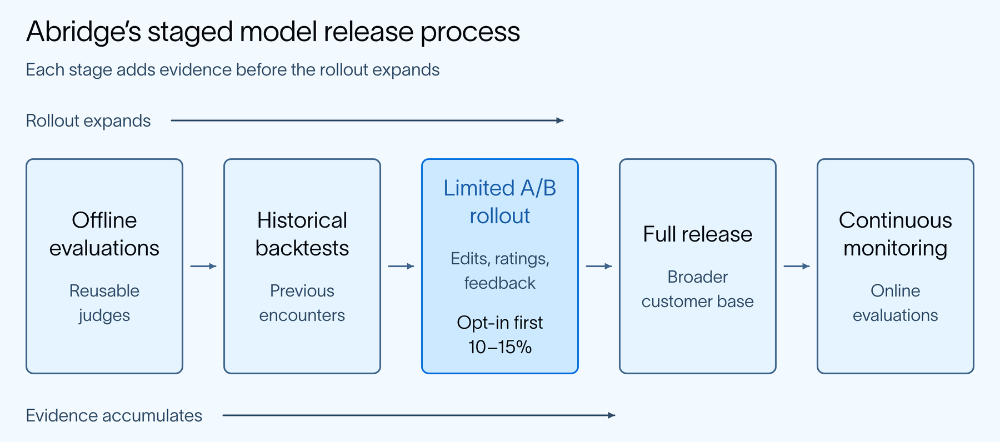
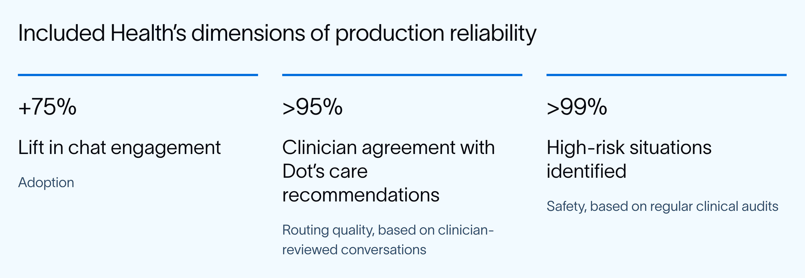

# The Reliability Layer for Healthcare AI: Common LangSmith Use Cases

> **来源**: [https://www.langchain.com/blog/reliability-healthcare-ai-langsmith-use-cases](https://www.langchain.com/blog/reliability-healthcare-ai-langsmith-use-cases)  
> **作者**: Morgan Lo | **发布时间**: 2026-09-22T17:00:00+00:00  
> **深度调研**: [查看专题调研报告](research.md)  
> **标签**: AI Agent, 可靠性工程, 大模型评估, 发布门禁, LangSmith

---

## AI 导读

文章介绍了在医疗 AI Agent 生产落地中将临床专家评估转化为可持续评估基础设施的工程实践。针对专家评估时间稀缺与单次反馈成本高的问题，方案通过组合无参考与有参考两级评估器、利用提示词优化自动生成评估器、依托 LangSmith 标注队列沉淀结构化数据，并将评测嵌入离线、回测、静默 A/B 灰度与生产监控的多阶段发布门禁中。实践表明该架构帮助 Abridge 将发布周期从 1-2 个月缩短至数天，并保障了 Included Health 在两周内无回归完成多轮 Agent 架构迁移，验证了基于评估基础设施保障 Agent 可靠性的可行性。

---

## 原文整理

## Key Takeaways

- LangSmith lets teams turn clinical review into labels, evaluators, and datasets they can reuse across future releases, instead of starting over each time.
- Abridge uses LangSmith to run evaluations, helping to cut its release cycle from one to two months down to a few days.
- Included Health uses LangSmith to monitor routing quality and safety for its AI health guide. Following launch, chat engagement increased 75%, and the system correctly flagged more than 99% of high-risk situations.

In healthcare, the best judges of whether an AI system works correctly are the people whose time it was built to protect. A clinician can quickly tell if a generated note correctly attributes a symptom or a patient was recommended the most appropriate level of care. But they cannot perform this review across thousands of encounters indefinitely. At scale, expert validation becomes the limiting factor.

Healthcare teams have approached this challenge in different ways, but many share one principle: they treat clinical review as infrastructure rather than a recurring operational cost. This blog covers how two organizations, building AI healthcare products in different ways, converge on evaluation practices. Using [LangSmith](https://docs.langchain.com/langsmith/observability), they convert expert input into durable assets such as labeled datasets, calibrated evaluators, and automated release gates. The goal is not to eliminate human judgment, but to make its value compound.

You’ll explore:

- How scarce clinical expertise can be transformed into long-lasting evaluations
- How reusable evaluations enable faster releases while maintaining trust and safety
- Current evaluation challenges, such as protected health information (PHI) handling and drift

.png>)

## The challenges of AI evaluations in healthcare

Healthcare AI agents operate across various workflows, such as patient care decisions and visit documentation.

**Included Health** built Dot, an AI guide powered by [LangGraph](https://docs.langchain.com/oss/python/langgraph/overview) and [Deep Agents](https://docs.langchain.com/oss/python/deepagents/overview). It interprets ambiguous member needs, answers coverage and billing questions, routes people to appropriate care, and detects emergencies. A question about whether a scan is covered may reveal, several turns later, that the member actually needs to speak with a primary care physician. Evaluating Dot means both checking its accuracy and whether it used the member's full context to recommend a safe and appropriate next step.

**Abridge** transforms patient-clinician conversations into clinical notes. With a patient's consent, a physician records the visit, and Abridge converts the conversation into a note that becomes part of the longitudinal health record and supports billing. In this setting, attribution is critical. If a patient's observation is presented as a physician's conclusion, a symptom can become a billable diagnosis. Hallucinations create a different risk: a medication or dosage that was never prescribed can enter the record. A trustworthy note must preserve who said what, capture what matters clinically, and introduce nothing the conversation does not support.

These systems fail in different ways, but both teams use LangSmith to address the same constraint: accuracy is determined by someone outside the engineering team, and that person's time is often the scarcest resource in the system.

That makes expert review both indispensable and a potential bottleneck. As the Abridge team puts it: “trust is earned in drops and lost in buckets.” The goal is to make each expert judgment reusable across future tests, releases, and iterations.

### The gaps clinical review must close

Before clinical judgment is encoded into automated evaluations, teams must first define exactly what experts are evaluating. Three properties make that judgment difficult to scale.

**Ground truth is rarely singular.** A clinical note does not have one canonical form*.* What belongs varies by specialty, encounter, and clinician, and reasonable experts can disagree. Reference notes are useful, but treating a single reference as the only correct answer can penalize valid variation while still missing clinically important errors.

**Correct inaction matters.** Healthcare teams must evaluate whether a system acted correctly and if it recognized when not to act. For instance, Included Health's reviewers check that emergency guardrails trigger when appropriate and remain inactive in benign cases. For example, Abridge tests whether its agent stays within its boundaries and selects the tools a clinician would expect.

**Reviewer expertise is part of the specification.** Abridge determines upfront whether an evaluation requires a board-certified physician or a particular specialist. A judge is only as good as the judgments that calibrated it.

None of this makes clinical judgment impossible to automate. It simply defines the requirements for doing so responsibly: tolerance for valid variation, attention to what did not happen, and the right expertise behind every label.

### Converting clinical expertise into durable artifacts

Once teams have defined the judgment they need to preserve, they can begin converting expertise into infrastructure. Abridge converts clinician input into labeled datasets and calibrated judges that keep working after an individual review ends.

Abridge begins with known failure modes from clinician and user feedback. The team ranks them by prevalence and severity, groups them into categories such as accuracy, compliance, style, and completeness, and builds a separate judge for each. Rather than produce one general quality score, the evaluators test for specific ways a note can fail.

The time savings come from automating what happens after they've provided their judgment*.* Previously, a clinician wrote an annotation guide and labeled encounters, then someone manually adjusted the judge’s prompt until its scores matched those labels. Abridge now feeds the same guide and examples into an automated prompt optimization framework that generates the judge.

Because no single reference can capture every valid note, Abridge layers two approaches with complementary strengths:

- [**Reference-free judges**](https://docs.langchain.com/langsmith/online-evaluations-llm-as-judge) score a note directly against its source conversation. Needing no reference to compare against, they generalize across encounters and can run both during development and continuously in production.
- [**Reference-based judges**](https://docs.langchain.com/langsmith/evaluation-types#offline-evaluation-types) compare the output with curated examples and can be tailored to a medical specialty, capturing context and nuance that broader judges miss.

Together, they balance breadth and precision: one provides scalable coverage across encounters, while the other captures the specialty-specific nuance that clinical review demands.

An optimized judge still must be validated against clinician annotations. [LangSmith’s Align Evaluator](https://docs.langchain.com/langsmith/improve-judge-evaluator-feedback) gives teams an interface for comparing the two and investigating disagreements. Abridge separately asks annotators to explain their decisions, even when the output is correct. Those explanations help resolve inconsistencies and confirm the labels reflect careful review.

The result is an evaluation system that can be inspected, recalibrated, and reused. By turning individual judgments into durable evaluators, teams reserve scarce clinical expertise for the cases where it adds the most value. Production review supplies the new cases and feedback that keep those standards current.

## Closing the evaluation loop with production review

Calibrated judges apply judgment the team has already captured. Production review supplies the next round of that judgment, revealing how the system behaves in real conversations and generating evidence for what to fix.

Included Health shows how that new evidence enters the loop. Conversations go into a [LangSmith annotation queue](https://docs.langchain.com/langsmith/annotation-queues), where clinical reviewers assess whether Dot directed the member to the right care setting, whether its emergency guardrails behaved appropriately, and whether the case requires follow-up.

Those decisions become structured labels that are exported to Included Health's data warehouse, where the data science team uses them to build operational dashboards. They also feed back into the skill definitions that govern how Dot navigates members. Each review is spent once and used three times.

The result is a powerful feedback loop. Clinical judgment becomes data, the data guides product changes, and those changes are tested against the same standards before the next release. Every review contributes to both the case at hand and the system’s future behavior.

### Turning evaluation into a release gate

The feedback loop pays off at release time. Instead of evaluating every candidate change from scratch, teams can test it against evidence they have already captured.

At Abridge, a model change moves through progressively more realistic stages: offline evaluations, backtesting against historical encounters, a limited A/B test, full release, and continuous production monitoring. Each stage adds a different kind of evidence.

The A/B test is the most unusual step in this process. Some of Abridge’s partners agree to be among the first 10 to 15% of customers included in a silent rollout. This lets Abridge observe signals automated judges cannot provide: whether clinicians edit the generated notes, how they rate them, and what qualitative feedback they share. Offline evaluations establish whether a change is ready for limited exposure; production behavior determines whether the rollout should expand. That process reduced Abridge’s release cycle from one or two months to a matter of days.

Included Health applied the same principle to an architectural change. Moving Dot’s supergraph to Deep Agents affected four product teams, all wary of breaking changes. The team ran its existing multi-turn simulation suite, confirmed that performance held, and completed the migration in under two weeks without significant regressions.

In both cases, release confidence became cumulative. Rather than re-establish trust with every change, teams could build on evidence they had already collected.

## **Measuring reliability in production**

A faster release cycle matters only if the system performs reliably once it reaches real users. Included Health measures performance across three dimensions: adoption, routing quality, and safety.

Each metric answers a different question: *Will members use the product? Does it direct them to appropriate care? Does it recognize situations that require urgent attention?* Looking at them together gives the team a more complete picture of production reliability.

Following Dot's launch, Included Health reports a 75% lift in chat engagement. Among the graded conversations, clinician agreement with Dot’s care recommendations remains above the team’s 95% target, and clinical audits show that Dot identifies more than 99% of high-risk situations.

At Abridge, labeled encounters calibrate judges that run against future releases; at Included Health, clinical labels outlive the conversation that produced them. The artifacts still require review and recalibration, but the expert judgment behind them is no longer consumed by a single decision.

## **PHI in the evaluation pipeline**

The same artifacts that make clinical judgment reusable—encounter traces, conversation histories, and clinician annotations—can also contain protected health information. Once teams begin storing and reusing them, security and deployment architecture become part of the evaluation design.

Abridge treats self-hosting, access controls, and auditability as requirements for its evaluation infrastructure. They also remove identifying information from conversation data before using it for learning. These are not controls to add after the evaluation pipeline is built; they shape what data can enter it in the first place.

LangSmith supports managed [cloud](https://docs.langchain.com/langsmith/cloud), [bring-your-own-cloud](https://docs.langchain.com/langsmith/byoc), and [self-hosted](https://docs.langchain.com/langsmith/self-hosted) deployments. Teams must decide where evaluation data will be stored, who can access it, which audit and retention controls apply, and how traces containing PHI will be handled.

## **Making trust repeatable**

Trust builds slowly in healthcare AI. It grows with every encounter handled correctly, every guardrail, and every regression caught before it reaches users. Yet one change that escapes those checks can undo it.

Healthcare teams move fast by ensuring each careful review continues working long after the review itself is complete.

For the complete customer stories, watch [Building Clinical AI Agents with LangGraph: Abridge's Eval Stack for High-Stakes Healthcare](https://www.youtube.com/watch?v=mxweSHetuN8&t=356s) and read [How Included Health Built Federated Agents for Healthcare Navigation with Deep Agents and LangGraph](https://www.langchain.com/blog/how-included-health-built-federated-agents-for-healthcare-navigation-with-deep-agents-and-langgraph).
