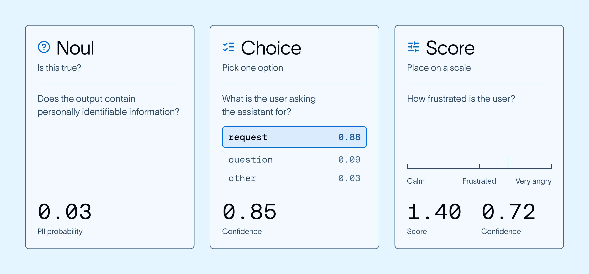
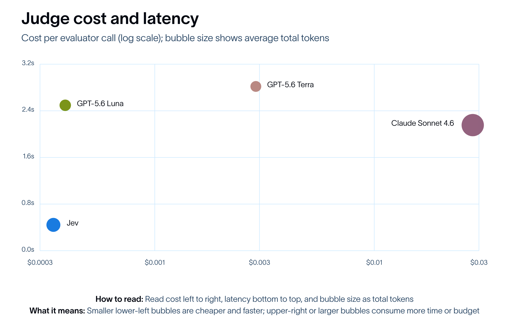
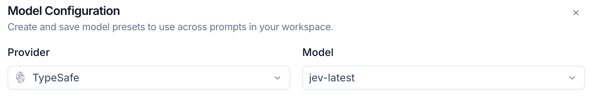

# Jev is now available in LangSmith Evals

> **来源**: [https://www.langchain.com/blog/jev-is-now-available-in-langsmith-evals](https://www.langchain.com/blog/jev-is-now-available-in-langsmith-evals)  
> **作者**: Winston Huynh | **发布时间**: 2026-09-21T16:00:00+00:00  
> **深度调研**: [查看专题调研报告](research.md)  
> **标签**: Agent评估, LangSmith, 可靠性工程, System One模型

---

## AI 导读

本文介绍了在 LangSmith 中将 System One 决策模型 Jev 引入作为评估器（Jev-as-a-judge）的工程实践与测试结果。为解决传统 LLM-as-a-judge 在生产流量评测中成本高昂、延迟较大且非确定性强的工程痛点，Jev 通过对 Agent 状态并发返回强类型的判定与概率分布，在分类评测任务中实现了显著的加速与降本。实测表明其在窄域决策中对齐人类标注且方差大幅降低，文章详细展示了评估器的配置步骤及其与传统 LLM 评估器的互补边界。

---

## 原文整理

Jev is now available as a judge for evaluations in LangSmith. Jev gives teams a fast, low-cost way to evaluate open-ended agent behavior and turn the results into structured feedback they can track in LangSmith.

Below, we explain why a System One model like Jev is useful for agent evals, share what we found when we tested it, and walk through setting up a Jev-as-a-judge evaluator for online evals.

Try Jev-as-a-judge in [LangSmith](https://smith.langchain.com/) today by visiting the Evaluators tab in any tracing project.

## A brief history of agent evals

Back in 2023 when we first started building agents (which we mostly called LLM apps at the time), the primary approach to evals was code-based. Later that year, researchers introduced [**LLM-as-a-judge**](https://arxiv.org/abs/2306.05685), and since then, code-based and LLM-as-a-judge have been the two main ways to evaluate agents.

Code-based evaluators check for specific, deterministic conditions: Did the agent call a tool? Does the output match a pattern? Is a field present? That's fast and reliable, but it only covers the narrow slice of agent behavior you can fully specify before the agent runs. Since agents are non-deterministic, an agent that solves the same problem three different valid ways will fail a code-based check that only expects one of them.

LLM-as-a-judge evaluators fill that gap. You give an LLM judge an agent trace, along with instructions and a rubric on how to grade it, and it reasons through the trace in free text before returning a verdict. However, that flexibility comes at a cost. LLM-as-a-judge evaluators are slower and more expensive to run than a function call, and because they're non-deterministic, the same input can produce a different verdict from one run to the next. On top of that, the step that turns free text into a structured output is itself a source of error, independent of whether the judge's reasoning was correct.

Now, [System One models like Jev](https://typesafe.ai/blog/introducing-system-one-models-and-jev) introduce a third type of agent eval, one that trades some of code-based evaluation's speed for the flexibility to evaluate open-ended agent behavior, at a fraction of the cost of an LLM judge.

## What is Jev?

Jev isn't a traditional LLM and doesn't generate text. The TypeSafe AI team calls it a [System One model](https://typesafe.ai/blog/introducing-system-one-models-and-jev):

📖 System One models are a class of AI models built to make fast, structured decisions that software can use directly. A System One model evaluates a [**state**](https://docs.typesafe.ai/concepts/state) and returns typed answers and probabilities.

For evals, the state can be an agent trace, a single message, or any other context you want evaluated. Questions define the criteria you want to evaluate the state against, like whether a response leaked PII, what the user's intent was, or how frustrated the user seemed. Jev can answer three types of questions: (1) a noul returns a yes/no probability, (2) a choice picks one option from a set, and (3) a score rates the state on an ordered scale. Each answer comes back typed, instead of a block of generated text that gets converted into structured output.

*The three question types Jev can answer, using the feedback keys from this post: PII leakage (noul), user intent (choice), and user frustration (score).*

## Why is Jev interesting for agent evals?

Three things about Jev map directly onto pain points in agent evals. According to TypeSafe AI, Jev is up to [**\~450x cheaper and \~200x faster**](https://typesafe.ai/blog/introducing-system-one-models-and-jev) than comparable LLMs on classification tasks, and it can evaluate multiple questions about the same state in parallel.

Cost is a common reason teams evaluate their agents less than they would like to. Every eval carries a trade-off: score more agent runs, evaluate more criteria, or test more changes, and the cost of testing grows proportionally. With multiple agents and high-volume usage, an LLM judge that costs a few cents per eval gets expensive fast across production traffic, large datasets, and regression tests against every model or prompt change. Teams end up running fewer evals to manage costs, which slows down the feedback loop that building great agents depends on. At a fraction of that cost, a Jev judge can remove that trade-off.

With Jev-as-a-judge, you can score every trace instead of a sample of them, check more criteria per trace, and run the same judgment repeatedly to see how consistent the judge is. The cheaper the judge, the more of your agent's behavior you can afford to evaluate, and the tighter that agent improvement loop becomes.

Speed matters a great deal for online evals, where a judge is scoring live traffic. Being up to \~200x faster than an LLM judge, a Jev judge is better at keeping pace with traffic as it arrives. That matters most for feedback keys that flag security or safety risks, like PII leakage, prompt injection, or toxicity, where you can set an alert on the feedback key that triggers a webhook to automate a response. The faster the judge, the smaller the window between something going wrong and something being done about it.

Parallelization changes how many criteria you can evaluate against a single agent trace. Jev evaluates every question in a request together, so scoring a trace against multiple feedback keys, such as PII leakage, user intent, and user frustration, costs only marginally more than scoring it against one.

💡 System One models evaluate every question in a request in parallel. Adding questions barely changes the response time and costs only the tokens for the extra questions, which are cheap.

An LLM judge, by contrast, either needs a separate call per criterion or has to reason through all of them sequentially in one prompt with output tokens scaling with the number of criteria.

System One models map well onto these pain points, but none of this makes LLM judges obsolete. Fine-tuned and open models can be effective judges at much lower cost than a frontier model, and for open-ended criteria where you want written reasoning alongside a verdict, an LLM judge is still the better tool. Jev is a good fit when the decision you need is narrow and typed and you are making it at volume.

## Does Jev-as-a-judge actually work?

We put Jev to the test in [**Jev-as-a-Judge for Agent Evals**](https://www.langchain.com/blog/jev-agent-evals-langsmith#evaluation-with-jev), comparing it against GPT-5.6 Luna, GPT-5.6 Terra, and Claude Sonnet 4.6 on accuracy, consistency, speed, and cost. Jev was more accurate, dramatically more consistent, and both faster and cheaper than the LLM judges.

Jev matched a human reviewer on every decision, with 92-913x lower variance than the LLM judges. It averaged 0.44 seconds per call, compared to 2.16-2.83 seconds for the LLM judges. At $0.00035 per call, running the full set of judgments cost $0.34 with Jev, versus $0.39 with GPT-5.6 Luna, $2.90 with GPT-5.6 Terra, and $28.17 with Claude Sonnet 4.6.

This was one test on one agent, but the results are a promising early sign that Jev-as-a-judge is a viable third type of agent eval, alongside code-based and LLM-as-a-judge.

## How to use Jev-as-a-judge in LangSmith

TypeSafe is now a model provider in LangSmith, with Jev available as a model. Setting up a Jev-as-a-judge evaluator follows the same path as an LLM-as-a-judge evaluator. The key difference is that a Jev-as-a-judge evaluator defines a state and a set of typed questions instead of a prompt and evaluation criteria.

1. **Add a TypeSafe API key.** From Settings, open Provider secrets and click + Secret. Select TypeSafe as the Provider and paste your TypeSafe API key into the TYPESAFE\_API\_KEY field. You can create one from your TypeSafe AI account.

%20TypeSafe%20API%20Key.png>)

1. **Add an evaluator.** From your tracing project, open the Evaluators tab and click + Evaluator. Under Create from scratch, select LLM-as-a-Judge Evaluator.

%20Add%20an%20evaluator.png>)

1. **Choose TypeSafe as the provider.** Name your Jev-as-a-judge evaluator. Under Prompt & Model, open the Model Configuration and select TypeSafe as the Provider and jev-latest as the Model.

1. **Define the state.** Once the model is configured, define the state, or the context, that Jev will evaluate by mapping in run or thread variables. Unlike an LLM judge, the state should not include grading instructions. Those go in the questions in the next step.

%20Define%20state.png>)

1. **Add questions.** Under Feedback Configuration, add one question per criterion you want to evaluate against the state. Each question becomes a feedback key. Phrase a noul as a yes/no question where a high probability means yes, give a choice its full set of options, and give a score its levels in order from low to high. Because Jev evaluates every question in a single call, adding a second or third question costs only marginally more.

%20Add%20questions.png>)

1. **Start evaluating.** Save the evaluator. The Jev-as-a-judge evaluator will start scoring incoming runs or threads, and each question shows up as its own feedback key. From there, you can filter, chart, or set alerts or automations on those keys like any other feedback in LangSmith.

%20Feedback.png>)

## Get started

Jev-as-a-judge is available in LangSmith today.

[Sign in or sign up](https://smith.langchain.com/) for LangSmith, then open the Evaluators tab in any tracing project, add an LLM-as-a-Judge evaluator, and select TypeSafe as the provider to try it out. For more details, see the [decision model evaluator guide](https://docs.langchain.com/langsmith/decision-model-evaluator).

If you try Jev as a judge on your agents, we want to hear how it holds up, especially against the LLM judges you use today. Share what you find on the [**forum**](https://forum.langchain.com/) or tag us on [**X**](https://x.com/LangChain).

To see how Jev fits into the agent loop beyond evals, including model routing and tool-risk gating, read [**Building a harness with Jev**](https://www.langchain.com/blog/building-a-harness-with-jev).

If you want to learn more about building agents with Jev, we're hosting a livestream with the TypeSafe AI team on Tuesday, Sep 22nd: [https://events.langchain.com/webinar/building-a-harness-with-jev/](https://events.langchain.com/webinar/building-a-harness-with-jev/*)
