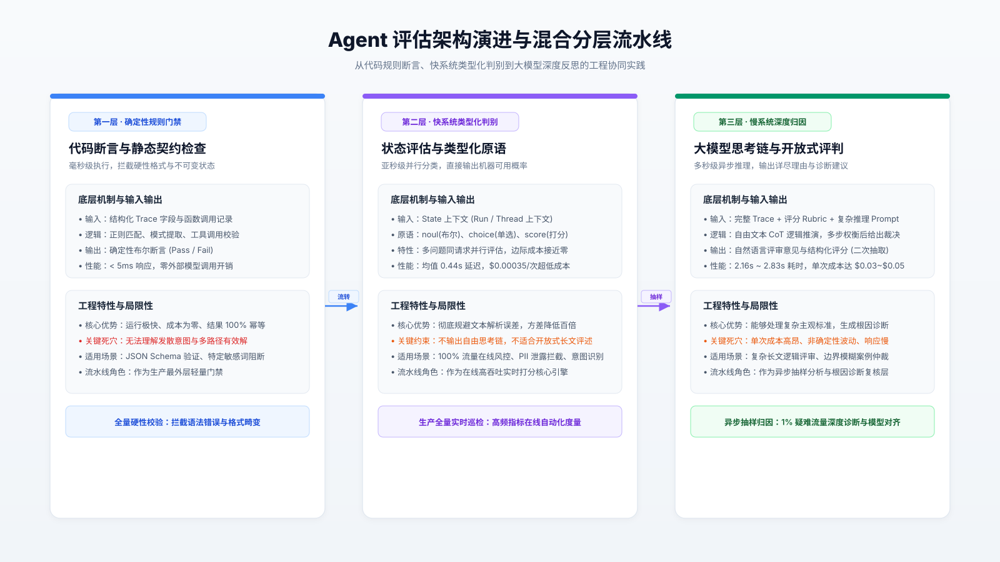

# 终结百万 Token 账单：用快系统判别打破 Agent 评估的成本与延迟困境

> 面向 LLMOps 工程师与 Agent 架构师，深度剖析 System One 评估范式、底层类型化机制与生产混合流水线设计。

## 1. 线上评估的成本死锁与核心结论先行

在智能体（AI Agent）步入生产环境的过程中，评估环节（Evaluation）始终面临着残酷的工程死锁：若采用传统的代码断言，难以应对开放式、多路径收敛的非确定性行为；若采用大模型裁判（LLM-as-a-Judge），单次调用高达数秒的延迟与数美分的成本，在生产高并发流量下会迅速击穿运维预算。结果是，大多数工程团队被迫将线上评估降级为 1%～5% 的稀疏随机抽样。抽样评估不仅留下了大面积的安全与质量盲区，还将线上缺陷的发现周期从秒级拉长至数天。更严峻的是，大模型裁判本身存在非确定性方差，其将自由思考文本（Free Text）序列化为结构化 JSON 的抽取过程，更构成了不可忽视的独立误差源。

核心结论先行：由 TypeSafe AI 开发并在 LangSmith 原生集成的 Jev 引入了“快系统判别模型”（System One Model）这一第三类评估范式。该模型彻底舍弃了自由文本生成，转而针对输入状态（State）直接输出强类型决策与离散概率。在单次调用中，Jev 实现了 0.44 秒的平均延迟与单次 0.00035 美元的成本，方差相比通用大模型裁判降低了 92～913 倍，且支持同一上下文内多评估维度的近乎零边际耗时并行判定。

本文将拆解 Jev 的底层类型化判别机制，通过横向对比量化其与主流大模型裁判的技术取舍，并为工程团队提供一套“确定性门禁 + 快系统在线巡检 + 慢系统异步抽检”的三层混合流水线落地指南。

## 2. Agent 评估的三代演进与架构瓶颈转移

评估基础设施的演进本质上是灵活性、确定性与执行成本之间的动态再平衡。梳理这一历程有助于理解当前架构的瓶颈转移：

第一代：确定性代码断言（Code-based Evals）。在智能体开发早期，评估主要依靠函数断言、正则表达式与字段存在性校验。其运行延迟低于 5 毫秒，计算成本几乎为零。然而，Agent 的核心特征在于解决同一目标具备多种有效求解路径。预设规则的断言程序无法覆盖未枚举的合理行为，导致大量误报。

第二代：大模型自由推理裁判（LLM-as-a-Judge）。2023 年下半年起，团队开始将 Agent Trace 与评分准则（Rubric）打包输入 GPT-4 等前沿模型，依靠模型的链式思考（Chain of Thought）进行主观裁决。这种方式具备极高的语义理解柔性，但暴露了三大架构缺陷：其一，慢，端到端耗时通常在 2～3 秒以上，无法嵌入在线实时阻断；其二，贵，面对百万级生产调用，全量评估成本远超 Agent 运行本身的开销；其三，脆弱，模型先生成自由文本再转结构化输出的过程极易遭遇 JSON 解析崩溃或键值幻觉。

第三代：快系统类型化判别（System One Model）。认知科学中的“系统一”指代快速、直觉且模式化的直觉反应。Jev 作为该类模型的代表，不再承担开放式长文生成的职责，而是被设计为一个纯粹的强类型判别器。它以不可变状态为输入，直接映射到预定义的离散决策空间，以放弃生成自由推理链为代价，换取了亚秒级的吞吐速度与极低方差。

## 3. 快系统裁判 Jev 的底层工作机制白盒化

Jev 的核心并非对传统因果语言模型进行简单的微调，而是在推理协议与输入输出建模上重构了评估过程。

输入侧建模：状态与问题的契约解耦。在配置 Jev 时，评估上下文被称为状态（State），通常直接绑定运行追踪记录（Trace）、单次会话消息或工具调用载荷。与必须在 Prompt 中混杂评估背景和评分指令的 LLM 裁判不同，Jev 将“被评测对象”（State）与“评测准则”（Questions）解耦。State 内严禁包含评分说明，评分逻辑完全由独立的类型化问题承担。

输出侧建模：三类强类型原语（Typed Primitives）。Jev 原生支持三类原子评估问题，其输出直接由底层模型计算其分类概率分布，杜绝自由文本转换：
- 布尔概率原语（noul）：针对二元命题返回“是/否”概率分布。例如判断“回答中是否存在 PII 敏感信息泄露”，输出直接体现为置信度浮点数。
- 集合单选原语（choice）：从封闭枚举项中选取一个命中标签。例如分类“用户当前真实意图”，返回枚举项中的唯一标签。
- 有序等级原语（score）：在有序离散标尺上评定等级。例如打分“用户情绪挫败感等级（1 至 5 级）”，直接返回标尺离散值。

矩阵化并行评估机制（Parallel Evaluation）。这是 Jev 在系统吞吐上的关键突破。通用 LLM 裁判若要同时评估“意图匹配度”、“安全泄露风险”与“回复专业度”，要么必须发起三次独立的远程 API 调用，要么必须在一个巨型 Prompt 中要求模型顺序推理所有维度，导致生成的 Token 数量与耗时成倍膨胀。而 Jev 在单次推理中共享 State 上下文的特征表示，对注入该请求的所有 Questions 进行并行判定。增加评估维度仅需追加少量问题描述的输入 Token，端到端响应耗时几乎不发生改变。

必须明确的架构未知项：虽然 TypeSafe AI 与 LangSmith 公开了调用接口与交互原语，但 Jev 模型的具体网络层数、参数规模、底层预训练语料构成以及具体损失函数设计均为厂商闭源资产，当前公开资料中明确未知。工程团队在选用时应将其作为黑盒判别服务对待。

## 4. 多维方案权衡决策矩阵与实测数据边界

在 LangChain 针对特定 Agent 的评测实验中，Jev 与 GPT-5.6 Luna、GPT-5.6 Terra 以及 Claude Sonnet 4.6 进行了同台对比。评测数据显示：在人类基准一致性上，Jev 在该测试集上与人类评审达成 100% 吻合；在输出稳定性上，Jev 的判定方差比 LLM 裁判低 92 至 913 倍；在调用耗时上，Jev 平均仅为 0.44 秒，远快于 LLM 裁判的 2.16 至 2.83 秒；在成本层面，Jev 单次调用仅耗费 0.00035 美元，全量评测总开销为 0.34 美元，而 GPT-5.6 Terra 为 2.90 美元，Claude Sonnet 4.6 达到了 28.17 美元。

需要客观指出该数据的外推边界：该公开 Benchmark 仅基于单个特定 Agent 场景测试，不可盲目外推至涉及复杂数学定理推导、代码逻辑纠错等需要深层推理链的场景。

为帮助架构师合理选型，下表归纳了三类主流评估方案的关键工程指标：

| 评估维度 | 代码断言 (Code-based) | 快系统判别 (System One / Jev) | 大模型裁判 (LLM-as-a-Judge) |
| :--- | :--- | :--- | :--- |
| **典型单次耗时** | < 5 毫秒 | ~0.44 秒 | 2.0 ~ 3.0 秒 |
| **单次评估成本** | 几乎为零 | $0.00035 | $0.005 ~ $0.05 |
| **输出确定性** | 100% 确定性 | 极高 (方差较 LLM 降 92~913 倍) | 较低 (非确定性波动显著) |
| **多维度扩展性** | 顺序代码执行 | 同一请求并行判定 (边际耗时近零) | 输出 Token 随维度线性膨胀 |
| **结构化解析风险** | 无风险 (原生布尔/对象) | 无风险 (原生 Typed 强类型) | 较高 (存在 JSON 解析失败与幻觉) |
| **主观解释力** | 无解释力 | 仅提供概率与标签，无思考链 | 极强 (提供自然语言 CoT 推理与评语) |
| **反向适用场景** | 开放式多步意图理解 | 需要详细文字归因的仲裁任务 | 高并发 100% 实时在线流量巡检 |

失效模式与适用边界：
- 绝对适用场景：高吞吐量实时风控（如输入注入拦截、PII 泄露拦截）；生产流量全量在线打分（意图分布统计、挫败感监控）；高频 CI/CD 流水线中的回归基线测试。
- 必然失效场景：当业务需要评估“为什么回答不符合企业文化”并输出详细修改意见时；当准则处于初期摸索阶段、尚未形成明确离散标准时；在这类需要开放式归因反思的场景中，大模型裁判依然具备不可替代的价值。

## 5. 生产级混合流水线落地与排障诊断指南

在真实生产环境中，孤立依赖某一种评估工具均是不成熟的架构设计。结合 LangSmith 的工程实践，推荐构建“三层混合分层评估流水线”。

正文阐述的三层流水线逻辑在下图架构拓扑中得以完整呈现：



该架构的分层协作机制如下：

第一层：轻量代码门禁。在 Agent 收到输入或调用工具前，通过静态代码完成 JSON Schema 验证、不可变状态断言及敏感关键词硬拦截，以零成本过滤 80% 的低级错误。

第二层：Jev 全量在线巡检。在 LangSmith Tracing 中将 `jev-latest` 挂载为在线评判器（Online Evaluator）。将每一次 Trace 的上下文映射为 State，配置 noul（安全越权检测）与 score（回答质量评分）。由于单次调用仅需 0.44 秒且成本极低，系统可实现 100% 生产流量实时巡检。当 noul 检测出 PII 泄露概率高于阈值时，直接触发 LangSmith Webhook 执行自动化会话熔断与告警。

第三层：大模型深度异步归因。对 Jev 判定为低置信度（如预测概率处于 0.4～0.6 的模糊地带）或被用户踩踩标记的异常 Trace，以 1% 的比例异步投递至大模型裁判甚至人工评审，生成完整的长文本分析报告，反哺 Prompt 迭代与模型微调。

针对生产环境上线 Jev 评判器可能遇到的常见异常，工程团队可遵循以下排障诊断清单：

```text
[线上诊断：Jev 在线评估指标异常或流水线告警]
  ├── 分支 1：评估延迟突增至 > 1.5s
  │     ├── 检查 State 体积 -> 是否将超大历史上下文或无意义二进制注入了 State
  │     └── 检查网络链路 -> 确认 Provider API 连接延迟与超时重试策略
  ├── 分支 2：判定结果与人工预期发生系统性偏差
  │     ├── 检查 State 纯净度 -> 是否在 State 中混入了评估规则指令（应剥离至 Question）
  │     ├── 检查原语定义 -> score 标尺等级是否单调递增，choice 选项是否穷尽且互斥
  │     └── 检查置信度校准 -> 对 noul 概率设定更贴合业务风险偏好的阈值（如安全项设 0.2）
  └── 分支 3：下游自动化 Webhook 频繁误触
        ├── 降低敏感度阈值并增加时间窗口滑动平均
        └── 将边界样本分流至第三层大模型裁判进行二次复核
```

## 6. 核心信源溯源与参考链接

本文分析基于以下公开技术资料与基准评测数据：

- 原文技术公告：LangChain 官方博客《Jev is now available in LangSmith Evals》
  https://www.langchain.com/blog/jev-is-now-available-in-langsmith-evals
- 模型概念定义：TypeSafe AI 团队《Introducing System One Models and Jev》
  https://typesafe.ai/blog/introducing-system-one-models-and-jev
- 状态原语文档：TypeSafe AI 文档库《Concepts: State & Typed Primitives》
  https://docs.typesafe.ai/concepts/state
- 基准评测报告：LangChain 博客《Jev-as-a-Judge for Agent Evals》
  https://www.langchain.com/blog/jev-agent-evals-langsmith#evaluation-with-jev
- 决策模型指南：LangSmith 官方文档《Decision Model Evaluator Guide》
  https://docs.langchain.com/langsmith/decision-model-evaluator
- 大模型裁判奠基论文：Zheng et al.,《Judging LLM-as-a-Judge with MT-Bench and Chatbot Arena》(2023)
  https://arxiv.org/abs/2306.05685
