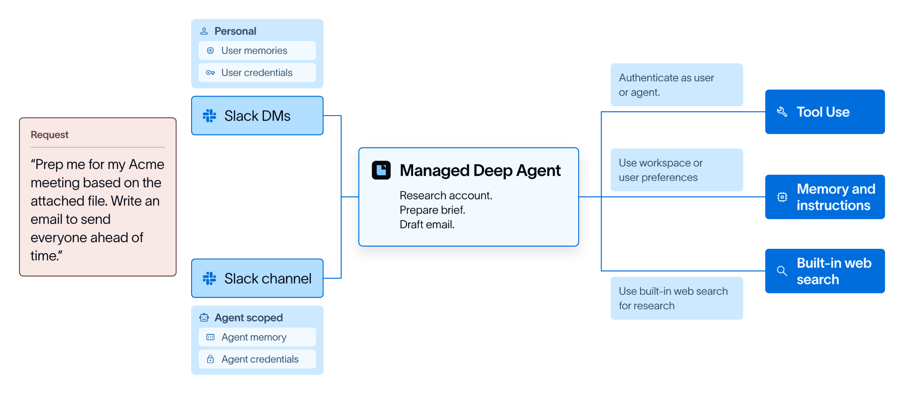
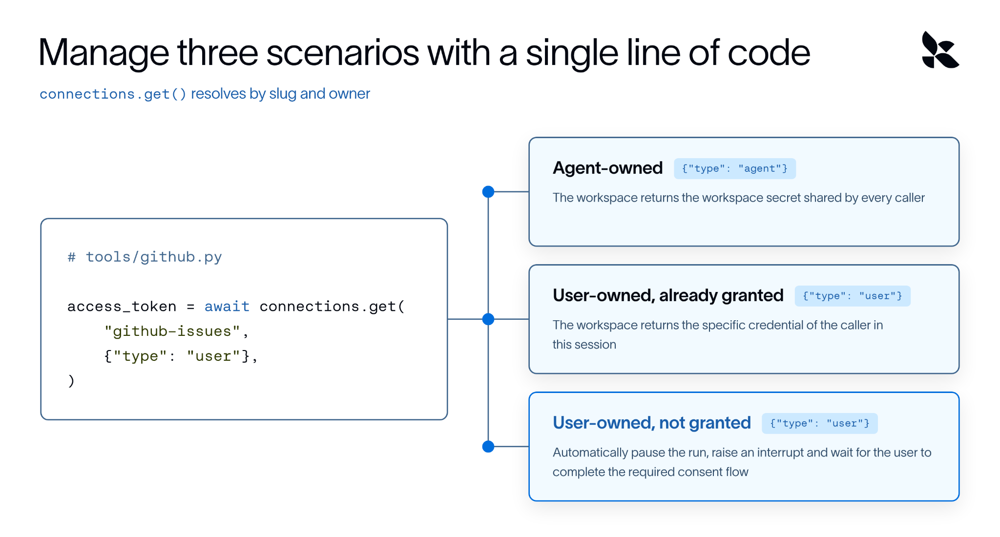

# Managed Deep Agents delivers a better user experience for agents in production

> **来源**: [https://www.langchain.com/blog/langsmith-managed-deep-agents-whats-new](https://www.langchain.com/blog/langsmith-managed-deep-agents-whats-new)  
> **作者**: Nathan Drezner Karthic Subramanian | **发布时间**: 2026-09-24T14:03:00+00:00  
> **深度调研**: [查看专题调研报告](research.md)  
> **标签**: Agent工程化, 多租户内存, 身份凭据管理, MCP协议, 生产部署

---

## AI 导读

文章介绍了 LangChain 推出的生产级托管运行时框架 Managed Deep Agents 0.8。该版本主要解决生产多用户环境下的 Agent 工程落地难题：通过双层记忆架构（/memories/agent/ 与 /memories/user/）隔离全局规则与单用户私有上下文，防止多用户会话间信息泄露；区分用户级与 Agent 级凭证作用域以保障安全；扩展 HTTP Webhook 通道与支持文件传输的 Slack 工作流；并内置基于 MCP 协议的 Parallel 网络搜索工具。方案旨在将 Agent 底层认证、存储与通道等繁重基建交由托管运行时处理，使开发者能够专注于核心业务行为逻辑。

---

## 原文整理

## Key Takeaways

- **Identity-scoped auth and memory:** user-owned credentials and user-level memory let agents act on the right permissions and remember caller-specific context.
- **HTTP channels:** use agents in internal tools, customer portals, support systems, and other product surfaces that can send webhooks.
- **Built-in web search:** Managed Deep Agents now includes web search powered by Parallel out of the box.

Today we’re launching Managed Deep Agents 0.8, which adds support for user-owned credentials, user-level memory, HTTP channels, file transfer in Slack and adds a pre-built tool for web search powered by Parallel.

[Managed Deep Agents](https://docs.langchain.com/langsmith/python/managed-deep-agents-overview) (MDA) is the simplest way to build, deploy, and run mission-critical agents in production, so engineering teams can focus on agent behavior instead of rebuilding the same infrastructure that every agent needs. With today’s release, we’re expanding Managed Deep Agents to support four challenges that most teams face when running agents in production: agent memory, authentication, channels, and tool management.

## About Managed Deep Agents

[Managed Deep Agents](https://docs.langchain.com/langsmith/python/managed-deep-agents-overview) combines the Deep Agents harness with all of the infrastructure required to run agents in production. A Managed Deep Agent is a code-first project in your repo that allows you to easily organize all your agent’s primitives into a simple directory:

```
my-agent/
  agent.py | agent.ts | agent.tsx
  pyproject.toml | package.json    	# project dependencies
  instructions.md                  		# prompt synced to Context Hub
  identity.py | identity.ts        		# auth, thread scoping, memory scoping
  memory.py | memory.ts            	# define your agent's memory
  tools/                           			# custom tools
  channels/                       	 	# entry points like Slack and GitHub
  middleware/                      		# custom middleware
  schedules/                       		# managed cron schedules
  connectors/                      		# managed connectors
  skills/                          			# skills synced to Context Hub
  sandbox/                         		# sandbox configuration
  evals/                           			# agent evals
```
## Managed Deep Agents in practice

Imagine you’re building an internal agent to support your sales team (we’ll call this agent our **GTM Agent** in this post). You want your agent to be able to look up account details, research the account, draft meeting briefs, follow-up emails, and so on, and help keep your team’s accounts engaged. To support this, your agent needs memory, tool access, web search, reasoning, and planning.



Agent harnesses, like [Deep Agents](https://www.langchain.com/deep-agents), help with building these agents. They provide primitives for building complex agents that can take on long-running, mission-critical tasks. With Deep Agents, getting a prototype up and running is straightforward, but making the agent work seamlessly in production requires a lot more.

That’s where Managed Deep Agents comes in. It packages your customized Deep Agents harness with the managed infrastructure required to run an agent like this at scale. This includes adding channels, like Slack, identity and authentication, and managing permissions for tools. Building this infra typically takes quarters of roadmap and requires ongoing maintenance. Managed Deep Agents allows engineers to focus on building the agent logic and hand off the boilerplate code.

## Memory for your agent, scoped to the user

When an agent is used by multiple users in production, robust, secure systems to manage memory are important. Managed Deep Agents already supported durable agent memory, which lets a deployment retain instructions and preferences across conversations. Setting up memory can be done through simple declaration files:

```
# A memory declaration file enables durable agent and user-level memory.
my-agent/
  agent.py
  memory.py
```
With Managed Deep Agents 0.8, we’ve added a second layer for user-level memory, scoped to the authenticated person starting the agent run. This gives the agent a place to store caller-specific context, such as preferences, working style, recurring tasks, or details the user has asked it to remember, without mixing that context with the shared agent-level memory.

```
from managed_deepagents import MemoryLayer, define_memory
memory = define_memory(
    agent=MemoryLayer(),
    user=MemoryLayer(),
)
```
Under the hood, durable memory is backed by LangSmith [Context Hub](https://www.langchain.com/blog/introducing-context-hub), which enables teams to store, version, and collaborate on agent files like Skills and AGENTS.md. Agent memory is mounted at `/memories/agent/` and shared by everyone using the deployment. User memory is mounted at `/memories/user/` and keyed to the caller’s authenticated identity. The runtime never copies content between these layers, so teams can keep shared knowledge and personal context separate by default. This is useful in real-world agent use cases, such as:

- A support agent might use agent memory for team-wide escalation rules and user memory to remember that a specific teammate prefers concise Slack updates.
- A research agent might keep shared research procedures in agent memory, while storing an individual user’s preferred source types or formatting conventions in user memory.

*"Building with Managed Deep Agents has been such a smooth experience. The LangChain team partners well with us, and helped troubleshoot quickly. Our production chat app runs as a Managed Deep Agent - with Context Hub and user-level memory, we are able to maintain client confidentiality while delivering a superior experience." 
— Zahid, CTO,* [*Kyth.ai*](http://kyth.ai) 

Memory is easily configurable and lives within a single file in a Managed Deep Agents project. You can enable the agent layer, the user layer, or both. You can also define access policies for each layer, giving teams control over when memory is available and what scope it applies to. Unless specified, Managed Deep Agents uses the following defaults:

This layered approach ensures user-level information is not ‘leaked’ into a conversation with multiple users. Consider the ***GTM agent*** mentioned earlier. Users could initiate requests in a direct DM with the agent, or they could start a request in a Slack group. Defined access policies and defaults ensure that:

- A direct DM has the agent acting as per the user’s preference.
- Requests with multiple users in a thread or a slack group has the agent defaulting to workspace / team preferences.
- There is no leakage of preferences and stored memory between the two scenarios.

Learn more about setting up agent and user-level memory [here](http://docs.langchain.com/langsmith/python/managed-deep-agents-memory).

## Securely provide user and agent identity through connections

Connections link a Managed Deep Agent to an external service such as GitHub, Notion, or Tavily. Connections are named credentials in your LangSmith workspace that your tools only read at runtime.

As with memory, it’s important to scope credentials according to the agent’s purpose and how users interact with it. With Managed Deep Agents, you can scope credentials at the user- or agent-level.

Agent-owned credentials are shared across all users, which is useful for an agent capability that does not differ per person, such as web search. By contrast, user-owned credentials are important when the user will have unique permissions within a tool. This is often necessary for tools like GitHub, Linear, and Notion.



For example, our **GTM agent** should be able to pass through user credentials and use Salesforce data when a user requests it in a DM. The agent should also be able to use agent-credentials to search the web and find information about a customer.

Managed Deep Agents comes with OOTB support for [23 services](https://docs.langchain.com/langsmith/python/managed-deep-agents-connections#use-the-oauth-catalog) including Linear, GitHub and Google Workspace tools, where LangSmith manages authorization, tokens and methods so developers only need to set up user ID and secrets.

Learn how to set up and use credentials in connections [here](https://docs.langchain.com/langsmith/python/managed-deep-agents-connections).

## Accessing agents through user-preferred channels

Internal agents are commonly accessed through existing communication channels like Slack. Managed Deep Agents provides pre-built Slack support to make it simple to expose agents where your team is already working.

With today’s release, Managed Deep Agents now supports richer [Slack workflows with file transfer](https://langchain-5e9cc07a-preview-docsmd-1789592284-4ee7e30.mintlify.site/langsmith/python/managed-deep-agents-channels-slack), and adds [HTTP channels](http://docs.langchain.com/langsmith/python/managed-deep-agents-channels-http) for connecting agents to any service that can send a JSON webhook.

```
# channels/orders.py
from managed_deepagents import channels
from lib.orders import parse, verify, messaging
channel = channels.http(
    provider="orders",
    verify=verify,
    parse=parse,
    messaging=messaging,
)
```
For Slack-based workflows, users can invoke an agent from a DM, an app mention, or a thread reply. With file transfer support, they can also send the materials the agent needs directly in the conversation, such as logs, spreadsheets, contracts, screenshots, or customer documents.For example, with our **GTM agent**, a user can now add notes from a previous call or documents shared by a customer right inside Slack while making a request to the agent. The agent then picks up the file, adds it to the context and responds based on it.

HTTP channels let teams bring agents into internal tools, customer portals, support systems, order systems, or any product surface that can send a webhook. This is useful for customer-facing agents that live on multiple channels. For example, a customer support agent that manages intake and triage can live in your product and an agent that schedules demos and meetings can live on your webpage.

For both Slack and HTTP methods, teams keep control over authentication, identity, and memory, while giving users access to agents in the channels they already prefer.

*“\[Managed Deep Agents is\] by far the most complete agent platform, end to end. Slack integration worked perfectly and made life easier since we access all our agents through slack. We were able to deploy multiple agents, with custom MCP servers, to production using the CLI and GitHub actions. Now we have always-on triage with access to the right monitoring and the ability to open PRs and alert teams.” 
— Derek Gilbert, Engineering, Consensus*

## Built-in web search, powered by Parallel

Web search is one of the most common agent tools, so we decided to build it right into Managed Deep Agents. Now, you can use web search powered by [Parallel](https://parallel.ai/) without creating a separate vendor account, managing another API key, and wiring a search tool into the agent themselves.

Simply specify the MCP server in the tools folder and LangSmith manages the Parallel credentials and executes the tool. The agent receives relevant excerpts and source URLs it can cite, while calls, latency, and errors show up in LangSmith traces.

Add Parallel to the servers map in `tools/mcp.py / tools/mcp.ts`. Define `mcp` only once

```
from managed_deepagents import define_mcp
mcp = define_mcp(
    servers={
        "Parallel": {
            "transport": "http",
            "url": "https://api.smith.langchain.com/v1/managed-tools/servers/parallel/mcp",
        },
    },
)
```
## Getting started

Managed Deep Agents 0.8 simplifies agent authentication, memory, and channels, and brings in web search as a pre-built tool.

We’re excited to see how teams use these new capabilities, so we’re making **Parallel web search available free** through Managed Deep Agents while MDA is in beta.

Learn more in the [Managed Deep Agents docs](https://docs.langchain.com/langsmith/python/managed-deep-agents-overview), or get started with:

```
uvx --from managed-deepagents mda init my-agent
cd my-agent
uv run mda deploy
```
We’re continuing to improve Managed Deep Agents and would love to hear what you’re building. [Join our Slack community](https://www.langchain.com/join-community) to share what you’re building and reach out to us with any feedback.
