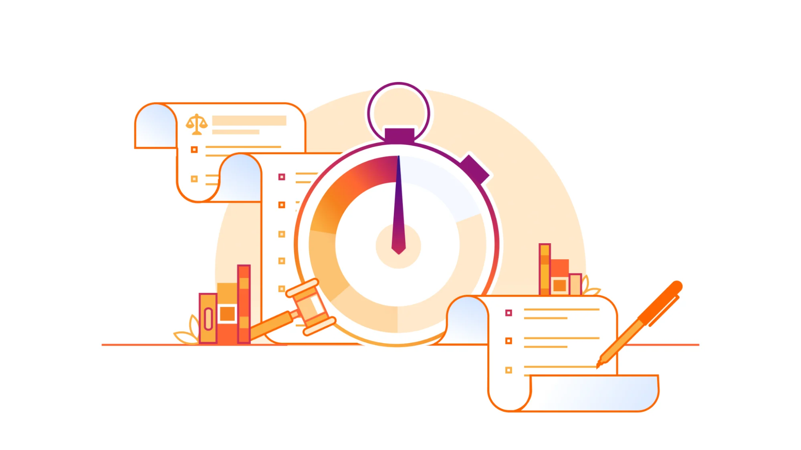
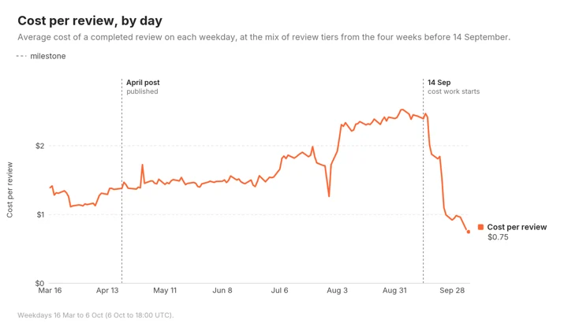
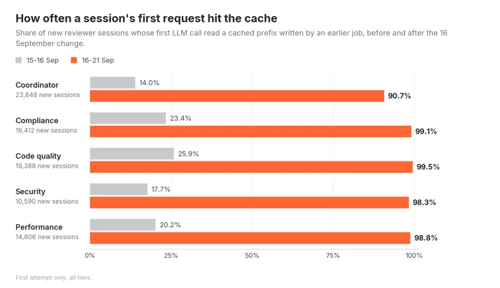
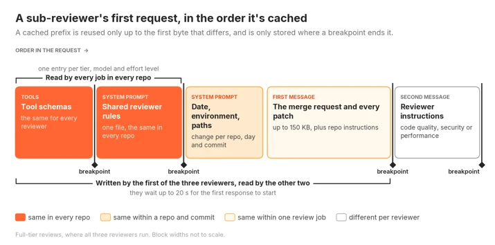
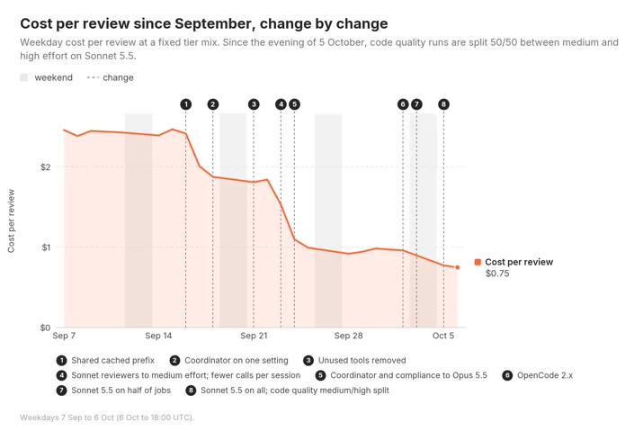
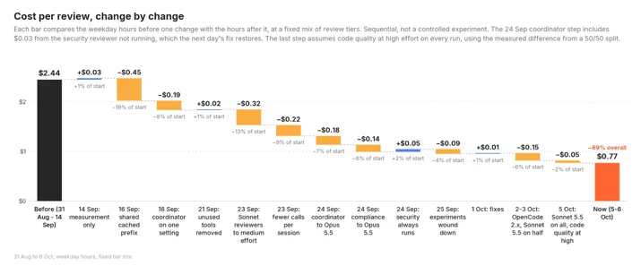
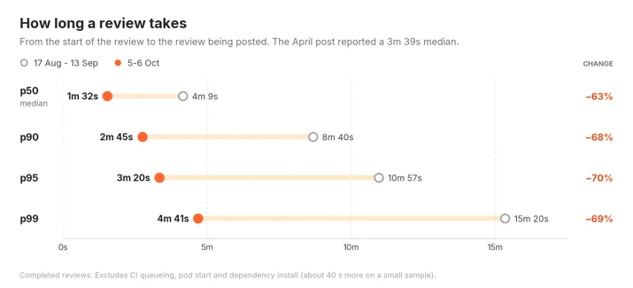
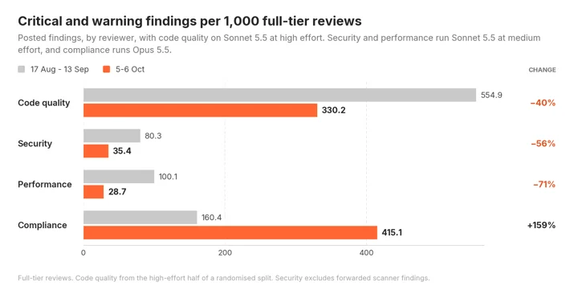
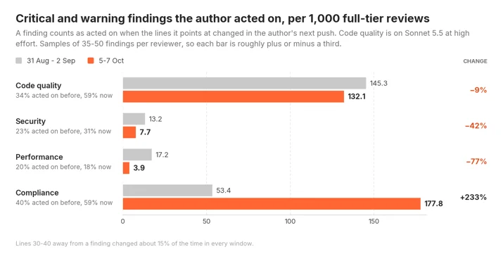
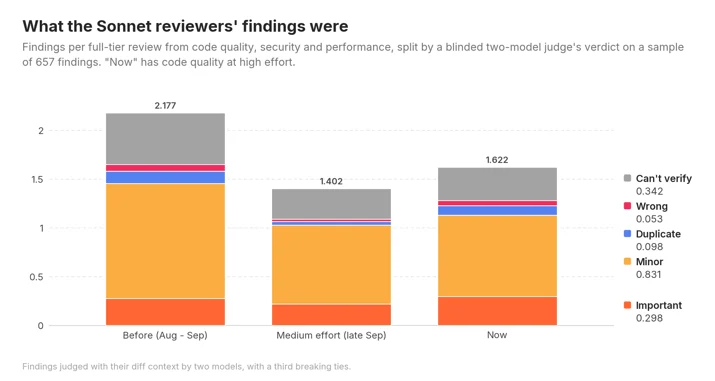

# Cutting our inference bill by 68% by being obsessive about optimization

> **来源**: [https://blog.cloudflare.com/obsessive-inference-optimization](https://blog.cloudflare.com/obsessive-inference-optimization)  
> **作者**: 未知 | **发布时间**: 2026-10-19T19:12:53.031000+00:00  
> **深度调研**: [查看专题调研报告](research.md)  
> **标签**: LLM推理优化, 提示词缓存, AI代码审查, 上下文管理, 工具调用优化, 模型评估, 成本与延迟优化

---

## AI 导读

文章处理内部 AI 代码审查费用持续上涨的问题：模型更换、上下文增大和调用次数增加，使高缓存命中率仍伴随高成本。作者记录首轮请求用量及系统提示词哈希，发现仓库路径和日期被放进唯一缓存断点之前，阻碍跨仓库复用。改进包括拆分稳定提示词与环境信息、为公共前缀单独设置断点、将固定参考索引纳入提示词，以及让多个审查器共享缓存；同时移除不可调用工具、批量读取文件、跳过无新增内容的复审、结束无用尾轮、修正超时重试并终止已取消任务。随后通过模型和推理强度对照继续减少令牌消耗。文章报告平均费用由2.43美元降至0.77美元，中位耗时由4分09秒降至1分32秒。
质量验证分别观察告警对应代码是否在后续提交中修改，并让不同提供商的模型盲评657条发现。结果支持高推理强度下的代码质量审查减少噪声与严重性夸大，但重要发现数量未见明显下降；性能审查在中等强度下的重要发现明显减少，安全审查也有下降迹象，尚待进一步测试。局限是成本拆解主要依赖非受控的前后比较；修改代码不等于告警正确，模型评审缺乏独立人工真值，各组样本少且最新窗口仅一天，也未直接测量漏检率。因此，降本和提速证据较具体，质量保持的结论应限定于已观察的审查器、配置及样本。

---

## 原文整理

# Cutting our inference bill by 68% by being obsessive about optimization

When we previously [<u>blogged about our AI code reviewer in April</u>](https://blog.cloudflare.com/ai-code-review/), an average review cost a palatable $1.19. By the end of August, that figure had shot up to about $2.46. We hadn't made any significant architectural changes: the coordinator was still handing work to the same set of specialist reviewers, and the same risk tiers decided how intensive of a review we gave.

Around mid-September we tasked our agents with working out where those tokens were going and cutting them — aggressively. With code quality at high effort, the average review now costs just $0.77, down 68% from the $2.43 it averaged over our two most expensive weeks before we started. Our main goal was to cut costs, but as part of this work we also managed to optimize the reviewer, so that the median review now takes just 1m 32s instead of the 4m 09s it took before.

About 40% of the savings came from changes and optimizations to the reviewer's code, and the rest from experimenting with which models we use and how much effort they put in.

## How a review doubled in cost

The chart below shows the cost of an average review on each weekday since March. It holds the mix of review tiers fixed, so a day with more large reviews doesn't skew the data.

The cost per review steadily rose from $1.22 (March) → $1.44 (June) → $1.74 (July) and finally, to $2.32 (August). A small part of that is that more reviews landed in the most expensive tier (59% of reviews in March and then 65% in August). We believe there’s a simple answer for why: models are getting much better, and much more capable. Naturally, engineers are producing bigger, more complex changes which means more of them fall into our “full review” tier. We found that most of the cost increase actually came from model changes over those months, though.

At the start of August we moved every reviewer onto Anthropic models, which raised the cost per job from $1.38 to $2.03. We made this choice because we found that during our evals, Anthropic models performed better on this specific workload than other models.

Our internal [<u>standards reviewer, Codex</u>](https://blog.cloudflare.com/engineering-standards-enforcement), ended up on Claude Opus 4.7 due to a mix of performance and reliability. That took it from about $0.25 per review to $0.88 in August, which made it more expensive than the coordinator agent itself.

The cache hit rate also increased, going from 85.7% in April to 97% by September, while the number of tokens per review more than tripled, from 0.91 million to 2.99 million. A high hit rate on three times as many tokens still costs a lot more, even with the low cache read cost.

## What else has changed since our last post?

One of the biggest changes is that the reviewer now runs on [<u>OpenCode</u>](https://opencode.ai/) v2, which is a [<u>ground-up rewrite</u>](https://anoma.ly/notes/opencode-2-0/) from v1. Before switching all reviews over from v1 to v2, we ran every review in every canary repo on both v1 and v2 in a comparative shadow mode. The two agreed on the approval decision in 98% of the merge requests we tested, so we moved everyone over in one go in early October and removed the v1 code. Comparing two days with the same models, full-tier reviews on v2 finish about 13% faster. We’re also currently experimenting with other ways to run our internal AI reviewer, including solely on Durable Objects using [<u>pi-durable</u>](https://earendil.com/posts/pi-durable/). We’re hopefully going to have more on this coming soon, so keep an eye out!

## So, where were the tokens going?

Right before we started focusing on cost optimization, our AI review spend was split by: output tokens making up about 23%, cache writes cost 43%, and cache reads cost 34%. This means that most of the money was going on context the model had already seen or was about to see again.

That makes complete sense when you look into a single session. The code quality reviewer made 16.6 large language model (LLM) calls per review on average and over those calls it wrote 72k tokens to the cache and read back 1.08m, because each call sends the whole conversation as context. A session's cost grows with both the number of calls and the size of the context, and over the last few months we had slowly increased both.

It’s worth taking a few minutes to read about how [<u>Anthropic's prompt cache</u>](https://docs.anthropic.com/en/docs/build-with-claude/prompt-caching) works. It works by caching parts of the prompt that have already been computed by the large language model (LLM). These are known as prefixes, because they only work on the messages at the start of the conversation, not mid way through or the end. This means that a future request can reuse an earlier prefix, up to the part of the conversation that changes from what’s been cached. In our case, the harness tools, system prompt and messages at the start of our AI reviewer sessions rarely change, so they’re a great candidate for prefix caching. A prefix is only stored where a cache breakpoint ends it. Writing to the cache costs 1.25 times the normal input price and reading costs 0.1 times, and an entry expires after five minutes unless something reads it.

That means we had two things to work on: make the first request of each session read from the cache instead of writing to it, and make each session use fewer calls.

## Sharing a cached prefix between every repository

Beginning September 14, the reviewer recorded the token usage of each reviewer's first LLM call, plus a hash of the first system block exactly as it was sent to the provider.

The data showed that the first request of a session found a cached prefix only 14% to 26% of the time. Every session starts with the same tool definitions and the same agent prompt, between 11k and 21k tokens that are identical in every repository we review, so almost all of them should have been cache hits.

The problem ended up being in how OpenCode v1 constructed the system prompt: It built one block containing our agent prompt, followed by an environment section with the working directory and the date, and placed the only cache breakpoint at the end of that block. The shared part was never stored on its own, so a review in one repository could never reuse what a reviewer ran in another repository had written.

On September 16, we added a marker to the end of every agent prompt and a plugin hook that split the block in two at that marker. The first half now ended on bytes that every job shares, and got its own breakpoint. To keep it that way we had to remove anything repository-specific from in front of it, so the list of available skills is disabled and tool descriptions can't change between jobs.

The same day we also moved our internal standards (Codex) reviewer's reference index (a table of internal standards, a skill file and a list of reference files) into its prompt. Until then every session had spent its first three turns reading those files with tool calls. Its LLM calls per run decreased from 15.9 to 9.6, and its cost per run dropped from $1.12 to $0.72.

Together these took the cost per review from $2.47 down to $2.02, and the drop was noticeable as soon as we kicked off the release.

## Fewer calls, fewer dollars

The next set of changes went out on September 21 and 23. None of them were particularly impressive by themselves, but together they took about $0.20 off every review.

| Change | What was happening | Effect of change | 
| Removing tools that reviewers couldn't use | Sub-reviewers could see the tool that posts the final review comment. In 57% to 76% of sessions they tried to call it, were rejected by a check on the server, and spent another call recovering. | One wasted call gone, and about 2.9k fewer tokens of tool definitions in every sub-reviewer request | 
| Reading files in parallel | In 64% of the code quality reviewer's turns, the model made exactly one tool call, usually to read a single file. | Reviewers read the shared context and all of their patches in their first response, up to 150 KB | 
| Skipping reviewers on re-reviews | About two-thirds of our jobs are a second or later review of the same merge request, and often three of the reviewers have nothing new to look at. | On full-tier re-reviews, AGENTS.md reviews are skipped 56% of the time, performance reviews skipped 23% and documentation reviews skipped 13%. | 
| Stopping after the review is posted | OpenCode passed the result back to the model for one more turn, which read the entire conversation again to write a summary nobody saw. | About $0.07 saved per job | 
| Treating a slow reviewer differently from a broken provider | A reviewer that hit its time limit was treated like a provider failure and started again with the same time limit. | Together with longer time limits and lower effort, security reviewer timeouts went from 1.8% of runs to almost none | 
| Canceling canceled jobs | GitLab's Kubernetes executor doesn't send a signal to a job's script when the job is cancelled. In a sample of 446 cancelled jobs, 358 kept running until the review was finished. | Jobs check their own status every 15 seconds and stop if cancelled | 

The most involved change was sharing one prefix between three reviewers. The code quality, security, and performance reviewers now send identical first requests with the same tools, a shared rules file, then the merge request with every patch included. Each reviewer's own instructions follow after that, and we make sure that one of them writes the cache and the other two read from it.

A cache entry can't be read until the response that wrote it has started streaming, and the three reviewers start at the same time. So the second and third wait for the first one's response to begin, for up to 20 seconds, before sending their own first request. It slows them down slightly and saves about nine cents per reviewer.

## Changing models and effort

The next chart shows the same line from the start of September, with each change marked.

When we split the period at every release and every configuration change, the code changes turn out to be the smaller part of the saving.

Code changes account for $0.65 of the $1.67, and model and effort changes for $1.06. Each step compares the weekday hours before a change with the hours after it, so this isn't a statistically sound controlled experiment.

The coordinator had been running three model and effort combinations since August. On the same model, full-tier jobs on medium effort finished 20% sooner, so we dropped the other two. In a later randomized split, Opus 5.5 at medium showed no measurable change in review outcomes or critical findings compared with Opus 5, so we switched. Opus 5.5 at high effort cost more than Opus 5.5 at medium while not producing a meaningful increase in findings.

Opus 5.5 is cheaper per token than Opus 5, but price is only responsible for about $0.20 of the drop. The rest comes from sending and generating fewer tokens. Since the start of September cache reads per review are down 82%, cache writes down 54%, and output down 67%.

The most recent change was a new model. On October 3, we split every Sonnet reviewer 50/50 between Sonnet 5 and Sonnet 5.5. After two and a half days, Sonnet 5.5 was 62% cheaper per run for code quality, 58% for performance and 47% for security. The two models cost the same per token, so all of that comes from using fewer tokens. On full-tier reviews, the 5.5 reviewers posted about as many critical and warning findings as the Sonnet 5 ones, so on October 5 we moved all of them to 5.5.

On Sonnet 5.5 at medium effort, the code quality reviewer makes 1.7 LLM calls per run instead of 6.2, and more than half of its runs finish in a single call, which means they don't open any other file in the repository. At high effort it makes 3.4 calls per run. We were concerned that this made reviews shallower, which we cover in the quality section below.

To see whether more effort brings findings back on the larger tiers, the code quality reviewer has been split 50/50 between medium and high effort on 5.5 since October 5. After one day, high effort costs 61% more per run and posts 58% more critical and warning findings. That's about two cents per review, and the quality section below shows those extra findings are worth having, so we're moving code quality to high effort. The cost figures in this post assume that.

## Latency

We weren't aiming to make reviews faster, but fewer calls also means less waiting, which means faster reviews and happier engineers.

The slowest reviews improved the most. In the four weeks before September 14, 37.9% of reviews took longer than five minutes and now just 0.7% do. The 99th percentile today is faster than three quarters of reviews were in April. Every tier got faster along the way with the median full-tier review going from 5m 16s to 1m 54s, lite from 2m 58s to 1m 14s, and trivial from 77 seconds to 30.

By August, the median review was 14% slower than what we reported in April and the 99th percentile 48% slower, so a good part of this work just got us back to where we had been.

## Review quality

A cheaper review isn't worth much if it also finds fewer problems, and the first chart here looks like that's what happened.

With code quality on Sonnet 5.5 at high effort, it posts 40% fewer critical and warning findings than it did in late August. Security and performance, which stay at medium effort, post 56% and 71% fewer. A fall in severe findings doesn't tell you on its own whether real problems are being missed or noise is being cut, so we looked at it from two directions.

First, we checked whether authors act on what the reviewer flags. For samples of critical and warning findings, we compared the commit that was reviewed with the author's next push, and counted a finding as acted on if the lines it pointed at had changed. Lines 30 to 40 away from each finding changed about 15% of the time in every period, which gives a baseline for edits that happen by coincidence.

**Before the changes, authors acted on 34% of the code quality reviewer's serious findings. Now it's 59%.** The reviewer flags fewer things, but those it flags are much more likely to lead to a change, so the number of findings that led to a change per 1,000 reviews is about the same. We now saw 132 against 145 before, which is within the margin of error. Across all four reviewers, serious findings that led to a change went from 229 to 321 per 1,000 reviews.

Second, we had two models from different providers judge a blinded sample of 657 findings from the three Sonnet reviewers, with the diff each one referred to and without knowing which period it came from. Disagreements went to a third model. Each finding was labelled important, minor, duplicate, wrong, or unverifiable, and its severity was marked as fair, too high, or too low.

Most of what disappeared was minor findings, plus some duplicates and findings the judges couldn't verify from the diff. Important findings per review went from 0.28 before to 0.30 now, and the intervals overlap. The bigger change was in severity. Before, the judges rated 0.46 critical or warning findings per review as more severe than they deserved. Now that's 0.14, a 70% drop and the clearest result in the research. Much of the drop in critical findings is the reviewer no longer calling minor things critical.

So the answer depends on the reviewer. For code quality at high effort, what disappeared was mostly noise and inflated severity, and it still finds about as many real problems as before. Medium effort did lose real findings. In the randomized split, code quality at medium led to roughly a quarter as many acted-on findings as at high, which is why we're moving it to high. Performance also lost real findings: the judges found about 64% fewer important performance issues per review, which in practice is about one fewer important finding every 24 full-tier reviews. Security fell by about a quarter, though that isn't statistically significant. Both are still at medium effort, and testing them at high is next.

Neither method is perfect. An author changing the flagged lines shows they did something, not that the finding was right. The judges are models too, and there are only 35 to 66 findings in each group. The "now" window is also only a day long. Even so, the two methods agree with each other, and neither suggests that code quality is finding fewer real problems.

Reliability has held up as well. Reviews that end without a verdict went from 0.79% to 0.27%, and security reviewer retries from 3.5% to 0.04%.

## Where this leaves us

An average review now costs $0.77 instead of $2.43, and the median one finishes in 1m 32s instead of 4m 9s. The biggest single saving came from checking what actually reached the provider on each session’s first request, and finding a way to order those messages in a way that was as consistent as possible across commits, merge requests and repositories. The remaining cost savings came from relentlessly experimenting with different models and effort mixes, while making sure we put any preconceived bias for particular models aside.

Lower cost reviews didn’t automatically mean worse quality, but it didn’t automatically mean fine either. Code quality at high effort finds about as many real problems as before, with much less noise and far fewer inflated severities. Performance lost real findings at medium effort, and security may have, too, so testing both at high effort is next. If you run agents at any kind of volume, the two things we’d check first are whether each session’s first request actually reads from the cache, and whether your reviewers still find real problems at the effort level you’re paying for.

If you’re at Cloudflare Connect in San Francisco, I’m talking about how we built the reviewer instead of buying one in my session, [<u>It’s time to build, not buy</u>](https://www.cloudflare.com/connect/sessions/4348076), on Tuesday, October 20 at 12:30 PM PDT. I’ll also be in the Speaker Connection Lounge from 1:10 PM if you want to ask about any of the numbers in this post.
