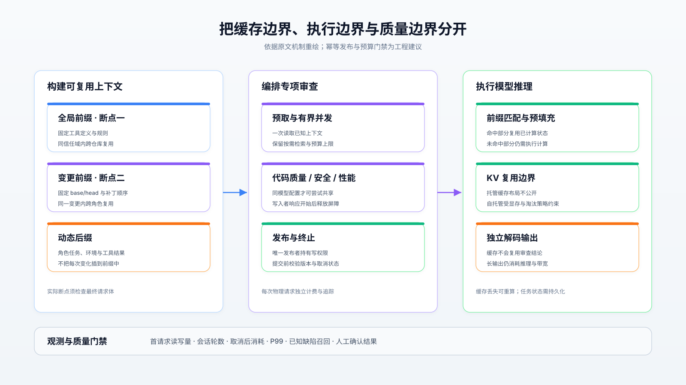
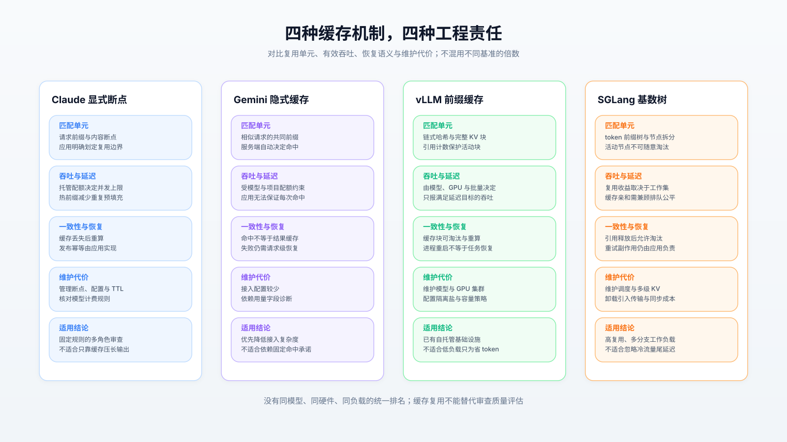
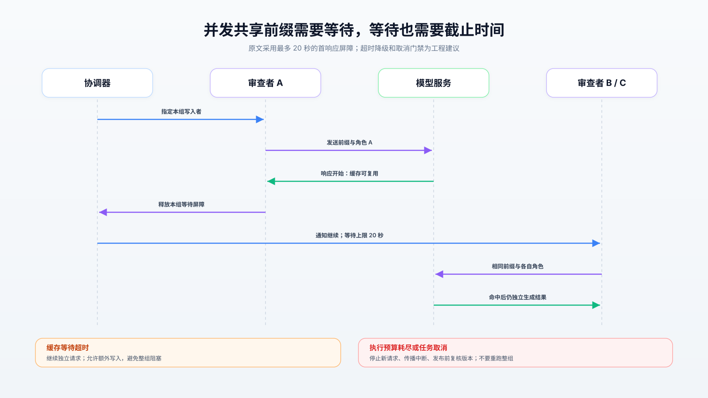
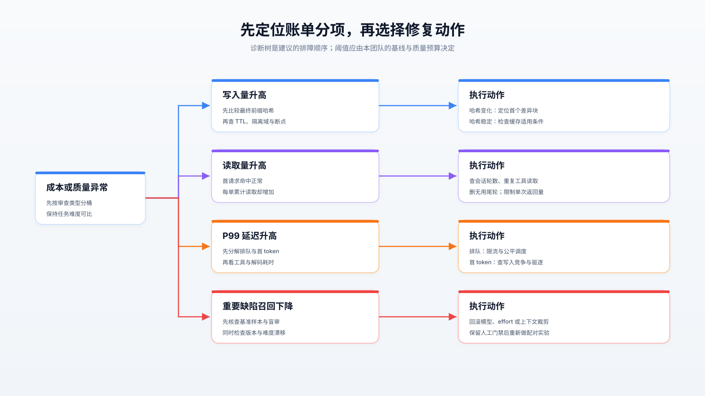

# 缓存命中率 97%，为什么 AI 审查账单仍在上涨？

> 从 Cloudflare 的降本实践，拆解前缀缓存、Agent 编排与审查质量之间的工程取舍。

Cloudflare 的 AI 代码审查一度出现反常识现象：缓存命中率从 85.7% 升至 97%，每次审查累计处理的 token 却从 91 万增至 299 万，账单继续上涨。**第一，优先优化每次任务的上下文总量和调用次数，缓存命中率必须与账单分项一起看。第二，共享前缀必须在最终请求中具有稳定边界，并承担并发等待与隔离成本。第三，模型与推理强度只能在缺陷召回约束下调整，不能凭评论减少就宣布质量无损。** 对多数已有托管模型的团队，合理顺序是先修编排、再做模型实验，最后才评估自托管。

## 1. 先审计“降本 68%”

原文报告平均费用从 2.43 美元降至 0.77 美元，中位耗时从 249 秒降至 92 秒，P99 从 920 秒降至 281 秒。它是有价值的生产案例，但不是可直接复用的容量基准：费用曲线固定了审查等级混合比例，仍可能受到等级内部的补丁规模、代码语言和复审比例影响；分阶段上线也没有隔离所有变量。[原文及输入材料](https://blog.cloudflare.com/obsessive-inference-optimization)

尤其要区分三个证据层级：

| 命题 | 交叉核验结果 | 可以推出什么 |
| :--- | :--- | :--- |
| 动态环境混入共享前缀导致失效 | 原文观测、OpenCode v1 源码、缓存协议相互支持 | 可以迁移稳定前缀设计 |
| 框架改造贡献约四成降本 | 作者按发布窗口估计，缺少独立随机实验 | 可以确定优先排查方向，不能承诺同等收益 |
| 换模型和降低强度没有质量损失 | 原文自身发现性能审查的重要问题减少约 64% | 只能逐审查类型判断 |

本文截至 2026 年 10 月 20 日核查公开资料；生产数字来自输入文章，源码用于解释机制，外部实验用于验证边界。未获得作者内部实现、完整请求日志或可复现评测集，因此没有把“机制可解释”写成“68% 已获独立复现”。

## 2. 成本来自反复经过上下文

### 按物理请求记账

一次审查通常包含协调器、多个专项审查者及重试。应把每次实际发往模型服务的请求计入费用，而非只数逻辑任务：

$$
C=\frac{1}{10^6}\sum_{j=1}^{N}(p_uU_j+p_wW_j+p_rR_j+p_oO_j)\tag{1}
$$

其中，$C$ 为单次审查费用，$N$ 为实际请求次数；$U_j、W_j、R_j、O_j$ 分别是第 $j$ 次请求的普通输入、缓存写入、缓存读取和计费输出 token；$p_u、p_w、p_r、p_o$ 是对应的每百万 token 单价。推理 token 如何归类，应以服务商用量字段与账单为准。

即使命中率不变，十轮重复读取十万 token 仍比两轮昂贵。若初始上下文为 $B$，每轮后新增 $d$ 个 token，累计输入近似为：

$$
V=NB+d\frac{N(N-1)}{2}\tag{2}
$$

$V$ 为累计输入 token，$N$ 为轮数，$B$ 为初始 token 数，$d$ 为每轮增长量；此式只描述等量增长、没有压缩或截断的会话。它说明减少一次无用尾轮，能同时减少前缀读取、历史读取和输出。

原文中，专项审查者尝试调用无权使用的发布工具，随后花一轮恢复；发布完成后，框架又要求模型生成无人阅读的总结。前者应从工具集合中消除，后者应以发布成功作为终止条件。服务端权限校验仍需保留，隐藏工具只能减少无效调用。

### 前缀必须能独立命中

OpenCode `v1.2.10` 的 `session/llm.ts` 将 Agent 提示与附加系统内容先拼成一个字符串，再执行 `experimental.chat.system.transform`；这为原文通过插件拆分系统块提供了实现依据。该版本还会把已过滤工具传给 `streamText`，并传递 `AbortSignal`，说明工具裁剪和中断传播应落在真实调用链上。[请求组装源码](https://github.com/anomalyco/opencode/blob/v1.2.10/packages/opencode/src/session/llm.ts)

对应的 `system.ts` 包含工作目录、平台与日期；`provider/transform.ts` 的 `applyCaching` 选择前两个系统消息和最后两个非系统消息设置缓存选项。若公共指令与目录、日期处于同一块且只在块末设断点，就缺少可跨仓库复用的公共边界。[环境源码](https://github.com/anomalyco/opencode/blob/v1.2.10/packages/opencode/src/session/system.ts)、[缓存变换源码](https://github.com/anomalyco/opencode/blob/v1.2.10/packages/opencode/src/provider/transform.ts)

工程上可将上下文划为“固定工具与规则”“同一变更的补丁与共享资料”“角色任务与动态结果”三层。前两层分别设置复用边界，环境信息不要插到公共前缀之前；但不能为命中率破坏指令优先级，补丁始终是不可信数据。核对对象应是适配器和插件处理后的最终请求，而非提示模板文件。

缓存复用的是前缀计算，不是审查结论：模型仍需生成输出，客户端通常也仍需发送完整请求。原文把已知参考索引预置到提示、合并读取独立文件，消除的是不必要的模型往返；这与提升缓存命中率是两种收益。一次塞入大量文件也有代价，应限制返回字节和 token，保留按需查找能力，避免无关上下文挤掉关键证据。

## 3. 四种缓存，四种责任

Claude 的显式断点适合明确控制共享层；Gemini 的隐式缓存降低接入配置；vLLM 与 SGLang 则把容量、淘汰和调度责任交给自托管团队。它们解决同一类重复预填充问题，却不提供相同的运维接口。

vLLM 使用父块哈希、当前 token 和额外身份信息识别完整 KV 块。核查 `v0.10.2` 的 `BlockPool` 可见哈希到物理块的映射、引用计数与空闲队列：`touch` 保护命中块，`free_blocks` 在引用归零后使其可回收；释放请求不意味着立即清空可复用缓存。[设计文档](https://docs.vllm.ai/en/latest/design/prefix_caching/)、[块池源码](https://github.com/vllm-project/vllm/blob/v0.10.2/vllm/v1/core/block_pool.py)

SGLang `v0.4.9.post6` 的 `RadixCache` 将 token 前缀组织成基数树；`match_prefix` 可拆分节点，`value` 关联 KV 索引，`evict` 跳过 `lock_ref > 0` 的活动节点。这里的“锁”主要表达淘汰保护的引用关系，不能直接理解成线程互斥锁，更不能推导出分布式一致性。[基数树源码](https://github.com/sgl-project/sglang/blob/v0.4.9.post6/python/sglang/srt/mem_cache/radix_cache.py)

| 维度 | Claude 显式断点 | Gemini 隐式缓存 | vLLM 前缀缓存 | SGLang 基数树 |
| :--- | :--- | :--- | :--- | :--- |
| 复用控制 | 应用划定前缀边界 | 服务端自动匹配 | 完整块哈希匹配 | 树匹配与节点拆分 |
| 吞吐极限 | 模型及账户配额，原文未提供 QPS | 模型及项目配额，无统一 QPS | GPU、模型、批量与 KV 容量决定 | 同左，并受缓存调度影响 |
| 延迟特征 | 热缓存减少预填充；共享需等待 | 命中收益需实测 | 热命中仍可能排队 | 缓存亲和与公平调度需权衡 |
| 一致性 | 前缀匹配不保证发布幂等 | 自动命中不保证结果唯一 | 引用保护不等于事务 | 节点保护不等于任务持久化 |
| 容灾 | 缓存丢失后重算，任务由应用恢复 | 同左 | 重启后需重建或外部恢复 KV | 多级缓存可扩展，恢复另行设计 |
| 运维负担 | 管断点、用量与预算 | 少配缓存，多核查实际命中 | 管 GPU、模型、容量和隔离 | 另需理解树、调度与卸载 |
| 不宜场景 | 长输出占主导，却指望缓存解决全部费用 | 依赖确定命中承诺的预算 | 低负载、无 GPU 运维能力 | 低复用，或无法承担调度调优 |

Gemini 当前文档说明隐式缓存默认适用于 2.5 及更新模型，但显式缓存受模型和 API 路径限制；不能沿用旧教程假设所有新模型都支持缓存对象。[Gemini 缓存文档](https://ai.google.dev/gemini-api/docs/caching)

### 倍数必须带着分母读

独立于上述引擎团队的 HotPrefix 论文，在单张 A6000、Llama-2 13B 等设置下，使用 MMLU、HellaSwag、BBH、CEVAL，对比 SGLang `0.4.1.post1` 与 vLLM `0.6.4.post1`，报告相对 SGLang-LRU 约 1.55～2.00 倍的收益。其吞吐统计包含预填充与解码 token，“延迟”是跑完整个数据集的时间，不能当成线上单请求 P99；它支持“淘汰与主机内存卸载很关键”，不代表当前版本排名。[论文实验设置与结果](https://cs.nju.edu.cn/tianchen/lunwen/2026/sigmod26-liyuhang.pdf)

更接近生产规模的 SGLang 实验采用 12 个节点、每节点 8 张 H100；其中解码配置在批量 256、KV 长度 2000 时报告每节点约 22,282 输出 token/s。该团队也报告双批重叠在每设备 32 token 的小批量场景下降速约 27%。这些是部署实验，仍非 Cloudflare 审查流量的独立生产基准；它们揭示高吞吐配置可能损害低负载延迟。[大集群实验与消融](https://www.lmsys.org/blog/2025-05-05-large-scale-ep/)

本地评估应固定模型、精度、硬件、输出长度与质量要求，分别回放冷启动、稳定热前缀、多仓库突发和缓存容量不足四类流量。报告满足既定 P99 的完成审查数，而非只报总 token/s。

## 4. 并发共享为何会反噬

原文让三个审查者共享前缀，一个先写，另外两个等待首个响应开始，最多 20 秒。按原文的五分钟缓存写价 1.25 倍、读价 0.1 倍计算，三个冷请求都写入的前缀费用为 3.75 个输入价单位；一次写入加两次读取是 1.45，**此前缀部分**减少约 61%，不能外推成整次审查降本。

这里还有价格时效问题：核查时 Claude 文档已将 Opus 5.5、Sonnet 5.5 的缓存读取标为普通输入价的 0.05 倍，其他模型规则也有差异；原文的 0.1 倍不可硬编码。文档还明确首响应开始后缓存才可供并发请求复用，缓存具有隔离域、最小长度和 TTL 限制，复用不会免除输出生成。[Claude 缓存协议与计费](https://platform.claude.com/docs/en/build-with-claude/prompt-caching)

推荐以同一隔离域、模型配置、工具版本和前缀哈希作为等待分组键。只让一个写入者负责预热；到达截止时间后，其余请求独立继续，允许多付少量写费。不要持有数据库事务锁等待网络流，否则首响应抖动会占住连接并拖慢整个审查队列。

三类失效尤其容易隐蔽发生：

1. **插件改了缓存位置。** OpenCode Issue #43507 报告，插件追加两条消息可使有效历史断点丢失，出现读取停滞、写入持续增长。维护者在 v2 发布后将该 v1 问题关闭为“不计划处理”；关闭记录不构成修复证明，升级后仍应回放原请求验证。[Issue 与关闭原因](https://github.com/anomalyco/opencode/issues/43507)
2. **超时触发整组重跑。** 服务商限流、传输失败与审查预算耗尽需要不同处理。前者适合有界退避，后者应调整预算、拆分任务或交给人工；已成功完成的审查者不应重新付费执行。
3. **取消只发生在控制台。** 原文抽样 446 个已取消任务，358 个继续运行，并用每 15 秒查询状态补救。GitLab 的公开信号传播问题提供旁证，但不能据此断言所有 Runner 版本都无法取消。[GitLab 信号问题](https://gitlab.com/gitlab-org/gitlab-runner/-/issues/28162)

进程崩溃还会暴露另一条边界：缓存恢复不等于副作用恢复。OpenCode v2 的公开会话契约描述持久事件、进程内执行所有权和有界恢复，同时明确不保证模型请求或工具效果恰好一次；它是设计契约，不能代替对当前部署的故障测试。[v2 会话契约](https://github.com/anomalyco/opencode/blob/dev/specs/v2/session.md)

建议将发布键绑定仓库、变更号、head SHA、审查类型和策略版本，提交前再次核查取消状态及当前 head；响应丢失时先查询发布结果，再决定是否重试。缓存共享也应限于同一信任域；自托管可利用 vLLM 的 `cache_salt` 划定隔离边界。主机内存或磁盘卸载会引入传输成本，缓存若没有明确持久化机制，断电后应按冷启动重算，而非假设它能恢复审查进度。[隔离与缓存设计](https://docs.vllm.ai/en/latest/design/prefix_caching/)

## 5. 质量必须拥有否决权

原文代码质量审查的严重发现采纳率从 34% 升至 59%，每千次审查促成修改的发现约为 145 对 132；另有 657 条发现接受跨供应商模型盲评。它们支持“严重级别膨胀减少”，却无法估计完全没被发现的缺陷。行号附近发生修改也不是正确性的充分证据，原文附近行的偶然变动基线约为 15%。

更关键的是负面结果：代码质量审查在中等强度下促成修改的发现约为高强度的四分之一；性能审查的重要发现减少约 64%，安全审查也存在不确定下降。把所有角色统一调到中等强度，会把降本变成风险转移。应对已知历史缺陷、人工植入缺陷和随机无告警样本做人工盲审，分别追踪精确率、召回率及严重级别校准。[原文质量评估](https://blog.cloudflare.com/obsessive-inference-optimization)

模型迁移时按变更单随机分组，复审沿用分组；避免同一变更在多个实验组之间串扰。原文影子运行的批准决定一致率 98% 只说明两套系统相近，不能证明两者都正确。提示、工具、模型、推理强度与压缩策略均应版本化，否则无法定位质量回退来源。

## 6. 从观测到灰度

**POC 阶段：先建立账本。** 每次请求记录任务与变更版本、模型和强度、工具版本、前缀分层哈希、缓存读写量、输出量、首 token 时间及取消时间；每单汇总失败、重试和取消后的费用。敏感内容留在受控存储，诊断面板使用哈希与计数。

**灰度阶段：先固定模型修编排。** 删除不可用工具、无用尾轮，合并独立读取；随后测试分层断点和有界等待。按小流量逐步扩大，同时注入写入者失联、限流、流式中断、取消和 head 更新。代码量大的补丁、配置文件变更、复审与小仓库应分别观察。

**全量阶段：再调整模型。** 每类审查独立设质量与时延门槛；例如可将“费用降低至少 20%、P99 不恶化、已知关键缺陷集合无新增漏检”设为团队初始门禁，这些是建议值，不是行业基准。漏检、无结论率或取消后消耗越界即回滚，并保留人工高风险审查。

发生异常时，按费用分项选择路径：写入增加先查前缀漂移；读取增加先查轮数；尾延迟增加先分解排队、首 token、工具和解码；重要缺陷召回下降先恢复质量配置。下面的决策树可直接用于值班手册。

自托管应作为独立容量项目立项，重新核算 GPU 空闲率、冗余容量、模型质量差距及运维工时。无论选哪种后端，都应按“通过质量门禁的完成审查”衡量单位成本，让缓存服务于有效工作量。

## 7. 证据索引

- **生产锚点：** [Cloudflare 原文](https://blog.cloudflare.com/obsessive-inference-optimization)，2026-10-19；费用与质量数字来自作者内部观测，输入文件保留了正文。
- **协议与接口：** [Claude 缓存](https://platform.claude.com/docs/en/build-with-claude/prompt-caching)、[Gemini 缓存](https://ai.google.dev/gemini-api/docs/caching)、[vLLM 设计](https://docs.vllm.ai/en/latest/design/prefix_caching/)，按核查日规则解释，价格与支持范围可能变化。
- **固定版本源码：** OpenCode `v1.2.10` 的 [LLM 组装](https://github.com/anomalyco/opencode/blob/v1.2.10/packages/opencode/src/session/llm.ts)与[缓存变换](https://github.com/anomalyco/opencode/blob/v1.2.10/packages/opencode/src/provider/transform.ts)；vLLM `v0.10.2` 的[块池](https://github.com/vllm-project/vllm/blob/v0.10.2/vllm/v1/core/block_pool.py)；SGLang `v0.4.9.post6` 的[基数树](https://github.com/sgl-project/sglang/blob/v0.4.9.post6/python/sglang/srt/mem_cache/radix_cache.py)。这些快照不等于作者生产部署版本。
- **实验与失效证据：** [HotPrefix 论文](https://cs.nju.edu.cn/tianchen/lunwen/2026/sigmod26-liyuhang.pdf)提供外部缓存策略对照；[SGLang 大集群实验](https://www.lmsys.org/blog/2025-05-05-large-scale-ep/)提供规模与批量边界；[OpenCode Issue #43507](https://github.com/anomalyco/opencode/issues/43507)、[GitLab Issue #28162](https://gitlab.com/gitlab-org/gitlab-runner/-/issues/28162)提供真实故障线索。均不能替代本团队负载的回放验证。
