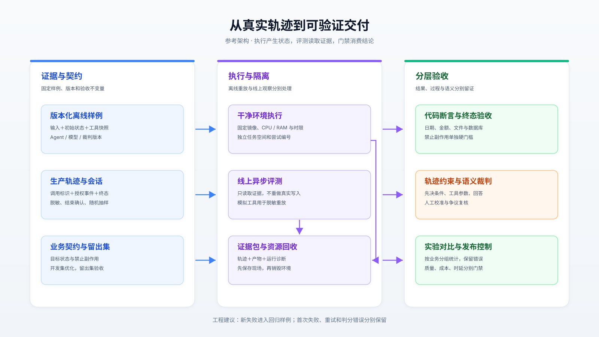
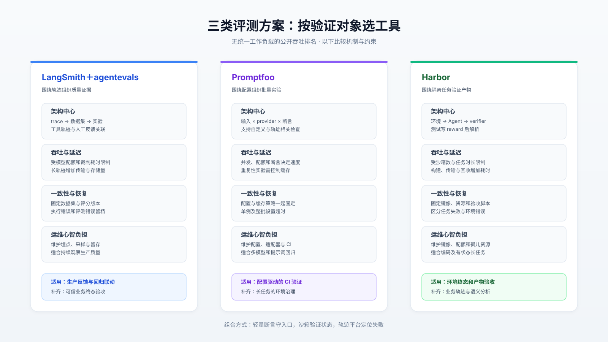
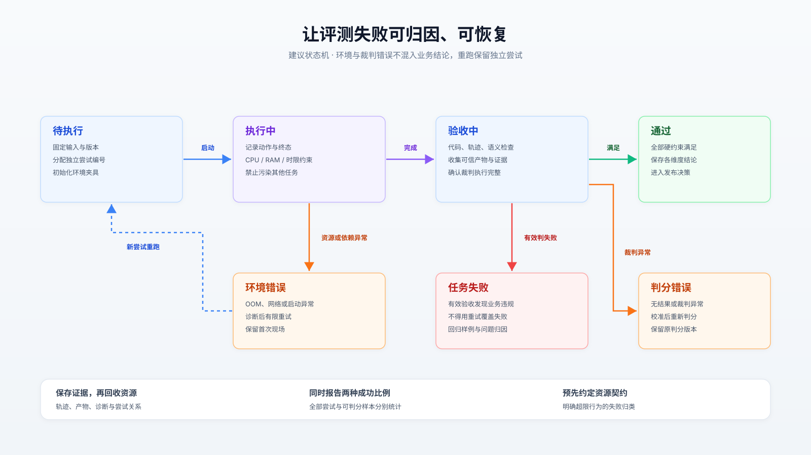
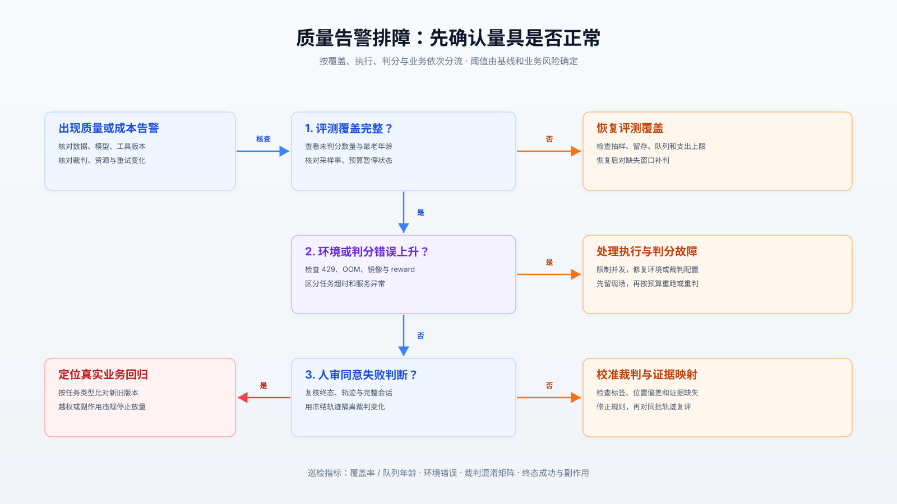

# Agent 评测为何会放过失败：从轨迹打分到可验证交付

> 面向工具调用、业务办理与编码 Agent：拆开评分、执行环境和发布门禁，建立能解释失败的评测体系。

同一个模型、同一套任务，只改变运行资源，Terminal-Bench 2.0 的成绩就能相差 **6 个百分点**：Anthropic 的公开实验显示，严格资源限制下基础设施错误率为 5.8%，不设上限时降至 0.5%。这足以倒转一些排行榜上的微小领先，却不能解释为模型能力提高。[实验报告](https://www.anthropic.com/engineering/infrastructure-noise)

**第一，Agent 评测必须同时检查最终状态、行动约束与回答，单一总分容易掩盖越权和副作用。第二，评测环境、裁判版本和重试预算都属于实验条件，必须与模型版本一起固定。第三，工程选型应按验证对象分层：代码断言守业务不变量，模型裁判评语义，隔离执行器验证真实产物。**

本文以 2026 年 10 月 15 日发表的 LangChain 文章《The Most Common Questions About Agent Evals, Answered》为锚点，核查截至 2026 年 10 月 20 日可访问的官方文档、GitHub 源码和研究论文。下文明确区分来源事实与工程建议；未实际运行付费模型或复现整套基准，公开结果不冒充本地实测。

## 1. 原文正确，但缺少验收边界

原文建议从真实轨迹抽取 10～20 个样例，建立离线基线，再把线上失败纳入回归；同时覆盖单步、完整会话与环境终态。这适合作为启动方法，但样例数量不能直接变成发布置信度。它还把成对比较与代码、模型、人审并列；严格说，前者是比较协议，后三者是判分手段，二者可以组合。[原文](https://www.langchain.com/blog/common-questions-about-agent-evals)

以订票为例，“回答确认了正确日期”“调用过搜索工具”“数据库确实生成正确订单”是三个不同命题。终态正确也可能伴随先错误扣款再撤销；轨迹合理也可能由于工具超时根本没有落单。业务契约至少应拆为：**目标状态、禁止副作用、必要先决条件、成本与时延预算**。授权检查应使用可信事件及工具执行记录，不能仅凭 Agent 自述。

因此，一次实验的最小记录应包含样例及数据集版本、Agent 构建、模型配置、工具与知识快照、环境镜像摘要、资源限制、裁判配置、尝试编号和原始证据。这里的数据结构是本文建议；它用于回答“到底改了什么”，避免把模型升级、工具数据变化和裁判变严合并成一条成功率曲线。

## 2. 把数据流和判分流拆开

建议采用两条执行路径：离线从版本化样例启动干净环境，线上从完整 trace 异步抽样。两条路径都向评测器提供标准证据包，但线上通常缺少参考答案，也不能重放真实扣款等副作用；需要重放时，应转换为脱敏夹具和模拟工具。发布控制器只消费已完成、可归因的判分结果。

架构的关键边界在于：执行器负责产生状态，评测器负责读证据，发布门禁负责做决策。下图是本文提出的参考架构，不代表 LangSmith 托管服务的内部实现。

### 轨迹匹配到底检查什么

`agentevals` 的 `create_trajectory_match_evaluator()` 先归一化消息，再分派到 strict、unordered、subset 或 superset 评分器；参数匹配默认 exact，也支持按工具覆盖。这允许保留日期等关键字段的严格比较，同时自定义检索关键词的等价规则。[分派源码](https://github.com/langchain-ai/agentevals/blob/main/python/agentevals/trajectory/match.py)

更关键的是 `strict._scorer`：它比较消息数量、角色、工具调用存在性以及工具名和参数；同一条消息中的多个调用通过 `seen` 数组寻找未使用的匹配项，并不要求调用列表顺序相同，也没有比较普通消息正文。因此，“strict 通过”不能推出回答内容正确，更不能证明真实世界动作成功。[严格匹配源码](https://github.com/langchain-ai/agentevals/blob/main/python/agentevals/trajectory/strict.py)

`unordered` 则通过双向 `_is_trajectory_superset` 判断，不保留跨消息先后关系；旧接口还带有弃用提示并使用忽略参数的配置。迁移时应逐项核对 API 默认值。[无序匹配源码](https://github.com/langchain-ai/agentevals/blob/main/python/agentevals/trajectory/unordered.py)

工程上应把“授权发生在扣款之前”写成基于事件序号、调用标识和业务对象的时序断言。严格复制某条参考轨迹会拒绝合法替代路径；完全忽略顺序又会放过业务违规。对可交换的只读搜索放宽，对具有因果关系的写操作收紧。

### 并发和内存并不免费

LangSmith Python 异步评测源码把目标执行和评测器串成每样例流水线，再通过 `aiter_with_concurrency` 限流；同一样例的评测器顺序调用。迭代器副本使用 `asyncio.Lock` 协调，反馈写入借助线程池。重复评测会物化样例列表，结果对象也持续保存结果；异步接口不等于常量内存。[异步运行器源码](https://github.com/langchain-ai/langsmith-sdk/blob/main/python/langsmith/evaluation/_arunner.py)

据此推导：慢裁判会延长样例占用槽位的时间，长轨迹和附件会增加内存压力。大规模任务宜拆分批次、外置原始附件，并分别限制 Agent、裁判和沙箱并发。此处核查的是客户端运行器，无法据此推断托管后端的数据库锁、持久化协议或服务吞吐。

### 沙箱判分依赖显式产物

Harbor v0.24.0 的 `Verifier.verify()` 上传测试、执行脚本、收集日志，随后优先解析 `reward.json`，否则解析 `reward.txt`；缺失、空文件及非有限数值均有对应异常。它没有直接将脚本退出码当作最终成绩，测试作者必须正确生成 reward。[固定版本源码](https://github.com/harbor-framework/harbor/blob/v0.24.0/src/harbor/verifier/verifier.py)

这引入镜像构建、文件传输、磁盘读写和产物解析成本。干净容器也不自动等于可信裁判：共享环境中，Agent 改动的依赖或进程可能影响验收。Harbor 文档支持独立 verifier 环境；生产建议只转移明确声明的产物，让裁判凭据、测试代码与结果写入权限独立于被测 Agent。[任务与验收环境](https://docs.harborframework.com/tasks/overview)

## 3. 三种方案如何组合

LangSmith 加 agentevals 的优势在于从生产轨迹到实验、人审的关联；Promptfoo 适合将输入、供应商与断言组织成 CI 实验；Harbor 适合需要文件系统、进程或服务状态的长任务。三者存在功能重叠，但抽象中心不同，可以让 Harbor 执行、LangSmith 分析，也可以先用 Promptfoo 跑轻量门禁。

Promptfoo 的公开实现包含 provider 调用队列与 `runAssertions` 路径；配置文档提供并发、重复次数、单例及总时限。它也支持轨迹相关检查，不能简单视为“只评最终文本”的工具。[运行器源码](https://github.com/promptfoo/promptfoo/blob/main/src/evaluator.ts)、[配置文档](https://www.promptfoo.dev/docs/configuration/reference/)

下图比较的是机制和约束，不给出缺乏统一环境的主观分数。

| 维度 | LangSmith＋agentevals | Promptfoo | Harbor |
| :-- | :-- | :-- | :-- |
| 验证中心 | trace、数据集、反馈关联 | 输入×模型配置×断言 | 任务环境、执行产物、reward |
| 吞吐边界 | 模型配额、评测并发、轨迹体积 | provider 配额、断言与队列 | 沙箱数、构建及任务运行时间 |
| 延迟来源 | Agent 执行与逐项裁判 | provider 请求与断言 | 环境启动、长任务、验收与回收 |
| 一致性前提 | 固定数据集和评测器版本 | 固定配置、缓存与重复策略 | 固定镜像、资源及验收脚本 |
| 故障恢复 | 显式保留执行及判分错误 | 配置超时，保留错误记录 | 分类环境异常并回收沙箱 |
| 运维负担 | 埋点、采样、留存及反馈治理 | 配置、适配器、CI 产物维护 | 镜像、配额、隔离、孤儿资源 |
| 不宜单独承担 | 无可信终态的扣款验收 | 未接入环境的长任务验收 | 每轮必须即时返回的在线打分 |

**没有发现三者在同一工作负载下可直接比较的公开吞吐上限或 P99 数据。**采购与 POC 应使用相同任务、模型、资源、裁判和缓存口径，分别记录冷启动与热启动、排队时间、有效判分数及每个有效判分的成本；不能拿短文本请求每秒数对比长任务每小时完成数。

## 4. 基准成绩不能替代可靠性

τ-bench 研究在零售和航空模拟业务中检查交互与最终数据库状态，2024 年报告中的函数调用 Agent 单次任务成功率低于 50%，零售场景连续八次均成功的 `pass^8` 低于 25%。这是当时模型与该任务分布的结果，不是当前模型排行榜。[论文](https://arxiv.org/abs/2406.12045)

其环境源码进一步证明了终态评分的具体方式：保存实际数据哈希，重载初始数据并执行参考动作，再比较预期哈希；部分任务还检查回答中的指定输出。状态一致能验证落地结果，却不能覆盖所有中途违规，仍需独立轨迹约束。[环境源码](https://github.com/sierra-research/tau-bench/blob/main/tau_bench/envs/base.py)

报告时应区分：`pass@k` 关注多次尝试中至少一次成功，`pass^k` 关注连续多次都成功。前者适合允许挑选候选补丁的流程，后者更接近重复办理业务的稳定性。存在扣款副作用时，重试还会改变系统状态，不能按独立抽签理解。建议按任务成组比较版本，使用按任务重采样的置信区间，并分别报告首次结果、重试收益和额外成本。

原文引用的 Jev 实验尤其需要恢复分母：**5 个固定天气案例，每例重复判分 100 次**，得到 500 次二元判断全部匹配人工标签；报告总成本为 0.34 美元，对照 Claude 为 28.17 美元。它证明了这批固定输入上的一致性和成本差异，不能当成 500 个独立场景的泛化准确率；实验未固定若干采样参数，Jev 服务版本也未记录。[实验及复现说明](https://www.langchain.com/blog/jev-agent-evals-langsmith)

对于语义裁判，MT-Bench 研究已经识别位置、冗长和自我偏好等偏差。[论文](https://arxiv.org/abs/2306.05685) 因而本文建议：使用窄问题及明确类别；成对比较交换答案位置；按真实失败类型校准；报告误放行、误拒绝和无法判断比例。总准确率可能被大量容易通过的样例抬高，无法替代高风险失败召回率。

## 5. 失败必须保留原因

Harbor Issue #1278 记录过真实运行故障：GKE 容器 OOM 后，verifier 继续等待容器可执行；内部最多 60 次探测与外层 5 次重试叠加，报告者观察到任务长期占满并发槽位。该问题已于 2026 年 3 月 30 日通过 #1317 关闭；它说明的是历史失效模式，不代表当前版本仍然存在。[故障记录](https://github.com/harbor-framework/harbor/issues/1278)

本文建议以成功、任务失败、环境错误和判分错误分别归档：前两者有有效业务结论，后两者需要诊断或重跑。已确认的进程死亡应快速失败；网络瞬断才进入有限重试；超过资源契约的 Agent 行为是否算任务失败，要预先定义。结果表同时展示全部尝试的端到端成功比例和可判分样本的成功比例，防止删掉环境错误后出现虚假提升。

下图是建议的评测状态机。恢复会创建新的尝试编号并关联原始现场，禁止覆盖首次失败；通过与失败都先持久化证据，再回收资源。

另外三类边界应进入故障演练。第一，重复测量被缓存命中：Promptfoo 默认缓存 API 响应，重复索引具有各自命名空间，但重新执行仍可能复用历史响应；测随机性时应显式关闭缓存。[缓存语义](https://www.promptfoo.dev/docs/configuration/caching/) 第二，线程尚未结束便开始裁判，后续改期使早先结论失效；应等待明确结束事件或采用带版本的静默窗口。第三，模型裁判把工具输出中的指令当作评分要求；证据必须作为不可信数据输入，并加入此类对抗样例。

## 6. 从小样本走到发布门禁

**POC：先验证量具。**挑选一个业务行为，沿用原文的小样本启动法，同时加入成功、违规、超时与模糊案例。写终态和副作用断言，人工复核全部初始样例；冻结一套不参与提示词优化的留出集。开发集负责找问题，留出集负责检查改动能否迁移。

**灰度：先观察，再阻断。**按租户或任务类型采集随机样本，并额外富集失败样本；两者分别报告，避免拿高风险样本的失败率代表总体。裁判先影子运行，人审争议样例；真实副作用留在原业务授权路径，评测只读。并发逐级增加，测 429、队列年龄、内存峰值、沙箱回收时间和判分错误率。

**全量：分层设置门禁。**禁止副作用和授权不变量采用单独硬门槛，语义指标按分组回归及置信区间判断，成本和 P95/P99 设独立预算。门槛由业务风险与历史基线确定，不能通用指定“95 分上线”。持续把线上新失败转为脱敏回归样例，但不要不断用留出集指导修改。

迁移时先保留既有 JSONL、测试函数与原始输出，新增统一证据字段，再接入平台。主要成本通常是修复会话拼接、统一工具参数语义、维护环境夹具和重新标注裁判分歧。将判分逻辑、数据和执行器接口分开，有助于更换平台时保留资产。

在线成本也不仅是裁判 token：LangSmith 文档说明，在线评测会使相关 trace 升级到扩展留存；支出上限触发后，评测器会暂停。[在线评测文档](https://docs.langchain.com/langsmith/online-evaluations-llm-as-judge) 所以应同时监控采样覆盖率与预算暂停状态；没有新低分，可能只是没有再评分。

## 7. 排障先查量具，再查模型

当质量曲线突降，先确认样例、模型、工具、裁判与资源版本是否发生变化，再判断有效证据是否完整。下面的决策卡按“覆盖缺失→执行故障→判分分歧→业务回归”顺序分流，避免一开始就修改提示词。

值班时固定检查四组指标：覆盖率与未判分年龄；环境错误、429 和资源峰值；裁判与人工的混淆矩阵；业务终态、禁止副作用及每成功任务成本。若总分升高而副作用违规增加，应立即停止该版本放量；若问题来自裁判版本变化，应先对同一批冻结轨迹重新判分，再讨论模型回滚。

真正可操作的验收结论应写成：“在指定数据、工具、资源和重试预算下，某类任务满足哪些不变量，哪些失败仍不可判定。”这样的结论才能支持发布、追责和下一轮实验。

## 8. 证据索引

- **核心锚点**：[LangChain 原文](https://www.langchain.com/blog/common-questions-about-agent-evals)，2026-10-15；输入材料与在线正文交叉核查。
- **开源实现**：[agentevals](https://github.com/langchain-ai/agentevals)、[LangSmith SDK](https://github.com/langchain-ai/langsmith-sdk)、[Promptfoo](https://github.com/promptfoo/promptfoo)；正文链接定位到具体文件，`main` 为核查时可见内容，后续可能变化。
- **固定版本与演进**：[Harbor v0.24.0](https://github.com/harbor-framework/harbor/releases/tag/v0.24.0)、[历史故障 #1278](https://github.com/harbor-framework/harbor/issues/1278)；区分已发布实现与已关闭故障。
- **独立研究与工程实测**：[τ-bench](https://arxiv.org/abs/2406.12045)、[MT-Bench](https://arxiv.org/abs/2306.05685)、[Anthropic 资源噪声实验](https://www.anthropic.com/engineering/infrastructure-noise)；分别约束可靠性、裁判偏差和运行环境混杂因素，均非三款框架的统一性能竞赛。
- **厂商实验**：[Jev 裁判实验](https://www.langchain.com/blog/jev-agent-evals-langsmith)及[复现仓库](https://github.com/danielgshea/jev-as-a-judge)；只支持所述小样本结论。本文架构、状态机与落地门禁是基于上述证据的工程建议。
