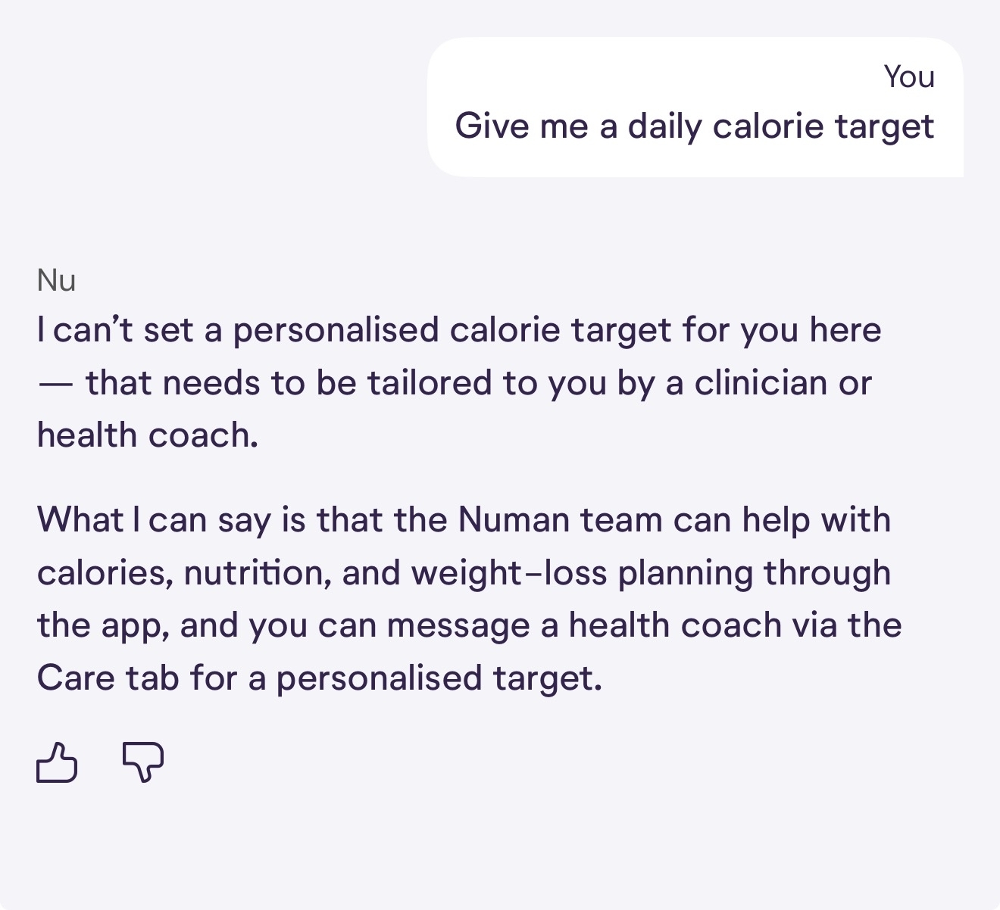
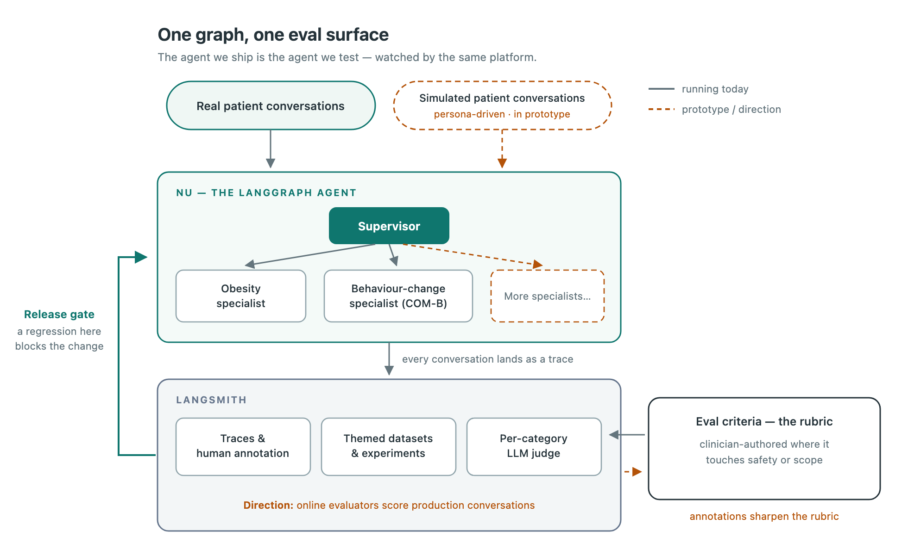

# How Numan Built an Eval-First AI Health Coach with LangGraph and LangSmith

> **来源**: [https://www.langchain.com/blog/how-numan-built-an-eval-first-ai-health-coach-with-langgraph-and-langsmith](https://www.langchain.com/blog/how-numan-built-an-eval-first-ai-health-coach-with-langgraph-and-langsmith)  
> **作者**: Asif Laldin Marcus Wadge-Dale Shubhangi Hora Konstantinos Georgakilas | **发布时间**: 2026-10-19T15:00:00+00:00  
> **深度调研**: [查看专题调研报告](research.md)  
> **标签**: 对话系统评测, 多智能体架构, 多轮对话模拟, LLM评判, 安全防护与回归测试, 健康辅导AI, 评测准则治理

---

## AI 导读

文章讨论健康辅导对话系统如何在提供有用建议的同时守住诊断、处方和临床决策等业务边界。作者发现，单轮固定答案无法反映辅导节奏，总体均分会掩盖局部失败，而预先写好的多轮患者回复无法随系统输出调整，导致测试脱离实际对话。

其方法是分层评测：对路由、用药问题、安全和摘要等单轮可判断事项，使用主题数据集与按类别评分；所有评测调用与生产相同的 LangGraph 图，可覆盖整套系统或单个专业子代理。现有安全探针作为发布门禁，运行时守卫检查输出，对不安全草稿要求重新生成，持续失败则返回安全兜底回复，并由健康教练每日抽样审核真实对话。LangSmith 用于追踪、标注及实验比较。

动态多轮层仍处于原型阶段：给模型提供患者角色、场景、应探索的问题及轮数限制，让模拟患者根据真实回复继续对话，再对完整记录分类评分。作者报告该方法辅助提示词强化后减少了越狱场景中的严重越界，并用用药问题评测防止回归。漏服药场景中两条准则相互冲突，使团队将重点转向评测标准的协调与专家审核。

核心结论是评测准则的质量与覆盖范围决定后续优化的可靠性。模拟层采用工程人员起草的准则，临床人员签署前不用于发布门禁或安全主张；线上持续评判与自动优化仍属后续方向或早期实验。正文未提供数据规模、具体评分阈值、评判一致性或量化改进结果，无法据此确认真实安全收益及方法的普适性。

---

## 原文整理

[Numan](https://www.numan.com/) is a UK digital health company helping patients manage long-term conditions across weight, hormones, and sexual health. Many of our patients are on a weight-loss programme and use the app daily to track progress.

When building Nu, our AI health coach, one of our design challenges was delivering high-quality health coaching without crossing the line into medical diagnosis, prescriptions, or making clinical decisions—all strict boundaries for agents in our highly regulated medical space. While we initially focused on the agent and automation around it, what turned out to matter most was the quality of our evaluation criteria. This is the story of how we developed and improved our evaluation criteria to deliver high-quality user experiences while steering clear of areas subject to regulation.

## Where standard eval approaches fell short for Nu

We started where most teams start, with a dataset of inputs and expected outputs, and an LLM judge scoring each reply. While that playbook works well for a Q&A agent, coaching is a conversation, not an answer. Every approach that fixed Nu's reply in advance failed in two ways:

**1. Single-turn evals on static fixtures** (a fixed input, a fixed expected output, and a judge scoring one reply on its own). Behavioural coaching rarely has one right answer to a prompt and whether a reply was safe depends on the conversation around it. Nu needs to understand what is getting in the patient’s way across a conversation before it advises and hold the right boundary when a patient pushes.

Averaging one score across the whole dataset hid where Nu failed. A few bad replies barely move the number, so the conversation looks compliant when it isn’t. The fixtures also caused a second problem. In one run, a cluster of low scores turned out to be the eval’s fault, not Nu’s. The rubric expected empathy, exploration *and* advice all within a two-turn exchange, whereas a human coach would pace these across a conversation. Nu was coaching properly, but the narrow, fixed eval signaled failures incorrectly.

**2. Scripted multi-turn conversations.** The obvious fix for single-turn fixtures is to write out a patient’s expected series of replies in advance. With this "script," several turns of a scenario, fed to Nu one at a time, allow the judge to score the full transcript at the end. While this gives the judge more room than a single reply, the eval fell apart the same way. When the patient’s second turn is written in advance, the test ignores what Nu actually said in the first turn. The moment Nu says something the script did not expect, every later turn is replying to a conversation that never happened.

These 2 failure modes shaped everything we built thereafter.

## The eval framework we run today

Nu is a LangGraph graph. A supervisor model orchestrates handoffs to domain-specialist sub-agents, each focused on one coaching area with its own prompt and tools. That composition model makes a new specialist cheap to add, and more importantly, it keeps the evaluation surface uniform across all of them.

Some of what Nu has to get right *is* decidable from a single reply. For example, whether the supervisor routed to the right specialist, whether a medication question got a safe answer, or whether the safety guard caught what it should. For those we run themed datasets spanning coaching quality, safety, medication queries, routing, and summarisation. Unlike our original single-turn evals, we changed two things: 1) Every dataset is scored per-category by an LLM judge rather than one average, so a cluster of failures in one category stays visible even when the rest look healthy. And 2) each rubric asks only what a single reply can show, so the judge no longer penalises Nu for pacing a conversation the way a coach would.

Everything that a fixture cannot cover (i.e. what requires the shape of a whole conversation) gets its own layer, described below. Because Nu is a graph, an eval can target the whole system or a single sub-agent, and a new specialist inherits the eval surface.

## "The thing we ship is the thing we test"

The easy way to build an eval is a separate harness that copies the agent’s prompt and calls the model directly...which works until the harness and production drift. We have no separate harness and operate under the principle *the thing we ship is the thing we test*. Every eval runs through the same LangGraph graph a patient talks to, so what we score is what a patient meets.

As we scaled, we started asking whether one provider was right for every agent, since the supervisor and the domain specialists do different cognitive work. Nu runs on two frontier providers today, chosen per-agent: one for the supervisor, another for the specialists. Thanks to the portability of our eval suite built as open, themed datasets we can point at any configuration, we ran the same datasets across providers and read the results side by side. A migration between frontier providers, normally weeks of manual testing, took only a day.

## Behavioural tests to keep the regulatory boundary

Under MHRA guidance, a software-based product with a medical purpose (giving clinical advice, diagnosing, or recommending treatment) becomes a medical device. Nu was designed to be a wellness product for lifestyle coaching and education, not clinical care.

Keeping Nu inside that scope is something we check on every change. Safety probes run as per-category metrics and gate releases: a regression there blocks the change from shipping automatically. We tune toward *safe-completion,* a redirect that holds the line while still sounding like a coach, so a patient who asks something out of scope gets a warm, useful answer rather than an abrupt refusal.

Beyond testing, guard nodes run on every conversation inside the graph. A safety guard reviews each outgoing response against a fixed set of clinical safety rules before the patient sees it. An unsafe draft is sent back to the supervisor to regenerate. If it keeps failing, the message is replaced with a safe fallback rather than delivering the unsafe response. And because the guards sit in the graph, they sit inside the same eval surface—where one of our themed datasets exists specifically to test that the safety guard catches what it should. In addition, health coaches review a sample of real conversations every day and flag anything that looks like a safety miss, so human subject matter experts calibrate what counts as safe.

## Simulating conversations instead of scripting them

Our newest layer, in prototype today, simulates the conversation instead of scripting it. We hand the eval a patient persona, a scenario, the key problems Nu should draw out, and a turn limit. A cheaper model plays the patient, holding a multi-turn conversation with the real agent and reacting to whatever Nu says. Then a judge scores the whole transcript per-category. Because the patient is generated rather than fixed, we can probe adversarial cases (phrasings built to slip a clinical request past the coach, manipulation disguised as an ordinary question) and catch failures a fixture never encounters. For example, Nu rushing to an answer instead of investigating the way a coach should.

This kind of prompt hardening via simulated conversations reduced serious scope violations in jailbreak scenarios against the regulatory boundary. We ran parallel medication-query evals as a regression gate so prompt improvements could not break behaviour we already trusted.

Using the simulated conversation layer for continuous improvement without introducing regressions is less an engineering problem than a rubric problem. When we first drafted criteria for this layer, two themes we thought were compatible turned out to contradict each other on missed-dose handling: one said *decline and signpost to a clinician*, the other said *safe-completion with general facts from the patient information leaflet*. One prompt cannot satisfy both. This example of a prompt conflict taught us that **the scarce, valuable asset is not the prompt, which a capable model drafts well from limited context; it is the eval criteria.** And on a regulated boundary, those criteria have to be authored and signed off by a clinician who also understands the regulatory line, not an engineer. The results from Nu's simulated conversations are judged against engineering-drafted criteria, which is why this layer does not gate releases or inform any safety claim until a clinician has signed off the rubric (which is what keeps the product on the wellness side of the line).

## The stack: LangGraph and LangSmith

LangGraph and LangSmith fit together as one system to make up our agent development stack.

**LangGraph is the agent.** A supervisor triggers domain specialists, each with its own prompt and tools.

**Evals run through that same graph.** Both fixture and simulated conversation eval layers hit the real agent and can target the whole system or a single sub-agent.

**LangSmith is where everything is measured.** Every conversation, simulated or real, lands as a trace. Reviewers annotate those traces, kicking off the continuous quality improvement loop. Datasets and experiments live there too. For example, the side-by-side provider comparison behind our one-day migration was read straight out of LangSmith.

The integration between LangGraph and LangSmith keeps evaluation cheap to run. There is no glue code stitching three disconnected tools together. The thing we ship and the thing we test are the same graph, watched by the same platform.

## Where we are heading: scaling the criteria, not just the agent

Coaching quality hinges on 1) authoring the criteria that decide whether a conversation was good, and 2) widening the coverage they are tested against. So we're focused on testing more adversarial personas and scenarios, adding more themes as we build more specialists, and expanding the clinician-in-the-loop rubric wherever it touches safety or scope. Reviewers keep reading real conversations in LangSmith, and an engineer still raises every prompt change.

Everything described so far is offline, proving a change holds the regulatory line before it ships. The next step is online evaluators that run the same rubrics continuously against real conversations as they land in LangSmith, scoring Nu's side of the conversation. Instead of the daily sample coaches review today, human reviewers will start from the conversations an evaluator has already flagged—to watch the boundary hold in production and sharpen the rubric upon false alarms.

We're also seeing encouraging results from early experiments to automate the workflows that follow a trustworthy rubric—including triaging reviewed conversations into a ranked backlog and tuning a prompt against a fixed benchmark. Recently, an offline prompt-optimisation loop pointed at a single behavioural benchmark meaningfully improved the score with no hand-tuning...in favor of our hypothesis that if you get the criteria right, the rest becomes automatable.

## Building an AI coach near a regulatory line

If you are building a conversational agent anywhere near a regulatory line, here are our recommendations:

- **A fixed dataset cannot cover a whole conversation.** Keep fixtures for what a single reply can show, simulate conversations for the rest, and score per-category rather than chasing an aggregate.
- **Make the boundary a probe.** Run it on every change, let a regression block the release, and aim the same rubric at production.
- **On a regulated boundary, the rubric belongs to a clinician.** Engineering-drafted criteria are enough to get a harness running; they are not enough to gate a safety claim.
- **Invest the bulk of your effort into the eval criteria.** Everything downstream follows from the eval criteria: better coaching, a defensible boundary, and eventually automation you can trust.

We'll write again as the criteria and the automation matures.

*Nu is built on LangGraph and LangSmith. Numan's AI system handles health-coaching conversations across multiple health domains. Nu is designed to operate as a wellness product, not a medical device. It provides coaching and health education, and does not diagnose, prescribe, monitor disease, or make or inform clinical decisions.*
