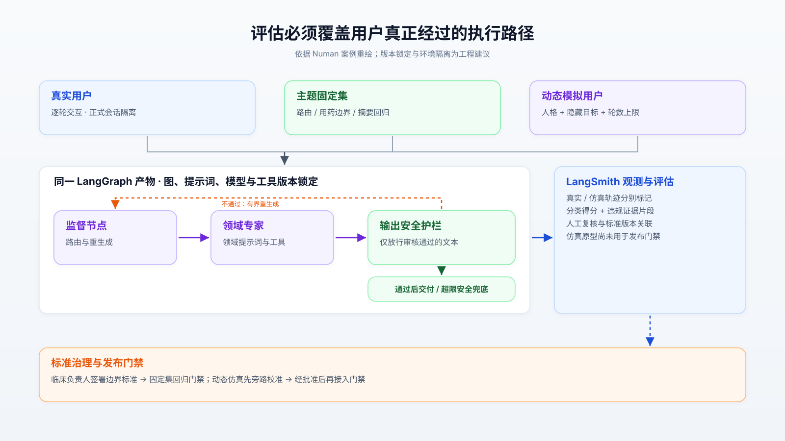
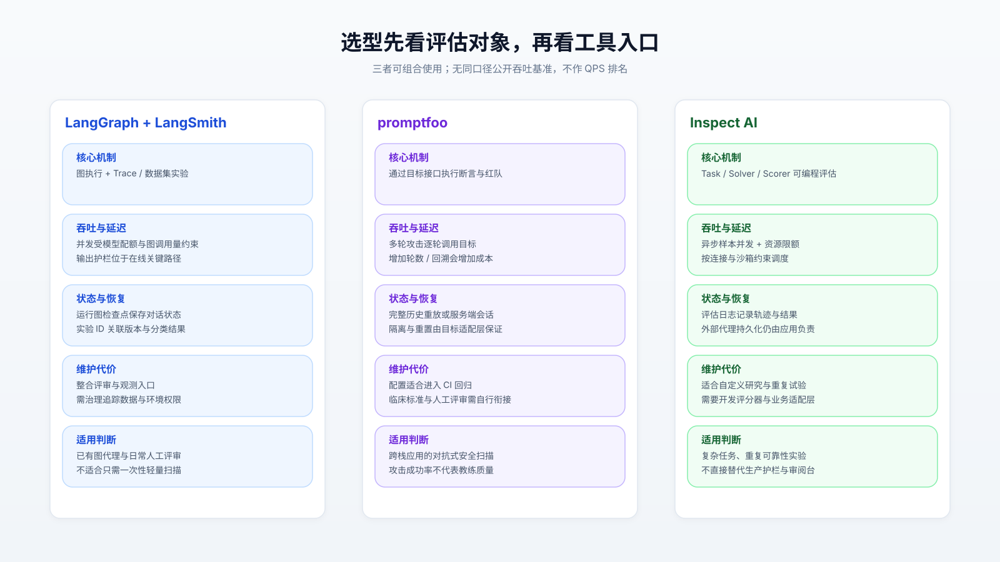
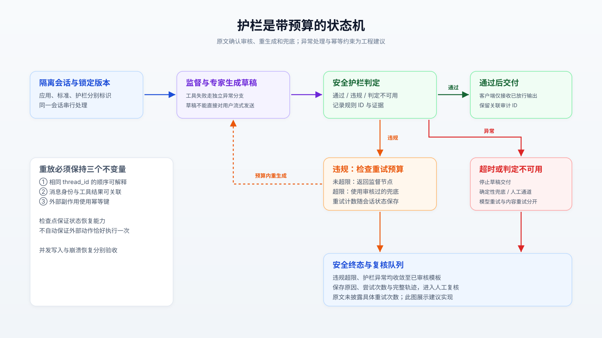
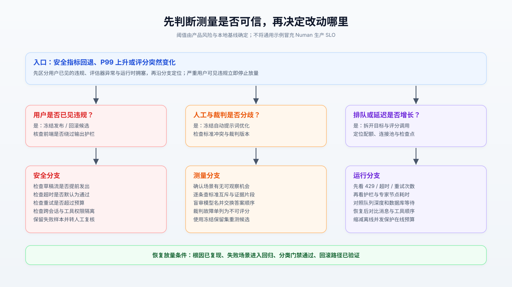

# 健康教练代理的安全边界，为什么先由评估标准决定

Numan 在评估健康教练 Nu 时遇到过一次“低分误报”：标准要求两轮对话同时完成共情、探索与建议，代理按合理节奏追问，反而被判失败。这个案例说明，可靠的教练代理需要把单轮边界检查、整段对话质量与运行时护栏分别验证，并让评估经过实际交付的执行图。工程上应先冻结可审计的分类标准，再建设动态仿真和发布门禁；平均分、一次模型迁移成功或临床人员签署，都不能单独证明系统安全。[原文案例](https://www.langchain.com/blog/how-numan-built-an-eval-first-ai-health-coach-with-langgraph-and-langsmith)

## 1. 先划清事实与安全主张

Nu 使用监督模型分派领域专家，由输出护栏审核草稿，失败时重生成，持续失败则使用安全兜底；固定主题集覆盖路由、用药问题、安全与摘要，相关安全回归阻断发布。这是原文描述的已运行能力。

动态模拟用户则仍是原型：便宜模型根据人格和场景逐轮回应，裁判评分整段记录。原文明确说，其标准由工程人员起草，临床负责人尚未签署，因此这一层**不承担发布门禁，也不支持安全主张**。线上自动评估与自动优化也属于后续方向，不能在架构复述中写成既成事实。

| 原文命题 | 交叉核验结果 | 可采用的结论 |
| :--- | :--- | :--- |
| 相同图保证测到实际交付物 | 框架允许直接评估应用入口；但模型参数、工具权限、状态库仍可能不同 | 同图是必要条件，还须锁定配置和依赖 |
| 分类评分揭示总体均分掩盖的失败 | 独立多轮基准显示平均成功与重复可靠性有明显差距 | 同时报告分类分母、严重失败与重复试验 |
| 标准签署约束产品边界 | MHRA 按预期用途及制造商提供的材料判断用途 | 签署是治理证据，不能自行决定法律分类 |

MHRA 指南强调，应从客观观察者角度，结合标签、说明、宣传与技术材料理解预期用途。因此，“健康教育”的自我定位不能覆盖实际诊疗功能；临床负责人批准评分标准也不等于监管批准。把允许行为、禁止行为、转介条件与产品宣传逐项对应，才便于检查边界是否一致。[MHRA 预期用途指南](https://www.gov.uk/government/publications/crafting-an-intended-purpose-in-the-context-of-software-as-a-medical-device-samd/crafting-an-intended-purpose-in-the-context-of-software-as-a-medical-device-samd)

本次核查截至 2026 年 10 月 20 日。原文没有提供 Nu 的源码仓库、模型快照、测试集规模、违规率分母或生产延迟数据；下面区分框架源码事实、外部实验与工程建议，不将公共框架能力视为 Nu 已启用的配置。

## 2. 同一执行图如何避免测试漂移

### 状态必须成为显式契约

建议把应用状态至少拆为消息、当前专家、风险标签、草稿、护栏结果和重试计数。模拟患者只看患者可见内容，裁判另取完整记录；若把隐藏评分目标传给代理，测试会退化为答案泄漏。真实会话与仿真应使用不同命名空间、追踪项目和工具凭证，确保测试经过相同代码，同时隔离真实副作用。

LangGraph 的 Pregel 运行时采用分步执行：规划节点、并发执行、统一更新通道。节点在当前步骤写入的通道更新，要到后续步骤才对其他节点可见；这提供了明确的状态合并边界，也意味着慢节点会延长当前步骤，增加专家数量不会自动缩短用户等待。[运行时文档](https://docs.langchain.com/oss/python/langgraph/pregel)

调度源码核查以发布标签 **1.2.16** 为锚点，提交为 `41c9c22`，不代表 Numan 使用该版本。`pregel/_algo.py` 的 `apply_writes()` 先按任务路径排序，再应用通道更新；`pregel/_runner.py` 通过任务执行器和 Future 管理完成、异常及重试。这里的确定性合并不能代替应用层会话串行化：同一用户连发消息，应在入口排队或拒绝冲突运行；锁应覆盖状态推进边界，避免用一个全局锁包住所有模型请求。[合并实现](https://github.com/langchain-ai/langgraph/blob/1.2.16/libs/langgraph/langgraph/pregel/_algo.py)、[执行器实现](https://github.com/langchain-ai/langgraph/blob/41c9c22fdc83d68a2859d0c9a2b627c8615a792f/libs/langgraph/langgraph/pregel/_runner.py)

消息合并也有语义：`add_messages()` 按消息 ID 更新已有消息，否则追加。重试沿用 ID 还是生成新 ID，会影响草稿被替换还是重复进入历史。建议区分内部草稿与用户可见消息，只把批准后的文本写入正式对话记录；这项约束需要应用自己实现。[消息合并源码](https://github.com/langchain-ai/langgraph/blob/main/libs/langgraph/langgraph/graph/message.py)

### 存储恢复不等于动作幂等

对话状态驻留内存，检查点后端负责序列化持久化。长历史若每步保存完整消息集，累计写量会随轮数加速增长；增量存储可以减少重复写入，但增加回放工作及格式迁移成本。生产上要同时看检查点字节数、写入耗时和恢复耗时，不能只看模型 Token 消耗。

框架提供 `sync`、`async`、`exit` 三种持久化模式，分别在下一步前同步保存、与后续执行并行保存、退出时保存。它们交换的是保存开销与崩溃恢复窗口；均不能让外部通知、预约或数据写入天然获得“恰好一次”语义，相关工具仍须使用业务幂等键。[持久化模式定义](https://reference.langchain.com/python/langgraph-sdk/schema/Durability)

由此，评估入口应接收不可变的版本清单，关联图、提示词、模型、工具、护栏和评分标准。下图将原文运行链路与建议的版本、环境隔离放在一起，避免把“代码相同”误读为“实验条件相同”。

## 3. 评估工具应按职责选择

固定集适合判定路由和明确越界，脚本多轮适合复现特定协议路径，动态仿真适合探索追问、节奏与诱导。脚本并非没有价值：当测试目标就是固定事件序列，确定性反而方便定位；其限制是无法自然回应代理偏离预设后的新问题。

在工具层，LangSmith 把轨迹、数据集实验与人工评审放进同一工作入口。其 Python 异步评估源码把预测与逐样本评分组成流水线，由 `max_concurrency` 控制样本流水线并发；样本内部仍可能调用多个专家和护栏，因此该参数不是供应商请求数的硬上限。[评估执行源码](https://github.com/langchain-ai/langsmith-sdk/blob/main/python/langsmith/evaluation/_arunner.py)

promptfoo 可从应用接口发起多轮攻击，例如 Crescendo 逐步升级请求并在拒绝后回溯。必须区分完整历史重放与服务端有状态会话，否则重复注入历史会改变测试条件；轮数和回溯增加也会增加调用成本。这适合发现边界绕过，教练质量仍需另设评分器。[多轮策略文档](https://www.promptfoo.dev/docs/red-team/strategies/multi-turn/)

Inspect AI 提供可编程任务、求解器和评分器，适合复杂实验与重复试验；其异步调度可限制模型连接和沙箱资源。Agent Bridge 可以接入外部代理，但会将原生模型调用转向 Inspect 的模型提供层；若要验证精确的生产请求行为，应核对桥接差异，或直接调用部署入口。[并发机制](https://inspect.aisi.org.uk/parallelism.html)、[代理桥接](https://inspect.aisi.org.uk/agent-bridge.html)

三者可以组合：用 LangSmith 评审真实失败，用 promptfoo 扩展攻击，用 Inspect 做可编程对照；团队也可以只保留一个主平台，减少身份、数据和评分结果的同步负担。

| 维度 | LangGraph＋LangSmith | promptfoo | Inspect AI |
| :--- | :--- | :--- | :--- |
| 主体机制 | 执行图、轨迹与实验关联 | 目标接口、断言与攻击策略 | 可编程任务与评分流程 |
| 吞吐极限 | 未见同口径公开上限；受模型、图展开及存储约束 | 未见可直接比较的上限；多轮攻击扩大调用量 | 未见可直接比较的上限；受连接与沙箱限额约束 |
| 延迟关注点 | 在线专家、护栏与检查点耗时 | 离线逐轮攻击及评分耗时 | 样本执行、工具与评分耗时 |
| 一致性与容灾 | 图状态可持久化；外部工具需幂等 | 目标会话重置与隔离依赖适配层 | 评估日志记录结果；应用恢复另行负责 |
| 运维负担 | 维护追踪数据、权限和标准版本 | 维护配置、目标适配与业务评审入口 | 维护实验代码、评分器及资源限制 |
| 反向不适用 | 仅需一次小规模扫描 | 单靠攻击成功率判断长期教练效果 | 期望直接获得完整生产护栏服务 |

## 4. 基准能证明什么

Numan 称供应商迁移只用一天，但未披露样本数、并发、成本和置信区间。这能支持“既有评估资产降低比较成本”的经验判断，不能证明模型等价，也不能据此推导生产吞吐或安全改进幅度。本次未获得 Nu 可复现的生产压测报告或公开事故复盘。

独立证据来自任务交互基准 τ-bench：ICLR 2025 版本中，GPT-4o 函数调用代理的零售、航空单次成功率分别为 **61.2% 和 35.2%**；零售任务的八次全部成功指标 `pass^8` 降至 **25% 以下**。主结果每任务至少三次试验，代理最多执行三十个动作；这些是历史模型在模拟业务环境中的实验，不能外推为当前模型排名或健康场景安全率。[论文与实验口径](https://proceedings.iclr.cc/paper_files/paper/2025/file/1b126cc38b8638e07bef37e7b2bb72bf-Paper-Conference.pdf)

可迁移的方法是对关键场景重复运行，并保留失败轨迹。`pass^k` 衡量反复全部成功，与多次尝试中至少成功一次的 `pass@k` 不同；后者适合搜索候选答案，前者更能揭示用户反复使用时的不稳定。健康教练还应分别报告草稿越界率、护栏漏检率和用户可见越界率：草稿改善不代表护栏改善，兜底增多也可能只是隐藏了代理退化。

裁判自身需要校准。MT-Bench 研究观察到强模型裁判与人类偏好的一致率超过 80%，同时发现位置、篇幅和自我偏好等偏差；偏好一致率并不等于临床安全识别准确率。工程上应盲化候选模型名称、交换成对答案顺序，并用专家标注样本测量漏判与误判。[裁判研究](https://arxiv.org/abs/2306.05685)

对于罕见严重事件，零失败仍有统计限制。例如在独立、同分布的伯努利试验假设下，300 次零失败对应的单侧 95% 精确上界约为 **0.994%**；这是统计计算，不是 Nu 的测量结果。人格与攻击模板通常相关，因此应按场景族分析，而非把同一攻击的数百次改写算成数百份独立证据。

## 5. 最危险的失效发生在边界之间

### 护栏不能晚于交付

输出审核需要实际控制客户端出口。若前端已经收到草稿 Token，之后发现违规也无法撤回。NeMo Guardrails 的公开文档明确指出，`stream_first: true` 会先交付分块再审核；设置为 `false` 才先检查分块。这是可核验的实现取舍，并非 Numan 的事故；它说明健康场景必须检查传输链路，分块通过也不能证明整段语义安全。[输出流式护栏](https://nvidia-nemo.github.io/Guardrails/develop/configure-rails/yaml-schema/streaming/output-rail-streaming.html)

建议草稿整体通过后再交付，且把内容违规重试与网络重试分开计数。护栏超时或供应商不可用时，进入审核过的确定性兜底或人工通道；设置最大尝试数和总截止时间，防止“生成—拒绝—再生成”耗尽配额。生成器与护栏若共享模型或同一套含糊标准，还可能同时漏判，不能假设两层错误相互独立。

### 检查点回放也会改变对话

GitHub Issue #8382 给出 DeltaChannel 的复现：并发写入后，历史回放顺序与实时结果不一致，继续会话时已有状态会重排。该问题针对 beta 增量通道，不能扩大为所有 LangGraph 会话均有缺陷；发布记录已列入按任务路径排序回放的修复 #8544，1.2.16 还包含恢复更新与子图重复执行的修复。[问题复现](https://github.com/langchain-ai/langgraph/issues/8382)、[版本记录](https://github.com/langchain-ai/langgraph/releases)

落地验收应覆盖并发扇出、进程中断、检查点恢复和下一轮续聊，核对消息 ID、工具调用对应关系及副作用次数。升级运行时或切换存储格式时，应使用历史会话验证恢复与回滚，避免只测新会话。

另一类失效是标准冲突：原文两套标准对漏服药问题分别要求拒绝并转介、提供说明书中的一般事实。继续优化提示词无法解决互斥要求。应先由责任人统一规则，再在评分中加入“不可观察”状态：没有出现危机场景的对话，不能算危机识别通过；裁判超时也必须单列为不可评分。

## 6. 从概念验证到可回滚发布

**概念验证阶段**先建立风险分类和标注规范。每条标准记录规则 ID、适用上下文、禁止行为、允许替代行为、严重度、正反例与批准人；让双人独立标注冲突样本，经仲裁形成冻结集。保留未参与提示词优化的测试集，防止优化循环只学会迎合裁判。

**灰度阶段**采用固定回归集验证候选版本，动态仿真先旁路观察。场景至少覆盖含糊请求、跨专家切换、长上下文诱导、工具超时和护栏不可用。按会话稳定分配版本，避免一次对话中途换模型；为在线请求、模拟用户和裁判分别分配限额，离线实验不能抢占在线护栏预算。

**全量阶段**要求人工确认的严重用户可见违规阻断放量，同时满足分类质量与运行稳定性要求。具体阈值由产品风险和本地基线决定；每次发布保存版本清单、实验 ID、失败样本与回滚入口。在线评估除了优先查看被标记的会话，还应随机抽检未标记会话，否则无法发现裁判漏报。

| 巡检指标 | 必须保留的口径 | 可执行动作 |
| :--- | :--- | :--- |
| 分类越界率 | 场景数、可观察数、失败数及严重度 | 严重失败先暂停放量并人工复核 |
| 护栏漏检与误拦 | 专家标注分母、草稿及最终输出 | 分别调整检测规则与允许行为 |
| 对话质量 | 探索、节奏、行动建议分别评分 | 检查标准是否强迫过早给建议 |
| P95/P99 与成本 | 端到端及节点耗时、重试和 Token | 分开定位模型、护栏、存储与排队 |
| 评估运行健康 | 超时、429、裁判错误及不可评分数 | 修复实验基础设施后重新比较 |

排障时先判断用户是否已看到违规，再判断测量是否可信，最后定位运行资源。只有确认标准、实验环境和状态恢复均有效，才值得继续改提示词。

## 7. 核心证据索引

- **案例事实**：[Numan 原文](https://www.langchain.com/blog/how-numan-built-an-eval-first-ai-health-coach-with-langgraph-and-langsmith)。生产实践自述；未公开量化安全或压测数据。
- **开源实现**：[LangGraph 1.2.16](https://github.com/langchain-ai/langgraph/tree/1.2.16)、[LangSmith SDK](https://github.com/langchain-ai/langsmith-sdk)。调度代码锁定标签，消息合并与 SDK 按本次访问的主分支核查；均不代表 Nu 私有应用代码。
- **对标生态**：[promptfoo 仓库](https://github.com/promptfoo/promptfoo)、[Inspect AI 仓库](https://github.com/UKGovernmentBEIS/inspect_ai)、[NeMo Guardrails 仓库](https://github.com/NVIDIA-NeMo/Guardrails)。分别用于攻击生成、可编程评估和运行时护栏机制对照。
- **独立实验**：[τ-bench 代码与数据](https://github.com/sierra-research/tau-bench)、[MT-Bench 研究](https://arxiv.org/abs/2306.05685)。前者验证多轮任务可靠性问题，后者揭示裁判偏差；均不是医疗生产认证。
- **监管原始资料**：[MHRA 预期用途指南](https://www.gov.uk/government/publications/crafting-an-intended-purpose-in-the-context-of-software-as-a-medical-device-samd/crafting-an-intended-purpose-in-the-context-of-software-as-a-medical-device-samd)。用于核对用途界定，不能从评估通过反推监管结论。
