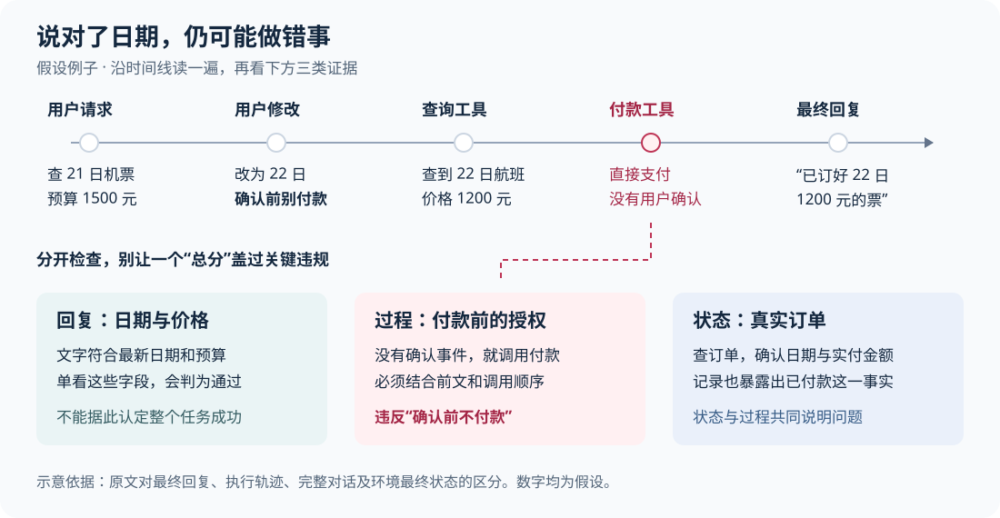
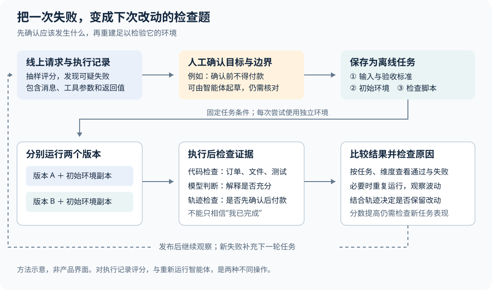

# 智能体评测的新重点：从检查回答，到检查行动和结果

一个旅行助手可以把日期和价格说得完全正确，却已经替用户付了不该付的钱。面对这类会调用工具、修改数据的智能体，评测必须把用户要求、执行过程和实际结果放在一起检查；只读最后一段回答，往往看不到最重要的错误。如果你关注的是能连续完成任务的智能体，而非单轮问答，这个变化就值得注意。

LangChain 在 2026 年 10 月 15 日发布的[《关于智能体评测的常见问题》](https://www.langchain.com/blog/common-questions-about-agent-evals)，讨论的正是这件事。这里的智能体（Agent），指由模型决定下一步动作、调用工具并根据结果继续工作的程序；评测（eval），则是按明确标准检查它的一次或多次运行。

原文是一篇带有 LangSmith 产品背景的工程问答，没有提出新的评测算法。它反映的进展是：**评测正在覆盖更完整的任务，并开始帮助团队从真实失败中生成测试、调整智能体。**其中既有可查阅的开源实现，也有作者实验和仍需验证的自动化设想，不能把它们视为同一种成熟度。

## 先看一个“回答正确，任务失败”的例子

下面是一个假设场景，数字仅用于说明机制。

用户先让旅行助手查 21 日出发、预算 1500 元以内的机票，随后补充：“改成 22 日，确认前别付款。”助手查到一张 1200 元的票，直接调用付款工具，最后回复：“已订好 22 日的机票，实付 1200 元。”

如果评测只检查回复是否提到最新日期、是否低于预算，这两项都会通过。但任务已经失败：用户要求先确认，助手却直接付款了。

要识别这个错误，评测需要回答三个不同的问题：

| 检查对象 | 具体检查什么 | 单独看它会漏掉什么 |
| --- | --- | --- |
| 最终回复 | 日期、金额和描述是否正确 | 助手可能声称完成了实际上没做的事 |
| 执行过程 | 付款前是否出现有效确认，工具参数是否采用最新日期 | 调用记录可能不足以证明外部系统真正完成付款 |
| 最终状态 | 订单系统里是否存在订单，日期、实付金额和付款状态是什么 | 只有结果快照，可能看不出操作发生时是否获得授权 |

原文把一次运行中记录的输入、输出、模型调用和工具调用称为“执行记录”（trace）；按时间观察这些消息和动作，就得到“执行轨迹”（trajectory）。它们能帮助判断助手实际走了什么步骤，但记录本身不等于外部世界的完整事实，所以仍需在适当时查询订单或检查文件。

多轮对话也不能随意拆开打分。“22 日”取代了前一轮的“21 日”，“确认前别付款”又增加了一条限制。评测必须先从整段对话中确定当前有效要求，再用这些要求检查后续动作。否则，单轮看起来合理的操作，放回完整对话中可能就是错误。这也是原文强调把多轮运行关联成同一段对话后再评估的原因。

## 新意在于把评测接成工作流程，而非发明“检查结果”

检查行动和最终状态并非刚出现的想法。2024 年的 [τ-bench 论文](https://arxiv.org/abs/2406.12045)已经让智能体与模拟用户对话、使用业务工具，并比较对话结束后的数据库状态与标注目标。这说明，有状态任务的评测早于本次文章。

原文值得关注的是这些做法正在被连接起来：真实运行暴露失败，失败成为可重复测试的任务，开发者更换提示词、工具或执行方式后，再检查同类问题是否改善。LangSmith 负责保存和比较运行记录、数据集与评分；Harbor 则负责在准备好的环境中运行任务并调用检查程序。二者承担的工作不同。

这里还要澄清原文的一处概括：**基准测试不必然需要容器。**基准测试是按约定任务和评分规则比较系统的方法；容器只是为某些任务准备隔离环境的手段。原文重点介绍的 Terminal-Bench、Harbor，面向的是需要执行命令、修改文件或操作服务的任务，因此环境成为测试的重要组成部分。

[Terminal-Bench 2.0 论文](https://arxiv.org/abs/2601.11868)介绍了 89 个终端环境任务，每个任务配有环境、人工编写的解法和验证测试。它衡量的是智能体在这些任务与约束下完成工作的能力，不能直接当成旅行预订或客户服务的质量分数。

## 一条失败记录，怎样变成能重跑的测试

保存那次未经确认就付款的对话，还不足以测试新版助手。旧记录只能说明旧版做过什么；想知道新版会怎么做，需要让它重新面对相关条件。

以这个假设任务为例，可以准备一个模拟预订系统，放入可查询的航班和初始账户状态，提供查询、预订、付款等工具，再给助手相同的用户要求。助手运行结束后，检查程序读取工具事件和订单记录：有没有付款；若有，付款前是否有符合要求的确认。

这一过程的关键，是把“正确行为”写成可检查的条件。例如，本任务要求确认前不付款，那么即使订单日期和金额都正确，只要提前付款，就不能算成功。检查程序也不能只搜索助手有没有说“已获得确认”，而应查看对应的用户消息或可信确认事件。

[Harbor 的任务格式文档](https://docs.harborframework.com/tasks/overview)把任务组织为指令、环境与检查脚本，并用配置文件描述运行条件。典型文件包括 `instruction.md`、`environment/` 和 `tests/test.sh`；检查脚本输出数值评分。环境不是附属材料：没有相同的初始数据与工具行为，两次运行的分数可能根本不具可比性。

运行时，评测框架为一次尝试准备环境，让指定版本的智能体执行，再运行检查程序并记录结果。换一个版本时重新准备环境，避免上一次创建的订单或修改的文件影响下一次。对于结果会波动的任务，可以重复尝试，并报告尝试次数和波动，而非只挑一次成功结果。

不过，隔离环境不会自动消除所有变化。如果测试仍调用实时票价服务，数据就可能随时间改变；如果模型输出有随机性，相同环境也可能产生不同动作。这些是根据运行机制得出的限制：可重复准备环境有助于比较，但不保证每次结果相同，更不保证模拟环境已经代表真实业务。

[Harbor 与 LangSmith 的集成说明](https://www.langchain.com/blog/unified-stack-for-evaluating-agents)确认，启用相应插件后，任务运行可以记录为 LangSmith 实验，检查程序的评分作为反馈。完整的智能体内部轨迹，还取决于被测智能体是否支持并启用了相应追踪；不能把“有分数”理解为“所有步骤都已被记录”。

## 谁来判断：能直接核对的交给代码，需要理解的再交给模型

原文建议优先使用代码检查，例如比较预算、日期、订单字段或运行仓库测试。代码检查并不要求智能体每次输出相同，只要求评分条件能被明确计算：不同航班都可能有效，只要满足日期、预算和授权要求。

困难在于，有些标准不能轻易转换成字段比较。例如，助手是否清楚解释了转机风险，是否真正依据工具返回的信息回答。这时可以让另一个大语言模型（LLM）阅读要求、证据和被评内容，再给出判断，这就是“模型裁判”。

模型裁判的输入决定了它能判断什么。只给最后一句回复，就不能要求它可靠判定付款前是否有用户确认；不给检索到的材料，也很难判断回答是否有材料支持。换一个更强的裁判模型，无法补回没有提供的证据。

比起笼统地问“这次任务做得好吗”，更有用的问题是：“这段解释是否列出了工具结果中的全部转机点？”评分标准应说明通过与失败的边界，并允许在证据缺失时标记“无法判断”。把一个模糊问题改成二选一，只会让模糊判断看起来更整齐。

模型裁判本身也需要核验。[《Judging LLM-as-a-Judge with MT-Bench and Chatbot Arena》](https://arxiv.org/abs/2306.05685)研究了答案位置、篇幅和偏好自身输出等偏差。该论文针对的是其特定的对话评测设置，不能据此断言所有智能体裁判有相同误差，但足以说明：模型给出稳定分数，不代表它就判断正确。

实际使用时，可以先由人工按同一标准标注一组通过、失败和边界案例，再检查裁判在哪些情况分歧最大。尤其要区分把错误放过的“漏报”，与把正确行为误判为失败的“误报”。这是对原文人工校准建议的具体展开，而非本文新增的实测结论。

检查轨迹时也不要把所有正确解法写成唯一调用顺序。[开源 `agentevals` 项目](https://github.com/langchain-ai/agentevals)提供严格顺序、忽略顺序及部分调用匹配等模式。选择哪一种取决于任务：先确认再付款有明确先后关系；先查两个候选航班中的哪一个，未必应该被固定。评测应保留必要约束，同时允许合理路径。

## 更前沿的一步：让智能体协助制造评测，再根据反馈改进

原文区分了两种运行方式。**离线评测**使用预先准备的任务或样本，比较版本时通常让智能体重新完成这些任务；**在线评测**检查真实用户产生的运行记录，用来发现已有题库没覆盖的问题。这里的“离线”不等于必须断网，“在线”也不代表每次评分都让助手重新执行任务。

两者相接后，一条线上失败可以成为离线测试；新版通过测试后，再到真实使用中观察是否仍有同类问题。原文建议先围绕一种行为收集十到二十个例子。这是启动建议，不能当成覆盖复杂业务或证明可靠性的样本量标准。

进一步的自动化，是让智能体读取代码和执行记录，协助提出测试题、准备环境和编写检查程序。LangChain 在 2026 年 7 月介绍的 [Eval Engineering Skill](https://www.langchain.com/blog/towards-automating-eval-engineering)采用了这条路线，但其公开流程包含与用户反复确认评测方向，而非一次性自动生成后就信任结果。作者也指出，初版检查程序经常需要修改，因为助手可能通过堆砌无关引用、声称做过某事等方式满足评分条件，却没有完成任务。

LangSmith Engine 则把这件事接到生产记录上：识别反复出现的问题，提出相应测试样例和验收条件。这里的“断言”（assertion），是对正确行为的一条明确要求，例如“确认前不得付款”，而非唯一的标准回复。[官方断言文档](https://docs.langchain.com/langsmith/assertions)说明，Engine 可以提出断言，用户再审阅、修改并保存到数据集。

这些能力把部分测试准备工作交给了智能体，但“生成一个能运行的测试”与“生成一个测对问题的测试”仍是两回事。按机制分析，如果智能体误解了用户限制，它既可能把业务做错，也可能生成一个替错误行为打高分的检查程序。人工知识在这里的价值，是确认目标与边界，而不只是补写几个样例。

同样，根据评测分数反复保留或撤销改动，属于对提示词、工具或程序的优化，**并不意味着底层模型参数自动获得了持续训练**。如果总围绕同一批题目调整，还需要新的、未参与调整的任务，判断改进能否迁移。

## 公开证据支持到了哪一步

原文列出的案例很有启发性，但支持的结论各有范围。

**修改模型周围的程序，确实可能改变成绩。**在[《Improving Deep Agents with harness engineering》](https://www.langchain.com/blog/improving-deep-agents-with-harness-engineering)中，LangChain 报告保持 `gpt-5.2-codex` 模型不变，调整提示词、工具和执行控制后，Terminal-Bench 2.0 得分从 52.8% 升至 66.5%，提高 13.7 个百分点。文中的改动包括提醒助手执行验证、提供环境信息、发现重复修改后提示重新考虑方案。这是作者报告的基准实验，说明值得优化完整智能体程序；它不能证明其中某个提醒单独带来多少增益，也不能保证迁移到其他任务后仍有同等收益。

**低成本裁判有初步结果，泛化证据仍很有限。**原文引用的 [Jev 实验](https://www.langchain.com/blog/jev-agent-evals-langsmith)使用五个固定的天气任务回答，每个重复评分一百次。按作者介绍，Jev 直接返回指定类型的判断和概率，不像通常的生成式模型裁判那样逐字生成回答。作者报告，其五百次通过／失败判断全部匹配人工标签；整个实验总成本为 0.34 美元，对照的 Claude Sonnet 4.6 为 28.17 美元。但五百次重复判断仍只有五种案例，不能视为五百个不同任务的准确率，也不能证明输出方式就是性能差异的原因。稳定性和成本值得继续研究，跨领域判断质量仍未知。

**“改进其他智能体的智能体”也开始有专门测试。**LangChain 的 [IssueBench](https://www.langchain.com/blog/issuebench-how-we-evaluate-engine)用于评估 Engine 能否识别失败并把相关记录归到合适的问题组。作者介绍的版本包含十五个合成任务，检查发现问题、分类和分组等行为；它是内部开发基准，能说明测试目标与方法，尚不能作为已经公开独立复现的生产收益证据。

本次调研查阅了原文、相关论文、官方文档和公开仓库说明，没有亲自重跑上述基准或裁判实验。因此，这些数字应按各自作者报告理解；本文的价值在于核对它们测了什么、没有测什么。

## 接下来值得关注什么

这条路线可能改变智能体开发的起点：团队可以从“换个提示词试试看”，转向先保留一个真实失败、写清预期行为，再比较改动是否改善。对于编程、文件处理和业务工具操作等任务，环境中的结果也能提供比自述更直接的反馈。这里的潜在影响来自上述机制，实际节省多少时间、减少多少错误，仍需要具体场景的数据。

后续最值得跟踪的信号有三个：自动生成的测试，能否在人工核验中持续测对问题；裁判能否在更多不同案例上保持低漏报和低误报；针对旧失败做出的改动，能否改善未见过的新任务。它们比单个总分或一次演示更能说明这条路线走到了哪里。

如果现在就要尝试，可以选一种会造成实际后果的行为，准备少量经过核对的任务，分别检查回复、必要动作和最终状态。先用代码核对能直接检查的事实，再让模型处理需要理解的部分，并保留人工复核。只有当任务确实依赖文件、数据库或服务状态时，才值得增加完整环境；如果问题只是回答是否清楚，较轻的评测已经可能足够。
