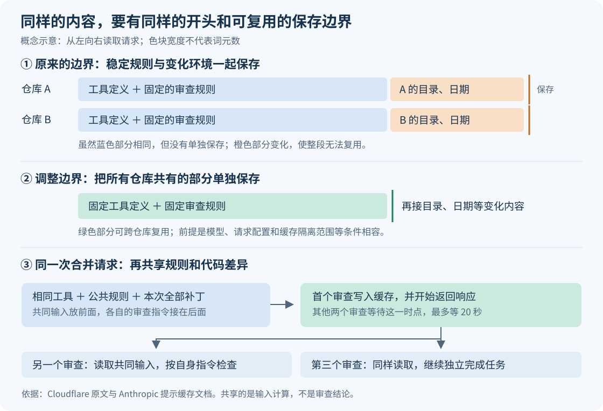
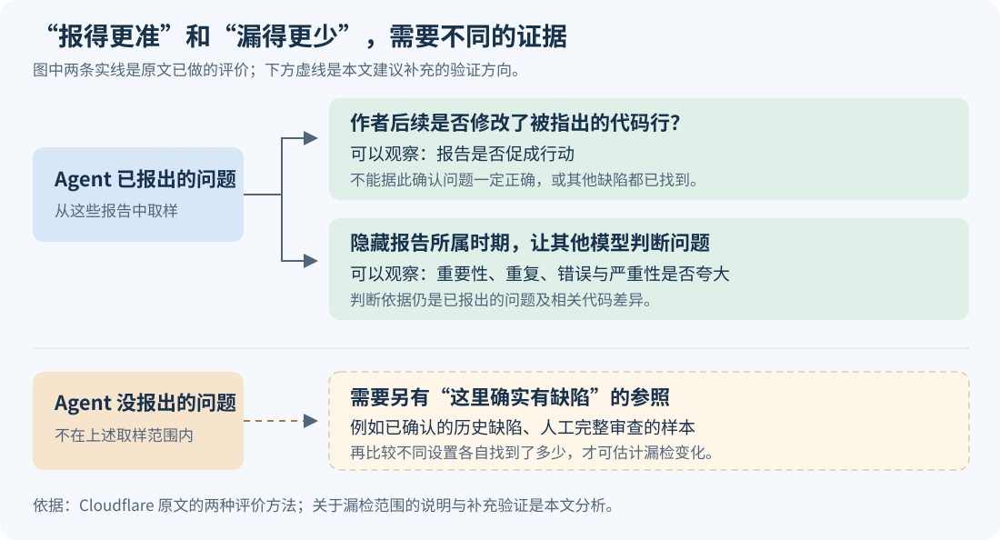

# Cloudflare 如何让 AI 代码审查便宜 68%，又发现了哪些质量代价

让 AI 自动审查代码，费用不只取决于它最后写了多长的评论。每读一次文件、等待一次工具结果，它都可能再次接收整段对话；几名审查助手还可能分别为相同的规则和代码付费。Cloudflare 最近公布了一次优化：复用重复输入、删除无效调用，再按审查任务调整模型和推理强度。与优化前最昂贵的两周相比，平均每次审查的推理费用从 2.43 美元降到 0.77 美元；审查的中位耗时也从 4 分 09 秒缩短到 1 分 32 秒。

这项进展值得运行大量自动审查、检索或分析任务的团队关注。不过，“便宜 68%”需要和质量结果一起看：作者观察到，代码质量审查在较高推理强度下保留了相近的有效发现，但性能审查在中等强度下少找到了重要问题。它展示的是一套已经在内部系统运行的优化方法，以及仍待补足的质量证据。[原文：Cloudflare，2026 年 10 月 19 日](https://blog.cloudflare.com/obsessive-inference-optimization)

## 一次代码修改，为什么会让多个助手反复付费

这里的 Agent，指能调用工具、读取文件并继续决定下一步动作的 AI 助手。Cloudflare 的系统由一个协调者分派任务，让不同助手分别检查代码质量、安全、性能和内部规范等内容，再形成审查结果。按修改的规模和风险，系统会调用不同数量的审查助手；这种分工在此前的系统中就已存在。[此前的系统介绍](https://blog.cloudflare.com/ai-code-review/)

**假设**有人修改了“用户取消订阅”的接口。代码质量助手要检查状态更新是否正确，安全助手要检查调用者是否有权操作该账户，性能助手要检查新增的数据库查询。三者关注的问题不同，却都要先看工具说明、公共规则和这次修改的代码差异，也就是补丁。如果各自启动一段独立对话，相同材料就会被重复提交。

重复还发生在每个助手内部。模型先要求读一个文件，工具返回内容后，程序再把此前的对话和新内容一起发给模型；模型可能随后要求读第二个文件。这样，一次审查的费用同时受三个因素影响：每次请求有多长、总共调用几次、这些输入中有多少能按较低的缓存价格计费。

模型把文本切成用于计算和计费的小单位，称为**词元，英文为 token**。原文报告，整个审查系统每次审查处理的词元从 91 万增加到 299 万；即使总体缓存命中率从 85.7% 升至 97%，账单仍然上涨。缓存读取便宜，却并不免费，命中率也没有反映总量增加了多少。

因此，这次工作的技术新意主要在于：把复用的范围从“同一个助手的后续对话”扩展到“不同仓库的新任务”，再扩展到“同一次任务里的多个专业助手”；同时检查减少调用是否改变了实际审查行为。这是对现有提示缓存和 Agent 运行方式的工程改进。

## 第一处关键改变：把相同的开头单独存下来

**提示缓存**保存的是模型处理某段输入时已经算出的中间结果。后续请求如果具有相同的开头，就可以复用这部分计算，再处理新增内容。这个相同的开头叫**前缀**。它复用输入计算，不会把上一次的审查结论直接当成这一次的答案。

Cloudflare 发现，每个新会话开始时，都有约 1.1 万至 2.1 万词元的工具定义和固定提示可以复用，但首个模型请求命中缓存的比例只有 14%—26%。问题出在发送给模型服务的实际请求：当时使用的 OpenCode v1——负责组织对话和执行工具调用的程序——把固定规则、工作目录和日期拼在同一个系统提示块里，只在块末尾放了缓存保存标记。

这个标记通常称为**缓存断点**，意思是“把截至这里的输入作为可复用的前缀保存”。它不是程序调试时暂停执行的断点。

假设仓库 A 和仓库 B 的审查规则完全相同，但工作目录不同。若只保存“规则＋A 的目录”这一整段，B 就无法复用它；前面相同的规则也没有被单独存下。Cloudflare 的修改是在固定规则结束处切开提示块，先保存大家共有的部分，再追加目录、日期等变化内容。

这也解释了为什么只修改一份提示模板还不够：工具说明在请求中排得更靠前，如果它随仓库变化，后面的固定规则依然无法形成相同前缀。作者因此固定工具描述，并禁用了会随任务变化的可用技能列表。原文报告，调整后首个请求的缓存命中比例提高到 91%—99.5%。

图的上半部分展示跨仓库复用，下半部分展示同一次代码修改内的复用。后者还要多走一步：让代码质量、安全和性能助手先接收相同工具、公共规则与全部补丁，再在后面接各自的审查指令。这样，它们可以共享更长的前缀，同时继续独立检查各自的问题。

但三个请求同时发出时，缓存可能还没写好。模型供应商 Anthropic 的官方文档说明，写入缓存的首个请求开始返回响应后，该缓存才可供其他请求使用。Cloudflare 因此让另两个助手等到这个时点，最多等待 20 秒，再发出自己的首个请求；作者报告每个后续助手约节省 0.09 美元。代价是它们的启动会稍微推迟。[提示缓存机制与并发条件](https://platform.claude.com/docs/en/build-with-claude/prompt-caching)

这些收益有明确前提：前缀必须精确一致、长度达到所用模型的缓存门槛，并在有效期内被复用。原文采用默认五分钟的缓存，每次命中会刷新有效期；请求还要处于允许共享的模型、配置及服务隔离范围内。尤其“跨仓库”不意味着“跨客户”：官方文档规定，Claude 的程序调用接口（API）按工作区隔离缓存。把文本放到前面，并不会自动获得所有任务之间的共享。[缓存限制与隔离规则](https://platform.claude.com/docs/en/build-with-claude/prompt-caching)

## 第二处改变：让模型少走没有必要的回合

缓存解决了重复输入的价格，减少调用则让一些输入根本不必再次提交。两者会叠加：少一次模型调用，不仅少生成一次回答，也少读取一次不断增长的历史。

原文里最能说明问题的几项修改如下。这些都是作者对内部系统的观察，不能直接当成其他 Agent 系统的预期收益。

| 原来的动作 | 修改后的动作 | 为什么能省钱 |
| --- | --- | --- |
| 内部规范助手每次先通过工具读取固定参考索引等文件 | 把固定参考信息放进提示 | 不必先花几轮对话取得每次都需要的材料；该助手平均调用次数从 15.9 次降到 9.6 次 |
| 专业助手看得到发布最终评论的工具，但调用后会被服务器拒绝 | 从这些助手的可用工具中移除它 | 避免失败后再用一轮模型调用恢复；每次请求还少带约 2,900 词元的工具定义 |
| 模型经常一轮只读取一个文件 | 第一轮集中请求公共上下文与补丁，最多 150 KB | 对可以提前确定的读取任务，不必等上一轮结束后再决定读取下一个 |
| 最终评论发布后，程序再让模型写一段无人查看的总结 | 发布后直接结束 | 删除一轮没有用户价值、却会重读整段对话的调用；作者报告每次任务约节省 0.07 美元 |

这里有一条适用边界：如果下一步要读哪个文件，必须依赖上一步的内容，就不能预先并行读取。把更多材料提前交给模型也可能增加输入量。集中读取是否划算，取决于这些材料有多大概率会被使用，而不是“一次塞得越多越好”。这是根据上述机制得到的分析。

作者还处理了两种容易被忽略的浪费：任务被取消后，后台审查仍继续运行；审查超时后，被当成模型服务故障，按同样的时限重新开始。前者通过检查取消状态停止，后者则需要区分“服务不可用”和“任务没做完”。这说明 Agent 的费用既由模型决定，也由调用它的程序何时继续、重试和结束决定。

## 模型更省词元，不代表它会做同样深的检查

除了程序修改，Cloudflare 还更换模型，并调整 **effort，即推理强度**：这个设置影响模型愿意用多少计算和词元完成回答，也会影响工具调用行为。它不是固定的“检查文件数量”开关。官方文档也说明，较低强度往往会减少工具调用或合并操作。[推理强度文档](https://platform.claude.com/docs/en/build-with-claude/effort)

原文的一个变化很醒目：代码质量助手使用 Sonnet 5.5、中等强度时，平均模型调用次数从对照配置的 6.2 次降到 1.7 次，超过一半的任务一轮就结束。由于补丁已经放在输入里，一轮结束意味着它没有再打开仓库里的其他文件。较高强度下，平均调用次数是 3.4 次。

回到取消订阅的假设例子：如果缺陷就在补丁中，直接阅读可能足够；如果缺陷取决于另一个文件里的权限规则或事务边界，不继续查文件就可能漏掉。这里没有理由单凭调用次数判断好坏：更少调用可能来自更有效率的处理，也可能来自提前停止调查。

Cloudflare 因而把代码质量助手随机分成中等和较高强度两组。短期结果显示，较高强度的该助手单次运行贵 61%，但换算到整个审查任务平均只多约 0.02 美元，并报出多 58% 的严重或警告级问题。后续评价还发现，中等强度促成的修改数量大约只有较高强度的四分之一。作者据此选择较高强度；本文开头的 0.77 美元已经按这一选择计算。[原文的模型、强度与质量实验](https://blog.cloudflare.com/obsessive-inference-optimization)

这项观察支持按角色分别选择强度：协调者需要做的分派判断，与专业助手需要做的深入检查并不相同。它没有给出一个能适用于所有任务的最佳档位。

### 价格也要放回实验发生的时间

原文称，10 月 3—5 日对照 Sonnet 5 和 5.5 时，两者词元单价相同，因此代码质量、性能和安全助手分别便宜 62%、58% 和 47%，来自用量减少。外部核验需要保留这个时间窗口：Anthropic 在 **10 月 7 日**才宣布，把 Sonnet 5.5 的缓存读取价格从每百万词元 0.20 美元减半到 0.10 美元。[官方降价公告](https://www.anthropic.com/claude-haiku-5-5)

因此，不能用降价后的价格否定此前对照实验的解释；也不能把原文的解释直接延伸到降价之后的所有节省。截至 2026 年 10 月 20 日核验时，官方列出的 Sonnet 5.5 缓存读取价格是普通输入的 0.05 倍，而原文介绍缓存时使用了 0.1 倍的口径。重算今天的成本，应按具体模型和实际账期区分普通输入、缓存写入、缓存读取与输出，再分别乘以用量。[当前缓存计价表](https://platform.claude.com/docs/en/build-with-claude/prompt-caching)

整项优化的归因也只能近似理解。作者按发布时间前后的工作日时段估算，约四成节省来自程序修改，其余来自模型和强度调整，并明确说这不是严格的受控实验。文中列出的程序修改节省 0.65 美元、模型与强度调整节省 1.06 美元，合计 1.71 美元，也未与该段所述的 1.67 美元总降幅完全对齐。因此，这些分项适合说明主要方向，不适合当成可以精确相加的独立贡献。

## 质量证据支持什么，又没有回答什么

原文最有价值的部分，是没有把“少报问题”自动解释成“去掉噪声”。代码质量、安全和性能助手报出的严重或警告级问题分别减少了 40%、56% 和 71%；这既可能是误报变少，也可能是漏检变多，必须另找证据。

作者用了两种办法。第一种是看开发者的下一次提交：被评论指出的代码行是否改动了。代码质量助手的这一比例从 34% 升到 59%，说明留下的报告更可能促成行动；但每千次审查促成修改的严重问题数量是此前 145 个、优化后 132 个，作者认为差异在误差范围内。这里能说的是“观察到的数量接近”，不能说“已经证明质量完全相同”。

第二种是让两个不同供应商的模型，评价一批共 657 条审查发现，意见不一致时交给第三个模型。评价者只看到相关代码差异和报告，不知道它属于优化前还是优化后，这就是**盲评**：隐藏分组信息，减少先入为主的判断。模型把发现分成重要、轻微、重复、错误或无法验证，并判断严重性有没有夸大。

作者报告，三个 Sonnet 审查助手合计的、被评价为重要的问题数，从每次审查 0.28 个变为 0.30 个，统计区间重叠；严重性被夸大的问题则从 0.46 个降到 0.14 个。它们支持“整体上减少了不少噪声”的解释，但合计值不能替代每个角色的结果。

| 审查角色与配置 | 原文观察 | 能支持的判断 |
| --- | --- | --- |
| 代码质量，较高强度 | 促成修改的发现数量接近此前，重要发现未显示明显下降 | 有初步证据支持减少噪声、保留相近的有效发现 |
| 性能，中等强度 | 盲评认为重要问题减少约 64%；折算约每 24 次完整审查少一个 | 观察到了有效发现减少，不能仅以误报减少解释 |
| 安全，中等强度 | 重要问题约减少四分之一，但统计证据不足 | 存在值得继续检验的下降信号，尚不能确定幅度或是否稳定存在 |

这些结果仍有两层限制。原文本身承认，开发者改了代码不代表报告一定正确；评价者也是模型；细分组只有 35—66 条发现，最新质量窗口只有一天。因此，这是一项有业务反馈和模型交叉评价的内部实践，尚不足以证明长期质量不下降，也不是独立复现的通用基准。[原文的质量结果与限制](https://blog.cloudflare.com/obsessive-inference-optimization)

另一层限制来自取样范围：两种方法都从“已经报出的问题”出发。它们可以检查报告是否有用，却看不到所有没有报出的问题。**召回率**指实际存在的问题中，有多少被系统找到了；要估计它，需要另有一批已确认缺陷作为参照。原文没有给出独立标注的真实缺陷集合，所以“重要发现数量接近”不能推出“漏检率不变”。这是本文对评价方法的分析边界。

## 接下来值得关注的，是省下的计算花到了哪里

这项实践提示了一个具体方向：当多个 Agent 都要阅读同一批材料时，可以保留专业分工，同时复用共同输入的计算。代码审查之外，多个助手分工分析同一组文档、分别检查同一份数据，也可能受益。但这是从机制得到的用途推断，原文没有验证这些场景的收益；任务量小、输入差异大或调用间隔超过缓存有效期时，收益会明显受限。

另一个方向是把节省的费用重新分配给更需要深入检查的角色。Cloudflare 愿意为代码质量助手每次多花约两美分，就是因为短期实验显示额外发现有价值。性能和安全助手是否也应提高强度，原文仍列为下一步测试；不能把代码质量助手的结果直接推广过去。

后续最值得跟踪的信号有三个：更长时间、更多仓库中是否还能保留有效发现；提高性能和安全助手的强度后，新增发现是否值得额外费用；以及引入已确认缺陷或人工完整审查的样本后，不同配置的漏检是否出现差异。相比继续压低一次运行的价格，这些证据更能说明它适合承担多大责任。

对正在运行 Agent 的团队，这个案例给出的起点很具体：检查模型服务实际收到的第一份请求，确认共同内容是否真的被读取缓存；再检查减少的调用里，哪些是无效回合，哪些原本承担了必要调查。对尚未部署系统的读者，它展示的发展方向则是：让多个助手少重复处理相同材料，并用任务结果决定哪些地方值得继续投入计算。
