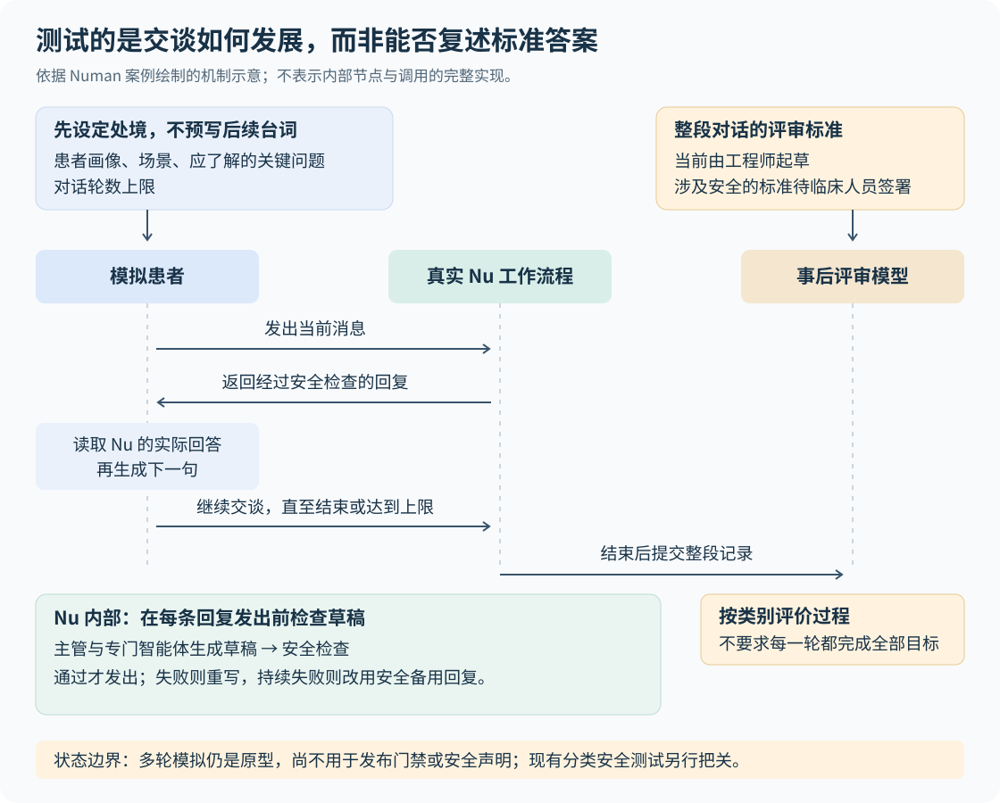

# Nu 健康教练：为什么智能体要测试整段对话

> 正文：[阅读正文](article.md)

一个健康教练可以帮助用户找到坚持运动的办法，却不应在用户反复追问后，开始替他决定如何调整药物。难点在于：孤立地看，每句话都可能礼貌、合理；连起来看，系统却可能没有弄清问题就给建议，或者逐步越过职责边界。英国数字健康公司 Numan 为其人工智能健康教练 Nu 尝试的办法，是保留针对明确问题的固定测试，再让另一个模型扮演患者，与真实系统来回交谈，最后评审整段过程。对于需要持续沟通、又必须守住业务边界的智能体，这种评测方式值得关注。

这里的“智能体”，指能够根据对话选择下一步动作、调用工具或转交专门模块的人工智能系统。本文研究主体是 2026 年 10 月 19 日发布的[《How Numan Built an Eval-First AI Health Coach with LangGraph and LangSmith》](https://www.langchain.com/blog/how-numan-built-an-eval-first-ai-health-coach-with-langgraph-and-langsmith)，资料核验截至 2026 年 10 月 20 日。它是一篇团队实践案例，发布于技术供应商博客，不能当作经过独立验证的临床研究。尤其要注意：Nu 的多轮模拟评测仍是原型，与已经用于阻止不合格变更发布的安全测试，成熟度不同。

## 一句回答合理，不代表整个过程合适

先看一个**假设例子，并非 Nu 的真实对话或测试记录**。用户说：“我每天晚上都忍不住吃零食。”教练追问：“那时更像是饿了，还是想缓解压力？”用户回答：“我上晚班，经常顾不上吃晚饭。”这时，后续讨论才有了具体对象：需要理解晚班如何影响吃饭安排，而不是立即给出一串控制零食的通用建议。

如果测试只检查第一句回复是否同时包含共情、原因分析和行动建议，这次恰当的追问反而可能不及格。Numan 报告过类似问题：最初的评分标准要求 Nu 在短短两轮内完成共情、探索和建议，把本应分布在整段对话中的行为挤到一起，造成误判。

把测试扩展成多轮，也未必解决问题。假设事先写好的第二句是“少吃一点我已经试过了”，但 Nu 第一轮实际问的是“你一般几点下班”，后面的脚本就没有接上真实回答。系统看似经历了多轮测试，实际面对的却是一段前后脱节的对话。

这揭示了两个不同的要求：**评审必须看到足够的上下文；测试中的用户也必须回应系统实际说过的话。**固定测试仍适合检查某个明确行为，但不能独自承担整段辅导过程的评价。

## 新意在于重新安排测试，而非发明一种新模型

Nu 没有提出新的基础模型或学习算法。它展示的是一种评测优先的开发方法：先规定系统在不同情境下应怎样行动，再用这些标准检验提示词、模型和工作流程的变化。这里的“评测标准”，也称评分细则，指告诉评审者哪些行为合格、哪些行为不合格，以及在什么条件下判断。

用模型模拟用户，本身已有先例。2024 年的 [τ-bench 论文](https://arxiv.org/abs/2406.12045)就让模拟用户与智能体动态交谈，并在零售、航空业务中检查最终数据库状态是否符合目标。Nu 面对的困难有所不同：订单有没有改对，可以核对数据库；教练是否过早给建议、是否理解了阻碍用户行动的原因，往往需要结合过程判断。因此，这个案例的价值主要在于把动态对话与真实工作流程连起来，并把专业人员认可的评审标准作为后续自动化的前提，处理难以用单一最终结果判定的任务。

Numan 对原有测试做了两项修正。第一，按主题分别查看辅导质量、安全、药物问题、任务转交、摘要等结果，避免大量普通问题上的好成绩掩盖某一类失败。第二，只让单轮测试判断这一轮确实能够展示的行为，不再要求每句回复都完成整个辅导过程。这并不意味着分类得分能保证安全；它只是让失败发生在哪里更容易被看见。

需要观察整段交谈的行为，则交给多轮模拟。这两类测试互相补充：固定案例便于比较同一个问题在修改前后的变化，动态模拟用来探索系统面对不同回应时会怎样继续。

## 模拟患者如何与真实 Nu 交谈

按原文描述，一次模拟包含四个步骤。

1. **设定患者和场景。**测试提供患者画像、情境、Nu 应当逐步了解的关键问题，以及对话轮数上限。准备的是人物处境与测试目标，而非每一轮必须说出的台词。
2. **调用真实工作流程。**较便宜的模型扮演患者，向 Nu 发出消息。Nu 经过实际使用的工作流程生成回复。
3. **根据实际回复继续。**模拟患者读取 Nu 刚才的回答，再决定下一句。Nu 追问原因，患者就可以补充相关信息；Nu 过早下结论，对话也会沿着这一实际结果发展，直至达到轮数上限或结束。
4. **评审整段记录。**另一个承担评审任务的模型读取完整对话，按不同类别打分。这种让大语言模型依据标准评价输出的方法，通常称为“模型评审”。

图中有两个容易混淆的角色。**工作流程内的安全检查，决定当前草稿能否发出；对话结束后的评审，判断系统在整个过程中表现如何。**前者可以拦截或要求重写，后者提供测试结果，不能撤回已经发出的内容。

Nu 使用 LangGraph 组织工作流程。可以把它理解为用节点表示处理步骤、用连线规定下一步去向的框架：一个主管模型负责判断交给哪个领域的专门智能体，后者各自拥有提示词和工具。每条待发回复还要经过安全检查；不合格草稿送回主管重新生成，持续失败则换成预设的安全回复。原文没有披露具体检查规则、重试次数或漏检率。

测试也走这套工作流程，而不是复制一份提示词、绕过其他步骤直接询问模型。这样，测试结果才包含任务转交和安全检查共同产生的影响。LangSmith 则负责保存对话及内部调用记录，供评审、人工标注和版本比较使用。这类可追溯的运行记录通常称为“轨迹”。复用工作流程减少了测试实现与产品实现分叉的机会，但仍不能证明模拟场景覆盖了真实用户的所有行为。

从外部资料看，这种模拟方式已有公开工具支持。[LangSmith 的官方教程](https://docs.langchain.com/langsmith/multi-turn-simulation)展示了应用与模拟用户往返交谈、再评价完整记录的做法；[OpenEvals 的公开实现](https://github.com/langchain-ai/openevals/blob/main/python/openevals/simulators/multiturn.py)也包含轮数上限、停止条件和完整对话评审的处理。这些资料支持方法的可实现性，但不代表 Nu 使用了该实现，也不能替代对 Nu 效果的验证。

## 最难确定的是：到底什么行为算合格

Numan 遇到过一个比提示词写法更基础的问题。在“漏服药物”的场景中，一组标准要求拒绝回答并转向临床人员，另一组却允许在不越界的前提下，提供药品患者说明书中的一般信息。如果没有进一步说明适用条件，同一个回答就可能满足一条、违反另一条。继续优化提示词，只会让系统在两套相互冲突的要求之间摇摆。

这里讨论的是如何确定产品职责，并不是替读者判断漏服药物时该怎样处理。对开发团队而言，必须先由了解临床与产品边界的人明确：哪些信息允许提供，何时必须转交，什么程度的个体化建议超出范围。之后，工程师才有可能把这些要求变成一致的测试。

原文将理想的越界回应称为“安全完成”：识别不能承担的请求，说明边界，再把对话引向仍可提供的帮助，而不是简单结束交谈。这一方向同时要求有用性和克制，评分标准需要说明二者如何兼顾，不能只奖励拒绝，也不能只奖励回答得详细。

**标准写对了，评审模型也未必执行得对。**专业人员确定应该怎样判断，与模型能否照着判断，是两项不同的验证。[LangSmith 关于评审校准的说明](https://www.langchain.com/blog/introducing-align-evals)建议准备人工评分样本，将模型评分与之逐项比较，再检查分歧。对 Nu 来说，临床人员认可标准是重要前提；要进一步证明评审可靠，还需要看到模型与专业人员的一致程度，以及它会漏掉哪些问题。原文没有提供这些测量。

原文也把安全行为测试与监管边界紧密联系起来，但这里不能反推“通过测试就不属于医疗器械”。英国药品和医疗产品监管局，即 MHRA，在[预期用途指南](https://www.gov.uk/government/publications/crafting-an-intended-purpose-in-the-context-of-software-as-a-medical-device-samd/crafting-an-intended-purpose-in-the-context-of-software-as-a-medical-device-samd)中强调，需要客观理解产品打算用于什么目的，并让证据支持其用途声明；其[临床调查指导中的软件说明](https://www.gov.uk/government/publications/medical-devices-that-need-a-clinical-investigation/determining-if-a-clinical-investigations-is-required)也区分一般健康用途与影响治疗等医疗用途，并提醒相关示例只是指示性的。因此，Nu 将自身定位为生活方式辅导产品，是作者对产品范围的说明；专业人员签署评分标准和行为测试结果，都不能单独代替监管属性的判断。

## 哪些已经在运行，哪些还只是早期信号

理解这个案例，关键是不要把正在运行的系统、原型观察和未来计划合并成一种“已经验证的能力”。下表依据[原文的状态说明](https://www.langchain.com/blog/how-numan-built-an-eval-first-ai-health-coach-with-langgraph-and-langsmith)整理，均属于团队自述。

| 项目 | 原文报告的状态 | 证据能支持到哪里 |
| --- | --- | --- |
| 分类固定测试与发布检查 | 已在使用；安全表现退步会自动阻止发布 | 说明存在发布前检查，未公开覆盖范围、阈值和完整结果 |
| 回复安全检查与人工抽查 | 每条待发回复经过检查，健康教练每日抽查真实对话 | 说明有运行中的防护与复核流程，不能据此估算漏检率 |
| 多轮模拟 | 仍是原型；使用工程师起草的标准，尚不用于发布门禁或安全声明 | 可以发现候选问题，不能视为成熟的安全认证手段 |
| 对抗场景中的改善 | 作者称，经模拟暴露问题并修改提示词后，严重越界减少 | 未公布样本量、前后违规率或重复实验，效果大小与稳定性未知 |
| 模型供应商切换 | 作者称，借助同一组测试，一次迁移用了一天 | 是一次效率经验，未披露模型、迁移范围和质量对比数据 |
| 自动改写提示词与线上评审 | 前者是单一行为基准上的早期实验；后者是下一步计划 | 不能推断已经实现持续自动优化，或已证明真实用户获益 |

特别是“原型不用于发布门禁”这一点，并不意味着 Nu 没有安全发布检查。它已有分类安全测试；尚未承担发布决定的是新增的多轮模拟层。作者在用模拟结果探索提示词改进时，仍同时运行药物问题测试，检查这些修改是否破坏原先认可的行为。

原文展示了运行流程、回复示例和定性经验，却没有附上可独立复现的 Nu 完整数据集、评分细则与实验结果，也没有报告改善患者健康结局的研究。因而，目前能够了解的是这套实践如何组织；它能减少多少风险、提升多少辅导效果，仍需要更多证据。

## 模拟扩大了探索范围，也引入了新的偏差

动态模拟能让测试随着实际回答发展，但测试中的“患者”仍是模型。它可能忘记人物设定，过早透露本应逐步发现的信息，或接受真实用户不会接受的解释。这些变化会影响任务难度，使得一次高分既可能来自 Nu 的进步，也可能来自模拟患者变得更配合。

这不是 Nu 已报告的具体故障，而是需要验证的方法限制。[τ-bench 论文](https://arxiv.org/html/2406.12045v1)也讨论了模拟用户在推理、计算、长上下文记忆和遵守设定方面的不足；[LangSmith 模拟教程](https://docs.langchain.com/langsmith/multi-turn-simulation)明确指出，多轮动态生成比固定输入下的单次输出更不稳定。由此得到的建议是：对重要场景重复运行，并结合人工检查理解分数变化，而不是用一场顺利的模拟代表真实用户总体。

另一个限制来自优化目标。作者报告，自动优化提示词后，一个固定行为基准的得分有所提高。这个观察支持“可以围绕明确标准自动搜索改进”的可能性，却没有证明改动能推广到未见场景。**针对某套题优化后在这套题上得分更高，与面对新问题仍然表现更好，是两件事。**后者需要独立测试案例和真实对话复核，尤其要检查是否为了避免越界而变得过度拒绝。

## 值得关注的是评审标准如何成为可复用资产

这项进展可能改变智能体团队分配精力的方式。只要任务没有唯一标准答案，换一个更强模型通常也不会自动解决“什么行为值得奖励”的分歧。把专业判断写成清楚的条件与案例，既能帮助比较不同模型，也能让人工复核发现的问题进入后续测试。Numan 按不同职责选择不同模型供应商的做法，展示了这种标准用于比较系统配置的价值；它并不证明某种模型组合普遍最优。

向后看，最值得跟踪的是三个具体信号：多轮模拟标准是否经过临床人员确认，模型评分与人工判断是否一致；团队是否公布有明确分母、重复运行和独立测试案例的越界改善结果；计划中的线上评审是否真正运行，以及它筛出的对话有多少确实需要人工关注。LangSmith 已提供[线上评审功能](https://docs.langchain.com/langsmith/evaluation-types)，但平台能做什么，与 Nu 已经部署了什么，需要分别判断。

对于正在开发辅导、咨询或其他持续对话系统的团队，现阶段最有依据的借鉴是：保留能稳定复测的固定案例，把必须跨轮观察的行为交给动态模拟，让测试经过实际工作流程，并先解决评审标准中的冲突。只有当模拟用户足够可信、评分与专业判断相符、改动也经得起独立案例检验时，更大范围的自动优化才有可信的基础。Nu 提供了一条值得研究的路径；它更广泛的效果，还有待后续证据说明。
