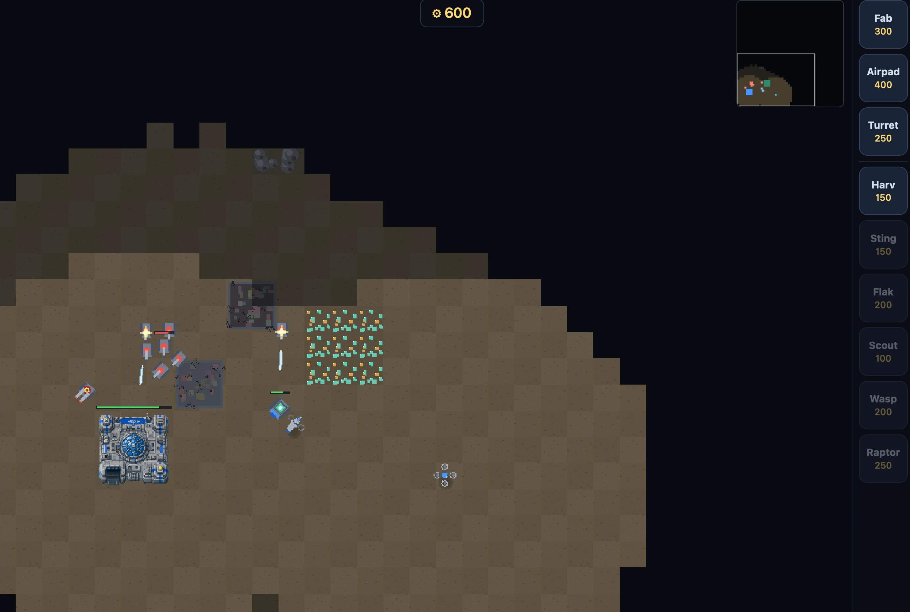
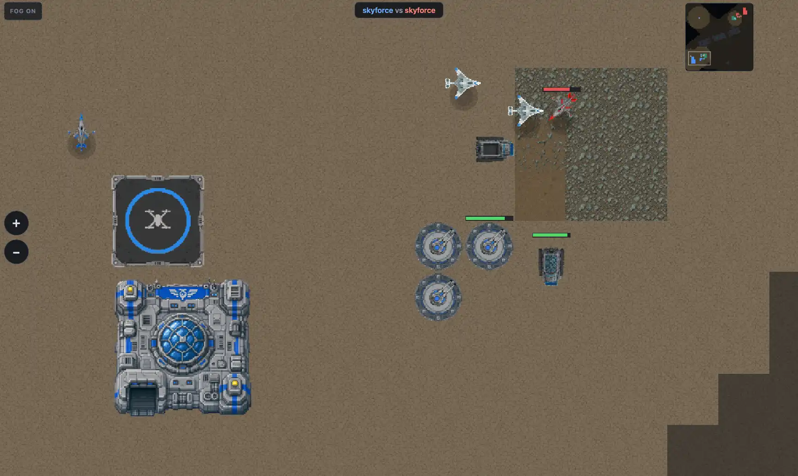
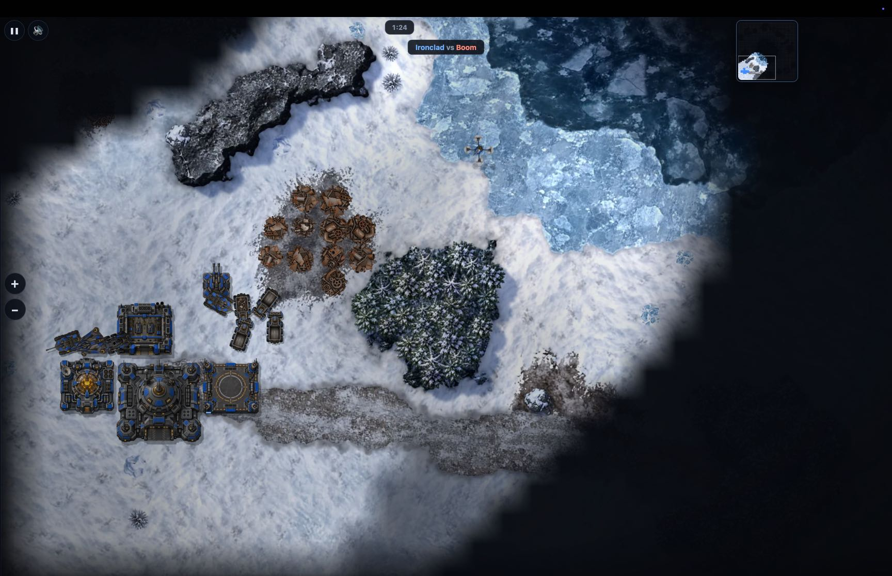
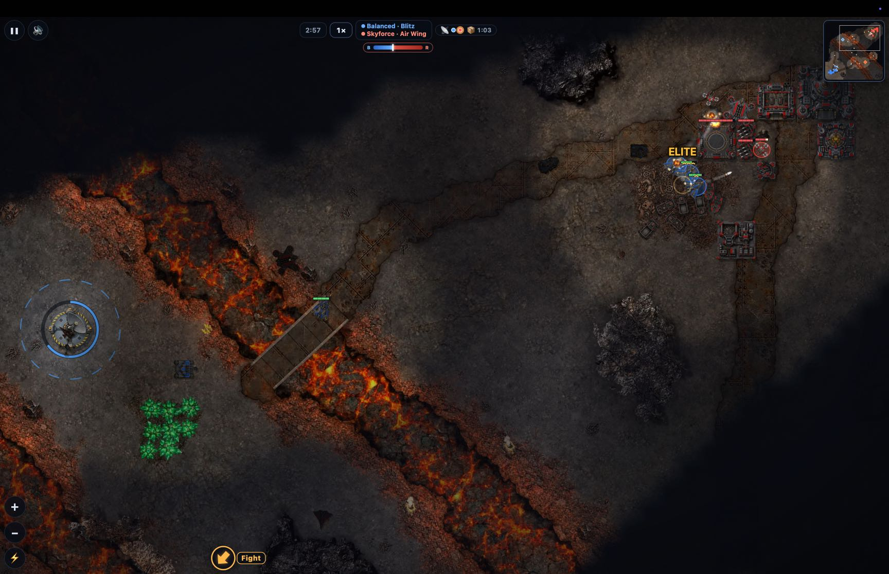
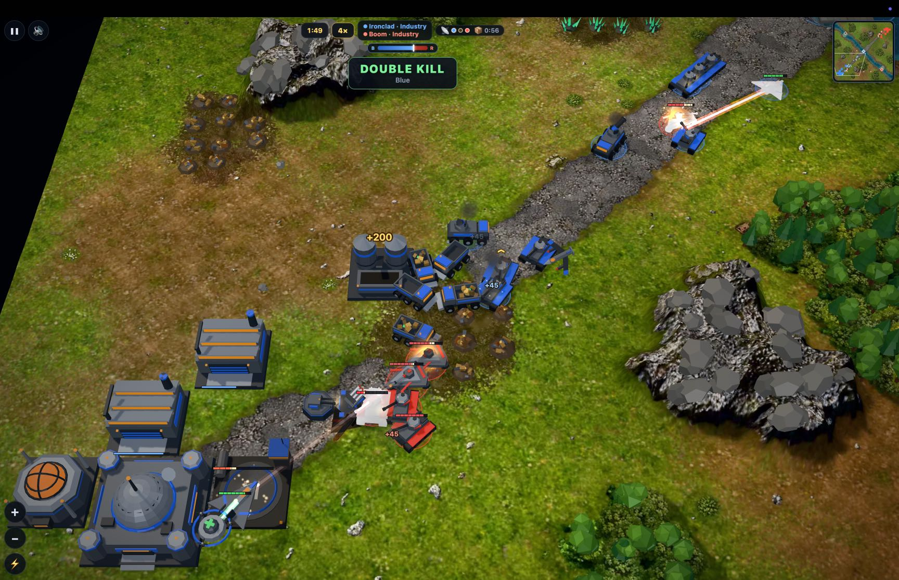
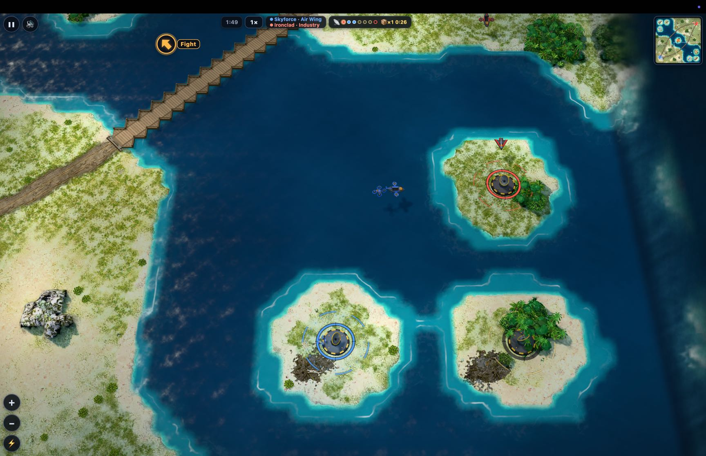
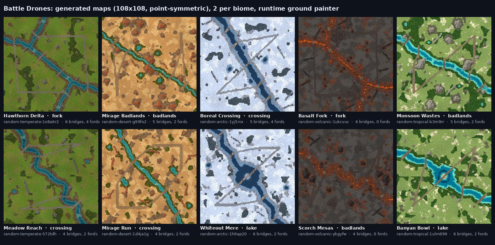

# Battle Drones：用氛围编程开发、通过声音联机的即时战略游戏

> **来源**: [https://simonwillison.net/2026/Oct/20/battledrones](https://simonwillison.net/2026/Oct/20/battledrones)  
> **作者**: Simon Willison | **发布时间**: 2026-10-20T00:00:00+00:00  
> **深度调研**: [查看专题调研报告](research.md)  
> **标签**: AI辅助编程, 即时战略游戏, 游戏平衡性测试, Three.js, 程序化地图生成, 确定性模拟, 音频调制解调器, 大型语言模型对战

---

## AI 导读

作者希望做出一款能在手机上玩的即时战略游戏，也就是玩家持续建造、调兵并争夺资源的游戏。最初版本已有基本操作，却缺乏吸引力；文章围绕这一问题，记录了借助 AI 编程工具持续修改玩法、画面和联机功能的过程。

作者主要通过自然语言提出目标，由工具编写代码、生成图像并运行模拟对战，自己反复试玩。一次要求“更好玩”的修改加入了开局选择、争夺目标、支援能力和更多模式，并用上千场模拟对战调整平衡。文中引用的发布说明称，普通难度下超过25分钟仍未结束的对局比例由14%降至0.9%，曾落后至少800资源的一方获胜的比例由24%升至46%；这些指标反映对局节奏和翻盘情况，不能直接等同于真人体验改善。作者还通过岛屿目标必须由运输机运送步兵占领的规则，让原本少用的单位获得明确用途。

后续版本改用 Three.js 三维图形库，以代码构造模型，并加入由大型语言模型控制单位、记录和回放对战的功能。为避免不同浏览器的微小计算差异让回放失步，工具替换了部分数学函数，使相同输入能够产生一致的模拟结果。

最后，作者尝试让附近设备通过声音传递消息，实现无需专门联机服务器的双人游戏，并报告已在笔记本、iPhone 和 iPad 之间试用。声音联机刚刚完成，正文没有提供通信协议细节或性能测量。作者几乎没有审查代码，因此文章主要支持这种开发方式能够产出可试玩作品的个案观察，尚不能证明代码质量、广泛兼容性或长期稳定性。

---

## 原文整理

## Battle Drones：用氛围编程开发、通过声音联机的即时战略游戏

2026年10月20日

我最近一次氛围编程游戏实验，是一款《命令与征服》风格的 RTS（即时战略）游戏，名叫 [Battle Drones](https://github.com/simonw/battledrones#readme)（[在这里玩](https://simonw.github.io/battledrones/)）。和[之前的实验](https://simonwillison.net/2026/Aug/5/raccoon-heist/)不同，这次的游戏*真的很好玩*。说来有点不好意思，我是靠对 Claude 说“让它好玩得多得多”做到的。它还支持附近的设备通过声音同步游戏状态，实现多人联机！下面是我目前做出的成果，以及一路上学到的一些东西。

### Battle Drones

我最初的目标，是做一款能在手机上玩的 RTS 游戏，风格类似[《命令与征服》](<https://en.wikipedia.org/wiki/Command_&_Conquer_(1995_video_game)>)。我对1995年的初代有着美好的回忆（我也喜欢《红色警戒》），想找回一点当年的感觉。

经过12轮重大迭代，以及编程智能体（主要是 Claude Code）的 [321次提交](https://github.com/simonw/battledrones/commits/main/)，我现在有了一款能在手机和电脑浏览器中运行的游戏。它有多种玩法、几张地图（还包括随机地图生成器），甚至支持两台处于彼此麦克风收音范围内的设备联机。

下面是一段 Battle Drones 在电脑浏览器中运行的演示视频：

目前的功能包括：

- 9种建筑、7种地面载具、6种飞行载具、3种步兵单位——全部采用3D模型，可以[在这里浏览](https://simonw.github.io/battledrones/models.html)
- 战争迷雾
- 攻击飞行载具和地面载具需要使用不同的武器
- **6张地图**，覆盖温带、沙漠、极地、火山、热带5种环境
- 随机地图生成器
- **遭遇战模式**——红蓝双方在旋转对称的地图上对战
- **背水一战模式**——一名玩家尽可能抵挡更多波敌人的进攻
- 范围攻击武器：Barrage、EMP、Drop Pod、Sky Hammer
- 提供额外资源的**空投补给箱**
- 随事件变化的游戏音乐——战斗打响时，音乐也会更加激烈
- 不同的游戏内 **AI 性格**（均衡、快攻、空中蜂群、经济扩张、空军、铁甲）
- **AI 对 AI** 模式，可以观看这些不同性格的 AI 相互对战
- **Goliath**——一台迈着沉重步伐的巨型机甲，有激光眼、臂炮，还能建立新基地
- 加入额外规则或变化的**变体规则**
- “每日行动”挑战
- 军衔和成就（**勋章**）
- **智能体对智能体**模式，让两个大语言模型在 Battle Drones 中对战
- **多人模式**，让附近的两台手机通过声音消息通信，延续了我之前的 [Chirp Pong](https://simonwillison.net/2026/Oct/15/chirp-pong/) 实验

### 我是怎么做的

Battle Drones 主要靠氛围编程开发——我几乎没有审查过代码，而且用的语言是我自己几乎没怎么用过的 TypeScript。不过，我倒是试玩了很多次；从项目启动到现在，它也经历了大量迭代。

下面大致回顾一下项目到目前为止的发展过程，包括关键提示词和对话记录链接。

### v1：最初的原型

我在7月开始用 Claude Fable 5 开发：

> 我们要做一款适合手机玩的 RTS 游戏，采用《命令与征服》的风格，名叫 Battle Drones。游戏中，两支由无人机和无人地面载具组成的军队争夺领土和资源。
>
> 先从最小可行产品（MVP）的设计开始，问我几个问题。

这里有一份[共享的对话记录](https://claude.ai/code/session_015RYeKm4ji4N16oqthyX1b1)。我通过环境变量给 Claude Code for Web 提供了一个 OpenAI API 密钥，让它使用 OpenAI 的[图像生成 API](https://developers.openai.com/api/docs/guides/image-generation) 制作素材，得到了一些基础精灵图。

你可以[在这里试玩 v1](https://simonw.github.io/battledrones/v1/)——当时是这个样子：

看得出来，这是一款 RTS：有建造机制，可以选择和指挥单位，也有一个基础 AI 作为对手。

这个最初版本勉强算是验证了概念，玩起来并没有乐趣。

在这些早期版本中，Claude 用的是 [Phaser](https://github.com/phaserjs/phaser) 二维游戏框架。我甚至直到又迭代了好几轮之后，才发现这一点！

### v2：补齐精灵图

第二个版本（[在这里试玩 v2](https://simonw.github.io/battledrones/v2/)）为所有载具加入了精灵图，还增加了“AI 对 AI”模式，这样我就能看着游戏自己运行，无须亲自操控。

事实证明，Claude 很会给 OpenAI 的图像模型写提示词来生成精灵图。你可以在 [public/assets/sprites](https://github.com/simonw/battledrones/tree/v2/public/assets/sprites) 文件夹中浏览 v2 的精灵图。

### v3：丰富地形

游戏还是不怎么好玩，画面也很单调。这时已经到了10月，我也升级到了 Claude Opus 5.5。我对它说：

> 大幅改进这个游戏。把画面和玩法都做得更好（仍然要适合手机）。使用最新的 OpenAI GPT 图像 API（查一下具体用法），通过环境变量中的 API 密钥渲染新图像。加入新的单位类型，更好地调整游戏平衡。还要加入新建筑，以及更好、更多样的地形。

结果是新增了5张地图，并生成了多种风格的背景图块，[可以在这里查看](https://github.com/simonw/battledrones/commit/aa22f08a34347d7d9f94b33f44a73b4deb046aa1)。Opus 还重新生成了精灵图，让它们好看了很多。你可以[在这里试玩 v3](https://simonw.github.io/battledrones/v3/)——它看起来是这样的：

这开始有真正的游戏那种感觉了！不过，玩起来还是不太有意思——我很快就会觉得无聊。

### v4：趣味性更新

到这里，Battle Drones 实验一直在印证我[之前的看法](https://simonwillison.net/2026/Sep/27/2026-in-llms-so-far/#simon-willison-2026-in-llms.059.webp)：编程智能体能做出看起来像游戏的东西，却做不出真正让人想一直玩下去的游戏。

我在晚餐时和别人聊起了这个想法，之后又觉得，应该认真给模型一个证明我错了的机会。我在手机上给 Opus 5.5 发了这条提示词：

> 这个游戏还不够好玩。让它好玩得多得多。

这一次我用的是 [Ultracode 模式](https://code.claude.com/docs/en/workflows)。在这种模式下，Claude Code（这里是 Claude Code for Web）会运行“动态工作流”，文档中是这样描述的：

> 动态工作流是一段 JavaScript 脚本，用来同时协调多个[子智能体](https://code.claude.com/docs/en/sub-agents)。

这一下启动了*长达好几个小时*的工作。我晚上开始运行，直到第二天上午很晚，才拿到一个可以玩的版本。不过，结果非常惊艳。

你可以[在这里试玩 v4](https://simonw.github.io/battledrones/v4/)——它看起来是这样的：

我让 Claude [自己写了发布说明](https://github.com/simonw/battledrones/blob/main/Battle%20Drones%20The%20Fun%20Update%20%E2%80%94%20Release%20Notes.md)，重点如下：

> 现在，每场遭遇战和每日行动都从一个选择开始，为落后的一方提供翻盘机会，并引导双方军队到地图中央交战。另外还加入了两种新玩法。
>
> - **开局方案**：计时开始前，选择 Blitz、Industry 或 Air Wing。
> - **呼叫支援能力**：Barrage、EMP、Drop Pod，以及 Sky Hammer 轨道打击。
> - **目标与回收**：上行链路中继站、空投补给，以及能回收为废料的残骸。
> - **体验**：更带感的战斗表现、自适应音乐、单位语音和播报员。
> - **指挥**：战斗警报、游戏速度、保存编队和触控放置。
> - **新模式**：抵挡一波波敌人的“背水一战”生存模式，以及包含8项任务的“行动”战役。
> - **成长系统**：英雄、带有奖励的战后报告、生涯记录、7种变体规则，以及每日行动。
>
> 战斗持续得更久，局势的起伏也更大。在普通难度的1,200场 AI 对 AI 测试中，25分钟后仍未分出胜负的对局比例从14%降至0.9%。曾落后800以上废料的一方取得胜利的比例，从24%升至46%。

Claude 花了这么长时间，部分原因是它运行了上千场模拟试玩，并根据结果重新调整现有单位的平衡、增加新单位，以及引入新功能。

### v5：Battle Drones 迈入3D

Ultracode 成功完成了“让它好玩得多得多”之后，我决定再大胆一些：

> 把这个游戏移植到 three.js，为所有建筑、载具和地形制作3D模型。

这次又运行了一整夜。醒来时，我看到了[这个 v5 版本](https://simonw.github.io/battledrones/v5/)：

这些新的3D模型，完全是 Claude 用 TypeScript 代码构造出来的。

v6（[在这里玩 v6](https://simonw.github.io/battledrones/v6/)）进一步打磨了画面。v7（[玩 v7](https://simonw.github.io/battledrones/v7/)）加入了机器人步兵（步兵、火箭小队、狙击手），以及一种名叫“Condor”的运兵飞机。

### v8：群岛

我开始有点内疚，因为自己在游戏设计上实际投入的想法太少了——过去几个版本，我真的只是说了“让它更好玩”和“打磨一下画面”。

我注意到，AI 不怎么使用 v7 新增的步兵和运兵飞机——在战略上，没有什么很强的理由需要用它们。

如果有一张新地图，配上一种新机制，主动鼓励玩家把机器人步兵装进 Condor，再把它们送往地图各处，应该会很有意思。

于是，我写出了当时最长的一条提示词：

> 设计一张新地图。目标是设置不同的战略诱因，鼓励使用步兵、Condor 和飞行载具。
>
> 为此，地图上可供采集车开采的资源要有限，但要多放几座上行链路站——不过，这些站点要放在地面载具和步兵都无法抵达的岛上，也不能用飞行载具占领。唯一的获取方式，是用 Condor 把步兵运过去。
>
> 每支军队开局时都要有一架 Condor 和一个小队。如果某支军队没有 Condor，就免费提供一架，让它从距离己方 HQ 最近的地图边缘飞进来，并在那里降落。这架免费的 Condor 上还要搭载一个免费小队。
>
> 双方的 HQ 应完全由水域隔开，但要在地图的不同位置设置两座桥，让载具仍然能通行。
>
> 我想鼓励双方争夺上行链路站。
>
> 地图大小应是其他地图的几倍，仍然保持正方形。
>
> 先研究，再评议这个设计。等我们就需要做的修改达成一致后，再开始构建。
>
> 你可以为它设计一种新的环境。

最终做出来的是热带的**群岛**地图，有7座位于岛上的上行链路站，玩家只能用 Condor 运送步兵前去占领。在较简单的地图上掌握基本机制之后，这绝对是最好玩的一张地图。[v9 版本](https://simonw.github.io/battledrones/v9/)又让这张地图更有趣了一些——现在看起来是这样的：

### v10：Goliath 与智能体对战

我决定给游戏加入巨型机器人机甲——可以想象[《环太平洋》](<https://en.wikipedia.org/wiki/Pacific_Rim_(film)#Plot>)里的 Jaeger，或者《战锤40,000》里的泰坦。

下面是我和 Claude 一起构思时用过的一些提示词：

> 帮我想想，怎样把巨型机器人加进这个游戏——比如 W20K 里的无畏机甲或泰坦——怎么做才能改善玩法、保持平衡，又加入独特的变化？现在先别想得太复杂。

> 我们继续想。我喜欢把它做成移动基地的想法——可以接收采集来的废料，可以在附近建造建筑（即使它之后移走，建筑也能留下），还能生产步兵单位。如果能和 Condor 有些互动会很有意思，但我还不知道可以怎么互动。

> 一个想法：随着受损，它会失去使用某些武器的能力——默认有眼部激光（像 Lancer）、臂炮（像 Titan）、两门肩载迫击炮，还有火力类似一队步兵的机枪。

> 受损时，先失去迫击炮，再失去激光——机枪始终保留。不能因为某座建筑是靠机甲才建起来的，就继续在那座建筑旁边建造。要在基地外建造，机甲必须在场，而且只能建在它周围3格以内。

> ［……］就设定成两架 Condor 可以运走机甲吧。

最后的结果*真的很酷*。

Goliath 可以在 Gantry 建造；而 Gantry 这座建筑，只有先建好 Fab、Bay、Airpad 和 Tech Lab 之后才能建造。你能看到 Goliath 的建造过程，随后它会从 Gantry 中走出来，在地图上行进。

Goliath 可以“锚定”，把自己固定在地面上。在锚定状态下，它们能充当新的 HQ，在新的区域生产步兵单位、建造更多建筑。

两架 Condor 飞机可以挂住一台 Goliath，然后就能把它吊运到地图各处！

现在，只有摧毁敌人的 HQ 建筑，*以及*他们可能造出的所有 Goliath，才能结束游戏。

还有两种与 Goliath 有关的变体规则：

- **Goliath 舰队**：双方开局各有4台处于空运状态的 Goliath（每台配两架 Condor），没有其他单位。
- **机器人之恋**：加入一条特殊规则：如果敌对双方的 Goliath 在战场上靠得太近，它们就会坠入爱河，游戏以平局结束。（这个点子得感谢 Natalie。）

### 智能体对战

v10 的另一个功能是**智能体对战**。在思考多人联机可以怎么实现时，我有了一个想法：让不同的大语言模型在游戏里一决高下，怎么样？

> 再来个有趣的额外挑战：想想怎样让编程智能体也能参与多人游戏。如果能安排一场比如 GPT-6 Sol 对 Claude Opus 5.5 的战斗，应该很有意思。每个模型都能使用一个工具，通过它获得游戏信息（大概不是视觉信息，但只能拿到它们在战争迷雾等限制下能看到的信息），还可以控制自己的单位等［……］
>
> 查阅 ~/dev/llm/docs，并在那个文件里加入说明，写清楚这里怎样通过一个新的工具插件使用大语言模型。

Opus 5.5 开始着手这件事，写出了[这份 AGENT-BATTLES.md 方案](https://github.com/simonw/battledrones/blob/7001ed186c8b8aef4acb27f680ecf4c09b607e54/AGENT-BATTLES.md)，然后实现并测试了它。这个功能还支持记录和回放对战——这里有一场 [Claude Haiku 5.5 对 GPT-6 Luna 的回放](https://simonw.github.io/battledrones/v11/?replay=battles/showcase/2026-10-14-frostbite-42-claude-haiku-5.5-vs-gpt-6-luna.json)，也可以[在一个独立的调试工具中](https://simonw.github.io/battledrones/record-viewer.html?replay=battles/showcase/2026-10-14-frostbite-42-claude-haiku-5.5-vs-gpt-6-luna.json#r1)观看同一场对战，查看背后的提示词响应。

驱动智能体对战的提示词[可以在这里看到](https://github.com/simonw/battledrones/blob/d584e351d9d28c4ba058b78ddcca9b93cd9bcd33/llm-tools-battledrones/llm_tools_battledrones.py#L106-L117)。

[README 中还链接了](https://github.com/simonw/battledrones/blob/main/README.md#watch-ai-models-play-it)几场这样的回放。我希望将来能把它做成完整的联赛积分榜。

### v11：随机地图

之所以有这个版本，纯粹是因为某天我瞥了一眼自己的 [Claude 用量](https://claude.ai/new#settings/usage)页面，发现每周额度只用了75%，而且还有45分钟就要重置。我决定看看能不能用剩下的 token 给 Battle Drones 再添一个功能，选中的目标是“随机地图”：

> 设计并实现一种生成随机地图的机制，可以使用现有的任意环境类型——地图要和最大的那张一样大，河流、桥梁、岩石、森林、废料、水晶都可以用上。让地图旋转对称，并使用种子，以便以后选择或复用。你有45分钟来完成！发挥创意。

这里是[对话记录](https://claude.ai/code/session_01CfwMwDaK1kLKnRV6di8VMT)，以及 Claude 为了展示成果而生成的一张图片：

### v12：通过声音联机

我*刚刚*才让它跑通，还没来得及做多少实际测试。最新版 Battle Drones 现在支持两台处于彼此麦克风收音范围内的设备进行多人联机了！

这个功能源自我上周的 [Chirp Pong](https://simonwillison.net/2026/Oct/15/chirp-pong/) 实验。我让 Claude Code 去看那个已经能运行的概念验证：

> 从 GitHub 克隆 Simonw/tools，查看最近的分支，找到那个使用网页麦克风、让两台手机通过声音信号实现多人联机的乒乓球游戏示例。
>
> 为 battledrones 做一个这样的版本。

Opus 做出了[这个 Radio Probe 工具](https://simonw.github.io/battledrones/radio-probe.html)，测量两台设备之间能达到多大的带宽。测试结果不错，于是它又实现了一套完整的音频调制解调器系统。到目前为止，我已经在笔记本电脑、iPhone 和 iPad 之间试过，看起来效果非常好！

为什么要用声音？因为我[喜欢静态 HTML](https://simonwillison.net/2025/Dec/10/html-tools/#the-anatomy-of-an-html-tool)，运行起来不花钱。我不想在什么地方开一台服务器，然后只要还有人想玩这个游戏，就得一直负责让它正常运转。

### 一些想法

我对游戏开发几乎*一无所知*。这恰好给了我一个很好的机会：在一个我已有的软件工程经验对结果影响较小的领域里，试用编程智能体。

游戏的试错代价也非常低。最坏的结果，无非是我的某个胡闹游戏实验出了 bug。

今天早上，我[通过 Hacker News](https://news.ycombinator.com/item?id=50168190) 看到了[《Steam 新品节充斥 AI 垃圾内容，玩家恳求加入“无 AI”筛选项》](https://www.ign.com/articles/steam-fans-are-begging-for-a-no-ai-filter-as-steam-next-fest-is-filled-with-slop)。我个人绝不会想着把 Battle Drones 提交到这种活动——投入的心血还远远不够，不足以让它被当作一个正经的独立游戏项目来看待。

……但我现在已经能看到一条路，让这样靠氛围编程做出的游戏也能得到认真对待。Battle Drones 很好玩，画面不错，也有创新功能（据我所知，通过声音联机这件事在 RTS 中还是头一回）。

我很想看看，一个比我更有品位、又满怀热情想做出真正出色作品的人，能做出什么！

这个项目还带来了其他一些观察：

- 静态 HTML 和 JavaScript 非常适合开发游戏。WebGL 表现很好，[Three.js](https://github.com/mrdoob/three.js/)（以及之前用的 [Phaser](https://github.com/phaserjs/phaser)）都是很出色的开发平台，而且现在的模型对它们了如指掌。
- 这也让游戏能以[渐进式 Web 应用](https://developer.mozilla.org/en-US/docs/Web/Progressive_web_apps)的形式运行——我没有提出这个要求，但 Battle Drones 可以离线玩。即使从没专门安装过它，我还是能在飞机上玩，因为手机已经把它缓存下来了。
- 给 Claude 一个 OpenAI API 密钥，让它用 OpenAI 的模型生成图像，效果非常好。它能查看自己生成的图像，并不断调整提示词。
- Opus 5.5 用 Three.js 做3D建模的能力非常出色（用 Blender 也是如此，想必其他3D应用也一样）。GPT-6 Astra [也是如此](https://til.simonwillison.net/llms/blender-coding-agents-macos)。它们完全有能力为3D游戏项目制作模型。
- 对回放和多人联机这类功能来说，一个确定性的模拟引擎很有用。有一次，Claude 不得不用[自定义版本](https://github.com/simonw/battledrones/blob/v12/src/sim/fmath.ts)替换 `Math.sin()`、`Math.cos()` 等函数的调用，因为不同浏览器（比如 Chrome 和 Safari）返回的数值有极其微小的差别，导致回放失去同步。
- Opus 5.5 会写音乐！这个项目里没有音频文件——配乐完全由代码生成，在不同地图上会有变化，甚至会随着战况升温而变得更激烈。我之前还做过一个用 Claude 作曲的实验，可以看 [Scrimshaw Jukebox](https://simonwillison.net/2026/Oct/6/scrimshaw-jukebox/)。
- “让它好玩得多得多”这条提示词居然这么有效，我到现在还觉得不可思议。
- 工具几乎是白送的。我通过提示词做出了 [Radio Probe](https://simonw.github.io/battledrones/radio-probe.html)、[模型浏览器](https://simonw.github.io/battledrones/models.html)、[智能体对智能体调试工具](https://simonw.github.io/battledrones/record-viewer.html?replay=battles/showcase/2026-10-14-frostbite-42-claude-haiku-5.5-vs-gpt-6-luna.json#r1)，Claude Code 还为自己[做了一堆工具](https://github.com/simonw/battledrones/tree/main/tools)，连我自己都还没探索过。
- 静态 HTML 游戏真的可以通过声音实现多人联机！我希望看到更多游戏采用同样的方式。今天四处查找时，除了 Alon Horesh 的 [Siner](https://github.com/AlonHor/siner) 和 Georgi Gerganov 的 [ggwave](https://github.com/ggerganov/ggwave)，我没找到多少先例（Georgi Gerganov 也因 `llama.cpp` 而闻名）。
- Claude Code 的“Ultracode”消耗 token 简直像没有明天一样，但它也能凭一条提示词解决复杂问题，比如加入通过声音实现的多人联机功能。
- 对于用这种方式开发软件带来的*内疚感*，我还是没完全释怀。在一个我几乎没有经验的领域里，我总觉得自己还没付出足够的努力，不配做出这么好的东西！不过，我已经私下给足够多的人看过它，现在如果不公开出来，让其他人也能看到并从中学习，反倒觉得不合适了。

## 更多近期文章

- [你好，Python 3.15；再见，3.10；现在我终于可以用3.11了](https://simonwillison.net/2026/Oct/12/python-3-15/) - 2026年10月12日
- [用语音为我的博客开发了一个新功能](https://simonwillison.net/2026/Oct/9/built-using-my-voice/) - 2026年10月9日
- [Claude Haiku 5.5](https://simonwillison.net/2026/Oct/7/claude-haiku-5-5/) - 2026年10月7日
- [几乎所有东西都得默认设定严格的预算上限了](https://simonwillison.net/2026/Oct/3/default-hard-budget-caps/) - 2026年10月3日