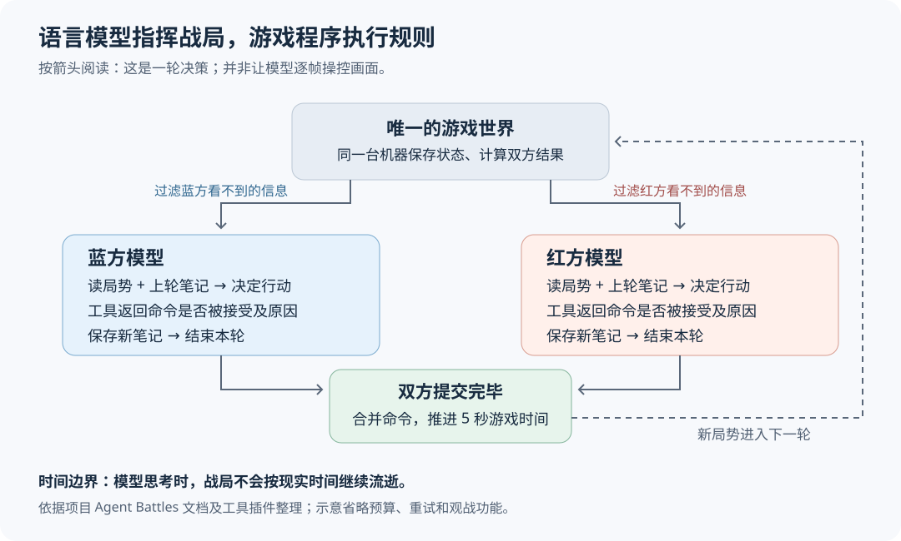
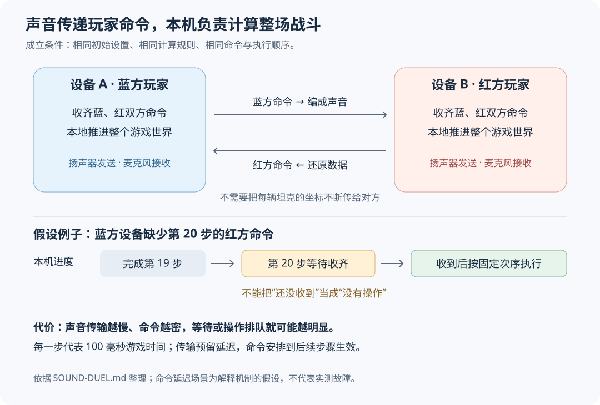

# Battle Drones：当 Agent 开始造游戏、测游戏，也下场玩游戏

让 AI 写出一个“看起来像游戏”的页面，和做出一个愿意反复玩的游戏，中间隔着玩法设计、反复测试和大量修改。Simon Willison 的 Battle Drones 实验尝试跨过这段距离：他给出方向，编码 Agent——能修改文件、调用工具并检查结果的 AI 程序——连续迭代作品，还制作测试和观察工具来辅助改进。最后，这个浏览器策略游戏不仅能让语言模型互相对战，还尝试让两台附近设备通过声音联机。

这项进展值得关注的地方，是 Agent 承担的工作从“生成一段代码”延伸到了“把作品做出来，再寻找改进依据”。它适合用来观察个人创作和交互式实验的变化；现有证据支持的是一个公开项目的实践案例，尚不足以证明 AI 已经普遍掌握游戏设计。

本文围绕 Willison 于 2026 年 10 月 20 日发表的[原文](https://simonwillison.net/2026/Oct/20/battledrones/)展开，并核对项目文档、公开工具源码和相关技术资料。

## 先看一个具体问题：有了运输机，为什么没人用？

Battle Drones 是一款即时战略游戏，简称 RTS：玩家一边采集资源、建造基地，一边指挥部队，战场不会等玩家想好再继续。它沿用了《命令与征服》一类游戏的基本结构，最初目标是适合手机浏览器操作。

原文中一个很有解释力的例子，出现在加入步兵和 Condor 运输机之后。Willison 发现，游戏里的电脑对手很少使用它们。问题并非缺少按钮或模型，而是现有地图没有给这些单位足够的用途。

他的后续要求改变了这一点：把可占领的资源设施放到孤岛上，地面部队走不过去，普通飞机又不能直接占领；玩家必须用运输机把步兵运过去。双方还会获得运输机和步兵的补给，降低失去这套能力后无法继续争夺的风险。这个设计最终成为 Archipelago 群岛地图。[设计过程见原文](https://simonwillison.net/2026/Oct/20/battledrones/)。

这里的因果关系很具体：孤岛上的收益制造争夺目标，登陆限制让步兵不可替代，跨水运输让 Condor 有了用途。运输机不再只是增加一个可生产的单位，而是参与了一条获取收益的行动链。

这个例子也说明，人的作用仍然重要。Willison 发现了“新增单位缺少战略理由”，提出约束，还要求 Agent 先研究、批评设计，达成一致后再实现。把整个项目概括成“一句话自动生成好游戏”，会漏掉这些影响结果的判断。

## “让它更好玩”如何变成可执行的工作？

原文最吸引人的转折，是 Willison 对一个不够有趣的版本说：“让它好玩得多。”据他描述，这次工作从晚上持续到第二天上午，Agent 增加了新玩法，并运行大量模拟对局来调整平衡。

他使用的是 Claude Code 的 Ultracode 工作方式。官方文档把其背后的“动态工作流”解释为：由 Claude 编写 JavaScript 脚本，再由运行环境执行脚本，组织多个子 Agent 完成任务。子 Agent 是分担具体工作的独立 AI 执行者；脚本可以保存中间结果，并决定下一步或何时重复检查。它让长任务的推进方式部分落到程序里，而不必全靠一段越来越长的对话。[机制依据 Claude Code 官方文档](https://code.claude.com/docs/en/workflows)。

但官方文档说明的是工具能力，不能据此还原 Battle Drones 那次运行中每个子 Agent 的具体分工。原文能支持的结论是：这次请求触发了持续数小时、包含模拟测试的修改过程。

从改动结果看，模糊的“更好玩”被拆成了几类更容易检查的问题：开局是否马上有选择，战斗是否来得及反应，落后者是否还有机会，双方是否有理由离开基地争夺地图。开局方案、战场目标、支援攻击以及战斗节奏的修改，分别回应了这些问题。**这是对改动与目标关系的分析，不代表已经完整复原 Agent 的内部设计过程。**

项目发布说明报告，在普通难度的 1,200 场内置 AI 对战测试中，25 分钟后仍未分出胜负的比例从 14% 降至 0.9%；获胜方曾落后至少 800 单位资源的比例从 24% 升至 46%。这些数字说明测试中的僵局减少、逆转增多。[数字及测试口径见发布说明](https://github.com/simonw/battledrones/blob/main/Battle%20Drones%20The%20Fun%20Update%20%E2%80%94%20Release%20Notes.md)。

它们没有直接测量人类的乐趣。发布说明明确指出，统计来自内置 AI 和脚本玩家的模拟，且在该说明发布时尚无人类试玩；后来 Willison 在文章中给出“好玩”的评价，是另一类证据。更长的战斗和更多逆转可能增加决策空间，也可能让某些玩家感到拖沓，需要人类体验来判断。

还要区分三种角色：负责实现游戏的是编码 Agent；上述千场测试使用的是游戏内置的程序化电脑对手；后面介绍的模型对战，才是通用语言模型亲自决定战术。把它们都叫“AI”，很容易误以为千场测试已经证明了语言模型的指挥能力。

## 模型如何下场：读局势、发命令、留下笔记

Battle Drones 的另一项进展，是给语言模型提供一组游戏工具。大语言模型，简称 LLM，是能理解和生成语言、并可提出工具调用请求的模型；在这里，它通过工具取得战场信息，再提交建造、生产和攻击命令。

这不是让模型盯着游戏画面、连续点击鼠标。项目采用文字观察和明确的命令接口，并用“战争迷雾”限制信息：未被己方发现的敌人不能直接出现在观察中。比赛由一台机器上的程序持有唯一战局，默认按每轮 5 秒游戏时间推进；两边先看到同一时刻的局势，提交完毕后再共同推进。[运行方式见 Agent Battles 文档](https://github.com/simonw/battledrones/blob/main/AGENT-BATTLES.md)。

假设蓝方发现敌机逼近基地，模型可以先查询附近区域，再提交建造防空设施、调整部队等命令。这是解释机制的假设场景，并非项目公开对局的复述。

关键在于，提交命令后还有反馈。公开插件的 `orders` 工具会逐项返回是否接受及原因；系统提示要求模型读完结果再结束本轮。模型还要用 `end_round` 保存笔记，记录计划、进度和已知敌情。标准逐轮运行方式不会带入完整的历次对话，上轮笔记承担跨轮记忆，笔记上限为 2,000 字符。部队则会在轮次之间继续执行已经收到的指令。[这些行为可在固定提交的插件源码中核对](https://github.com/simonw/battledrones/blob/d584e351d9d28c4ba058b78ddcca9b93cd9bcd33/llm-tools-battledrones/llm_tools_battledrones.py#L106-L117)。

这让我们能够具体观察 Agent 的能力：它能否根据不完整信息制定计划，能否发现行动未被接受，能否在新情况出现后修改计划。笔记机制也带来明确取舍：保留的历史更短、更可控，但漏写或写错的判断可能影响后续决策。

“5 秒一轮”指游戏内时间，不代表模型必须在现实中的 5 秒内回答。这样的安排减少了回答速度对输赢的影响，更适合观察战术决策；它没有证明模型能在人类比赛的实时压力下完成同样操作。

也不能根据几场展示赛就给模型排总榜。胜负还会受地图、出生侧、提示、工具预算和游戏版本影响。项目 README 特别说明，部分早期对局在新版代码上重新模拟后，结束时间发生过变化；展示回放因此固定到已知能正确重放的版本。[版本差异说明见 README](https://github.com/simonw/battledrones#watch-ai-models-play-it)。

## 声音联机的关键：少传数据，让两端自己计算

原文标题中的声音联机，是另一条技术线：两台设备放在彼此麦克风可接收的范围内，用扬声器和麦克风交换数据。Willison 的动机很实际——希望游戏保持静态网页的发布方式，不必长期维护联机服务器。

听起来最难的问题是：一场战斗里有那么多单位，声音怎么及时传完它们的位置？这个项目的办法是，两端各自运行完整游戏，只交换玩家命令。

它依赖“确定性模拟”：给定相同的起点和输入，程序应算出相同结果。再让双方按相同次序处理每一步命令，就形成“锁步同步”——缺少某一步的对方输入时，先等输入，而不自行猜测接下来发生了什么。项目声音联机规格以 100 毫秒游戏时间为一步，并预留命令延迟，让声音有时间到达。[协议依据 SOUND-DUEL.md](https://github.com/simonw/battledrones/blob/main/SOUND-DUEL.md)。

图中的缺包情形是假设示意。即使玩家没有下命令，对端也需要确认这一步确实没有操作；否则，“没有操作”和“消息还在路上”无法区分。等待会让游戏暂时停顿，却能避免两台设备各自进入不同战局。

声音本身承载的是编码后的数据，不是模型说出的自然语言。规格采用正交频分复用，简称 OFDM：把数据分散到一组按特定频率间隔排列的音调上同时发送，接收端再将它们分开、还原数据。双方使用不同频段发送，并配合纠错和校验，降低声音失真造成错误命令的风险。这里的声音通信由浏览器程序完成，与语言模型参战是相互独立的功能。

确定性也不是“代码相同”就自然具备。原文提到，项目曾因浏览器数学函数的微小差异出现回放不同步，因此替换了一些计算实现。语言规范确实允许 `Math.sin` 等函数采用实现近似的结果，而不保证所有引擎逐位一致。**可能的放大路径是**：微小位置差异改变一次射程判断，进而改变谁先开火、谁先被摧毁，后续战局随之分岔；这是机制解释，不是对项目某场故障的复述。[规范依据 ECMAScript 的 Math.sin 定义](https://tc39.es/ecma262/multipage/numbers-and-dates.html#sec-math.sin)。

这种选择减少了必须传输的数据，却把代价转移到了计算一致性和声音链路上。命令密集、设备处理声音不理想或环境干扰较强时，操作可能排队或战局等待。静态网页也只是省去了专用游戏服务器，并没有消除设备兼容和测试工作。

## 新意在哪里，证据又到哪一步？

让 AI 玩即时战略游戏已有长期研究。DeepMind 的 AlphaStar 曾通过游戏数据和专门训练学习《星际争霸 II》：先从人类对局中学习行为，也就是模仿学习；再利用行动结果的反馈改进策略，也就是强化学习。Battle Drones 展示的重点不同：把现成通用语言模型接到一个可观察、可控制、可回放的小型环境中，查看它们如何使用工具和维持计划。[背景参见 AlphaStar 官方介绍](https://deepmind.google/blog/alphastar-grandmaster-level-in-starcraft-ii-using-multi-agent-reinforcement-learning/)。两者的游戏、训练方式和操作条件不同，不能直接比较实力。

声音传数据也已有先例：[ggwave](https://github.com/ggerganov/ggwave) 提供声音数据传输库，[Siner](https://github.com/AlonHor/siner) 则公开描述过用高频声音实现附近设备间的游戏通信。因此，“首次用声音联机”不是这里可成立的新意；原文中“可能是 RTS 首例”的说法，也只是作者有限检索后的判断。

更有依据的新意，是这个项目把几件事连在了一起：Agent 持续开发一款可玩的作品，围绕作品制造测试与观察工具，再把作品开放成语言模型可以行动的环境。声音联机则展示了它还能围绕一个特殊约束——不维护联机服务器——尝试完成跨越游戏和信号处理的功能。

判断成熟度时，可以把证据分开看：

| 证据 | 已经支持什么 | 仍不能推出什么 |
| --- | --- | --- |
| 原文记录的迭代与公开项目 | 存在可访问的作品、版本和辅助工具 | 仅凭单条提示就能稳定复现同等结果 |
| 内置 AI 对战统计 | 特定测试中的节奏与胜负指标变化 | 人类玩家普遍觉得更有趣 |
| 工具源码与公开模型对战记录 | 模型通过受限工具参与游戏决策 | 已形成稳定、公平的通用能力排名 |
| 作者报告的跨设备声音联机体验 | 至少有作者实践层面的可行性观察 | 广泛设备、距离和噪声条件下的成功率 |

声音联机尤其需要保留最后一层区别。作者报告自己在笔记本、iPhone 和 iPad 之间试用过，体验良好；但项目规格仍列出 Android 高频输出、音频中断、离线首次配对等真机验证事项。没有覆盖性数据，就还不知道它在更广泛设备和环境下有多可靠。[待验证项目见声音联机文档末尾](https://github.com/simonw/battledrones/blob/main/SOUND-DUEL.md#before-launch-on-real-phones)。

本次核验阅读了公开文档和上述插件源码，没有独立运行千场对战、复现模型比赛或进行双设备声学测试。

## 接下来值得观察什么？

对个人创作者来说，这个案例提示了一种值得尝试的工作方式：提出希望改变的体验，让 Agent 实现，再同时要求它提供能帮助判断结果的测试或观察工具。判断仍要回到目标本身——如果目标是“有趣”，自动对战统计只能辅助，人类试玩不能省略。对于玩法设计，群岛地图的过程尤其有启发：发现缺少什么激励，再明确规则，比不断要求增加内容更容易解释结果为什么变化。

对 Agent 研究而言，潜在用途是把这种小型游戏当作可检查的决策环境。相较于只读模型的回答，研究者可以看它实际下了什么命令、被拒绝后有没有调整、短笔记是否支撑了长期计划。要把这种用途变成更强的证据，下一步应关注固定版本、多地图、交换出生侧和重复比赛的结果，而不是单场精彩回放。这是从现有机制出发的研究建议，并非项目已经完成的评测。

另外两个信号也值得跟踪：一是更多人类试玩是否证实自动指标对应了更好的体验；二是声音联机是否公布明确设备与环境条件下的延迟、等待时间和失败情况。它们分别决定“Agent 能改进作品”和“特殊联机方式可复用”这两项判断能走多远。
