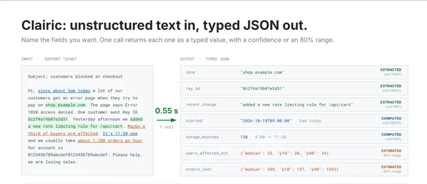
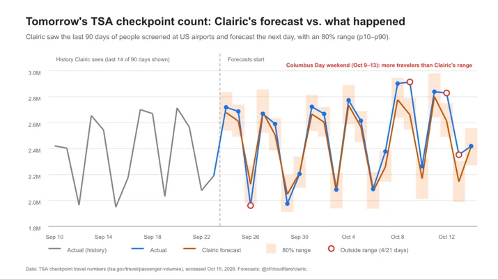
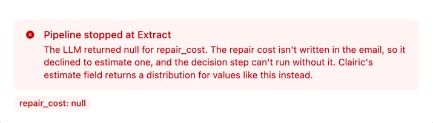

# Introducing Clairic, a new System One class of extraction models

> **来源**: [https://blog.cloudflare.com/clairic-extraction-model](https://blog.cloudflare.com/clairic-extraction-model)  
> **作者**: 未知 | **发布时间**: 2026-10-19T17:48:26.614000+00:00  
> **深度调研**: [查看专题调研报告](research.md)  
> **标签**: 信息抽取, 结构化输出, 多模态模型, 不确定性估计, 时间序列预测, 模型级联, Workers AI

---

## AI 导读

文章介绍 Clairic，一种面向 System One extraction 的单次前向模型，试图解决传统 LLM 在重复结构化抽取中的速度、成本、输出格式和可追溯性问题。用户以 state 和 typed fields 定义要读取的字段；模型返回文本跨度、数字、日期、时长、列表、估计分布或未来序列，并附带 confidence、p_null、区间和字符偏移。文中用客服邮件演示订单号、日期、总额、延迟天数、损坏类型和维修费用的提取或计算，用收据图像展示视觉读取，用房产可比数据展示带区间估计，用 TSA 每日客流展示预测。文章还把 Clairic、Clef 和 GLM-5.3 组成提取—决策—生成级联，在其测试中端到端延迟为 19.3 秒、较全 LLM 流程少 69%，成本少 49%。局限包括长链算术和多行聚合较弱、估计依赖输入证据、区间校准并非保证、预测能力基础且不替代专用时间序列模型；当前仍是早期预览。文中未提供足以独立复现实验的完整数据、评测协议或外部验证。

---

## 原文整理

# Introducing Clairic, a new System One class of extraction models


Today, we're announcing a preview of a new class of System One-style models: extraction models. Our first one, Clairic, is available hosted on Workers AI as `@cf/cloudflare/clairic.`We intend to release the model open-weights soon. Clairic is an extraction model that is able to extract, compute, estimate, and forecast values from unstructured inputs — all at a significantly higher accuracy, faster latency, and cheaper cost than traditional LLMs.

## Context

When System One models were announced by TypeSafe a month ago, it took the industry by storm. As referenced by [<u>TypeSafe in their blog</u>](https://typesafe.ai/blog/introducing-system-one-models-and-jev) and defined by Daniel Kahneman’s book *Thinking, Fast and Slow*, a System One model should be fast and precise, which contrasts a System Two model that is capable of deliberate reasoning (like LLMs). With this, TypeSafe introduced Jev — a model that is purpose-fit for a specific use case, and priced accessibly given its niche domain. It excelled where LLMs failed, helping users make decisions based on probabilities and well-typed outputs. The introduction of Jev prompted people to start thinking about a new class of models that were not LLMs and how to integrate them into their workflows.

We were inspired by the concept of System One models and started thinking about other tasks where LLMs are inefficient. There are many structured-output calls going to frontier LLMs today with the same shapes again and again: *What's the invoice total? When was this delivered? How many days late is it? What will this repair cost? What will traffic look like over the next 24 hours?* None of these have answers you can list out in advance, which is needed for a decision model to give probabilities against. That led us to the class of models we're introducing today: System One extraction models.

## Introducing System One extraction models

Until now, every System One model has been a decision model: Jev and [<u>Clef</u>](https://blog.cloudflare.com/clef-decision-models/) take an input state and a list of questions and give probabilities against the inputs and your listed questions. [<u>Clairic</u>](http://developers.cloudflare.com/workers-ai/models/clairic/) is the first model in a new class: System One extraction models. It is still fast, typed, and cheap, but it answers with **values** directly extracted from the input, computed from it, or predicted beyond it.

Most model tasks ask for one of three kinds of output: a number, a choice from a fixed set, or open-ended text. Clairic handles the first, returning numbers with an 80% range, and also pulls typed values like names, dates and lists out of the input. Clef handles the second: it picks among options and returns a probability for each. LLMs handle the third. We call Clairic and Clef System One models because they answer in a single pass, without reasoning or generating tokens. They charge only for input and typically respond in under a second, while an LLM that reasons through the same step takes several seconds.

An extraction model can return:

- **Extracted values:** Text copied from the input, such as a name, an order ID or a description. Each one comes back as a span with its character offsets and a confidence score.
- Including, **computed values:** Numbers, dates, times, datetimes, durations and lists, read from the input or worked out from it. They follow the rules of their type (for example, two decimals for cents) and come with a confidence score.
- **Estimated values:** Values the input doesn't state but gives evidence for. Each one comes back as a distribution inside the bounds you declare, on the grid you specify, with a median and an 80% interval.
- **Forecasted values:** Future values of a series, one estimate per step ahead, each with its own 80% interval.



And because it generates no tokens, it can't produce a mistyped answer or “hallucinate” in the same way as an LLM (though it can, of course, make mistakes). Outputs are a value of the type you asked for, or null when the model fails to find an answer in the input. It also comes with confidence scores against the outputs to help you evaluate if it is appropriate to trust the model or to take a second look.

Here’s how extraction models fit into the landscape of System One and System Two models:

|  | System One: Extract | System One: Decide | System Two | 
| Example models | Clairic | Jev, Clef | GPT, Claude, Gemini, DeepSeek | 
| Sampling | One parallel pass | One parallel pass | One token at a time | 
| Purpose | Predict values | Make decisions | Write and reason | 
| ML framing | Regression and extraction | Classification | Generation | 
| Thinking mode | System 1: fast, one pass | System 1: fast, one pass | System 2: slow, deliberate | 
| Output | Typed values: spans, numbers, dates, times, lists, distributions, with calibrated probabilities | Typed decisions: options with calibrated probabilities | Free-form strings | 
| Output space | Continuous, but typed and bounded by your schema | A finite set of options you list | Anything | 
| What it answers | What's the amount? When does it happen? How much will it be? | Which category is it? Is it legitimate? Which action should we take? | Why did it happen? How should we approach it? Can you fix it? | 
| Output always a valid response? | Yes: every answer is a value of its declared type (or null), inside your bounds | Yes: answers are always one of your options | No: strings must be parsed and checked | 

Together, these models can work together in unison to help you get closer to parsing through real-world data, making decisions on inputs, and then taking actions. Extraction models turn raw input into typed values, decision models turn values into decisions, and LLMs turn decisions into words.

## How a request works

Clairic is designed differently than an LLM. Similar to a decision model, it only processes input tokens with a single forward pass, and thus has no charge for output tokens. It is much faster, cheaper, and more accurate than an LLM for certain use cases.

A request is a `state` (the text to read, plus up to four optional images) and a map of typed `fields`. You name each field, give it a type and optional plain-language `instructions`, and get back one typed answer per field, all from one parallel pass. There is no reasoning and no output tokens – everything computes in a single forward pass, which means it is both fast and cheap.

| Type | Returns | 
| `text` | A specific span of the input, with its offsets | 
| `number` | A number read or computed, honoring `integer` and `decimals` | 
| `date`, `time`, `datetime` | Calendar dates and valid times, in ISO form | 
| `duration` | A length of time in the unit you choose | 
| `list` | Matching text, number or date, in input order | 
| `estimate` | A distribution inside your `[min, max]`, on your `step` grid, linear or log scale. | 
| `forecast` | One estimate per future step of a series | 

Every scalar answer comes with `p_null` (the probability that the value isn’t in the inputs) and `confidence`. Every `estimate` answer comes with a median and an 80% interval (`p10` to `p90`), plus all 99 percentiles on request. There's no limit on the number of fields: if they don't fit beside the input in one pass, the server splits them into parallel passes that each see the whole input, then merges the answers.

Here are some examples to illustrate the model’s features. Of course, using these features in a workflow would require appropriate inputs.

## An example: Extracting values

Extraction is probably the most common job handed to LLMs today: "return the invoice number, vendor and due date as JSON." It works most of the time, but the failure modes are hard to catch. The output may not be valid JSON, a digit can be misread as it's generated, and once a text excerpt comes back, there's no way to trace it to where it appeared in the source. Most people build extraction pipelines to combat this, with multiple layers of parsing, schema validation, retries and spot checks. On top of that, you pay for reasoning and output tokens on every field of every document.

Clairic operates differently; it doesn’t generate text answers. Instead, you get:

- **Values** extracted from your input, so an answer is grounded.
- **Computed values**, so it can parse through unstructured data without pre-sanitizing it.
- **Character offset spans**, so you can reference where in the input the data was.
- **Confidence labels**, so you can determine which values need a second look.
- **A strongly typed output**, so numbers and dates are formed under the rules of their type (e.g., a cents field has two decimals).
- **Handling for null values**, where a missing field returns with `null` as an answer (along with an estimated probability of null and a guess).
- **Cheaper and faster answers**, because every field is answered in the same parallel pass. So asking for thirty fields costs about the same as asking for three.

Let’s walk through an example to illustrate the ways Clairic can extract values from unstructured data and make estimates. Take a customer support email:

*Hi, order A-88412 arrived on Sept 28, 2026 with a cracked screen and a dented corner. I paid $649.00 plus $52.10 tax. It's now Oct 9, 2026 and I'd like this fixed or refunded. Thanks, Dana*

From a Worker, you would make a request to Clairic to process this data:

```
const { answers } = await env.AI.run("@cf/cloudflare/clairic", {
  state: email,
  fields: {
    order_id:            { type: "text", instructions: "Order number" },
    delivered_on:        { type: "date", instructions: "Delivery date" },
    amount_paid:         { type: "number", decimals: 2, unit: "USD", instructions: "Total paid including tax" },
    days_since_delivery: { type: "duration", unit: "days", integer: true,
                           instructions: "Days from delivery to the date the customer wrote" },
    damage:              { type: "list", items: "text", instructions: "Each kind of damage described" },
    tracking_number:     { type: "text" },
  },
});
```
Clairic returns the extracted values, spans in the input, probability that it is null (p\_null) and confidence score:

```
{
  "order_id": {
    "type": "text",
    "p_null": 3.4e-6,
    "span": [10, 17],
    "guess": "A-88412",
    "confidence": 0.999957,
    "value": "A-88412"
  },
  "delivered_on": {
    "type": "date",
    "p_null": 6.5e-8,
    "guess": "2026-09-28",
    "confidence": 0.999999,
    "value": "2026-09-28"
  },
  "amount_paid": {
    "type": "number",
    "p_null": 1.6e-5,
    "guess": 701.1,
    "confidence": 0.999944,
    "value": 701.1
  },
  "days_since_delivery": {
    "type": "duration",
    "p_null": 6.1e-9,
    "unit": "days",
    "guess": 11,
    "confidence": 0.999999,
    "value": 11
  },
  "damage": {
    "type": "list",
    "value": ["cracked screen", "dented corner"],
    "spans": [[50, 64], [71, 84]]
  },
  "tracking_number": {
    "type": "text",
    "p_null": 1,
    "span": [106, 112],
    "guess": "$52.10",
    "confidence": 0.416016,
    "value": null
  }
}
```
A few things to notice:

- `amount_paid` isn't written anywhere in the email. In this example, Clairic added the price and the tax in the same pass and returns the sum.
- `days_since_delivery` is also worked out from two dates in the text, not directly in the input.
- `damage` lists both kinds of damage as exact spans, so you can highlight them in the source.
- `tracking_number` isn't in the email, so it comes back `null` instead of a plausible-looking guess. `guess` shows what the model would otherwise have picked.

### Clairic also works with images

Here’s a real-life photo of a receipt — the text is not perfect and the angle of the image doesn’t help its legibility. We passed this image to Clairic to see what it could extract:


```
{
  "model": "clairic",
  "answers": {
   "order_number": {
    "type": "number",
    "p_null": 0.0040206750854849815,
    "guess": 77245,
    "confidence": 0.776249383996532,
    "value": 77245
   },
   "purchased_at": {
    "type": "datetime",
    "p_null": 4.136094133855295e-08,
    "guess": "2026-07-01T13:34:00",
    "confidence": 0.831464227002992,
    "value": "2026-07-01T13:34:00"
   },
   "quantity": {
    "type": "number",
    "p_null": 5.2313655629632194e-08,
    "guess": 2,
    "confidence": 0.9997007500403496,
    "value": 2
   },
   "unit_price": {
    "type": "number",
    "p_null": 0.001599092734977603,
    "guess": 7.99,
    "confidence": 0.9991279019989127,
    "value": 7.99
   },
   "subtotal": {
    "type": "number",
    "p_null": 9.69956488461321e-08,
    "guess": 15.98,
    "confidence": 0.9999881983893096,
    "value": 15.98
   },
   "sales_tax": {
    "type": "number",
    "p_null": 2.5511653802823275e-06,
    "guess": 0,
    "confidence": 0.9999800924450729,
    "value": 0
   },
   "tip": {
    "type": "number",
    "p_null": 5.953857908025384e-05,
    "guess": 2.39,
    "confidence": 0.9335768781214697,
    "value": 2.39
   },
   "discount": {
    "type": "number",
    "p_null": 0.9994148015975952,
    "guess": 0,
    "confidence": 0.91852733929319,
    "value": null
   }
  }
}
```
As you can see, it was able to extract all the values from the images, alongside a confidence score. It also correctly stated that there was no discount shown in the receipt, giving the value as null.

## An example: Estimating values

Some values aren't in the input at all, but the input carries evidence for them. For example, values might not be in plain text but can be discerned from values around it. If you ask an LLM for an estimation, you usually get a single number with no sense of how sure the model is. It will make safe guesses or hallucinate, or reason its way around the answer. If you land on an estimate, any downstream processing can't tell a confident $180 from an unconfident $180, so it can't help you decide what is appropriate to automate in the circumstances. It is also a lot slower and more expensive to do reasoning through LLMs.

A decision model can approximate an estimate by choosing among buckets ("under $100", "$100–500", …), but buckets are coarse, every bucket adds input tokens, and each new category adds more sources of confusion for the model during its decision making process.

Clairic returns a **distribution** over the range you declare: a point value, a median, an 80% interval, and every percentile on request. The estimate is designed to fall inside your bounds, so there's nothing to clamp or round afterward. The width of the interval reflects data confidence: a narrow range signals high certainty, while a wide range indicates low certainty, information you can use to route another check.

Here’s another example, where Clairic looks at historical home prices and comparable sales, to determine an estimate :

```
const { answers } = await env.AI.run("@cf/cloudflare/clairic", {
  state: `Comparable sales:
sqft,beds,year_built,neighborhood,sale_price
1450,3,1998,Elm Park,412000
2100,4,2006,Elm Park,585000
980,2,1975,Riverside,265000
1600,3,2003,Elm Park,449000
1300,3,1990,Riverside,318000
Subject property:
sqft,beds,year_built,neighborhood
1620,3,2001,Elm Park`,
  fields: {
    sale_price:     { type: "estimate", unit: "USD", min: 50000, max: 5000000, scale: "log", step: 1000 }
});
```
Clairic will return an estimated value:

```
{
  "sale_price":     { "type": "estimate", "value": 418000, "median": 415000, "p10": 370000, "p90": 470000, "p_below": 0.0, "p_above": 0.0 }
}
```
Values always fall inside your bounds, and the width of the interval shows how much the input informs the prediction: price is narrow ($370,000-$470,000), days on market is wide (24-148). Because fields are unlimited and answered in parallel, you can score many items in one call (one estimate per candidate, lead, or listing) and sort them in code.

## An example: Forecasting values

Forecasting values in a time series is quite hard for generalized models — it usually means you have to either build a specific pipeline per metric (parse the data, fit a model, tune it, deploy it), or you paste 36 months of numbers into an LLM and ask for the next three. The first is accurate but really expensive and time-consuming to set up for every new series. The second is easy, but you get point forecasts with no intervals, forecasts that shift depending on how the prompt is worded, and answers with limited confidence.

Clairic sits between the two — it is not claiming to replace a dedicated time-series model, but it is a little faster and cheaper than your regular LLM. A `forecast` field takes the history as plain text in `state` and returns, for every step ahead, a value and an 80% interval, inside the bounds you declare. It reads the history the way you already have it, whether that's a CSV export, a pasted dashboard, or rows mixed with notes, and may often work with no need to clean up your data beforehand.

To see how that holds up on real data, we used a public series: the number of people the Transportation Security Administration (TSA) screens at U.S. airport checkpoints each day. Each morning we asked Clairic for the next day's count, given the real counts so far, for 21 days in a row:

```
const { answers } = await env.AI.run("@cf/cloudflare/clairic", {
  state: `Daily number of people screened at TSA checkpoints at US airports.
date,weekday,travelers
2026-07-16,Thu,2850229
...
2026-10-13,Tue,2353356
Forecast date: 2026-10-14 (Wed)`,
  fields: {
    travelers: { type: "forecast", horizon: 1, interval: "day",
                 min: 500000, max: 4000000, scale: "log",
                 instructions: "Number of people screened tomorrow" },
  },
});
```
Which returns:

```
{
  "travelers": { "type": "forecast", "value": [2416117], "median": [2419283], "p10": [2270774], "p90": [2556769] }
}
```
In actuality, TSA screened 2,419,474 people that day, which is right around the median 2,419,283 that Clairic predicted.



*Data: [<u>TSA checkpoint travel numbers</u>](http://tsa.gov/travel/passenger-volumes), accessed Oct. 15, 2026.*

Across the 21 days, Clairic's forecasts were off by 3.3% on average, and 17 of the 21 actual counts landed inside its 80% interval, which follows what an 80% interval should do. It picked up the weekly rhythm from the numbers alone: quieter Tuesdays and Saturdays, busier Thursdays, Fridays, and Sundays.

The misses are also interesting: three of the four days outside the interval fall on the Columbus Day weekend, when more people flew than the previous weeks suggested. Clairic forecasts from the patterns in the series but doesn't account for events the series doesn't show, like holidays.

## Thinking fast and slow

These models are designed to fit alongside your existing agentic workflows. An extraction model predicts values, a decision model decides what to do with these values, and an LLM takes action with them. It is a perfect marriage between System One and System Two models. It bridges the existing gap, where you either have to manually extract data for LLMs, or have an LLM parse through messy data (which is costly, time-consuming, and can lead to hallucinations). With System One extraction models, you can work with real-world data with more speed, efficiency, and precision.

Here's an example of the damaged-product claim from earlier, illustrating how all the models can work together.  We built this into a [<u>live demo you can try here</u>](https://clairic-pipeline-demo.workers-ai-mle.workers.dev/).

```
// 1. Clairic turns the email into values
const facts = (await env.AI.run("@cf/cloudflare/clairic", {
  state: email,
  fields: {
    customer_name:       { type: "text", instructions: "Customer's first name" },
    order_id:            { type: "text", instructions: "Order number" },
    amount_paid:         { type: "number", decimals: 2, unit: "USD", instructions: "Total paid including tax" },
    days_since_delivery: { type: "duration", unit: "days", integer: true,
                           instructions: "Days from delivery to the date the customer wrote" },
    damage:              { type: "list", items: "text", instructions: "Each kind of damage described" },
    repair_cost:         { type: "estimate", unit: "USD", min: 10, max: 5000, scale: "log", step: 1,
                           instructions: "Cost to repair the damage described" },
  },
})).answers;
const { customer_name, order_id, amount_paid, days_since_delivery, damage, repair_cost } = facts;
// 2. Clef decides from Clairic's values and the policy, not from the raw email
const options = {
  refund:  "Full refund of the amount paid",
  repair:  "Free repair, with a prepaid shipping label",
};
const { choice } = (await env.AI.run("@cf/cloudflare/clef", {
  state: `Damage claim for order ${order_id.value}.
Paid: $${amount_paid.value.toFixed(2)}. Delivered ${days_since_delivery.value} days ago.
Damage reported: ${damage.value.join(", ")}.
Estimated repair cost: $${repair_cost.median} (80% range $${repair_cost.p10}-$${repair_cost.p90}).
Policy: refunds within 30 days of delivery. Prefer repair when it costs less than 60% of the price and the damage doesn't stop the product from working.`,
  questions: {
    resolution: { type: "choice", instructions: "What should we offer?", criteria: options },
  },
})).answers.resolution;
// 3. An LLM writes the reply, from the decision and the facts it needs
const { response } = await env.AI.run("@cf/zai-org/glm-5.3", {
  messages: [{
    role: "user",
    content: `Write a short, warm reply to ${customer_name.value}. Use only these facts: order ${order_id.value}; ` +
             `damage: ${damage.value.join(", ")}; what happens next: ${options[choice]}. Under 60 words.`,
  }],
});
```
Each step gets cleaner input than the one before. Clef decides from a five-line summary of typed values instead of a free-form email, which can also be susceptible to prompt injection. The LLM never sees the email, only the decision and the predictions it needs, so there are fewer numbers for it to misuse. Every step is typed and auditable, and only one step generates text. In the all-LLM version of this pipeline, all three steps are generative calls, and every value in the reply has to be checked by hand.

We ran this pipeline against an all-LLM version with GLM-5.3 writing the reply in both. In the all-LLM version, GLM-5.3 also does the extraction and the decision, from the same email, policy and prompts:

|  | Clairic → Clef → GLM-5.3 | GLM-5.3 for every step | 
| Latency, end to end | 19.3 s | 61.7 s | 
| 1. Extract | Clairic: 0.46 s | GLM-5.3: 16.1 s | 
| 2. Decide | Clef: 0.22 s | GLM-5.3: 21.9 s | 
| 3. Reply | GLM-5.3: 18.6 s | GLM-5.3: 16.4 s | 
| Input tokens | 701 ($184 per million claims) | 390 ($546 per million claims) | 
| Output tokens | 1,329 ($5,848 per million claims) | 2,544 ($11,194 per million claims) | 
| Cost per million claims | $6,032 | $11,740 | 

The cascade finished in 19.3 seconds against 61.7 seconds: **69% less time, or about 3.2 times faster**. Clairic and Clef handled extraction and the decision in under a second combined, where GLM-5.3 took 38 seconds for the same two steps. It also **costs 49% less** to use the cascaded pipeline vs the all-LLM pipeline. With GLM, both pipelines got the facts and the decision right in every run, but Clairic's repair estimate was identical each time, while GLM-5.3's changed on every run ($250, $250 and $220, with different ranges each time).

Notably, under the all-LLM pipeline both Gemma 4 and Qwen failed at this task, as they were unable to deduce values like repair\_cost from the inputs, showing how LLMs are not great at data extraction tasks.



## Preview release

Today, we're releasing a hosted endpoint for Clairic on Workers AI. We intend to release the model with open weights soon. We wanted to take the time first to introduce the concept of a System One extraction model, so you can start thinking about how this class of model would fit into appropriate workflows.

The current endpoint is an early checkpoint and we expect it to get better. Here are our early impressions:

- **Reading is strong, but multi-step arithmetic isn't yet.** One- and two-step calculations (totals, differences, conversions, date arithmetic) seem reliable. Longer chains of dependent steps are hard for any one-pass model without a scratchpad. The same goes for aggregating across many rows of a table. At least for now, have Clairic predict the value and let code do the math.
- **Estimates need evidence.** Clairic estimates best from comparables, history, or descriptive text in the input. Asking it for a value it has no evidence for may be limited in specificity.
- **Calibration is measured, not guaranteed.** Intervals are trained to be calibrated and are on most held-out sets, but they can run narrow on unfamiliar data.
- **Forecasting is basic**. The model is not designed to accurately replace or predict time-series models that are trained on specific data. You should use it where appropriate, such as non-critical, general pattern matching, not detailed long-horizon forecasting.
- **Use confidence.** The architecture makes every answer well formed, not necessarily correct. Use `confidence`, `p_null` and the intervals to decide what to automate (in an appropriate workflow context) and what to send off for additional review.

We'll keep working on the arithmetic, estimation and forecasting sides of the model with each checkpoint. After some more work, we plan to release the model open-weights for everyone to play around with as well.

## Try it out

Clairic is available as a preview on Workers AI as `@cf/cloudflare/clairic`. Call it from a Worker with `env.AI.run()`, or from anywhere with the REST API. We have full model docs [<u>here</u>](https://developers.cloudflare.com/workers-ai/models/clairic/), as well as [<u>a new docs explainer</u>](https://developers.cloudflare.com/workers-ai/concepts/extraction-models/) on how the extraction model API looks.

P.S. Since you liked the [<u>etymology of the name *Clef*</u>](https://blog.cloudflare.com/clef-decision-models#what-is-a-decision-model), here’s how we landed on the name *Clairic.* We started with a desire to keep the name of the model thematically and sonically similar to Clef. Clair came to mind, sharing the same “cl” sound, as well as roots in music (“Clair de Lune”). More importantly, we wanted the name to be descriptive to the nature of the model. The Clairic model should be able to help you with *clerical* tasks like extracting data *clearly* from a corpus of inputs and upholding accuracy in tasks like bookkeeping. The prediction aspect of the model leans into the “*Clair*” root — allowing you to estimate and predict future values, similar to *clairvoyance*. Lastly, we like the idea of having this be \[Cl\]oudflare’s \[AI R\]egression model. Thus, Clairic was born into the world. We hope you enjoy it.
