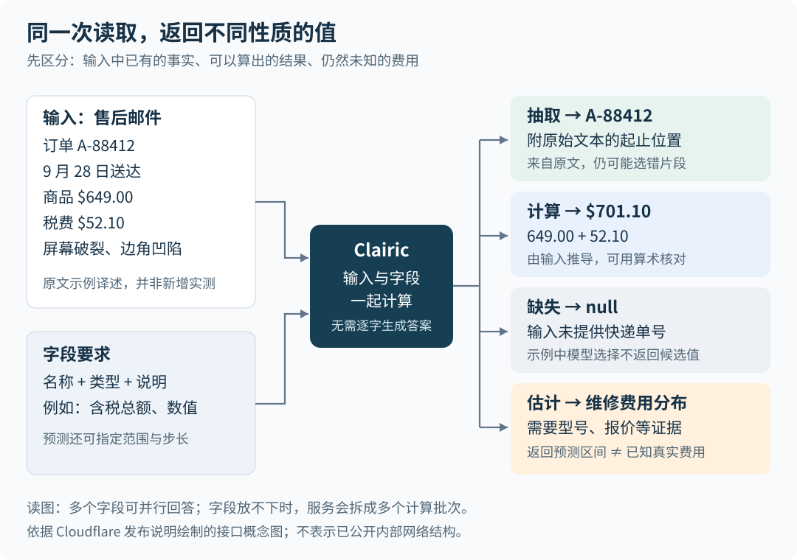

# Clairic：让 Agent 直接取得数值，而不必先生成一段话

一封售后邮件里有订单号、价格、税费和收货日期。程序需要把这些信息读出来，算出总付款额，再决定如何处理。今天，这些步骤经常交给大语言模型：先让它写出一份结构化答案，再由程序接着处理。Cloudflare 新发布的 Clairic 尝试省掉逐字生成答案的过程，直接返回文本片段、数值、日期，以及带不确定性区间的预测。

这项进展值得关注的场景，是 Agent——能够根据输入选择步骤、调用工具并完成任务的智能体——反复执行相似的数据读取工作。它提出了一种分工：专门模型负责取得值，另一个模型或程序负责选择行动，语言模型负责需要开放表达的部分。这样做有望减少等待和生成开销，但目前的证据还不足以证明它在各种抽取任务上都更准确。

Clairic 于 2026 年 10 月 19 日发布，当前是 Cloudflare 托管推理服务 Workers AI 上的预览模型，标识为 `@cf/cloudflare/clairic`。以下以[发布原文](https://blog.cloudflare.com/clairic-extraction-model/)为主体，结合官方文档和相关先行工作分析；资料核验截至 2026 年 10 月 21 日。文中的效果数字均来自作者报告，本文没有实际调用模型复测。

## 同一封邮件里，哪些值能读出，哪些只能猜测？

先看原文使用的邮件示例，译述如下：客户 Dana 说，订单 A-88412 于 2026 年 9 月 28 日送达，屏幕破裂、边角凹陷；商品价格为 649 美元，另付税费 52.10 美元。写信当天是 10 月 9 日，希望维修或退款。

程序可能提出几个看似相近、实际性质不同的问题：

| 问题 | 得到答案需要做什么 | 原文示例中的结果或边界 |
| --- | --- | --- |
| 订单号是什么？ | 找出输入中已有的文字 | `A-88412`，附带它在原始文本中的位置 |
| 一共支付了多少？ | 识别价格与税费，再相加 | 701.10 美元；这个总额没有直接写在邮件里 |
| 收货后过了几天？ | 识别两个日期，再求日期差 | 11 天 |
| 快递单号是什么？ | 判断是否有足够信息 | 示例返回 `null`，表示没有可用答案 |
| 维修大概多少钱？ | 根据相关证据估计未知值 | 邮件未给出型号、报价等充分信息，不能当作已知费用 |

这些问题涉及三类工作：**抽取**是找出现成信息；**计算**是从已知事实推导确定结果；**估计**是预测输入没有确定的未知值。Clairic 还支持第四类工作——**预测序列**，为未来每个时间点给出一个估计，例如明天和后天的客流量。

区别很实际。把价格与税费加起来，可以用算术核对；维修报价则需要产品型号、损坏程度和同类维修记录等证据。即使两者最终都返回一个数字，也不能把它们当成同样确定的事实。[Cloudflare 的概念文档](https://developers.cloudflare.com/workers-ai/concepts/extraction-models/)也明确区分了计算与估计：前者从已给事实推导，后者面对尚未确定的结果。

## 新意在于扩大直接返回值的范围

原文把 Clairic 称为“System One 抽取模型”。这里的 System One，也就是“系统一”，借用了人类快速判断的说法，用来描述快速、直接输出受约束答案的模型。它是这批产品的分类用语，不宜据此推断模型具有某种人类认知机制。

这条产品路线此前主要处理选择题。[TypeSafe 的 Jev](https://typesafe.ai/blog/introducing-system-one-models-and-jev)以及 [Cloudflare 的 Clef](https://blog.cloudflare.com/clef-decision-models/)接收输入和预先列出的选项，为选项给出概率。例如，从“退款”和“维修”中选择。Clairic 进一步处理“金额是多少”“日期是哪天”这类不方便事先枚举全部答案的问题。

不过，不逐字生成答案的信息抽取已有先例。2025 年的 [GLiNER2 论文](https://arxiv.org/abs/2507.18546)和其[公开项目](https://github.com/fastino-ai/GLiNER2)已经展示了按字段定义抽取人名、公司名等信息，完成分类和结构化记录抽取的模型。所谓字段定义，就是告诉模型需要哪些项目、每项代表什么，以及应当返回什么形式的数据。

因此，更有根据的理解是：**Clairic 把文本定位、数值与日期计算、数值分布和短期序列预测，放进了同一套直接返回值的接口。**“首个”应限定在作者提出的 System One 产品分类下，不能扩大成信息抽取领域首次出现这种方法。它是否在这些能力上取得了新的最佳效果，还需要与已有方法在相同条件下比较。

## 它怎样省掉逐字生成答案？

通常的生成式语言模型会把答案拆成一个个词元，再依次输出。词元是模型处理文本的基本单位，可能是一个字、一个词或词的一部分。输出后面的内容需要接着前面的内容计算；即使最终只需要几个字段，生成过程也可能包含字段名、标点、数值和解释文字。

按发布原文的说明，Clairic 接收两部分内容：`state` 提供要读的文本及可选图片，`fields` 列出需要回答的字段、类型和说明。模型把输入和字段要求一起处理，在一次前向计算中为多个字段取得答案。前向计算指输入经过模型各层后直接得到预测结果；它仍然有多层计算，并不是所有工作在一个瞬间完成。

从公开接口可以理解其处理过程：

1. **明确问题。** “金额”还不够，需要说明是商品价格，还是含税、含运费的付款总额；同时声明返回数值、货币单位和小数精度。
2. **结合输入寻找答案。** 文本字段返回原文片段及起止位置；数值、日期等字段则返回相应类型的值，也可以回答从输入推导出的简单计算结果。
3. **按类型约束返回结果。** 日期需要符合日期形式，数值遵守相应精度设置；估计值受用户指定的上下界和步长约束。步长规定可返回数值的间隔，例如按一美元或一千美元取值。
4. **附上缺失与不确定性信息。** 单值抽取或计算字段提供 `p_null` 和 `confidence`；估计与预测字段提供分布信息，供后续程序判断是否需要更多证据。

图中箭头表示输入与答案之间的关系，不代表已公开的内部网络结构。原文没有充分披露 Clairic 的底层模型、模型输出如何转成各类数值、训练数据和训练目标，因此目前只能解释接口行为与作者描述的计算方式，不能据此补出完整实现。

这种方法减少的是逐个生成输出词元的工作，因而有降低延迟和输出费用的理由。“没有推理”则需要谨慎理解：它没有生成可见的逐步推导文字，不代表内部没有识别关系或完成简单运算。原文恰恰展示了加法和日期差。

“一次请求”也不总等于“一次模型计算”。原文说明，当输入旁边放不下全部字段时，服务会把字段拆到多个并行计算批次，每批都看到完整输入，最后合并答案。因此，“三十个字段与三个字段成本差不多”只能看作有条件的描述，不能理解为字段无限增加仍然等价。官方模型页当前标价为每百万输入词元 0.10 美元；比较实际成本时仍应查看请求返回的用量，而非仅看调用次数。[模型文档](https://developers.cloudflare.com/workers-ai/models/clairic/)

## 类型正确，为什么还可能答错？

类型约束能防止一部分格式问题，却无法保证模型选中了正确事实。假设一张发票同时出现“小计”和“应付总额”，模型完全可能返回格式正确、精度合规的小计，却没有回答“最终应付多少”。文本片段也一样：它确实出自原文，不代表它就是所问的订单号。

原文将这一点与语言模型的“幻觉”作对照。这里的幻觉，指模型给出没有依据或错误的内容。更准确的说法是，Clairic 限制了凭空生成自由文本的路径，但并未消除选错片段、算错数值或无根据估计的可能性。

对照对象也应更新。已有语言模型支持按预先定义的数据结构生成答案，例如 [Gemini 的结构化输出文档](https://ai.google.dev/gemini-api/docs/structured-output)说明，可以通过 JSON Schema——规定字段、类型和约束的数据结构规范——约束输出。因此，不能把比较简化成“Clairic 有类型、语言模型只有任意字符串”。真正需要比较的是，直接取得字段值的方法，相对受结构约束的生成方法，在准确率、等待时间和费用上有什么差异。

Clairic 还把“没有答案”作为显式结果。`p_null` 表示模型判断输入不足以确定该字段答案的概率；它不能简单理解为“答案这串字是否逐字出现”，否则从价格和税费算出的总额也会被误认为缺失。`confidence` 是接口返回的置信分数，表达模型对答案的把握；在没有验证之前，不应把某个分数直接当成业务中的实际正确率。

原文的快递单号示例很能说明问题：正式结果 `value` 是 `null`，但诊断字段 `guess` 仍然给出了税额字符串。也就是说，模型内部仍可能挑出错误候选，只是最终判断应当不给答案。后续程序应读取正式结果，不能因为存在一个候选值，就把它当作补齐的事实。列表也不是缺失单值的另一种写法：官方文档说明，没有匹配项时列表返回空列表；估计与预测即使证据很少，也仍可能返回预测值。

## 一个“80% 区间”到底说明什么？

原文给出一个房价估计示例：输入几套房子的成交信息，以及目标房产的面积、卧室数量、建造年份和街区。返回的中位数是 415,000 美元，`p10` 是 370,000 美元，`p90` 是 470,000 美元。这些是作者展示的模型输出，没有对应的真实成交结果来证明估价准确。

中位数把预测分布分成上下各一半；`p10` 和 `p90` 分别是第 10 与第 90 百分位，二者夹住模型预测分布中间的 80%。它比只返回一个数字多表达了一件事：模型认为合理结果分散在多大范围内。这里描述的是对未知结果的预测区间，不能把“80%”读成“这个单次答案已被证明有八成把握”。

要让这些概率值得信任，需要检查**校准**：在大量相似的新案例上，标为 80% 的预测区间是否大约覆盖了 80% 的真实结果。区间窄可能意味着输入提供了充分证据，也可能意味着模型过于自信；只看宽窄无法区分二者。原文承认，陌生数据可能使区间过窄，但没有给出足够完整的分领域测试结果供外界核对。

上下界也只是限制模型能返回什么。假设把维修费用限定在 10 到 5,000 美元之间，模型就会在这一范围内回答；真实费用仍可能超过上限。指定范围不会让现实跟着改变。尤其是型号、零件价格和维修历史都缺失时，一个看起来精确的中位数和区间，仍然可能缺乏可靠依据。

## 已有证据支持到哪一步？

目前这篇材料是一份产品预览发布说明。它包含接口示例、作者演示和小规模实验观察，没有提供足以独立复现全部结论的研究材料。几类证据需要分别看待。

**邮件和小票示例展示了接口能表达什么。** 邮件示例覆盖了片段定位、简单运算和缺失值；倾斜小票照片示例展示了图片输入。它们有助于理解能力，但没有测试集规模、失败比例或文档难度分布，无法据此判断复杂表格、中文票据或模糊照片的总体准确率。

**售后流程对比展示了节省生成步骤的潜力。** 作者让 Clairic 抽取信息、Clef 选择处理方案，最后由 GLM-5.3 生成回复；对照流程则让 GLM-5.3 完成全部三步。报告结果如下，费用是按百万次理赔处理折算的口径，不代表真的运行了百万次：

| 作者报告的指标 | Clairic → Clef → GLM-5.3 | 三步均使用 GLM-5.3 |
| --- | --- | --- |
| 抽取耗时 | 0.46 秒 | 16.1 秒 |
| 决策耗时 | 0.22 秒 | 21.9 秒 |
| 端到端耗时 | 19.3 秒 | 61.7 秒 |
| 每百万次处理费用 | 6,032 美元 | 11,740 美元 |

按表中总数计算，端到端用时减少约 69%，费用减少约 49%。方向与机制一致：前两步不再等待长答案生成。但最终写回复仍耗时 18.6 秒，是混合流程的主要等待来源；替换抽取步骤并不意味着整个 Agent 都能在一秒内完成。

这组数字还有复现边界：原文没有完整披露测试规模、并发与重复运行统计，对照模型也不覆盖所有可能的便宜或快速方案。全语言模型流程的三个分步耗时相加为 54.4 秒，与所列总耗时 61.7 秒不同，文中没有解释差额来源。因此，可以引用作者的整体测量结果，但不能从分步表重建全部耗时。两套流程在该示例中都答对，也不能据此证明 Clairic 的准确率更高；维修估价每次相同证明的是重复性，并没有证明报价正确。[原文的流程对比](https://blog.cloudflare.com/clairic-extraction-model/#thinking-fast-and-slow)

**客流预测是较具体、但范围有限的实验观察。** 作者报告，连续 21 天用当时已有的美国运输安全管理局（TSA）机场安检人数预测次日人数，平均偏差为 3.3%，实际值有 17 天落在 80% 区间内，即约 81%。四次区间外结果中，有三次出现在哥伦布日周末，反映了仅从历史序列取模式、却缺少特殊事件信息的局限。

这里的 17/21 与目标覆盖率接近，但样本短、只有一条序列，也没有提供完整误差公式和对照结果。至少还需要比较“沿用上周同一天人数”这样的简单方法，才能知道模型在周期明显的数据上增加了多少预测能力。原文链接到 [TSA 公共数据页](https://www.tsa.gov/travel/passenger-volumes)，但公共真实数据的存在并不等于完整预测实验已被复现；本文未独立核验这 21 天的完整结果。

截至本次核验，在已查阅的发布说明、官方文档及定向搜索中，未找到 Clairic 已公开的权重、完整训练说明或独立评测。作者说计划开放权重，这仍是后续承诺。当前更合适的成熟度判断是：**已有可调用的预览接口与作者实验，通用效果和跨领域可靠性仍待验证。**

## 对 Agent 的影响：把“读、算、选、写”分给合适的步骤

Clairic 直接影响的是 Agent 处理信息的步骤。它本身不负责规划长任务，也没有在这些示例中自主执行维修或退款。原文的售后演示最后生成了一封回复；真正发起退款仍需要业务工具和明确的执行逻辑。

从这项设计可以推导出一种值得探索的工作方式：先让模型从杂乱材料中识别字段，再由程序完成精确运算；需要理解模糊政策时，再交给决策模型；需要解释或沟通时，才生成自然语言。对于大量重复请求，这有机会减少生成开销，也使“哪一步读错了、哪一步作出了选择”更容易追查。这是由设计得到的潜在价值，尚不能替代实际应用测量。

这种分工也有代价。下一步只看到抽出的字段，就可能看不到被遗漏的重要原文；错误的估计还可能被后续步骤当成事实继续使用。原文认为不把整封邮件传给后续模型，有助于减少提示注入，也就是输入内容夹带指令、试图改变模型行为的机会。这个方向合理，但抽出的文本本身仍可能携带恶意内容，类型约束也没有证明系统免疫此类攻击。

当前适合关注它的人，是已有高频字段读取任务、愿意用真实样本检验效果的开发者。最稳妥的起点是信息直接存在、结果容易核对的抽取；确定性运算交给代码完成。作者也明确承认，多步计算、跨许多表格行汇总和长时间跨度预测是当前弱项。缺少证据的维修报价，不应仅因为接口返回了区间就升级为可执行承诺。

接下来最值得跟踪的信号有三个：

- **权重和技术说明是否公开。** 这将帮助外界确认它如何生成不同类型的值，以及性能提升主要来自哪里。
- **独立测试是否同时测量答对率和不确定性。** 特别要看缺失信息、中文材料、陌生领域和节假日变化下，模型是否知道自己答不准。
- **优势能否在公平对照下保持。** 对照应包含受结构约束的语言模型、现有抽取模型和适合相应数据的预测方法，并比较相同输入、输出要求下的时间与费用。

Clairic 提出的方向很具体：程序需要一个金额或日期时，可以直接取得受类型约束的值；需要选择时，再比较选项；需要解释时，再写文字。这种分工值得研究，而它最终能替代多少生成式调用，要由更广泛、可复现的结果回答。
