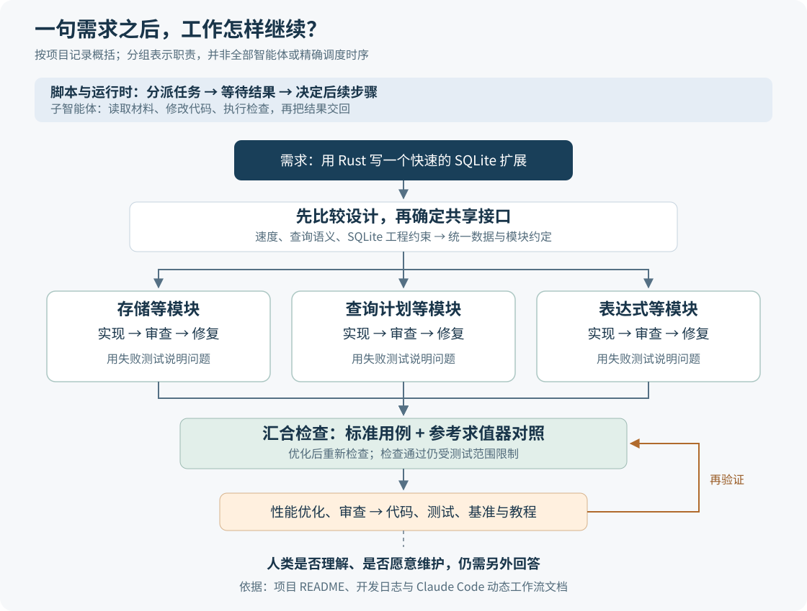

# 一句需求之后，Agent 能走多远？从 sparqlite 看长时间自主编程

> 来源：[simonwillison.net](<https://simonwillison.net/2026/Oct/16/sqlite-sparql-rust>)  
> 作者：Simon Willison · 发布时间：2026-10-16 08:00（Asia/Shanghai）  
> 翻译正文：[阅读中文正文](article-zh-CN.md)

让 AI 写一个函数，通常还能逐行检查；让它连续工作十几个小时，交回一套查询引擎、测试和教程，问题就变成了：它怎样组织这些工作，我们又凭什么判断结果可信？Simon Willison 的 sparqlite 实验把这两个问题同时摆了出来。

他让 Claude Code 用 Rust 语言编写一个 SQLite 扩展，在本地数据库里查询相互关联的数据。开启 Ultracode 后，工具持续工作超过十二小时，期间他只补充了一轮文档要求。值得关注的新意，是 Agent——能够调用工具、执行多步任务的智能体——开始自己安排设计、实现、审查和修复流程。产物规模随之增长，人的理解能力却未必同步增长。[原文：2026 年 10 月 16 日](https://simonwillison.net/2026/Oct/16/sqlite-sparql-rust)

## 先看它究竟做出了什么

SQLite 是可以嵌入应用、把数据保存在本地文件中的数据库。sparqlite 给它增加了 SPARQL 查询能力：SPARQL 是用来查找 RDF 数据中关系的语言；RDF 则把事实表示成“主体—关系—对象”，例如“某种语言—受到影响于—另一种语言”。查询用途包括查直接关系，也包括沿关系继续追踪。[SPARQL 1.1 规范](https://www.w3.org/TR/sparql11-query/)

项目的入门示例只放入三条关系：Rust 受到 OCaml、C++ 的影响，C++ 又受到 C 的影响。这里是在解释这份示例数据，不是核验完整的编程语言史。查询写成：

```sparql
PREFIX ex: <http://example.org/>
SELECT ?x WHERE {
  ex:Rust ex:influencedBy+ ?x
}
ORDER BY ?x
```

`ex:` 是名字前缀，`?x` 是待查的对象，关系后的 `+` 表示沿同一关系走一步或多步。因此，按这三条记录，答案应包括 OCaml、C++ 和间接相连的 C。扩展允许从 SQLite 的 SQL（数据库查询语言）语句中调用这样的查询，不必为这个示例另开一个数据库服务。[项目教程](https://github.com/simonw/research/blob/main/sqlite-sparql-rust/tutorial.md)

不过，这次实验主要展示的是软件如何被造出来。它没有提出一种新的图查询语言，也没有给出新的模型训练方法；它把多个 Agent 的工作组织成了能够持续推进、反复检查的软件开发过程。

## 变化在于：让脚本安排工作，让 Agent 执行任务

一般的对话式协作中，主 Agent 收到一份结果，再决定下一步调用谁、检查什么。Claude Code 的“动态工作流”把这些安排写进 JavaScript 脚本：脚本可以启动任务、等待结果、保存中间数据，再按条件分支或重复。Ultracode 是让 Claude 自动选择这类工作流的设置，不是原文公布的一款新模型。[官方工作流文档](https://code.claude.com/docs/en/workflows)

这样做有什么用？假设三个模块都要实现并接受审查，脚本可以分别安排它们，等结果齐备后再进入集成阶段。中间结果留在脚本变量里，主对话不必收下每个工作者的完整过程。具体的读文件、改代码和运行命令仍由子 Agent 完成；脚本负责决定这些任务怎样连接。这解决的是任务组织和上下文负担，不能直接保证判断正确。

sparqlite 的项目记录描述了一个具体过程：先由关注速度、查询语义和 SQLite 工程约束的不同设计者提出方案，再比较、合并；确定共享约定后，分模块进入“实现—审查—修复”，最后集成验证并做性能优化。这里的“审查者”也是 Agent，不能等同于独立的人类审计。[项目建设过程](https://github.com/simonw/research/tree/main/sqlite-sparql-rust#how-this-was-built)



图中最容易被忽略的一步是确定共享接口。项目的 `sq-core` 模块统一规定了数据编号、批量结果、存储读取接口，以及查询计划的表示方式。查询计划就是“按什么顺序读数据、怎样组合结果”的执行安排。其他模块围绕这些约定工作，才有可能把分别完成的代码接起来。[共享接口说明及仓库镜像](https://upd.dev/simonw/research/src/branch/main/sqlite-sparql-rust/crates/sq-core/README.md)

举个假设例子：存储模块若返回文本，执行模块却以为收到整数编号，两边各自的测试可能都通过，集成时仍会出错。提前约定返回形式，可以减少这类分歧。这是理解该案例的关键：增加 Agent 数量只是增加工作者，还需要给它们明确的交接物和检查方式。

## 查询引擎为什么可能更快

“直接读取数据”容易让人误以为，扩展完全绕过了 SQLite。实际上，sparqlite 把 RDF 事实放在普通 SQLite 表里，并自行决定怎样查询。存储时，每条关系还带一个所属图的字段，成为四元组；所属图用于区分不同的数据集合。

它读取数据有两条路径。一条使用可重复执行的 SQL 语句扫描索引；另一条在满足条件时直接解读 SQLite 索引的 B 树页面。B 树是数据库按键排列数据、快速定位范围的结构。直接读页面可以减少逐行经过 SQLite SQL 执行器的开销，但扩展也必须自己处理页面格式和读取条件。[存储模块说明及仓库镜像](https://upd.dev/simonw/research/src/branch/main/sqlite-sparql-rust/crates/sq-sqlite/README.md)

数据编号也有作用。例如，两条关系都涉及同一个对象，用整数编号对齐，比反复取出长文本再比较更容易减少工作量。索引则让引擎按已知的主体或关系，缩小需要读取的范围。这些动作共同影响速度，不能把全部收益归因于“Rust 更快”或“直接读文件”。项目规格说明了编号、索引和自主执行计划的组合。[设计规格及仓库镜像](https://upd.dev/simonw/research/src/branch/main/sqlite-sparql-rust/docs/SPEC.md)

直接读取也有明确边界：项目目前只在使用回滚日志（先保存旧数据以便撤销修改）、私有缓存（连接独用缓存）的文件数据库上采用它；写前日志模式（WAL，把更新先写到日志中）、内存数据库等情况改用 SQL 游标，也就是逐步读取查询结果的接口。SQLite 的最新可见数据可能涉及日志，不能只看主文件就假定读到了正确状态。[存储限制](https://upd.dev/simonw/research/src/branch/main/sqlite-sparql-rust/crates/sq-sqlite/README.md)、[SQLite 文件格式](https://sqlite.org/fileformat.html)

这说明 Agent 的产物包含了有实质内容的工程取舍。至于这些取舍是否适合真实负载，还要看验证范围。

## 测试很多，分别能证明什么

原文中的数字来自项目自身的报告。仓库也明确标注，报告文字和代码由大语言模型生成。本次调研核对了公开文档与开发记录，没有独立编译、复跑测试或完成全面源码审计。[仓库说明](https://github.com/simonw/research)

| 证据 | 项目报告的结果 | 可以怎样理解 |
| --- | --- | --- |
| 标准用例 | 639 项适用的万维网联盟（W3C）查询与更新结果测试中通过 636 项；另有 299 项按类别跳过 | 是对所覆盖行为的支持，不能改写成“完整通过 SPARQL 标准认证” |
| 随机对照 | 主测试活动约做了 770 万次优化引擎与参考求值器的比较，报告没有剩余的未解释差异 | 支持不同执行方式的结果相符；不代表 770 万个独立需求或真实应用 |
| 性能基准 | 相对项目内把 SPARQL 整体转成 SQL 的基线，计数模式约快 3.5 倍，完整返回模式约快 2.8 倍 | 是 17 条查询上的几何平均加速比，不是每次查询都更快 |

标准测试跳过了纯语法、推理规则、协议及远程查询等类别；项目把三项失败归因于使用的语法解析库。无论问题出在哪个依赖，使用者仍会遇到这些不兼容。[项目结果与限制](https://github.com/simonw/research/tree/main/sqlite-sparql-rust#results)

随机对照采用的是“差分测试”：让不同实现处理同一输入，比较输出。这里的参考求值器故意写得简单，便于按规范检查；但它与主引擎共享解析、查询转换和表达式组件。如果共享部分把输入理解错了，两边可能一起给出同一个错误答案。参考实现自己的文档明确列出了这些盲区。因此，“另一个 Agent 审过”和“另一个执行器算得一样”，都不能自动变成完全独立的证据。[参考求值器说明及仓库镜像](https://upd.dev/simonw/research/src/branch/main/sqlite-sparql-rust/crates/sq-oracle/README.md)

这里的几何平均是把各查询的加速比相乘后取相应次方根，避免直接混加不同查询的耗时。性能数字也要保留测量条件：项目使用 4 个虚拟 CPU 的云主机、SQLite 3.45.1，以及约 160 万条社交关系和约 100 万条商品、报价数据，预热后通常取五次运行的中位数。计数模式在引擎内部数结果，完整返回模式则把每个结果项变成 Python 字符串；后者包含更多输出成本。基准工具让两种引擎使用相同存储和输出路径，以尽量隔离执行策略的差别。[结果报告](https://github.com/simonw/research/tree/main/sqlite-sparql-rust#results)、[基准方法及仓库镜像](https://upd.dev/simonw/research/src/branch/main/sqlite-sparql-rust/py/README-bench.md)

## 一次错误的“快”，比一个总分更有启发

开发日志记录过一个基准错误：早期的计数接口遇到聚合查询（把记录汇总成计数、求和等结果的查询）时，直接返回“结果有一行”，却没有真正执行聚合计算。假设查询要统计整张表，总数最后确实只占一行；但如果连总数都没算，测到的短耗时就没有意义。项目随后去掉这条捷径，再重新测量。[开发日志](https://github.com/simonw/research/blob/main/sqlite-sparql-rust/notes.md)

这个例子解释了为什么“答案形状对了”仍不够：测试必须迫使程序完成它声称完成的工作。它也为 Agent 审查提供了比赞同或打分更具体的目标——给出能暴露错误的输入、预期结果和失败记录。

日志还记载了容器重启导致工作流中断，后来通过缩短任务阶段、及时保存进度继续推进。持续运行十二小时，不代表十二小时内没有失败，也不代表恢复过程已经无需额外处理。原文没有给出完整的模型用量、总费用，或与人类开发者在相同目标下的对照，因而无法据此计算开发效率提升了多少。[开发日志](https://github.com/simonw/research/blob/main/sqlite-sparql-rust/notes.md)

目前最合适的成熟度判断是：这是有公开产物和大量自报验证记录的研究性工程案例。它比只展示成功界面的演示提供了更多可检查材料；本次查阅资料中，尚无足够的独立复跑或长期应用证据，支持把它当作成熟数据库产品。

## 接下来值得关注的是谁能理解并接手

Willison 在原文中提出了一个直接的问题：代码多到自己不可能认真审完，连读文档都要投入不少时间；随手得到一套实现，如果不愿花时间理解，它究竟有多大价值？这不是否认产物，而是在问生成之后的工作由谁承担。[原文](https://simonwillison.net/2026/Oct/16/sqlite-sparql-rust)

从这个案例可以作出一个有限的推断：对于规范较明确、模块能拆分、结果可以机器检查的任务，Agent 有机会把一次想法推进成值得研究的原型。查询语言实现具备这些有利条件；需求含糊、评价依赖真实用户体验的任务，未必能照搬同样流程。

可能的新用途，是让研究者同时探索不同实现，自动补充反例，并保留性能变化的依据；人的工作则更多地集中在决定做什么、检查评价方法，以及判断哪些结果值得继续投入。这些是从案例推导出的方向，尚不是已经测得的普遍收益。

后续比代码行数更值得跟踪的，有三个信号：

- **能否独立复现。** 其他人是否在自己的机器、数据和查询上得到相同结果，并解释差异。
- **能否处理新的失败。** 有人提交原设计未覆盖的查询后，Agent 是否能定位问题、补充测试，并保持已有行为。
- **能否被人接手。** 使用者是否能理解关键约定、修改一个模块，并持续维护，而不必重新摸清整个生成过程。

如果想借鉴这次实验，最有依据的起点是选一个边界清楚的任务，先规定模块交接物，再要求审查提供可执行的反例，并预留阅读产物的时间。sparqlite 展示了 Agent 能把工作推进多远；它留下的下一道问题，是这些成果能否变成人愿意理解、验证和继续使用的软件。
