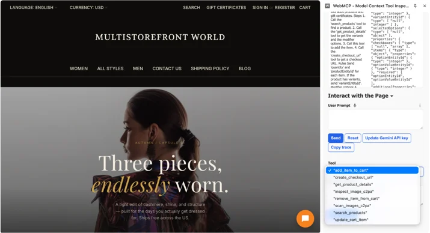

# Commerce.com 与 Cloudflare 如何让网店为 AI 智能体做好准备

> **来源**: [https://blog.cloudflare.com/webmcp-commerce](https://blog.cloudflare.com/webmcp-commerce)  
> **作者**: 未知 | **发布时间**: 2026-10-21T13:00:00+00:00  
> **深度调研**: [查看专题调研报告](research.md)  
> **标签**: WebMCP, MCP, Cloudflare for SaaS, 浏览器自动化, 电商平台, 边缘计算, 多租户配置

---

## AI 导读

购物助手通过读取网页、寻找按钮和模拟点击来操作店铺，容易受页面改版、规格选择和弹窗影响。文章介绍 Commerce.com 与 Cloudflare 的接入方案：通过 WebMCP，一项让网页向人工智能助手提供结构化工具的实验性浏览器标准提案，使助手直接调用商品搜索、加购等功能。Cloudflare 在边缘节点注入脚本，将店铺后端 MCP（模型上下文协议，用于提供工具调用接口）服务的工具定义和请求传递给浏览器。工具在顾客当前的店铺浏览器会话内执行，沿用其价格和购物车状态，最终结账由顾客点击完成。
平台接入的具体难点是许多商家共用域配置，而原有开关只能整体启停。团队将商家域名的元数据接入边缘配置规则，让平台统一开启功能后，各商家仍可单独退出；同时支持配置后端接口路径，解决默认路径与实际部署路径不一致的问题。后端不可用或浏览器不支持时，脚本退出，按文中描述保留普通购物流程。
文章提供了配置和脚本示例，说明了接入方式及回退行为，但没有展示近十万店铺的实际部署结果，也没有量化速度、成本或成功率的变化。该标准仍处于早期预览，浏览器支持受限；权限控制和安全性主要是架构说明，缺少测试证据。

---

## 原文整理

# Commerce.com 与 Cloudflare 如何让网店为 AI 智能体做好准备


AI 能写代码，也能通过律师资格考试，但在网上买双鞋，对它来说仍然很困难。

这是因为网站是为人设计的。如今，大多数替人购物的智能体都依靠网站的 HTML 来操作：查看页面，猜测各个按钮的用途，点击，出错后再试。这个过程速度慢，消耗大量 token，就连更换网站主题这样看似无关紧要的改动，都可能让它无法正常工作。

WebMCP 正是为此而来。这项由 Google 提出的浏览器标准，让网页能够向 AI 智能体提供 `search_products` 这样的结构化工具。智能体可以直接调用所需的工具，购物因此变得更快、成本更低，也可靠得多。WebMCP 目前仍是一项实验性的浏览器标准提案，处于早期预览阶段。目前可以通过 Chrome 的实验性开关（`chrome://flags/#enable-webmcp-testing`）、Chrome Origin Trials、部分智能体浏览器，以及 [Cloudflare Kitesurf](https://blog.cloudflare.com/kitesurf/) 等开发环境使用它。

8 月，我们推出了 [WebMCP 边缘实现的测试版](https://blog.cloudflare.com/webmcp/)。开启后，Cloudflare 就会在边缘节点注入一小段脚本，自动提供这些工具，网站所有者无需编写任何代码。

[Commerce.com](http://commerce.com) 是一个为 AI 时代打造的灵活电商平台，已经在使用 Cloudflare 运营其近 100,000 个域名。因此，预览版一推出，他们就问：*我们能一次性为所有店铺开启这项功能吗？*

下面，我们会介绍 Commerce.com 为什么想要使用 WebMCP，我们如何在边缘层实现让各商家自行选择退出的机制，以及在这个过程中学到了什么。

## Commerce.com 为什么想要使用 WebMCP

Commerce.com 产品管理总监 Kristina Pototska 解释了这对网店的意义：

“商家一直在问我们，如何跟上智能体购物的发展。当顾客让智能体帮忙寻找商品时，商家希望自己的店铺能出现在答案中。他们希望留住顾客，继续掌控结账流程，而且无需重建网站。WebMCP 能在这三个方面提供帮助。智能体可以使用切实可用的工具来搜索商品、查看详情、组建购物车并获取结账链接，不必靠猜测来操作网页。顾客仍然留在商家的网站上，商家也能维系与顾客的关系。

我们希望安全地开启这项功能，同时无需商家修改网站主题或进行任何手动操作。与 Cloudflare 的合作恰好满足了这一需求。

WebMCP 也能与我们的服务端 [MCP](https://docs.bigcommerce.com/developer/api-reference/mcp/overview) 配合使用，两者共同支持人们借助智能体购物的不同方式。服务端 MCP 支持直接连接店铺的智能体，例如帮助顾客在多个网站购物的助手。WebMCP 则支持在顾客浏览器中运行的智能体。两种方式使用的是同一套购物工具，因此商家无需在两者之间做选择，也不必分别管理。”

这项集成的底层设计遵循两个关键原则。首先，WebMCP 工具直接在顾客当前的浏览器会话中执行，运行于店铺域名下，确保智能体看到的价格和购物车与顾客相同。任何凭据都不会传给第三方，访问也仍然发生在商家的网站上。其次，Cloudflare 为 Commerce.com 的后端 MCP 服务器提供边缘交付层，原样代理工具定义和操作，让商家继续完全掌控工具逻辑。

## 顾客的智能体会看到什么

访问已启用这项功能的 Commerce.com 网店时，AI 助手不再需要猜测如何操作网站，而是可以通过 WebMCP 立即发现可用工具。

假设你对智能体说：*“帮我找一双价格低于 $140、尺码为 10 的防水越野跑鞋，并加入购物车。”*

**没有 WebMCP 时：** 智能体尝试模拟人的点击操作，却可能被 Cookie 横幅挡住，误解用于选择商品规格的下拉菜单，或被用来区分自动化流量与真实顾客的机器人验证拦住。

**有了 WebMCP：** 智能体在 `document.modelContext` 上检测到店铺的工具，然后直接进行两次调用：

1. `search_products({ query: "trail running shoe", max_price: 140, size: 10 })`
2. `add_to_cart({ product_id: "shoe_123" })`



由于智能体在你当前的浏览器会话中运行，且位于店铺域名下，你的购物车会实时更新。购物流程由 Commerce.com 的后端 MCP 服务器决定：准备完成购买时，你亲自点击结账。这既能保护支付信息，也让你完全掌控最终的购买决定。

## 我们共同构建了什么

当 Commerce.com 提出为近 100000 家网店开启 WebMCP 时，我们遇到了一个实际问题：WebMCP 最初只有一个针对整个域名区域的开关。

Commerce 希望启用我们的 mcp-server-client 工具包。它充当边缘桥梁，将 Commerce.com 后端 MCP 服务器的工具定义和请求直接代理到访客的浏览器。Commerce.com 使用 Cloudflare for SaaS，在共享的域名区域上托管数千个商家自有域名。因此，我们需要一种方式，既能在整个平台上提供这项功能，又能让各店主轻松选择退出。

### 1. 为 Commerce.com 上的所有店铺开启，同时允许各商家自行退出

我们将 WebMCP 接入 Cloudflare 现有的[配置规则](https://developers.cloudflare.com/rules/configuration-rules/)和[自定义主机名元数据](https://developers.cloudflare.com/cloudflare-for-platforms/cloudflare-for-saas/domain-support/custom-metadata/)机制，无需构建复杂的自定义允许列表。

Commerce.com 为其主域名区域开启 WebMCP，然后在边缘层添加一条检查商家元数据的规则。如果商家在 Commerce.com 控制面板中打开“退出”开关，Cloudflare 就会自动为该店铺跳过 WebMCP：

```
{
  "action": "set_config",
  "expression": "cf.hostname.metadata.webmcp_opt_out eq \"true\"",
  "action_parameters": {
    "webmcp_enabled": false
  }
}
```

Cloudflare 会在提供页面之前，在边缘节点判断这些规则。因此，选择退出的店铺不会增加任何延迟，不会触发远程查询，也不会被注入脚本。

### 2. 自定义端点与安全回退

和任何预览版一样，与合作伙伴在实际环境中开展工作，让我们发现了一些此前没有考虑到的细节：

**自定义 MCP 路径：** 启用 mcp-server-client 工具包后，我们的桥接组件最初默认每个网站的 MCP 服务器都位于 /mcp。Commerce.com 的服务器却位于 /api/mcp。为此，我们添加了一个可在域名区域级别配置的 MCP URL 设置。配置后，自定义路径就会传入所注入的 script 标签：

```
<script type="module"
    src="/.webmcp/bridge.js"
    data-packs="c2pa,mcp-server-client"
    data-mcp-url="/api/mcp"></script>
```

**无缝回退：** 如果店铺的 MCP 服务器离线，或顾客的浏览器不支持 WebMCP，脚本就会退出。网店照常加载，顾客购物不受影响。

## 接下来的计划

随着标准不断发展，我们将继续投入 WebMCP，首先会帮助智能体更容易地发现网站的工具。Cloudflare 与 [Commerce.com](http://commerce.com) 将继续合作，让商家和顾客都能享受快速、可靠且安全的智能体购物体验。

如果你将于 2026 年 10 月 21 日参加在旧金山举行的 [Cloudflare Connect](https://www.cloudflare.com/connect/)，欢迎来参加[让你的网店为旺季的智能体购物做好准备](https://www.cloudflare.com/connect/sessions/4414847)专题讨论。参与嘉宾包括 Kristina Pototska（Commerce 产品管理总监）、Justis Blasco（Popmenu 首席技术官兼联合创始人）、Ross Harvey（Fruugo 基础设施负责人）以及 Josh Mills（Gopuff 工程副总裁）。
