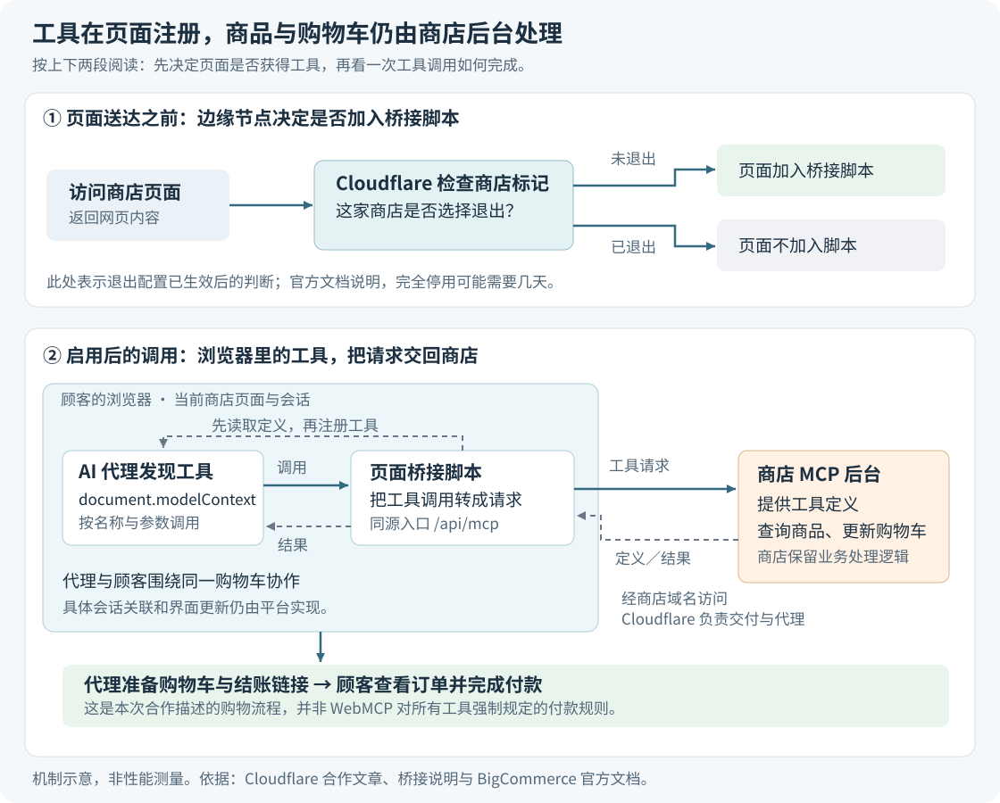

# 让 AI 直接调用商店工具：Cloudflare 与 Commerce.com 的 WebMCP 进展

> 来源：[blog.cloudflare.com](<https://blog.cloudflare.com/webmcp-commerce>)  
> 作者：未知 · 发布时间：2026-10-21 21:00（Asia/Shanghai）  
> 翻译正文：[阅读中文正文](article-zh-CN.md)

让 AI 帮忙买鞋，难点往往不在理解“防水、140 美元以内、10 码”，而在把这些要求变成网页上的正确操作：找到筛选器、选对尺码，再加入正确的购物车。网站换个主题，这条操作路径就可能失效。Cloudflare 与 Commerce.com 采用的办法，是让商店主动提供“搜索商品”“查看规格”“加入购物车”等工具，让 AI 按明确的参数调用。

这项进展值得关注，因为它尝试把浏览器里的购物助手接入现有商店，同时保留顾客正在使用的页面、购物车和人工结账流程。它尤其适合关注浏览器自动化、购物助手和电商平台演进的读者；目前应把它理解为一次平台接入进展，实际提速幅度和大规模购物效果仍待验证。

本文以 Cloudflare 于 **2026 年 10 月 21 日**发布的[合作文章](https://blog.cloudflare.com/webmcp-commerce)为主体，并核对浏览器提案及平台官方文档；资料核验截至 **2026 年 10 月 23 日**。

## 新在哪里：商店开始主动告诉代理“可以做什么”

这里的 **AI 代理（Agent）**，指能根据用户目标选择工具、执行动作并继续处理结果的 AI 程序。传统浏览器代理可以读取网页结构、截图或辅助功能信息，再模拟点击和输入。它不仅要判断买哪双鞋，还要判断哪个按钮代表尺码、购物车是否更新，以及下一步该点哪里。

**WebMCP** 是一项让网页向 AI 代理提供可调用工具的浏览器接口提案。网页可以声明工具名称、用途、参数格式及执行函数。代理因此能直接请求“把这个商品加入购物车”，减少对页面布局的猜测。提案也明确允许代理在工具不能覆盖任务时，继续使用普通浏览器操作。[WebMCP 项目说明](https://github.com/webmachinelearning/webmcp)

需要把它与 **MCP（模型上下文协议）**区分开：MCP 让 AI 客户端发现和调用外部服务提供的工具；WebMCP 则把类似的工具交互方式放到正在运行的网页里。两者可以配合，但 WebMCP 并不要求所有工具都来自远程 MCP 服务器，也不意味着把后端协议原封不动搬进浏览器。

这次合作的具体新意，是把两种入口接起来：Commerce.com 已有后台购物工具，Cloudflare 负责在网页送达顾客之前加入一段桥接脚本，由脚本把这些工具提供给浏览器代理。平台可以统一启用，单个商家又能选择退出。由此，商家有机会复用一套购物能力，同时服务直接连接后台的助手和在顾客浏览器中工作的助手。[原文](https://blog.cloudflare.com/webmcp-commerce)

因此，贡献主要在于**已有能力的复用与分发方式**。原文没有提出新的模型训练方法，也没有报告一项新的购物推理算法。

## 从买鞋看变化：少猜界面，仍要核对商品

沿用原文的假设场景：顾客要求“找一双防水越野跑鞋，价格低于 140 美元，10 码，加入购物车”。

模拟人工操作时，代理可能需要打开搜索框、填写关键词、检查商品页、选择尺码，再点加入购物车。WebMCP 的变化，是让代理先看到网站声明的购物工具，再把这些动作交给工具完成。不过，**调用方式更明确，不等于购物判断自动正确**。

原文用 `search_products` 和 `add_to_cart` 两次调用说明这一点，但这只是概念示意，不能照搬为真实接口。原文所链接的 BigCommerce 官方文档，列出的消费者商店购物流程更细：

| 步骤 | 官方工具及其作用 | 代理仍要判断什么 |
| --- | --- | --- |
| 搜索候选商品 | `search_products` 按关键词搜索；其必填字段是 `term` | 候选商品是否符合用途和预算 |
| 查看具体规格 | `get_product_details` 返回商品变体与图片 | 哪个变体对应所需尺码、颜色 |
| 加入购物车 | `add_item_to_cart` 接收商品、数量；有变体时还需要变体编号 | 是否加入了用户真正想要的规格 |
| 交给顾客结账 | `create_checkout_url` 返回当前购物车的结账链接 | 顾客是否认可最终订单 |

这里的“变体”是同一商品下可分别购买的规格，例如同款鞋的不同尺码和颜色。官方搜索接口并没有列出原文示意中的 `max_price`、`size` 参数；不能据此假定搜索调用已经完成了价格和尺码的严格过滤。[BigCommerce 购物工具参考](https://docs.bigcommerce.com/developer/api-reference/mcp/storefront/b2c)

从这个例子可以看出，结构化工具主要减少的是“这个界面怎么操作”的不确定性。商品是否防水、尺码采用什么体系、价格是否满足要求，仍取决于商店返回的数据和代理对条件的核对；信息不足时仍需要向顾客澄清。两次调用不是完成购物的固定成本。

## 工具怎样从后台来到当前页面

Cloudflare 所说的“边缘”，是指请求在到达或离开商店源站时经过的 Cloudflare 网络节点。在这里修改网页响应，可以让平台统一交付脚本，而不用逐家修改商店主题。

整个过程可以分成两个阶段：先把工具注册进页面，再执行具体购物动作。

图的上半部分表示配置已经生效后的交付判断；下半部分表示启用后的工具调用。它描述组件之间的关系，不表示测得的速度或调用次数。

**第一步，页面加载桥接脚本。** 启用后，Cloudflare 在网页响应里加入一个脚本标签，地址是商店域名下的 `/.webmcp/bridge.js`。标签还指定要启用的工具包，以及后台工具入口。本次合作使用 `/api/mcp`；Cloudflare 原先默认寻找 `/mcp`，因此新增了可配置路径。

**第二步，脚本读取工具说明并注册。** 脚本先检查浏览器是否支持 WebMCP，再从商店 MCP 服务取得工具列表。随后，它用 `document.modelContext.registerTool` 把工具注册到当前页面。每个工具包含名称、说明、`inputSchema` 和执行函数；`inputSchema` 是用来描述参数名称、类型与必填项的结构化规则，帮助代理知道该传什么值。[Chrome 工具注册文档](https://developer.chrome.com/docs/ai/webmcp/imperative-api)

**第三步，页面把调用送回商店。** 代理选择工具后，浏览器运行已注册的执行函数。对于这次接入的后台购物工具，函数会向商店的 MCP 入口发请求，再把返回结果交给代理。Cloudflare 此前公布的桥接示例，展示了读取 `tools/list`、注册工具，再将执行转成 `tools/call` 请求的做法；示例请求使用同源会话凭据，也就是让浏览器向商店自己的入口附带适用的登录状态。[Cloudflare 桥接实现说明](https://blog.cloudflare.com/webmcp/)

这个中间步骤很关键：**工具入口运行在浏览器，不代表商品查询、库存处理和购物车修改都在浏览器本地完成。** 本次合作仍由 Commerce.com 的后台服务决定购物业务如何执行；Cloudflare 负责交付和代理工具定义与请求。按原文描述，顾客最后自行进入结账流程并完成购买。浏览器不支持 WebMCP 或商店 MCP 服务不可用时，脚本会退出，普通店面照常加载；这保留了人工购物路径，并不表示代理任务仍能完成。[原文](https://blog.cloudflare.com/webmcp-commerce)

还要区分“请求来自当前页面”与“所有状态已经自动同步”。BigCommerce 为 Stencil 这一店面方案提供了专门的会话同步机制：页面生成一次性、60 秒有效的令牌，让 MCP 会话关联现有顾客身份与购物车；当后台新建购物车导致会话 Cookie 更新时，还需要把更新同步回浏览器。Cookie 是网站保存在浏览器中、用来识别会话的一类数据。这份文档说明，会话关联需要平台实际实现，不能只凭 WebMCP 的名称推导出保证；它也不等于公开了本次桥接脚本的全部内部处理。[BigCommerce 会话同步文档](https://docs.bigcommerce.com/developer/api-reference/mcp/storefront-session-sync)

## 平台批量启用，为什么还需要单店退出

让一家商店获得工具，只需决定是否给它加入脚本；让共享基础设施上的大量商店获得工具，还要回答“平台默认开启，某个商家不想开启怎么办”。

原文称，Commerce.com 已通过 Cloudflare 运行接近十万个域名，很多商家的独立域名共用平台的配置区域。Cloudflare 原来的 WebMCP 开关作用于整个区域，无法直接表达每家商店的不同选择。

双方采用的办法是：平台先统一开启，再把单店退出状态写到对应域名的元数据中。元数据就是附在域名上的配置记录。边缘节点处理请求时检查这条记录，如果该商家已退出，就关闭该请求的 WebMCP 注入。Cloudflare 官方文档确认，域名元数据可以被规则读取，配置规则也能按主机名等请求属性决定设置。[域名元数据文档](https://developers.cloudflare.com/cloudflare-for-platforms/cloudflare-for-saas/domain-support/custom-metadata/)、[配置规则文档](https://developers.cloudflare.com/rules/configuration-rules/)

这使平台能够统一交付工具，同时保留商家的选择权。原文据此声称，退出后的请求无需远程查询退出状态，也不会加入桥接脚本；其“零额外延迟”表述没有附带性能测量，不宜理解为整个配置处理过程绝对不消耗时间。

这里还存在一个容易忽略的时间差。BigCommerce 当前文档说明，退出可能需要几天才完全生效，退出后重新启用需要联系支持。因此，边缘对已生效配置作出判断，并不意味着商家按下按钮后所有访问立即改变。另外，退出只是停止提供 WebMCP 工具；代理仍可能读取页面、模拟操作。[BigCommerce 启用与退出说明](https://docs.bigcommerce.com/developer/api-reference/mcp/webmcp)

## 已经证明了什么，哪些仍是主张

这是一篇厂商合作介绍。公开资料支持“存在平台接入方式和可查阅的产品能力”，但不能把它当作独立完成的购物效果评测。

| 要判断的事 | 目前公开证据 | 可以得出的结论 |
| --- | --- | --- |
| 是否有具体接入方法 | 原文给出脚本交付、可配后台路径、单店退出等实现描述 | 已超出纯概念提议，但本文未对真实商店做端到端测试 |
| 是否已覆盖近十万家活跃代理商店 | 原文给出的是域名规模和平台启用诉求，没有实际启用率、代理访问量或成交数据 | 不能把域名数当成已验证使用规模 |
| 是否更快、更省模型处理量、更可靠 | 原文给出机制解释与简化例子，没有对照测试、成功率或耗时分布 | 有合理技术动机，提升幅度未知 |
| 是否已成为通用浏览器能力 | 存在提案、实验实现和试用入口 | 尚不能按跨浏览器普遍可用来设计预期 |

最后一行尤其需要准确表述。2026 年 10 月 20 日版 WebMCP 文档明确写着：它是万维网联盟（W3C）社区组草案，**不是 W3C 标准，也不在其标准轨道上**。编辑来自 Microsoft 和 Google，因此只称它为“Google 的浏览器标准”并不完整。[WebMCP 草案](https://webmachinelearning.github.io/webmcp/)

Chrome 当前文档提供从 Chrome 149 开始的源站试用入口，即让特定网站申请试用实验功能；本地也可以打开 `chrome://flags/#enable-webmcp-testing`。但支持仍在演进，客户端通常要先访问网站，才能发现可调用工具。WebMCP 本身没有让代理从整个互联网自动找到某家店。[Chrome WebMCP 文档](https://developer.chrome.com/docs/ai/webmcp)

“不用改代码”也有具体条件。BigCommerce 文档列出的默认启用范围是 Stencil 店面和托管在 Cloudflare 上的 Catalyst 店面，两者是平台的不同店面方案；要得到购物工具，商家仍须开启服务端 MCP。由此不能推导出“任意网页加一段脚本，就自动拥有完整购物能力”。[BigCommerce 适用范围](https://docs.bigcommerce.com/developer/api-reference/mcp/webmcp)

此外，结构化工具解决的是交互歧义，并没有自动消除错误意图。工具描述或商品评论仍可能夹带诱导模型的恶意指令，这类把外部内容伪装成命令的攻击称为“提示注入”。Chrome 官方安全文档同时讨论了恶意工具定义和被污染的工具结果。[代理安全说明](https://developer.chrome.com/docs/agents/security)

因此，原文的“顾客自己付款”应理解为本次购物流程的设计，而不是 WebMCP 对所有网站强制施加的限制。同样，工具请求不必把商店登录凭据交给额外服务，不代表代理处理的商品数据和用户对话一定留在本机；模型在哪里运行、数据发送给谁，要另看代理产品的实现。

## 接下来值得关注的变化

从这次合作可以推断，一个值得观察的方向是：浏览器代理的工作会更多地从“猜网页怎么点”，转向“挑选工具、补齐参数、核对结果”；网站则用自己维护的函数承接动作。对平台而言，一套后台购物能力有机会同时支持浏览器内协作和直接后台连接，减少分别维护两套业务逻辑的需求。这是基于机制的分析，还不是已被购物数据验证的行业结论。

对顾客而言，更直接的潜在用途是“代理准备、人来接手”：代理搜索候选商品、确认规格、准备购物车，顾客在熟悉的商店页面检查并付款。它是否优于现有方式，取决于工具能否覆盖真实需求、状态能否同步，以及代理是否会在不确定时停下来核对。

后续最有价值的信号有三个：

1. **实际任务评测。** 在相同模型、相同商品条件下，与模拟点击相比，完成时间、模型处理量、正确规格加入率和人工接管次数怎样变化。
2. **真实采用数据。** 有多少商店提供了购物工具，有多少代理实际调用，哪些任务会失败；不要用可覆盖的域名数替代这些数据。
3. **浏览器与发现机制的进展。** 接口是否稳定、更多客户端是否支持，以及代理能否更容易找到网站工具。原文本身也把改善工具发现列为下一步。

如果现在想理解或试用，最有信息量的小任务是：选一件有尺码或颜色的商品，让代理找出候选、确认规格、加入当前购物车，再由人检查。这个过程能同时暴露工具覆盖和状态同步的问题。判断这项进展是否有价值，最终要看它能否让真实购物中的正确动作更容易完成。
