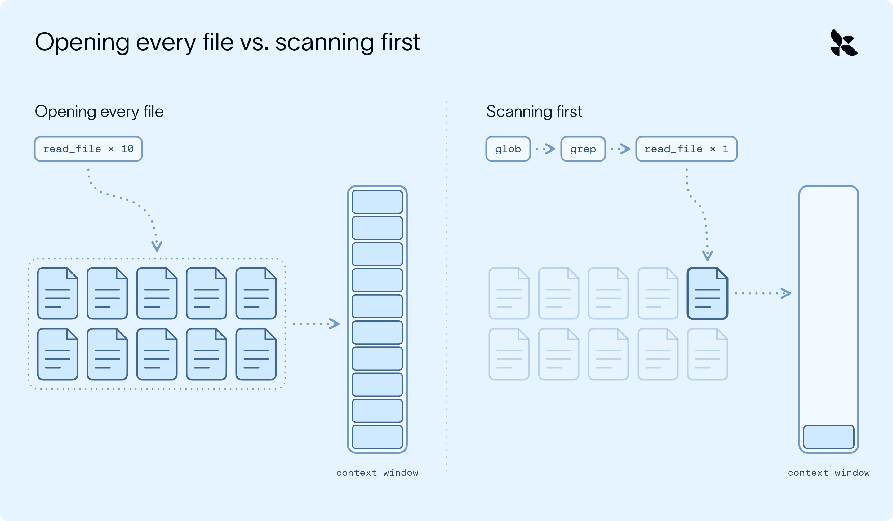
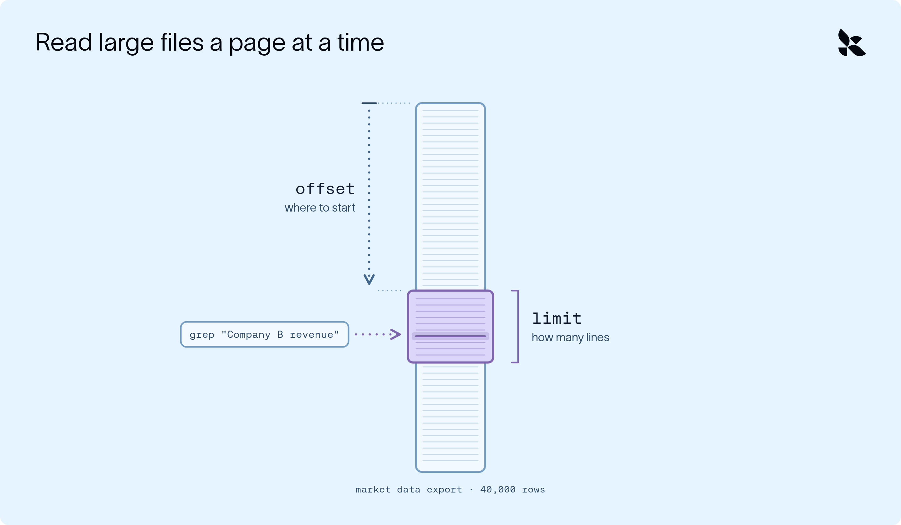
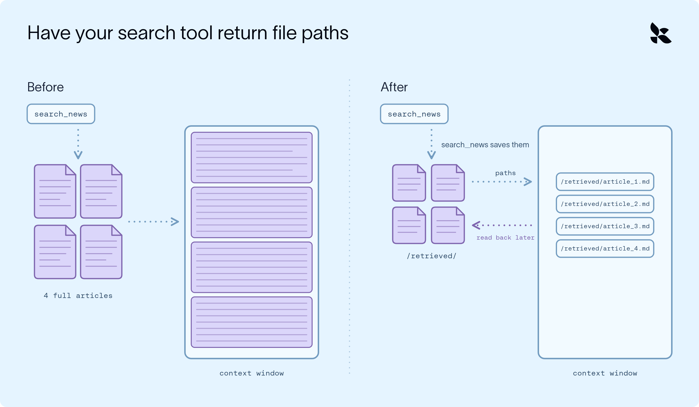

# AI 智能体的上下文工程始于检索

> **来源**: [https://www.langchain.com/blog/context-engineering-starts-with-retrieval](https://www.langchain.com/blog/context-engineering-starts-with-retrieval)  
> **作者**: Jess Weng | **发布时间**: 2026-10-23T17:00:00+00:00  
> **深度调研**: [查看专题调研报告](research.md)  
> **标签**: 上下文工程, 信息检索, Deep Agents, 语义搜索, 多智能体协作, 提示注入

---

## AI 导读

文章以每周自动生成竞品报告为例，讨论模型在查找笔记、市场数据和新闻时，如何避免重复搜索、一次读入过多材料，以及沿用无关或过期资料。它建议先按文件名和关键词缩小范围，再读取命中位置附近的内容；只有关键词难以覆盖不同表述时，才使用按含义匹配的语义搜索。检索可以随着任务推进反复进行，专门的搜索说明也可以等到需要时再加载。

对于结果过大的情况，文章介绍分段读取，以及把内容写入文件、只向主智能体返回路径的做法。随后由子智能体分别阅读文件并返回事实摘要和来源，主智能体再汇总，必要时继续检索。文中提供了保存搜索结果和接入子智能体的简化代码。对于过期资料，建议使用更新及时的数据源或按日期筛选；对于检索文本夹带指令的提示注入风险，则要求把外部内容当作待核验数据，并检查回答与引用来源是否一致。

核心思路是控制每次进入主智能体的材料范围，让原始资料留在文件中，通过按需读取和摘要支持后续工作。但文中没有量化验证收益，也未充分实现相关性筛选、日期过滤和来源保留。子智能体摘要仍需核验，不能仅凭分工就认定错误资料已被排除。

---

## 原文整理

## 核心要点

- 智能体的上下文窗口有限，而信息检索会在三个方面出问题：搜索效率低、一次引入过多上下文，以及上下文无关或过时。
- Deep Agents 运行框架默认就会控制搜索范围。内置文件系统工具先搜索，再读取：`glob` 匹配文件名，`grep` 查找匹配的行，`read_file` 则逐页读取。过大的工具结果会被转存到文件中：完整结果保存在文件里，智能体只收到路径和一段预览。
- 对于自定义搜索工具（例如 RAG），可以采用“检索、转存、委派”的方式：将结果保存到文件，返回路径，再让子智能体读取。主智能体只接收相关内容。

想象一下，你正在参加一场开卷考试：理论上，所有答案都在手边，但这反而让你更难找到*正确的那个答案*。

- 到底该从哪里开始找？
- 怎样才能确定资料是对的？
- 如何安排时间，才不会把精力都耗在重复搜索上？

想高效地找到正确信息，并没有那么简单。

把一个问题交给智能体，它也会面临类似的困境：它的上下文窗口有限，所以和人类一样，它必须通过**检索**信息来完成某些任务，而不是把一切都记在脑子里。搜索时，智能体常会遇到这些问题：

- **搜索效率低：**每次搜索都会消耗 token 和时间。如果智能体搜索不得法，例如为了看看文件里有什么就逐个打开，或者不断换个说法重复同一个查询，那么还没找到有用的东西，上下文就可能已经被搜索结果塞满了。
- **一次引入过多上下文：**一次搜索如果直接返回完整的数据导出文件或十几份文档，就会一下填满上下文窗口，连执行任务本身的空间都没有了。
- **上下文无关或过时：**对模型来说，过时或偏题的信息可能和正确答案一样有说服力。一旦这些信息进入上下文窗口，智能体就可能以此为基础继续推演，错误也会贯穿之后的每一步。

好在智能体可以使用多种方法，帮助自己检索到*正确的*信息。[智能体运行框架](https://www.langchain.com/blog/the-anatomy-of-an-agent-harness)的职责，就是根据具体任务，有策略地运用这些方法，让模型**在合适的时机获得合适的上下文**。

.png>)

本文将介绍智能体检索面临的挑战，也就是如何找到并且只引入当前任务所需的信息；介绍我们可以用哪些方法应对这些挑战；并以 [LangChain 的 Deep Agents](https://www.langchain.com/deep-agents) 运行框架为例，说明设计智能体运行框架时如何考虑这些问题。

至于信息*进入*上下文窗口后该如何管理，可以阅读这篇[上下文工程博客](https://www.langchain.com/blog/context-engineering-deep-agents-remember)。

## 示例：竞品分析智能体

我们通过一个实际场景，看看这些方法如何应用：竞品分析智能体。每周一，它都会研究数百家竞争对手，并按照团队的模板撰写报告。它需要：

- 找到上周关于 A 公司的笔记
- 在一份庞大的市场数据导出文件中查找某个具体的营收数字
- 搜索新闻档案，看看有没有新消息

这三项工作属于不同类型的检索，因此也会遇到不同的问题。我们的智能体使用 [Deep Agents 运行框架](https://docs.langchain.com/oss/python/deepagents/overview)构建，可以直接利用其中的一些方法，尽量减少这些问题。

## 1. 搜索效率低

我们的智能体需要为每家竞争对手查找三类信息。如果每一类都要试上十几次，例如为了看看内容就打开文件，或者因为资料中的用词不同而反复调整查询，那么报告还没写出一个字，上下文窗口就已经被失败的搜索填满了。

因此，最好的搜索是智能体无需重复的搜索，而这意味着要为每项工作选择合适的工具。

### 从内置文件系统工具开始

让智能体通过文件系统搜索信息，是最常见的做法之一。但如果我们的智能体为了了解文件内容而逐个打开文件，搜索效率就会很低：它读过的每个文件都会进入上下文窗口，光是翻看文件就可能把窗口填满。

更好的做法是先检查**名称**和**关键词**，就像开卷考试时先浏览书的索引，而不是逐页阅读。两种常用的文件系统工具恰好能做到这一点：

- `glob` 按文件名模式查找文件。例如，`**/company-a*.md` 可以找到上周关于 A 公司的笔记。
- `grep` 在文件内部搜索，无需将文件加载到上下文窗口。它按字面文本匹配，可以返回匹配的文件、匹配的行，或匹配数量。



每个深度智能体都[内置了这些工具](https://docs.langchain.com/oss/python/deepagents/tools#built-in-harness-tools)，以及 `ls`、`read_file`、`write_file` 和 `edit_file`。无论文件存放在哪里，是智能体状态、本地磁盘、持久化存储还是沙箱，都可以使用同一套工具，因为它们都通过智能体的[后端](https://docs.langchain.com/oss/python/deepagents/backends)访问文件。

### 关键词不够用时，添加检索工具

如果你知道该找哪些词，[grep](https://reference.langchain.com/python/deepagents/backends/protocol/BackendProtocol/grep) 非常好用，但它只能*精确匹配*你提供的文本。这就给示例中的第三项工作带来了问题：搜索新闻档案，看看有没有新消息。如果智能体用 grep 搜索“Company A funding”（A 公司融资），就会漏掉标题为“A 公司完成 $50M 的 B 轮融资”的文章，尽管这正是它要找的内容。

要按含义而不是精确字词搜索，也就是进行语义搜索，你可以添加一个由[向量存储](https://docs.langchain.com/oss/python/integrations/vectorstores)支持的[**检索工具**](https://docs.langchain.com/oss/python/deepagents/retrieval)。凡是智能体可以调用来获取信息的工具，都可以称为检索工具：它接收查询，在某个数据源中查找，然后返回找到的内容，也就是最接近的匹配结果。

.png>)

检索工具如何匹配，取决于背后的数据源。使用向量存储时，它会按含义匹配，但检索工具也可以接入其他数据源：

- SQL 数据库，用于查询结构化数据，例如销售数字或客户记录
- 搜索 API，用于获取网上的最新信息
- [MCP 服务器](https://docs.langchain.com/oss/python/deepagents/tools#mcp-tools)，用于调用别人已经构建好的工具，例如文档搜索工具

.png>)

要深入了解语义搜索的工作原理，请参阅 [LangChain 的指南](https://docs.langchain.com/oss/python/langchain/knowledge-base)。

### 让智能体决定何时搜索

许多检索方案只在开始时搜索一次，然后就作答。这适用于常见问题问答机器人（[两步式 RAG](https://docs.langchain.com/oss/python/deepagents/retrieval#2-step-rag)），却不适合我们的智能体。假设它在研究 C 公司的过程中，发现了一篇关于某款产品发布的文章，而它之前并不知道这款产品。现在，它需要查找该产品的定价，但在任务开始时，它不可能知道自己需要搜索这个信息。如果只能搜索一次，最终发布的报告就会缺少这部分内容。

研究型智能体需要[智能体式检索](https://docs.langchain.com/oss/python/deepagents/retrieval#agentic-rag)，而不是两步式 RAG：由智能体决定何时搜索、搜索什么，以及是否还需要继续查找。Deep Agents 默认就是这样工作的：智能体在循环中运行，可以按需要多次调用任何工具。

.png>)

### 把搜索经验封装成技能

为了帮助智能体更好地搜索，你可以把搜索经验封装成一项[技能](https://docs.langchain.com/oss/python/deepagents/skills)：针对特定任务的一组说明，例如使用哪个索引、如何组织查询，以及如何设置引用格式。

在任务需要用到某项技能之前，智能体只能看到它的名称和简短描述；需要时才会加载完整说明。这样，专门的知识和经验就能在需要时供智能体使用，平时又不会占用上下文。这种方法称为[渐进式披露](https://docs.langchain.com/oss/python/deepagents/skills#how-skills-work)。这里有一段[视频讲解](https://www.youtube.com/watch?v=bv1qgkbWhms)。

.gif>)

## 2. 一次引入过多上下文

不过，即便优化了搜索过程，*正确的*搜索也可能返回过多内容。我们的智能体只需要市场数据导出文件中的一个数字，也就是 B 公司的季度营收，但如果为了找到它而加载全部 40,000 行，就会填满上下文窗口。检索工具也面临同样的问题：如果每篇新闻文章都直接返回给模型，那么对五家公司进行搜索、每次返回四条结果，内容很快就会堆积起来。

### 逐页读取大文件

文件系统工具在设计上会尽量少返回内容。`read_file` 每次读取文件的一页，默认是 100 行。智能体可以设置偏移量，也就是从哪一行开始，以及读取上限，也就是读取多少行，从而直接跳到所需部分。因此，查找 B 公司的营收时，智能体可以先用 grep 定位，再只读取匹配位置附近的几行。



### 让运行框架转存过大的结果

有时，工具返回的内容仍然会超出预期。当工具结果过大，超过约 20,000 个 token 时，运行框架会将其保存到 `/large_tool_results/` 下的文件中，并向智能体提供路径和一小段预览，也就是开头和结尾的几行。随后，智能体可以利用 `read_file` 的偏移量和读取上限，只读取自己需要的部分。

.png>)

### 让检索工具返回文件路径

你也可以在自己的检索工具中采用同样的思路，无需等到触及大小上限：让工具把每条结果写入文件，只返回路径。这是“检索、转存、委派”模式的第一部分，[LangChain 的 RAG 指南](https://docs.langchain.com/oss/python/deepagents/rag)完整介绍了这一模式。



下面是一个简化的检索工具。它执行搜索，将每条结果作为文件保存到智能体的[后端](https://docs.langchain.com/oss/python/deepagents/backends#statebackend)，然后只返回文件路径列表：

```python
backend = StateBackend()
@tool
def search_news(query: str) -> str:
    """搜索新闻档案，并将每条结果保存到文件。"""
    docs = vector_store.similarity_search(query, k=4)
    files = [(f"/retrieved/result_{i}.md", doc.page_content.encode()) for i, doc in enumerate(docs)]
    backend.upload_files(files)
    return "结果已保存至：" + ", ".join(path for path, _ in files)
```

现在，主智能体看到的是四个简短的路径，而不是四篇完整文章。

## 3. 上下文无关或过时

如果结果是*错的*，再短也没有帮助。这四个文件中的任何一个，都可能讲的是另一家名称相近的公司，或者是两年前的新闻。对模型来说，偏题或过时的文本可能和正确答案一样有说服力，因此我们的目标是让这些内容完全不进入主智能体的上下文。

### 让子智能体筛选结果

然而，主智能体*仍然*需要读取这些文件，才能知道哪些内容有用，而它打开的每篇偏题文章也都会进入它的上下文。这时就轮到“检索、转存、委派”模式中的“委派”发挥作用了：让[子智能体](https://docs.langchain.com/oss/python/deepagents/subagents)读取每个检索到的文件，只返回关键事实。

1. 定义子智能体：描述告诉主智能体何时使用它，每次调用处理一个文件；系统提示词则告诉子智能体如何处理该文件。

```python
chunk_analyst = {
        "name": "chunk-analyst",
        "description": "分析一个检索到的文件。请传入问题和 /retrieved/ 下的单个文件路径。",
        "system_prompt": "使用 read_file 读取分配给你的文件。返回关键事实和来源 URL。",
}
```

2. 为主智能体配置检索工具和子智能体。传入 `search_news` 使用的同一个后端，让子智能体能够读取工具保存的文件。

```python
agent = create_deep_agent(
        model=model,
        tools=[search_news],
        backend=backend,  # 使用同一个实例，使 read_file 能访问 /retrieved/
        subagents=[chunk_analyst],
)
```

现在，流程如下：

1. **搜索：**主智能体调用 `search_news`，收到四个路径。
2. **委派：**它把每个路径交给一个 chunk-analyst 子智能体，这些子智能体可以并行运行。
3. **综合：**每个分析子智能体都返回一份附有来源的简短摘要。主智能体将它们整合起来，如果发现缺少信息，就再次搜索。

.png>)

原始结果进入文件，夹杂无关信息的阅读工作由拥有各自上下文窗口的子智能体完成，主智能体始终只看到结论。任何偏题内容都会留在子智能体的上下文中，主智能体的上下文窗口也就不会被这些内容干扰！

### 从及时更新的数据源获取信息

筛选确实能排除偏题结果，却无法修正过时的结果。我们的竞品分析智能体每周一运行，因此上个月的索引无法涵盖本周的新闻。

一种解决办法是使用搜索 API 或 MCP 服务器，为智能体提供当前信息，而不是几个月前建立索引时收录的内容。如果数据带有日期，在检索工具中按日期筛选，也能排除旧结果。

### 谨慎对待检索到的文本

另一方面，相关且最新的结果也可能带来问题！检索到的文本是数据，而不是指令；你检索到的任何内容都可能包含[提示注入](https://docs.langchain.com/oss/python/deepagents/rag#security-considerations)，而且没有任何提示词或分隔符策略能完全防止这一问题。务必验证输出：检查回答是否引用了你预期的来源，以及其中的说法是否与来源一致。

## 需要记住的检索策略

无论你基于哪种运行框架构建智能体，都需要留意以下几点：

- **使用能满足需求的最高效工具。**如果知道要找哪些词，grep 比向量嵌入查询更合适。等到确实需要时，再使用语义搜索。
- **分页读取。**分段读取大文件，而不是一次加载全部内容。
- **返回位置，而不是内容本身。**将检索到的内容写入文件，把路径交给智能体。
- **委派阅读工作。**让子智能体读取并总结，使主智能体只看到结论。
- **核实回答有据可依。**将回答与检索到的内容对照核验，并将检索文本视为不可信内容。

## 动手试试

`uv add deepagents`

想跟随讲师实时学习更多内容吗？我将在 11 月 9 日讲解这一主题：[点击这里报名](https://events.langchain.com/register/agent-memory-102-context-retrieval-storage/)！

**检索只讲了事情的一半：信息如何到达智能体。随着信息不断积累，我们该如何管理智能体的上下文窗口？**

*想了解更多，请查看：*

- 关于[使用 Deep Agents 进行上下文工程](https://www.langchain.com/blog/context-engineering-deep-agents-remember)的博客
- LangChain Academy 的 [Deep Agents 课程](https://academy.langchain.com/courses/foundation-introduction-to-deepagents)（免费、在线，可按自己的进度学习）。