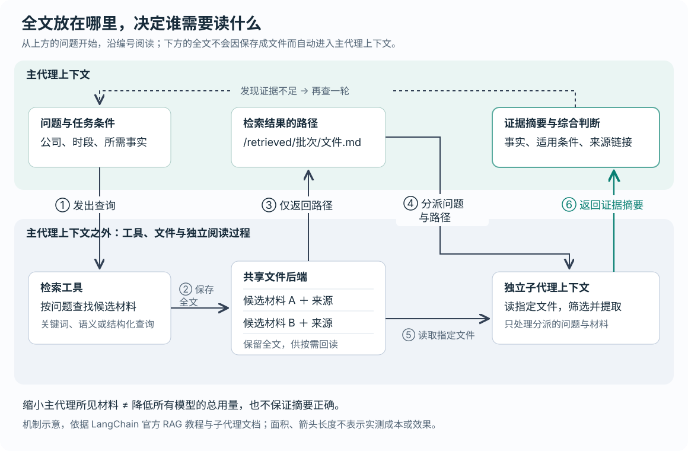

# 让 AI 代理少读全文、多找证据：检索如何成为上下文工程的起点

> 来源：[www.langchain.com](<https://www.langchain.com/blog/context-engineering-starts-with-retrieval>)  
> 作者：Jess Weng · 发布时间：2026-10-24 01:00（Asia/Shanghai）  
> 翻译正文：[阅读中文正文](article-zh-CN.md)

让 AI 代理研究一批公司，难点往往不在于资料不够，而在于它把大量新闻、旧笔记和数据表读进来之后，还能否找准当前问题需要的证据。LangChain 介绍的一套做法是：先用合适的工具缩小搜索范围，把检索全文保存为文件，再让独立的子代理阅读，主代理主要接收与问题有关的摘要。对于需要反复查资料、边查边调整问题的任务，这种组织方式值得关注。

这里的 **AI 代理（Agent）**，指能够根据任务反复调用工具、读取结果并决定下一步动作的模型程序；**上下文**是模型本次生成时能看到的指令、对话和工具结果。上下文工程，就是安排每一步让模型看到哪些信息，以及信息如何保存、补充和移出。它关心的不只是“提示词怎么写”，还包括“工具查到的东西，要以什么形式交给谁”。

本文以 Jess Weng 于 2026 年 10 月 23 日发布的 [《Context Engineering Starts with Retrieval》](https://www.langchain.com/blog/context-engineering-starts-with-retrieval) 为研究主体，结合官方文档和公开源码核验。需要先明确证据性质：这是一篇工程方法介绍，没有报告这套组合方法的对照实验；它展示了可实现的工作流程，尚未证明该流程在各种任务中都更准确或更便宜。

## 从一份竞争情报周报看问题

下面沿用原文的周报场景，作一个**假设示例**，不代表真实部署或实测结果。

假设代理要回答：“甲公司上周有什么变化？新产品价格是多少？最近一个季度的收入是多少？”资料分散在历史笔记、市场数据导出文件和新闻库里。

如果它依次打开所有笔记、整份数据表和每篇候选新闻，很多内容会成为之后每轮模型调用的输入。那些信息可能已经与当前问题无关，却仍占据有限的上下文窗口——也就是模型一次能接收的内容容量。更麻烦的是，同名公司的新闻、旧版报价和不同统计口径的收入，可能被一起拿来写结论。

合理的第一步，是按问题选择工具，而非让一种搜索包办所有查询：

| 要找什么 | 先做什么 | 为什么这样做 |
| --- | --- | --- |
| 已知命名规则的公司笔记 | 用 `glob` 按文件名模式定位 | 先得到候选路径，避免逐篇打开 |
| 已知公司名或产品编号的段落 | 用 `grep` 搜索文本，再读附近内容 | 用少量匹配结果定位证据 |
| 表格中的季度收入 | 若有结构化数据库，按公司、季度和指标查询 | 直接限定记录，减少相似数字之间的混淆 |
| 用不同措辞描述的融资新闻 | 用语义检索，并限定公司和日期 | 通过意思找材料，补足字面匹配的遗漏 |

**语义检索**通常先把文本转换成表示含义的数字向量，再寻找与问题向量接近的材料；保存和搜索这些向量的系统称为向量库。它可以把“完成 B 轮融资”找成“融资进展”的候选证据，但“意思接近”不等于“事实符合条件”。日期、公司身份和事件类型仍需核对。[LangChain 的检索说明](https://docs.langchain.com/oss/python/deepagents/retrieval)解释了这一机制，也明确支持直接连接已有数据库，无须把所有资料都改造成向量库。

还有一个容易误读的细节：原文说 `grep` 不把文件加载进上下文，意思是**搜索在工具端执行，模型收到的是匹配结果，而非整份文件**。匹配行和路径依然会占用上下文。在本次查阅的 Deep Agents 后端接口中，`grep` 明确采用字面子串匹配；这也不能直接推广为所有命令行 `grep` 工具的规则。[后端接口源码](https://github.com/langchain-ai/deepagents/blob/main/libs/deepagents/deepagents/backends/protocol.py)

## 新意在于组织阅读过程，而非发明一种搜索

原文讨论的 Deep Agents，是 LangChain 提供的一套代理运行框架。它承担模型外围的工作，例如提供文件工具、执行工具调用和分派子任务。原文把这类运行支撑称为 **agent harness**，可以理解为让模型持续完成任务的一组工具和控制机制。

它的关键思路，是把两件事拆开：**找到候选材料，不意味着马上把全文交给负责综合判断的模型。** 工具可以先保存全文，主代理先拿到位置，再决定由谁读、读多少、带回哪些证据。

这也延续了已有研究与实践。2022 年的 [ReAct 论文](https://arxiv.org/abs/2210.03629)已经研究了推理与外部动作交替进行，让新获取的信息影响后续步骤。Anthropic 在 2025 年的[上下文工程文章](https://www.anthropic.com/research/effective-context-engineering-for-ai-agents)中，也介绍了先保留文件路径、链接等轻量标识，需要时再调用工具读取内容的做法。

因此，把本文理解为“代理第一次能够自主检索”并不准确。更值得关注的进展，是 Deep Agents 将文件访问、结果外置和子代理阅读组合成可复用流程，让开发者能够明确控制资料进入主代理上下文的方式。这属于代理系统的工程方法进展。

## 核心机制：先找到、再保存、分派阅读

**检索增强生成（RAG）**，就是先获取外部资料，再让模型依据资料作答。简单做法是在回答前检索一次；复杂研究则可能需要模型看到结果后，再决定补查什么。后者通常称为代理式检索。例如，代理先发现甲公司发布了新产品，才知道还应查询该产品的价格。[官方文档对两类流程的说明](https://docs.langchain.com/oss/python/deepagents/retrieval#agentic-rag)

原文提出的“检索、外置保存、分派阅读”，可以沿着下图理解。

图中上方是主代理当前能看到的内容，下方是工具、文件与独立的阅读过程。箭头表示调用或信息传递，不表示实测成本比例。

**第一步，检索工具找出候选材料，并保存全文。** 例如，新闻搜索工具返回若干篇文章，程序将每篇写成文件，同时保留来源链接。这样，资料仍可回查，但不会因为一次搜索就全部进入主代理的输入。

**第二步，工具只向主代理返回文件路径。** 路径相当于一个可重新取回材料的位置。它之所以有用，前提是代理的文件工具确实能够访问那个位置；仅仅返回一串看起来像路径的文本，并不会产生读取能力。

**第三步，主代理把问题与路径交给子代理。** 子代理是执行一个分派任务的独立代理实例。在这里，它使用独立的上下文，读取指定材料，提取与问题有关的事实，再返回摘要。主代理因此不必接收子代理阅读时看到的全部正文和中间工具结果。Deep Agents 当前文档区分了这种默认的独立模式，以及继承父代理历史的模式；本文讨论的是前者。[子代理文档](https://docs.langchain.com/oss/python/deepagents/subagents)

**第四步，主代理综合摘要，遇到缺口再检索。** 如果摘要只说明“推出新产品”，却没有价格，下一轮就查询官方定价页。循环的价值在于让已经找到的证据决定下一步，而不是要求系统在开始时就猜全所有问题。

LangChain 的[官方 RAG 教程](https://docs.langchain.com/oss/python/deepagents/rag)提供了这一流程的完整示例：搜索工具把结果写入文件，子代理分析文件，主代理合成带链接的回答。**分派阅读需要配置与调用，不是添加一个搜索工具就会自动发生。**

在上述假设周报中，我建议子代理返回“发现了什么、发生日期、来源、适用条件、仍缺什么”，而不只返回一句结论。例如，报价可能只适用于年付套餐；丢掉这个条件，摘要虽然更短，主代理却可能写出错误比较。这是对摘要内容的建议，不是原文已经验证的输出保证。

## 文件工具和自动外置，各解决什么问题

Deep Agents 内置文件工具，可以先定位，再按需读文本。源码中的 `read_file` 默认读取 100 行，并允许指定起始位置和读取行数。于是，代理找到收入记录后，可以只读附近内容来确认季度、币种和指标名称。[文件工具实现](https://github.com/langchain-ai/deepagents/blob/main/libs/deepagents/deepagents/middleware/filesystem.py)

这不是让文件变小，而是让每次进入模型的片段变小。如果记录缺少表头、脚注或相邻解释，代理仍需补读；一行特别长时，按行分页也未必意味着返回内容很少。

另一层保护针对意外返回的大量内容：官方文档说明，工具结果超过默认阈值时，框架会将其保存到后端，再用文件路径和短预览替代。默认阈值约为 20,000 个 **token**，即模型处理文本时使用的计量单位，不能直接等同于中文字数。[上下文外置机制说明](https://docs.langchain.com/oss/python/deepagents/context-engineering#offloading)

这两层措施与主动保存检索结果的用途不同。自动外置主要处理单次返回过大的情况；自定义检索工具主动只返回路径，则可以避免许多未超过单次阈值的正文在连续搜索中逐渐堆积。这一判断来自流程本身，并非原文给出的量化实验结论。

此外，框架中的“文件”不一定是本机磁盘文件。**文件后端**是统一承接读写操作的存储接口，下面可以连接代理状态、本地磁盘或持久化存储。默认的 `StateBackend` 把文件放在会话状态中，不能据此推断它们已经成为跨会话共享的长期知识库。[后端文档](https://docs.langchain.com/oss/python/deepagents/backends)

原文还把搜索经验包装成“技能”：用一份说明记录该查哪个库、怎样构造查询、如何引用。模型开始时只接收技能名称与简介，需要时才读取详细说明。这种逐层加载称为**渐进披露**，它减少了每轮携带全部任务说明的需要，但不保证模型总能选对技能。[技能加载机制](https://docs.langchain.com/oss/python/deepagents/skills#how-skills-work)

## 已经有实现，不等于效果已经验证

本次查阅的资料支持不同层次的结论，不能混为一谈：

| 证据层次 | 能确认什么 | 尚不能推出什么 |
| --- | --- | --- |
| 原文的竞争情报场景 | 作者用它解释三类检索问题和组合方法 | 不能当作真实客户的部署报告 |
| 官方工具文档与公开源码 | 存在分页读取、结果外置等机制 | 不能证明特定任务的准确率提升 |
| 官方文档问答教程 | 提供了检索、保存、分派、综合的示例代码 | 不能代替重复实验、成本测量或独立复现 |
| ReAct 等早期研究 | 交替推理与外部动作已有研究基础 | 其论文结果不能移作本篇组合流程的成绩 |

原文没有给出相同模型、相同资料和相同预算下，与直接读取全文或简单 RAG 的完整对照。本文也未运行模型实验。因此，“主代理接收的原始正文可以减少”有机制支持；“总 token 消耗下降多少、最终答案改善多少、耗时增加多少”，仍然未知。

有两处示例细节，尤其适合用来理解方法与成品之间的距离。

首先，原文的简化搜索代码每次都使用 `/retrieved/result_0.md` 这类固定路径。多轮搜索可能写到同一位置，因此不能假定旧路径永远对应原来那份证据。官方教程另加了批次标识，将结果放在不同目录。这是保持证据可回查的必要细节。

其次，原文简化代码只保存文档正文，却要求子代理返回来源链接；若正文自身没有链接，来源就可能丢失。官方教程把文档附带的来源信息一并写入文件。这里的因果很直接：**下游能够引用什么，取决于上游实际保留了什么。**[官方检索工具示例](https://docs.langchain.com/oss/python/deepagents/rag)

## 三个边界决定它何时值得用

**主代理读得少，不代表整个系统读得少。** 多个子代理仍要分别接收任务、阅读资料并生成摘要，主代理还要汇总。并行可能缩短部分等待，但也增加模型调用与协调开销。少量、简短、已经高度相关的材料，直接交给一个模型可能更合适；大量且相互独立的候选材料，才更有理由尝试分派阅读。这是基于工作流程的取舍分析，不能当作已测得的性能结论。

**摘要会筛掉噪声，也可能筛掉关键条件。** 单篇阅读适合抽取局部事实，却可能看不到跨文档矛盾：一篇文章谈发布价格，另一篇谈后续涨价，分别都对，合并时却需要时间线。对金额、日期、版本和互相冲突的说法，主代理应能够回到原文核对。文件外置保留了这条回查路径，但不会替模型完成判断。

**读取方式不能补救资料本身的问题。** 旧索引没有收录本周新闻，增加子代理也找不到缺失事实；日期过滤能排除部分旧材料，却仍需区分网页发布日期、更新时间和事件发生时间。同样，外部正文可能夹带诱导模型改变任务的文字，这称为间接提示注入。文件和子代理改变了内容出现的位置，并未让内容变得可信；恶意指令还可能影响子代理，再通过摘要传回。官方教程明确提醒，提示语或分隔符不能完全防止这类问题。[教程中的安全边界说明](https://docs.langchain.com/oss/python/deepagents/rag#security-considerations)

这些限制共同说明：外置保存主要管理“材料怎样被读”，子代理主要管理“谁来读”。它们都不能保证检索命中、来源新鲜或结论正确。

## 值得跟踪的是证据选择能力

这套方法可能让代理更适合持续研究：保留大量可回查材料，让局部阅读与最终综合分别进行，再根据缺口继续搜索。类似做法也可能用于代码调查和多文档问答。不过，这些是由机制推导出的潜在用途，不能直接视为已验证的应用效果。

下一步最值得关注的，是三个更具体的信号：

- **同预算比较是否成立。** 在相同模型和资料条件下，分别测试直接读全文、单代理按需读文件、子代理分派阅读，同时报告答案质量、所有代理的总用量与完成时间。
- **压缩后是否仍保留证据条件。** 不只检查有没有链接，还检查原文中的币种、时间、版本和限制是否准确进入结论，跨文档冲突是否被发现。
- **代理能否判断何时继续、何时停止。** 新查询是否补上了真实缺口，还是只产生更多相似材料？停止搜索后，答案是否仍遗漏必要证据？

对正在做原型的人，我的建议是先观察一次完整任务：代理反复找不到文件，就改搜索入口和说明；经常返回整份大材料，就加定位与分页；主代理被大量独立材料占满，再尝试外置与分派阅读。应根据实际瓶颈增加机制，并保留简单流程作为比较对象。

这篇文章最值得带走的设计问题是：**每次搜索之后，下一步到底需要哪条证据，谁需要看到它，又该保留什么条件才能正确使用它？** 当这些问题得到明确回答，路径、文件工具和子代理才真正服务于研究，而不只是让系统多出几个组件。

*核验范围：截至 2026 年 10 月 24 日，查阅了原文、文中链接的官方资料及 Deep Agents 公开主分支源码。在线文档和主分支会变化，文中的默认值属于本次核验所见，不能替代对具体安装版本的确认。*
