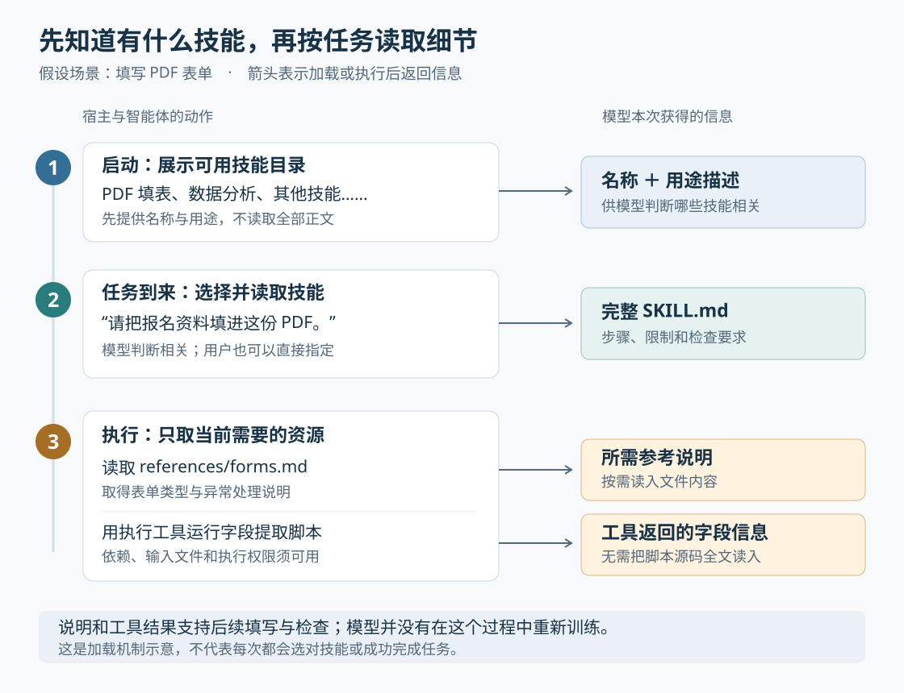

# Agent Skills 进入 AAIF：让智能体的工作方法可以共享

> 来源：[simonwillison.net](<https://simonwillison.net/2026/Oct/22/donating-agent-skills>)  
> 作者：Simon Willison · 发布时间：2026-10-22 08:00（Asia/Shanghai）  
> 翻译正文：[阅读中文正文](article-zh-CN.md)

让 AI 查到一份文档，与让它按团队规定完成一项工作，是两回事。它可能会处理 PDF，却不知道哪些字段必须保留；会检查代码，却不了解团队反复遇到的问题。Agent Skills 把这些操作步骤、参考资料和辅助脚本装进一个可以共享的文件夹，让智能体在需要时读取。这里的“智能体”，指能根据任务调用工具、读取文件并继续执行的 AI 程序。[技能格式概览](https://agentskills.io/home)

2026 年 10 月 22 日，Anthropic 宣布将 Agent Skills 标准捐赠给 Linux 基金会旗下的智能体人工智能基金会（Agentic AI Foundation，简称 AAIF），基金会也确认接收。此次进展的重点是标准交给谁维护，以及不同厂商如何共同发展它。如果你正在为智能体积累操作规范，或希望同一套工作方法能用于多种工具，这件事值得关注。[Anthropic 公告](https://www.anthropic.com/news/donating-agent-skills-to-the-agentic-ai-foundation)、[AAIF 公告](https://aaif.io/news/agentic-ai-foundation-announces-four-new-projects)

## 这次新在哪里

Simon Willison 的[原文](https://simonwillison.net/2026/Oct/22/donating-agent-skills/)是一篇简短的链接博客，主要转述捐赠消息，并回顾自己此前对这一走向的预测。理解这条新闻，需要分清技能机制的发展与这次治理变更。

Agent Skills 的机制早在 2025 年 10 月就已公开，同年 12 月发布为开放标准。因此，本次公告没有提出新的模型训练方法，也没有附带证明模型能力提升的新实验。[最初的技术介绍及开放标准更新](https://www.anthropic.com/research/equipping-agents-for-the-real-world-with-agent-skills)

此次明确捐赠的内容包括 Agent Skills 名称与标志、GitHub 组织和 agentskills.io 域名。官方表示，来自多家公司的工程师将以个人身份维护标准；使用或贡献标准不要求加入基金会。版本化发布、正式提案流程与安全指南，是公告提出的后续路线方向，应与已经完成的功能区分开。[捐赠范围与后续计划](https://www.anthropic.com/news/donating-agent-skills-to-the-agentic-ai-foundation)

它的技术新意则在于：把“如何完成某类任务”的知识，组织成智能体可以发现、按需读取、跨兼容产品复用的文件格式。操作说明、程序脚本和文件夹都很常见，Agent Skills 将它们组合成了有共同入口的技能包。[项目仓库](https://github.com/agentskills/agentskills)

## 用填写 PDF 表单理解它

**假设**一个团队经常需要把报名资料填进固定的 PDF 表单。团队要求：先识别实际存在的表单字段，再填入数据；缺失信息必须列出来，不能猜；交付前检查是否漏填。

没有专门指导时，智能体可能知道几种 PDF 库，却仍需临时决定用哪一种、怎样识别字段、怎样检查结果。团队可以把已有经验做成一个技能包：

```text
form-filling/
├── SKILL.md              用途、步骤与检查要求
├── references/forms.md   表单类型与异常处理说明
└── scripts/list_fields.py 读取表单字段的辅助脚本
```

这是一份解释机制的假设目录，不是原文展示的实测项目。不过，这种组织方式有真实对应：Anthropic 的公开 PDF 技能要求处理表单时读取 `FORMS.md`，并将更多操作说明放在其他参考文件中。[公开 PDF 技能文件](https://github.com/anthropics/skills/blob/main/skills/pdf/SKILL.md)

用户提出填表请求后，智能体先找到相应技能，读取要求，再调用工具识别字段、填写并检查。如果工具发现 PDF 没有可填写字段，后续就需要采用另一条处理路径，或说明当前方法不适用。技能提供的是判断和操作依据；文件、工具与执行环境仍决定它能做什么。

这个例子的价值，在于团队不必每次重新讲解相同要求，也不必把所有细节都写进用户当次的请求。至于能否减少漏填、节省多少时间，需要用实际表单验证，不能由目录结构直接推出。

## 智能体怎样从一个文件夹获得能力

### 先看用途，再读完整步骤

技能包的入口是 `SKILL.md`。这个文件开头用 YAML——一种表示字段和值的文本格式——记录名称 `name` 和用途描述 `description`，后面用 Markdown 编写操作说明。脚本、参考资料和模板都是可选内容。[格式规范](https://agentskills.io/specification)

关键机制叫**渐进式披露**，意思是根据当前任务逐步提供细节，而非一开始把所有技能全文交给模型：

1. 宿主程序，也就是运行智能体的软件，发现技能后，先让模型看到名称和用途描述。
2. 模型认为某个技能相关时，通过读取文件或专用加载工具，取得完整的 `SKILL.md`。
3. 执行过程中，再按需要读取参考文件，或调用工具运行脚本。

用户也可以直接指定技能。具体的发现位置、加载工具和显式调用语法，由客户端实现。[客户端接入指南](https://agentskills.io/client-implementation/adding-skills-support)



图以假设的填表任务说明加载顺序；脚本执行结果与参考资料是两条不同路径。依据：[加载机制](https://agentskills.io/home)、[脚本使用指南](https://agentskills.io/skill-creation/using-scripts)。

这种安排减少了无关说明占用的**上下文**，也就是模型当前能够参考的输入内容。但目录仍然占空间，读入的说明与工具结果也会增加输入。因此，“可以保存很多技能”不等于模型能同时理解无限多内容，更不能直接推导出速度或费用改善多少。[按需加载原理](https://www.anthropic.com/research/equipping-agents-for-the-real-world-with-agent-skills)

### 描述帮助模型选择，不保证一定触发

用途描述承担着选择入口的作用。“处理文件”很难说明何时应该使用；“读取 PDF 表单字段，填写数据并检查缺失项”就更明确。描述太窄可能漏用，太宽则可能让无关任务也加载技能。

这里通常依赖模型判断，不能把它理解成一个必然执行的关键词规则。官方描述优化指南也指出，同一请求在不同运行中可能出现不同的触发行为，并建议分别测试应该触发和不应该触发的请求。[技能触发与描述测试](https://agentskills.io/skill-creation/optimizing-descriptions)

### 脚本负责固定操作，模型负责理解与选择

技能可以要求智能体运行预先写好的程序。例如，模型决定需要取得表单字段，执行工具运行提取脚本，脚本把字段信息返回，模型再据此安排填写。脚本源码不必每次全文放进模型输入中，但程序依赖、输入文件和执行权限必须可用。[脚本与代码执行机制](https://www.anthropic.com/research/equipping-agents-for-the-real-world-with-agent-skills)

Block 的工程实践提供了另一个具体例子：它将仓库检查中的固定评分放进 Bash 脚本，由脚本按明确规则给分，让智能体解释结果和提出后续建议。这说明技能包可以把适合程序计算的部分固定下来，而不是让模型每次重新生成评分规则。不过，这是团队报告的设计实践，并非对所有技能效果的独立验证。[Block 的技能设计经验](https://engineering.block.xyz/blog/3-principles-for-designing-agent-skills)

因此，技能改变行为的路径是“提供说明和资源，让智能体据此执行”。这与把新知识训练进模型参数的路径不同。脚本中的固定计算可以更稳定，但整项任务还包含选择技能、准备输入和理解结果等环节，不能据此保证整个流程每次都相同。

## 能共享格式，为什么还不等于能无缝迁移

Agent Skills 主要约定技能包内部怎样组织。它没有统一所有客户端的安装路径、执行环境与权限机制。例如，`.agents/skills/` 是广泛采用的共享目录惯例，而非格式规范强制要求的位置。[客户端发现规则](https://agentskills.io/client-implementation/adding-skills-support)

实际迁移时，可以把问题分成三层：

| 要确认什么 | 共同格式提供了什么 | 仍需确认什么 |
| --- | --- | --- |
| 能否找到并读懂技能 | 共同的入口文件与基本字段 | 客户端怎样安装、发现和加载 |
| 能否完成操作 | 可携带说明、脚本和资源 | 工具、程序依赖、文件和权限是否可用 |
| 结果是否符合要求 | 可共享检查步骤和示例 | 换模型、换环境后，任务表现是否仍然合格 |

规范中的 `compatibility` 字段可以声明环境要求，但声明本身不会安装依赖；实验性的 `allowed-tools` 字段在不同实现中的支持也可能不同，不能把它当成通用的权限保证。[兼容性与工具字段](https://agentskills.io/specification)

原文还提到**模型上下文协议**（Model Context Protocol，简称 MCP）：它让 AI 应用以共同协议访问外部工具、资源等能力。Willison 通过自己博客的 MCP 插件，让 Claude 查找过去提过的观点。[原文中的检索过程](https://simonwillison.net/2026/Oct/22/donating-agent-skills/)、[MCP 架构文档](https://modelcontextprotocol.io/docs/2026-07-28/learn/architecture)

二者可以配合使用：MCP 提供查询工具的连接方式，技能说明何时查询、怎样使用结果。技能也可以只使用本地文件和脚本，不依赖 MCP。由此可见，把它们交给同一基金会维护有利于围绕共同需求协作，但不意味着两个标准会合并，也不意味着某个技能会自动获得外部系统的访问权。

## 证据到了哪一步

截至 2026 年 10 月 24 日，本次核验看到的材料支持不同层次的结论，不能相互替代。

**治理变更有双方官方消息确认。** Anthropic 宣布捐赠，AAIF 宣布将 Agent Skills 列为托管项目。这能确认标准维护安排的变化；“中立治理”能否持续体现在重大决策中，还需要观察之后的提案、讨论与发布。[AAIF 接收公告](https://aaif.io/news/agentic-ai-foundation-announces-four-new-projects)

**机制已有公开规范与可查看的技能文件。** 读者可以检查入口文件、目录组织及实际操作说明。这比只有概念演示更具体，但“文件符合格式”与“任务做得好”是两项不同判断。[规范与实现资料仓库](https://github.com/agentskills/agentskills)、[PDF 技能实例](https://github.com/anthropics/skills/blob/main/skills/pdf/SKILL.md)

**存在团队使用报告。** Block 在 2026 年 2 月报告建立了包含一百多个技能的内部市场，涵盖值班处理、实验配置等工作。这支持它已被用于真实团队工作，但报告没有提供可据此估计普遍收益的对照实验。[Block 工程文章](https://engineering.block.xyz/blog/3-principles-for-designing-agent-skills)

**生态规模数字需要保留口径。** Anthropic 公告称已有七十多个智能体平台接入。至于“一百万个技能、近 2.8 亿次安装”，可追溯到 Vercel 对 skills.sh 注册表的汇总报告；报告于 2026 年 9 月发布，图表覆盖启动至 8 月的数据。这些数字描述注册表收录和累计安装，不能解释为独立用户数、活跃使用量或成功完成的任务数。[平台接入声明](https://www.anthropic.com/news/donating-agent-skills-to-the-agentic-ai-foundation)、[Vercel 统计来源](https://vercel.com/blog/state-of-agent-skills)

本次公告没有给出统一条件下的跨客户端任务成功率、耗时或成本对照。本次调研也未运行这类实验。因此，更准确的成熟度判断是：**格式、公开实现和团队采用已有依据，普遍效果与迁移质量仍需逐项验证。**

还要注意，技能中的文字会影响模型行动，附带脚本则可能直接操作环境。Anthropic 最初的技术说明已经提醒，恶意技能可能诱导数据外传或非预期操作。基金会接收标准，并不表示所有第三方技能都经过审查。[最初说明中的安全边界](https://www.anthropic.com/research/equipping-agents-for-the-real-world-with-agent-skills)

## 接下来值得关注什么

从这些机制可以推断，Agent Skills 的潜在影响主要在工作方法的积累与传播：团队发现一个反复出错的步骤后，可以更新共享说明、示例或脚本，让后续任务有机会复用这次经验。基金会也将技能定位为团队知识可跨兼容工具使用的载体。不过，知识更新能否及时分发、智能体是否正确采用，仍取决于具体产品与维护流程。[AAIF 对团队共享的说明](https://aaif.io/blog/agent-skills-sharing-team-expertise-across-ai-agents)

判断后续进展，以下信号比单纯的技能数量更有解释力：

- **版本与提案流程是否落地。** 观察规范如何标记变更、讨论分歧并处理兼容性，才能判断团队能否长期维护自己的技能包。
- **跨客户端测试是否公开。** 用相同技能、输入与成功条件，比较不同环境，区分“能读取”“能执行”和“结果合格”。这是需要补充的证据方向。
- **评估是否包含无技能基线。** 官方评估指南建议比较使用技能与不使用技能的结果，并记录质量、耗时和输入输出量。这样才能判断技能增加的说明是否带来实际收益。[技能效果评估指南](https://agentskills.io/skill-creation/evaluating-skills)

如果想判断它对自己是否有用，可以选一个反复需要解释、且有清楚验收条件的小任务：保存成功步骤和常见例外，做成技能，再与不使用技能的结果比较。自动加载是否准确、最终结果是否更好，应分别检查。对于偶发而简单的任务，直接给出当次要求可能已经足够。

这次捐赠值得关注的原因，是团队写下的工作方法有了一个由多方维护的共同格式。它能否成为持久有用的资产，最终取决于这些方法能否被正确选择、实际执行，并在模型和工具变化后继续通过检验。
