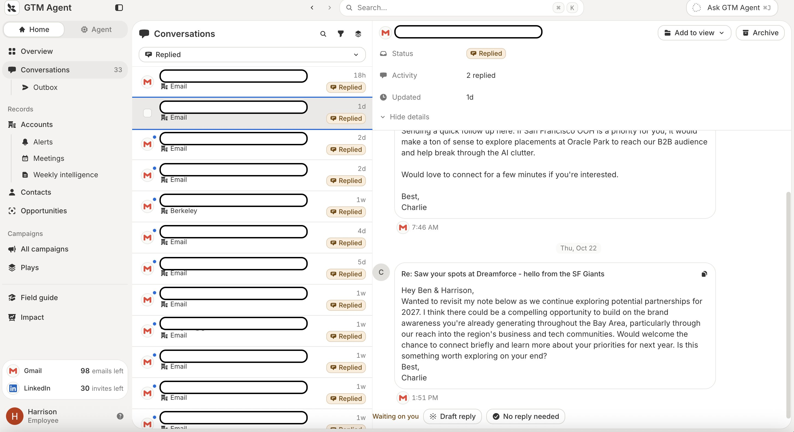

# 构建“企业智能体运行框架”的五个组成部分

> **来源**: [https://www.langchain.com/blog/components-building-company-harness](https://www.langchain.com/blog/components-building-company-harness)  
> **作者**: Harrison Chase Caspar Broekhuizen | **发布时间**: 2026-10-24T23:49:00+00:00  
> **深度调研**: [查看专题调研报告](research.md)  
> **标签**: 企业智能体, Slack 集成, 身份认证与授权, 智能体记忆, 沙箱代码执行, 凭据代理, 定时任务与事件驱动, Managed Deep Agents

---

## AI 导读

文章讨论企业智能体投入日常使用后遇到的五类问题，并以 LangChain 的销售、工程和营销应用说明处理方式。首先，把入口放在员工已经使用的 Slack 中，允许智能体另开线程，减少对人工讨论的干扰；遇到大量待审核邮件时，则使用独立界面。其次，根据工具和任务决定以谁的身份执行：用户发起的部分操作使用用户身份，后台任务或共享服务使用智能体自己的账号。邮件工具只在私聊中开放，公司社交账号的部分操作只允许指定用户调用，说明权限还要结合使用场景控制。
文章把记忆分为全体用户共享和个人专用两层，由智能体决定事实保存在哪一层，但作者明确表示这部分探索尚少。代码在沙箱（隔离的执行环境）中运行，智能体本身位于沙箱之外；不同应用使用不同依赖环境，并借助凭据代理连接需要认证的服务。任务既可由用户直接发起，也可按时间或事件自动运行，例如审查新建的代码合并请求、发送每日简报。
作者将这些做法归纳为企业智能体运行所需的通用配套能力，并说明内部应用使用同一托管平台搭建。正文给出了设计实例，但没有展示授权校验、记忆隔离、凭据代理的具体实现，也没有量化使用效果、成本或故障表现，因此更适合作为设计检查清单，尚不足以验证其通用性和运行保障。

---

## 原文整理

*如何构建企业智能体运行框架？*

*我们在 LangChain 为营销、销售和工程团队构建了内部智能体，彻底改变了这些团队的工作方式。要让它们真正好用并不容易。我们花了很多时间解决多人共用运行框架所带来的问题，而各个团队最终都采用了相同的几项核心基础能力：*

- ***融入人们现有的工作环境（对我们来说就是 Slack）***
- ***知道是谁在提出请求，在部分服务中代表该用户（OBO）执行操作，在其他服务中则使用自己的身份***
- ***具备记忆能力，记忆的适用范围可以是全体用户，也可以是单个用户，或同时支持两者***
- ***代码在沙箱中运行，并且能够向需要身份认证的服务发起请求***
- ***很大一部分运行由定时任务发起，而非由某个人明确调用（环境智能体！！）***

*感谢 @caspar\_br 对本文的帮助*

## LangChain 的内部智能体

为了让讨论更具体，先简要介绍一下 LangChain 的三个主要智能体：

**GTM Agent**：一个主动提供协助、持续运行的智能体，用于辅助 GTM 活动。它会监控并回复邮件，关注新出现的合格潜在客户并作出响应，发送每日简报，回答有关客户的问题，也能开展主动触达活动。

**OpenSWE**：我们的工程智能体，能够处理开发工作并起草 PR，还会对所有 PR 进行代码审查。

**Content Studio**：我们的营销智能体，了解我们的定位，能够按照我们的风格起草内容素材，包括博客文章、图片、PowerPoint 演示文稿和视频。

这些智能体都采用相同的方式构建。我们认为，这是一套构建企业智能体运行框架的通用方法。

## 问题：用户体验

我们所有的智能体都融入了人们现有的工作环境，对我们来说就是 Slack。每个智能体都有自己的 [Slack 应用](https://docs.langchain.com/langsmith/python/managed-deep-agents-channels-slack)，可以通过私信联系，也可以在频道中被提及。在频道中与智能体协作的一个好处是，其他人能看到大家如何使用它。

我们还添加了一个很实用的功能：在 Slack 中把对话“分出去”。很多时候，大家正在进行一场很有价值的讨论，你想让智能体加入，听听它的意见，或者让它做点事情。但如果智能体直接在这个讨论串里运行，就会干扰人与人之间的对话，分散大家的注意力。因此，我们提供了一种简便的方式，让智能体在同一频道中另开一个讨论串。

有些交互体验最好不要放在 Slack 中。例如，审核 GTM Agent 希望我发送的邮件时，偶尔在 Slack 中处理一封没什么问题；但如果积压了大量邮件，靠 Slack 消息跟进它们就很不好用。对于这类场景，我们最终还是构建了专门的用户界面。

## 问题：身份

我们遇到的最棘手、最难处理的问题是身份。具体来说：这些智能体执行操作时，究竟代表谁？

业内主要有两种处理方式：

- *代表用户执行（On-behalf-of）*：智能体代表调用它的用户执行操作。
- *固定凭据（Fixed credentials）*：无论谁调用智能体，它都使用同一组固定凭据，例如服务账号。

下面是我们对各个智能体的处理方式（文档：[为 Managed Deep Agents 添加身份](https://docs.langchain.com/langsmith/python/managed-deep-agents-identity)、[管理连接](https://docs.langchain.com/langsmith/python/managed-deep-agents-connections)）：

### OpenSWE

- 当你给它发消息时，它会代表你执行操作，例如以你的 GitHub 用户名创建 PR。
- 在后台运行时，例如充当代码审查智能体时，它会使用自己的身份（GitHub 应用）。

### GTM Agent

- 使用部分工具时，例如访问 Salesforce，它会采用固定身份，这样就不必让每个人都登录。
- 使用另一些工具时，例如邮件工具，它会代表调用它的用户执行操作。这些工具**仅在私信中可用**，在共享频道中不可用。

### Content Studio

- 使用部分工具时，例如 Notion，它会代表调用它的用户执行操作。
- 使用另一些工具时，例如 Twitter，它会采用一组固定凭据，这里用的是我们公司 Twitter 账号的凭据。不过，只有白名单中的用户才能调用其中的某些操作。例如，并非所有人都能在 Twitter 上发帖，有些人可能只能阅读或起草帖子。

## 问题：记忆

所有智能体都有[两个层级的记忆](https://docs.langchain.com/langsmith/python/managed-deep-agents-memory)：

- 全局记忆：适用于所有用户的记忆。
- 用户记忆：仅适用于某个特定用户的记忆。

智能体自行决定要记住哪些事实，以及把这些事实保存到哪个层级的记忆中。

这可能是我们迄今探索最少的领域——我们还有很多想做的工作！

## 问题：代码执行

我们的三个智能体都能编写和执行代码，而且往往需要这样做才能完成任务。它们都采用同一种模式：智能体本身运行在沙箱之外，但会连接到沙箱，在其中执行代码。它们使用的基础镜像略有不同，包含的依赖也不同。OpenSWE 是其中与编程关系最密切的智能体，它会根据频道或用户，智能选择启动哪种基础镜像。它们都使用 [LangSmith Sandboxes](https://docs.langchain.com/langsmith/sandboxes) 的[凭据代理](https://docs.langchain.com/langsmith/sandbox-auth-proxy)，让智能体能够直接从沙箱内部安全地连接到服务（另见[为 Managed Deep Agents 添加沙箱](https://docs.langchain.com/langsmith/python/managed-deep-agents-sandboxes)）。

## 问题：定时运行

很大一部分运行由定时任务发起，或由事件在后台触发，而非由用户直接启动。

其中一些由智能体的开发者设置。例如，OpenSWE 会监听 PR，每当有新的 PR 创建时，就会进行审查。

另一些则由用户提出要求，让智能体自行设置。例如，我让 GTM Agent 每天给我发送一份简报，它就为此自行创建了一个 [cron 定时任务](https://docs.langchain.com/langsmith/python/managed-deep-agents-schedules)。

## 全部基于 Managed Deep Agents 构建

这些智能体全部基于 [Managed Deep Agents](https://docs.langchain.com/langsmith/python/managed-deep-agents-overview) 构建，而 Managed Deep Agents 又建立在开源的 [Deep Agents](https://docs.langchain.com/oss/python/deepagents/overview) 运行框架之上。它提供了基础设施，来解决上述所有问题，包括频道、cron 定时任务、沙箱、记忆和身份，同时保留足够的灵活性，让你能够按需定制智能体的行为。现在就按照[快速入门指南](https://docs.langchain.com/langsmith/python/managed-deep-agents-quickstart)试试吧！