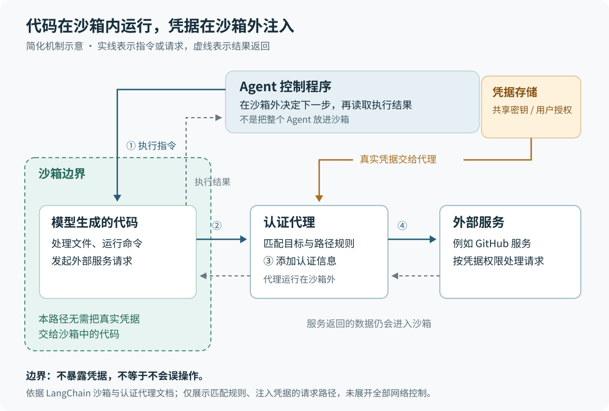

# 让 Agent 成为公司里的共享助手：LangChain 的五项实践意味着什么

> 来源：[www.langchain.com](<https://www.langchain.com/blog/components-building-company-harness>)  
> 作者：Harrison Chase Caspar Broekhuizen · 发布时间：2026-10-25 07:49（Asia/Shanghai）  
> 翻译正文：[阅读中文正文](article-zh-CN.md)

一个 AI 助手能替你写邮件、改代码，并不意味着它已经适合全公司共同使用。换个人提问，它该读谁的资料？在群聊里，它能不能使用私人邮箱？每天自动运行时，它又代表谁行动？LangChain 提出的“公司级 Agent 运行框架”，就是把这些问题连同聊天入口、长期记忆和代码执行一起处理。当助手开始跨团队共享、连接真实业务账号，并在后台持续工作时，这项进展值得关注。

这里的 **Agent（智能体）**，指能根据目标调用工具、读取结果并继续行动的 AI 程序；**harness（运行框架）**，则是围绕模型组织这些行动的软件。本文依据 LangChain 的[原文《The five components of building a “company harness”》](https://www.langchain.com/blog/components-building-company-harness)，并对照截至 2026 年 10 月 26 日查阅的官方文档与开源仓库，解释它的新意、机制和证据边界。

## 新意在于多人共用和后台工作

原文介绍了 LangChain 内部的三个助手：GTM Agent 服务于销售和市场拓展，处理线索、邮件与每日简报；OpenSWE 帮助修改代码、提交代码变更请求并进行审查；Content Studio 生成符合公司表达风格的内容素材。作者说，这些团队最终采用了相同的五项基础能力。

| 基础能力 | 它要回答的具体问题 |
| --- | --- |
| 工作入口 | 员工从哪里交办任务，又在哪里查看和处理结果？ |
| 身份 | 这次调用代表员工本人，还是代表一个共享账号？ |
| 记忆 | 哪些知识大家都能使用，哪些只属于某个人？ |
| 沙箱执行 | 生成的代码在哪里运行，怎样访问需要登录的服务？ |
| 后台触发 | 没有人发消息时，谁来启动任务，以谁的身份执行？ |

这些部件各自都有先例：账号授权、定时任务和隔离运行环境都不是新发明。**这项实践的新意，主要是把它们组织成同一个共享 Agent 的运行方式，并展示身份、会话场景与后台任务之间的联系。**这是对原文的分析，不是作者已经证明的行业标准。

还要区分“多人共用”和“多个 Agent 协作”：原文讨论的主要是多个员工使用助手时，如何处理不同身份、资料和操作权限；它并没有把多智能体协作作为核心创新。

从产品关系看，开源 Deep Agents 已提供模型调用工具、处理文件、管理上下文和委派子任务等能力。Managed Deep Agents 在这套框架外围提供托管服务，接上身份、通信渠道、记忆和调度。它没有要求开发者换用另一套智能体推理算法。[Deep Agents 概览](https://docs.langchain.com/oss/python/deepagents/overview)、[Managed Deep Agents 概览](https://docs.langchain.com/langsmith/python/managed-deep-agents-overview)

## 从一次私聊，看身份为什么不能只设一套

假设销售人员小林私聊助手：“整理我的客户邮件，结合销售记录，起草今天的跟进建议。”这是为了说明机制而构造的例子，并非原文记录的实际任务。

系统首先识别发消息的人，再为不同工具选择账号：读取邮箱时使用小林授权的账号，查询公司销售系统时可能使用共享服务账号，输出则回到小林的私聊。这里有两种身份方式：**代表用户执行**，即原文的 OBO（on-behalf-of），使用当前用户的授权；**使用固定身份执行**，即不随提问者变化，始终使用某个服务账号或应用账号。

原文没有为每个助手二选一，而是按工具和场景组合：

- OpenSWE 接受员工交办时，可以用员工的 GitHub 身份提交代码变更请求；后台审查代码时，则用 GitHub 应用自己的身份。
- GTM Agent 查询 Salesforce 时使用固定身份；邮箱工具代表用户执行，而且只在一对一私聊中开放。
- Content Studio 访问 Notion 时代表用户，操作公司社交账号时使用固定凭据；只有获准的员工能触发某些发布操作。

这意味着至少要分清三个问题：谁提出请求、哪个账号执行操作、结果会被谁看到。小林能读取自己的邮箱，不等于助手应该在全员频道展示邮件；助手持有公司发布账号，也不等于每个人都有权要求它发布内容。这是上述做法背后的原因。

官方连接管理文档给出了更具体的机制：工具请求凭据时，声明取“当前用户”还是“Agent”的凭据；运行服务根据已认证的调用者解析用户账号，而不是让模型随意指定一个用户编号。用户尚未授权时，任务会暂停，等待完成 OAuth 授权——也就是用户在服务商页面同意授予应用一定访问权限——再继续执行。[连接管理文档](https://docs.langchain.com/langsmith/python/managed-deep-agents-connections)

代价也很清楚：个人身份需要逐人授权，共享身份则需要另外限制谁能调用哪些操作。身份选择解决“用哪个账号”，不能自动回答“这名员工是否获准做这件事”。

## 聊天入口和记忆范围，要一起考虑

LangChain 将这些助手放进日常使用的 Slack：员工可以私聊或在频道中提及助手。官方文档描述的处理过程是：验证 Slack 事件，把会话对应到内部任务线程，确定调用者，运行助手，再把回复发回 Slack。这里的“线程”是保存一次对话及其执行状态的内部记录。[Slack 接入文档](https://docs.langchain.com/langsmith/python/managed-deep-agents-channels-slack)

原文还有两个容易被忽略的界面细节。第一，可以把助手的工作移到频道里的另一条讨论串，避免自动回复淹没人类正在进行的对话。第二，批量审阅待发送邮件时，他们另做了专用界面。前者保留协作现场，后者便于连续处理许多待办；接入聊天软件并不意味着所有操作都适合做成聊天。

记忆也受会话场景影响。这里的**长期记忆**，指能跨越多次对话保留的知识，不等于当前聊天记录，更不等于重新训练了模型。原文把它分为共享记忆与个人记忆，并让 Agent 判断哪些信息值得保存。

当前官方文档进一步说明：持久记忆需要主动启用；从 `managed-deepagents 0.8.0` 起，可分别启用部署内共享的 Agent 记忆和属于已认证个人的用户记忆。运行开始时，服务先检查身份和访问策略，再挂载允许使用的记忆；默认情况下，Slack 一对一私聊可用个人记忆，频道和群聊不可用。“全局”在这里应理解为一个部署内共享，并非所有公司数据天然互通。记忆以文件形式供 Agent 读取和更新：简短的常用内容随模型调用加载，详细资料按需读取，而不是把所有历史记录都塞给模型。[记忆文档](https://docs.langchain.com/langsmith/python/managed-deep-agents-memory)

例如，小林偏好的简报格式可以存入个人记忆；适用于所有人的公司术语可以进入共享记忆。这个例子同时揭示了难点：系统能划分存储范围，不代表模型总能正确判断一条信息该放哪里。原文也承认，记忆是他们探索最少的部分。它没有提供记忆分类准确率、错误信息被复用的频率，或长期积累后的效果数据。

## 代码放进沙箱，凭据留在外面

上述三个助手都会写代码并执行。例如，内容助手可能需要生成文件，工程助手需要运行测试；这类工作不能只靠模型输出文字完成。**沙箱**是为这些代码提供的隔离文件系统与命令执行环境，用来限制代码直接接触宿主环境。

原文采用的方式是：Agent 的控制程序在沙箱外运行，连接沙箱，要求它执行代码，再读取结果决定下一步。各助手使用的基础环境不同；原文还称，OpenSWE 会根据频道或用户选择环境。基础环境可以理解为预装了某些工具和依赖的软件起点。

隔离之后还有一个实际矛盾：代码需要调用 GitHub 等服务，但直接把真实访问凭据交给生成的代码，会增加凭据被读取或输出的机会。LangSmith 的认证代理把两件事拆开：沙箱负责发请求，沙箱外的代理负责给符合规则的请求补上凭据。

图中从上往下阅读。先由 Agent 发出执行指令；代码运行后，如果需要访问外部服务，就把网络请求交给代理。代理按配置匹配目标主机和路径，为匹配的请求添加认证信息，再发给服务。服务返回的数据仍会回到代码，代码执行结果再交给 Agent。官方沙箱文档也展示了使用当前用户的 GitHub 连接配置代理的方式，所以这种机制既能配合共享账号，也能配合个人授权。[沙箱接入文档](https://docs.langchain.com/langsmith/python/managed-deep-agents-sandboxes)

这里降低的是代码直接处理真实凭据的需要，不能据此推导出“代码不会做错事”。一个获准发出的请求，仍可能删除错误的文件或提交错误的内容；有权读取的数据也会返回沙箱。网络访问限制还需要单独配置：认证注入规则决定哪里补凭据，允许访问的目标列表决定代码能连接哪里，两者不是同一回事。[认证代理文档](https://docs.langchain.com/langsmith/sandbox-auth-proxy)

## 自动运行，是把下一次任务交给调度器

原文说，很大一部分运行由定时任务或后台事件触发，但没有给出具体比例。它举了两类例子：新代码变更请求出现后，OpenSWE 自动审查；用户要求每日简报后，GTM Agent 创建定时任务。

前一种是事件触发，后一种是时间触发。原文称它们为“环境式 Agent”：助手在既定条件出现时开始工作，员工不必每次重新发起对话。这个说法不表示模型一直在思考，也不表示它无限制地监视所有数据。

以“每天早上给我简报”为例，真正的中间步骤是：Agent 将请求转成待执行的提示和时间规则，调用创建日程的工具；调度服务保存规则，到点后启动一次新运行，并把结果交付到指定会话。时间规则可以使用 **cron 表达式**，即用分钟、小时、日期等字段表示何时触发的写法。

官方文档确认，从 `managed-deepagents 0.9.0` 起，支持运行中创建日程，但 Agent 必须通过开发者提供的工具访问这项能力。日程还区分归属：用户日程以该用户身份运行，Agent 日程以服务身份运行。因此，“没有人正在聊天”不等于“没有明确的执行身份”。这正是调度与身份必须一起设计的原因。[调度文档](https://docs.langchain.com/langsmith/python/managed-deep-agents-schedules)

这一步把助手的工作方式从“响应本次请求”延伸到“保存未来要做的事”。潜在用途包括持续准备销售简报、跟进代码审查、按固定周期整理内容；这些用途是否有价值，仍取决于输入是否可靠、输出是否值得处理，不能只看任务能否按时启动。

## 现有证据能支持到哪一步

这篇文章属于厂商内部实践总结，也在介绍其托管产品。阅读时应区分几类证据：

| 证据 | 已能支持的判断 | 尚不能支持的判断 |
| --- | --- | --- |
| 原文叙述与配图 | 作者报告三个内部助手采用了这些做法 | 普遍的效率提升、成本收益或任务成功率 |
| 官方能力文档 | 身份连接、记忆、沙箱代理与调度有具体配置和调用方式 | 配好这些功能后，任意业务任务都能可靠完成 |
| OpenSWE 开源仓库 | 存在公开实现，可进一步检查工程助手的工作方式 | 公开版本与内部部署完全一致，或已经稳定适用于所有团队 |

尤其需要注意，Managed Deep Agents 的文档仍标注为公开测试阶段；OpenSWE 仓库也明确提示正在积极开发，可能出现不兼容变更，且不保证正确性、稳定性与兼容性。这些信息比“完全改变了团队工作方式”一类体验描述，更适合用来判断当前成熟度。[身份文档](https://docs.langchain.com/langsmith/python/managed-deep-agents-identity)、[OpenSWE 仓库](https://github.com/langchain-ai/open-swe)

本次调研没有运行这三个内部助手，也没有找到足以独立验证其整体收益的对照测试。原文没有报告任务总量、后台运行占比、人工返工率或长期使用成本。因此，现有材料支持“已有内部使用报告，相关机制已公开”，尚不足以支持“这五项能力是所有企业的最优组合”。

## 接下来值得观察什么

这项实践提示了一种发展方向：共享助手的能力，越来越取决于它怎样接收任务、选择账号、取用知识和安排后续行动。模型能提出下一步行动，运行框架则决定这一步能接触哪些资源、由什么条件启动、把结果交给谁。这是从原文与文档得到的分析推断。

如果这一方式继续成熟，公司可能把一些反复发生的工作交给长期存在的助手：员工在熟悉的渠道提出目标，助手在授权范围内准备材料、执行检查，并在适当时间送回结果。不过，原文呈现的仍是销售、工程和营销三个场景，不能据此推出任何部门都适合共用同一套工具或记忆。

后续最值得跟踪的信号有三个：是否出现包含人工返工在内的持续使用数据；共享与个人记忆能否在长期使用中保持合适的范围和内容；后台任务是否能清楚展示归属、暂停和撤销方式。它们分别回答“有没有净收益”“会不会越用越混乱”和“未来的行动是否仍可控”。

对刚开始尝试的团队，更有依据的做法是选一项重复发生、结果容易核对的任务，例如准备内部简报或生成待审阅草稿。先看它在真实使用中是否减少总工作量，再扩大执行范围。原文最有参考价值的地方，是把共享 Agent 必须面对的问题具体展示了出来；这些问题有了可复用的处理机制，但效果仍需要在各自的业务里验证。
