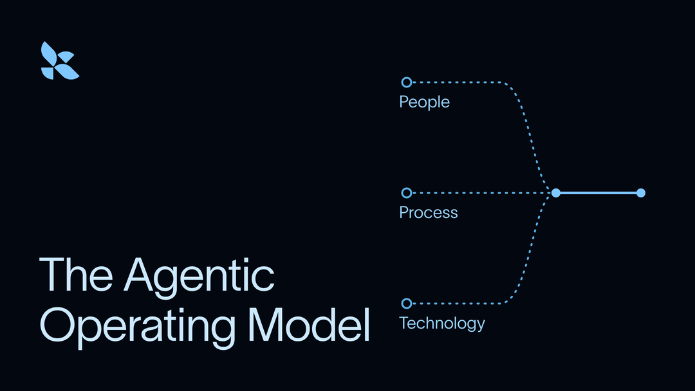

# LangChain 2026 年 10 月通讯：我们在 Interrupt 纽约站和伦敦站发布的全部新功能

> **来源**: [https://www.langchain.com/blog/october-2026-langchain-newsletter](https://www.langchain.com/blog/october-2026-langchain-newsletter)  
> **作者**: The LangChain Team | **发布时间**: 2026-10-15T16:00:00+00:00  
> **深度调研**: [查看专题调研报告](research.md)  
> **标签**: AI代理工程, 可观测性与执行追踪, 语义检索, 模型评估与红队测试, 模型微调, MCP工具集成, AI治理

---

## AI 导读

文章围绕团队构建、理解和改进生产环境 AI 代理的需求，汇总一组产品能力及学习资源。主要介绍通过自然语言语义搜索定位追踪记录，按会话时间顺序查看主代理与子代理的执行路径，利用红队测试及指标趋势发现问题，并宣称可自动测试和验证修复建议；同时介绍按运行上下文定制代理、用户级记忆、工具使用与任务调度，以及在 LangSmith 内发布自定义界面。模型改进方面，提出将生产执行轨迹转为训练数据，连接 Baseten 或 Fireworks 完成微调、评估和部署；开源更新提及通过 langchain.mcp 命名空间支持 FastMCP。文章还介绍结合人员、流程、持续评估与治理来扩展生产 AI 的框架，并列出相关培训活动。正文传达的主要判断是，这些能力能够增强团队对代理系统的控制并提高交付效率，但没有提供架构细节、复现步骤、评测数据或成本对比。客户案例仅定性声称功能交付变快，不能据此确认改善幅度或因果关系；链接指向的实现和案例详情不在本次材料范围内。

---

## 原文整理

任何公司都可以使用 AI。能够从中持续获得价值的公司，会[掌控自身的智能能力](https://www.langchain.com/blog/own-your-intelligence)：掌控模型、运行框架和上下文，让通用模型成为了解自家业务的模型。

在 Interrupt 纽约站和伦敦站，我们发布了多项新功能，帮助团队掌控自身的智能能力，让他们在构建、理解和改进生产环境中的智能体时拥有更多控制权。

## LangSmith 新功能

🔎 **LangSmith AI Search：** 根据对追踪记录的语义理解来查找对话。你可以直接提问，例如“用户是否感到沮丧？”或“PII 是否泄露？”，无需依赖传统筛选条件。

🤖 **Managed Deep Agents v0.9：** 构建动态、个性化的智能体，根据每次运行的上下文进行定制，在 Slack 中作出响应，具备用户级记忆和工具使用能力，还能安排任务等。此外，还可免费使用内置的网络搜索功能。

🛡️ **LangSmith Engine v2：** 通过红队测试，在问题进入生产环境之前将其发现。Engine v2 还能发现更难察觉的问题，包括智能体工作效率低下以及指标趋势中反映的问题，并自动测试、验证它提出的修复方案。

🧭 **LangSmith Trajectories：** 浏览追踪数据，按时间顺序查看每个会话中主智能体及其子智能体的活动，跟踪智能体的执行路径。

🧩 **LangSmith Custom Apps：** 直接在 LangSmith 中构建、发布和运行自定义界面，将反复执行的工作流程转化为基于 LangSmith 数据的共享工具。

🎛️ **LangSmith Fine-Tuning：** 将生产环境中的执行轨迹转化为训练数据，使用 Baseten 或 Fireworks 微调模型，然后评估微调后的模型，并将其部署为可调用的服务。

## 开源动态

🔧 **LangChain v1.4.0：** LangChain 现已通过 `langchain.mcp` 命名空间支持 FastMCP。

⚡ **使用 Jev 和 LangGraph 构建生产环境中的智能体：** 了解 LangGraph 如何编排 TypeSafe AI 的决策模型 Jev，构建运行速度更快、运行成本更低的智能体。

## 智能体运营模式：团队如何大规模运行生产环境中的 AI

[智能体运营模式](https://info.langchain.com/guide/the-agentic-operating-model)探讨领先团队如何结合人员、流程和技术，扩大生产环境中 AI 的应用规模。它涵盖重新思考智能体开发生命周期、建立持续评估实践，以及将治理融入其中：这些都是走出实验阶段、可靠地大规模运行智能体所需要的。欢迎参加即将举行的线上活动，了解这一框架及其在实践中的应用。

**🌍 欧洲、中东和非洲地区 · 10 月 29 日**  
10:00 GMT / 11:00 CET

[报名 →](https://events.langchain.com/webinar/emea-the-agentic-operating-model/)

**🌎 北美地区 · 11 月 5 日**  
上午 10:00 PT / 下午 1:00 ET

[报名 →](https://events.langchain.com/register/namer-agentic-operating-model/)

## 聊聊 Lang

通过实时工作坊，学习构建可靠智能体的基础知识。

**🧪 智能体评估入门：什么是智能体评估？**  
10 月 28 日，周三 · 上午 11:00 PT · 线上

学习如何通过评估智能体的执行轨迹来衡量其表现：执行轨迹就是智能体生成的一系列消息和工具调用。

[立即报名 →](https://events.langchain.com/register/762756f4-4344-4760-b4b9-a07dd63e76af/)

**🧠 智能体记忆入门：上下文工程**  
11 月 3 日，周二 · 上午 10:00 PT · 线上

这场实时工作坊将介绍智能体如何记忆。了解我们的开源智能体运行框架 Deep Agents 如何帮助精简上下文窗口中的内容。

[立即报名 →](https://events.langchain.com/register/agent-memory-101-context-engineering/)

## 近期活动

### LangChain 主办

**🇩🇪 德国慕尼黑 · 10 月 27 日 · 17:00–21:00 CET**  
LangChain x Data Reply 黑客松：使用智能体运行框架进行构建

[报名 →](https://luma.com/g6kvvori)

**🤖 伊利诺伊州芝加哥 · 10 月 27 日 · 上午 10:00 CT**  
LangSmith 巡回活动：用智能体构建智能体

[报名 →](https://events.langchain.com/LangSmithRoadshow/Chicago/)

**💻 线上 · 10 月 28 日 · 上午 11:00 PT**  
GTM 工程直播：我们如何构建设计智能体

[报名 →](https://events.langchain.com/gtm-engineering-live-series/design-agent/)

**🏛️ 弗吉尼亚州维也纳 · 10 月 29 日 · 下午 6:00 ET**  
DMV 智能体开发者聚会

[报名 →](https://luma.com/afqb2si8)

**🍁 安大略省多伦多 · 11 月 4 日 · 下午 5:15 ET**  
使用开放权重模型，掌控自身的智能能力

[报名 →](https://luma.com/htp51nvv)

### LangChain 社区主办

**🇲🇽 墨西哥城 · 10 月 29 日 · 下午 5:00 CT**  
生产环境中的智能体

[了解更多 →](https://luma.com/mxtw-e354f23b)

## 团队正在用 LangChain 构建什么

过去，为 **Zip** 早期版本的聊天机器人或智能体添加一项功能需要数周时间，而其自建的追踪数据处理流水线又缺少团队所需的细节。如今，LangSmith 和 LangGraph 让新功能的交付更快了。

**如何持续了解 Lang 的最新动态？** 欢迎查看 [LangChain 博客](https://www.langchain.com/blog)、[更新日志](https://docs.langchain.com/langsmith/changelog)和 [YouTube 频道](https://www.youtube.com/@LangChain)，获取更多产品和内容更新。