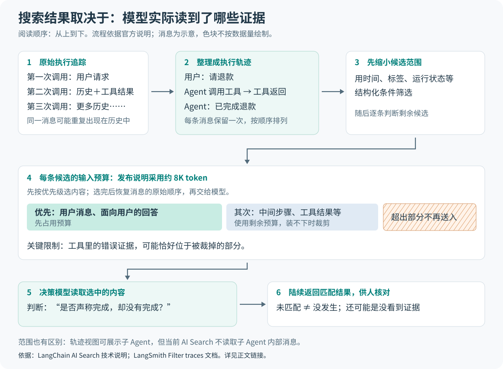

# LangChain 2026 年 10 月更新：让 Agent 的执行过程成为改进依据

> 来源：[www.langchain.com](<https://www.langchain.com/blog/october-2026-langchain-newsletter>)  
> 作者：The LangChain Team · 发布时间：2026-10-16 00:00（Asia/Shanghai）  
> 翻译正文：[阅读中文正文](article-zh-CN.md)

一个 AI 助手说“退款已完成”，并不代表退款工具真的执行成功。对能调用工具、连续完成多步任务的 AI 系统——也就是 Agent——来说，只检查最终回答或程序有没有报错，往往看不出问题。还需要知道：它看到了什么、调用了什么工具，又怎样处理返回结果。

LangChain 的这批更新，正在把这些执行记录变成更容易阅读、搜索、测试和训练的数据。如果你关心 Agent 从演示走向持续使用后，怎样发现问题、积累有效经验，这比新增几个工具接口更值得关注。

研究主体是 2026 年 10 月 15 日发布的[《October 2026 LangChain Newsletter》](https://www.langchain.com/blog/october-2026-langchain-newsletter)。它汇总了近期开源框架和商业平台的更新，并不是一篇提出新算法的论文。下文结合截至 2026 年 10 月 27 日查阅的官方说明、文档和公开仓库，区分已提供的功能、作者实验与仍待验证的效果。

## 从一句“已经完成”，追到任务究竟做了什么

先看一个**假设例子**。用户要求退回一笔订单款项，Agent 调用退款工具，工具返回“缺少授权”；Agent 却忽略错误，回答“已经退款”。这里可能没有程序崩溃，最终回答也很流畅，但任务实际失败了。

这类问题不能只靠搜索“退款”发现：成功与失败的会话都会出现这个词。也不能只看用户是否生气：用户可能相信回答，暂时没有投诉。真正需要核对的是工具结果与后续回答之间的关系。

LangSmith 是 LangChain 提供的 Agent 运行记录与评估平台。它原本就保存执行追踪，英文称为 trace：把模型调用、工具调用以及它们之间的父子关系记录下来。多轮会话可能对应多棵执行树，逐层打开才能拼出完整经过。

新增的 **Trajectories（执行轨迹）** 则把会话里的消息、工具调用和工具结果，按首次出现的顺序排列，并消除重复历史。它还能汇集主 Agent 和子 Agent——被委派处理部分任务的其他 Agent——的消息。阅读者可以先找到“工具报错后仍宣称成功”这一步，再回到原始追踪查看具体参数、耗时和重试情况。[官方轨迹说明](https://www.langchain.com/blog/langsmith-trajectories-tracing)

这项更新的价值在于改变阅读单位：先看一次任务怎样推进，再查某次调用的执行细节。它也提供了后续搜索、人工评审和训练所需的共同材料。不过，轨迹是对已有记录的整理，不能补回从未采集的数据。

## AI Search：让模型判断发生过什么，而不只是找相似话题

AI Search 允许用户用自然语言查找会话，例如“Agent 声称完成任务，但实际上没有完成”。理解它的关键，是分清两种搜索方式。

常见的向量搜索会把文本压缩成一组数字，再按相近程度寻找结果，适合找相关话题。但在退款例子中，“成功退款”与“谎称退款成功”谈的是同一件事，主题相似不等于行为相同。LangChain 公布的做法是：先用结构化条件缩小范围，再让一个擅长狭窄判断任务的**决策模型**，逐条阅读候选轨迹，判断是否符合描述；系统并行处理，并陆续返回匹配结果。[AI Search 技术说明](https://www.langchain.com/blog/agent-traces-ai-search-langsmith)

这里的新意，是把原先需要预先编写评估规则、或者逐条人工检查的问题，变成可以临时提出的行为查询。对于“工具报错后是否仍说成功”这样的关系判断，它比单纯的话题检索更贴近实际问题。但模型仍可能误判。

### 为什么搜索模型不一定看到了全部经过

长任务的工具输出可能非常多。上述技术说明给出的实现采用约 8K token 的输入预算；token 是模型处理文字时使用的片段单位，不能直接等同于汉字数。系统优先保留用户消息和面向用户的回答，再把其余预算用于中间消息、工具结果和系统消息。装不下的内容会被裁剪或舍弃，保留内容再按原顺序交给模型。[上下文选择机制](https://www.langchain.com/blog/agent-traces-ai-search-langsmith)

图中的流程依据官方技术说明；消息内容是示意，色块宽度不代表真实数据比例。

这个取舍直接影响搜索能力。**我的分析是**：判断“用户是否表现出不满”，主要对话往往已经包含证据；判断“Agent 是否忽略工具错误”，证据却可能埋在被裁掉的工具输出里。此时没有搜到，并不能证明问题没有发生。

还有一条更容易忽略的边界：**轨迹视图能展示的内容，不等于 AI Search 都会读取。** 当前文档明确说，AI Search 读取主 Agent 对话，不读取子 Agent、中间件或上下文压缩消息内部的内容；运行状态、标签和元数据也应使用结构化过滤器查询。结果中的匹配置信度表示模型判断的强弱，仍需打开对应消息核对。[AI Search 当前文档](https://docs.langchain.com/langsmith/filter-traces#search-with-ai)

因此，它更适合帮助人发现可疑案例，不能仅凭“没有匹配结果”就宣布全部会话没有问题。若要搜索个人身份信息泄露，还应注意同一文档的处理范围说明：启用该功能涉及将轨迹数据传往美国处理，数据存储区域与推理处理区域不能混为一谈。

## Engine v2：从提出修复建议，推进到实际复现和复测

找到可疑会话之后，仍有两件不同的事要做：确认问题能否重现，以及确认修改是否有效。LangSmith Engine 是平台内用来分析其他 Agent、识别问题并提出修改的 Agent。v2 的主要推进，是增加主动探测，以及在交付修改前进行自动测试。[Engine v2 发布说明](https://www.langchain.com/blog/langsmith-engine-v2-redteam)

所谓**红队测试**，就是主动设计可能让系统出错的输入。Engine 先查看近期执行记录和已连接的代码仓库，了解应用用途、工具与约束；再提出具体失败假设，生成新请求，发送给被测 Agent；最后查看回答和执行过程，判断假设是否得到证实。历史记录帮助它理解应用，实际发现则来自本次新发送的探测请求。[红队测试机制](https://docs.langchain.com/langsmith/engine-red-teaming)

这与等待用户遇到故障不同：测试者可以主动问“如果工具拒绝执行，它会不会仍宣称成功？”但测试覆盖的是生成并执行过的场景，没找到问题不代表其他输入也安全。

自动修复验证则从已有失败开始。当前文档描述的流程是：把问题关联的输入重新交给基准部署，检查能否复现；生成修改后，构建临时预览部署，再运行同组输入。如果问题仍在，就继续修改。文档给出的当前上限是每个问题选取五条不同追踪，修复最多尝试三轮，并允许返回“无法确定”。这比只给出看似合理的提示词修改，多了一层实际执行证据。[自动验证文档](https://docs.langchain.com/langsmith/engine-fix-validation)

这里的“验证通过”仍有明确范围：它说明这组输入在被测版本上没有再次出现所报问题，不能推出所有任务都更好了。**我的判断是**，少量复现用例适合确认局部修复，还需要独立样例检查其他行为是否退步。另一个必要前提是，重放会真实运行 Agent 并可能调用工具；官方因此要求使用可反复测试的部署，并限制会写入外部系统的操作。

截至查阅时，红队测试仍是私有测试版，限获准组织的 LangSmith Cloud 部署；自动修复验证也标注为测试版、仅限云端。不能把月报中的“已发布”理解成任意部署方式都能立即使用。

## 微调：把“正确的行动过程”教给模型

修复某个错误之外，还有另一条改进路径：挑出做得好的任务，让模型学习这些行动过程。LangSmith Fine-Tuning 提供的 `smithtune` 命令行工具，把轨迹筛选、数据准备、通过 Fireworks 或 Baseten 训练，以及评估连接起来。当前发布说明支持的是**监督微调（SFT）**：用输入和正确输出更新模型参数，让模型更容易复现示例中的行为；它并不等于 Agent 每运行一次就自动学习一次。[微调发布说明](https://www.langchain.com/blog/langsmith-fine-tuning)

为什么不能只收集最终回答？还是看假设的退款任务：正确的下一步可能是请求授权，也可能是调用工具，取决于当时已经收到什么信息、有哪些工具可用。只留下“退款成功”这句话，会丢掉决定行动的条件。

`smithtune` 的公开文档因此记录每次模型回答对应的历史消息和当时完整的可用工具列表。工具可以在不同轮次加入、移除，甚至改变参数定义；“没有提供工具”和“不知道当时提供了什么工具”也被区别对待。训练需要保留这些条件，否则模型可能学到在当时根本无法执行的行动。[训练数据参考](https://github.com/langchain-ai/smithtune/blob/main/docs/reference.md)

这也解释了为何搜索用的截取内容不能直接等同于训练数据：前者为快速判断选择证据，后者要尽量保留生成正确行动所需的上下文。公开文档同时承认，它无法重建隐藏的提示词改写、上下文压缩或 Agent 间路由等未完整记录的过程。

评估口径也需要看清。仓库说明中的回放，是让基础模型和微调模型根据已记录的上下文预测下一条回答或工具调用，**生成的工具调用不会真正执行**。相关分数衡量与参考行为的一致程度，并不是整项任务的实际完成率。[仓库中的评估说明](https://github.com/langchain-ai/smithtune#review-results-in-langsmith)

所以，目前有证据支持的是“数据到训练、评估的步骤更连贯了”。至于特定业务上能否用更小模型达到同等效果、节省多少成本，仍要拿保留测试集和真实任务验证，不能由工具链的存在直接推出。

## 另外几项更新，怎样补上这条路径

**Managed Deep Agents v0.9 把部分选择提前交给程序。** Deep Agents 是负责组织模型、工具和任务执行的框架，Managed 版本提供托管运行。v0.9 支持在每次运行开始时，由一个函数根据任务背景选择模型、指令、技能和工具。技能在这里是供 Agent 使用的一组任务说明与相关资源。它还允许 Agent 在对话中创建定时任务，并在 Slack 收到消息后先给出表情回应。用户级记忆和内置搜索则是前一版本已有的能力，月报把它们一起概述了。[v0.9 说明](https://www.langchain.com/blog/managed-deep-agents-schedules-per-run-configuration-slack)

例如，可以让同一个部署在处理财务任务时只加载财务工具，处理技术任务时加载另一组工具。模型开始工作前，可选范围已经确定，减少了让模型自行挑选整套工具的需要。但这不等于验证了调用者身份：官方文档特别指出，运行上下文只是应用数据，工具仍应依据经过验证的调用者检查授权。[按次配置文档](https://docs.langchain.com/langsmith/python/managed-deep-agents-agent-definition#select-configuration-per-run)

**Custom Apps 让业务专家直接参与评审。** 团队可以围绕 LangSmith 数据制作专用界面，把用户请求、工具证据和评判标准放在一起，并在平台内发布、共享。它改变的是反馈如何收集和重复使用，不会自动产生正确的业务判断。发布文中包含 Chime 对评审工作流的使用描述，但没有提供可直接推广的效率对照实验。[Custom Apps 说明](https://www.langchain.com/blog/langsmith-custom-apps)

**LangChain v1.4.0 把 MCP 接入移入主包。** MCP，即模型上下文协议，用统一方式向 Agent 提供外部工具。新的 `langchain.mcp` 基于 FastMCP，把服务端公布的工具适配成普通 LangChain 工具，不再需要单独安装原来的适配包；这属于工具接入方式的更新，不代表调用决策本身变准确。当前文档仍将该命名空间标为测试版，接口可能变化。[官方文档仓库](https://github.com/langchain-ai/docs/blob/main/src/oss/langchain/mcp/tools.mdx)

**Jev 与 LangGraph 展示了另一种分工。** Jev 是 TypeSafe AI 提供的决策模型，输入当前信息与限定的问题，返回程序可直接使用的类型化答案和概率；LangGraph 负责保存任务状态、执行步骤并决定下一步走向。其思路是让代码掌握明确的流程，让模型只处理需要理解语义的分支，而非每一步都让通用文本生成模型自由决定。[Jev 与 LangGraph 说明](https://www.langchain.com/blog/building-prod-with-jev-and-langgraph)

这与 AI Search 使用快速决策模型的方向相近，但查阅的 AI Search 说明没有明确披露使用的就是 Jev，二者不能直接画等号。返回格式受约束，也不代表判断事实不会出错。

## 证据支持到哪里，下一步该关注什么

这批进展主要处在产品发布、公开工具和作者实验层面。公开文档可以核对接口和工作方式，不能替代对实际业务收益的独立测量。本次没有运行云端搜索、训练或部署实验，也没有找到足以证明这些功能普遍提高任务成功率的独立对照结果。

尤其要留意两组容易被放大的数字。Engine 作者报告过问题检测成绩超过早期版本两倍、修复相关基准成绩提高 25%；但前者使用的是内部 IssueBench。其公开说明包含十五个合成环境任务，检验问题识别、分类和归组；后者引用 Terminal-Bench 等基准。它们并不是“真实生产故障减少一半”或“客户任务成功率提高 25%”的测量。[成绩说明](https://www.langchain.com/blog/new-in-langsmith-engine-2x-better-issue-detection)、[IssueBench 方法](https://www.langchain.com/blog/issuebench-how-we-evaluate-engine)

Jev 的评估实验同样需要看分母。LangChain 使用五条固定的天气任务输出，让每个评判模型重复评估一百次。Jev 在五百次重复的通过／失败判断中全部符合人工标签，并表现出较低的评分波动；这有助于观察重复判断是否稳定，但并不是覆盖五百种不同任务的泛化测试。稳定也可能意味着稳定地判断错误。[作者实验](https://www.langchain.com/blog/jev-agent-evals-langsmith)

这些证据仍然指向几个值得跟踪的方向：

1. **行为搜索能否选择更合适的证据。** 特别是涉及长工具输出、子 Agent 和间接错误时，是否有与人工标注对照的漏检、误检结果，而不只是搜索演示。
2. **自动修复能否通过独立测试。** 除了原来的失败输入，还能否在未用于修改的新任务上保持效果，并公开哪些情况无法判断。
3. **微调能否改善整项任务。** 除了模仿参考动作的分数，还应看真实执行中的完成率、延迟与总成本，以及在新输入上的表现。

对已有 Agent 的团队，最有信息量的尝试，是选一种真实而重复出现的问题，先人工核实一批会话，再比较自动搜索和判断是否找到了同样的证据。对尚未积累足够记录的团队，先记录好请求、工具调用、结果和最终回答，比立即启动微调更有依据。

这份月报值得关注的技术方向，是让执行过程同时服务于观察、判断、测试和学习。它已经提供了连接这些步骤的工具；它们在多大程度上能把一次成功变成可重复的成功，则仍需要更广泛、口径清楚的实际验证。
