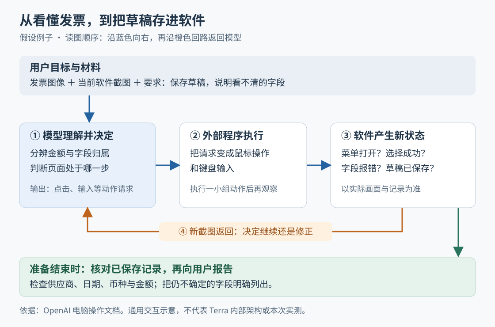

# GPT-6.1 Terra：让看屏幕、操作软件的智能体更快、更便宜

> 来源：[simonwillison.net](<https://simonwillison.net/2026/Oct/26/gpt-61-terra>)  
> 作者：Simon Willison · 发布时间：2026-10-26 08:00（Asia/Shanghai）  
> 翻译正文：[阅读中文正文](article-zh-CN.md)

让 AI 读懂一张发票，与让它把发票正确录入软件，是两件事。后者需要找到输入框、选择供应商、处理提示，再确认记录确实保存；每次判断都会增加等待和费用。GPT-6.1 Terra 针对的正是这类工作：把视觉理解、电脑操作和清楚表达组合起来，以较低价格完成需要反复观察与行动的任务。经常处理图像、表单和软件界面的读者，尤其值得关注它。

Simon Willison 在 2026 年 10 月 26 日的[原文《GPT-6.1 Terra》](https://simonwillison.net/2026/Oct/26/gpt-61-terra)中，抓住了这次发布的重点：模型的价值不能只按“整体聪明程度”排序，还要看它在具体工作上是否够用、够快、付得起。本文以用户提供的原文副本为主体，结合截至 2026 年 10 月 28 日查阅的一手资料，解释这项进展及其证据边界。

## 新意在哪里：把视觉操作能力放到更低的成本上

这里的“智能体”，指能根据目标调用工具、观察结果并继续行动的 AI 系统。Terra 是其中负责理解与决策的模型；浏览器、桌面控制工具和运行它们的程序，共同把决定变成实际操作。

“视觉推理”也不只是识别图中写了什么。它还需要结合布局和任务理解关系，例如判断某个金额属于哪一行、哪个按钮会打开正确表单，再选择下一步动作。原文强调的另一项能力是技术沟通：把处理过程和结果说明白，让用户容易理解。

OpenAI 的发布说明称，Terra 在专业任务基准 Agents’ Last Exam 上，以中等推理强度（控制模型推理计算投入的设置）比 GPT-5.6 Terra 高出 15 个百分点，任务成本约为其三分之一；在最高推理强度的比较中，完成任务的速度超过 GPT-6 Astra 和 GPT-6.1 Sol 的三倍。**这些是厂商报告的特定评测结果，不能直接推广到所有任务。** [来源：官方发布说明](https://openai.com/index/introducing-gpt-6-1-terra/)

因此，这次进展首先是能力、速度和价格组合的变化。公开材料没有提供足以复现 Terra 效率提升的专门算法说明。系统卡只说其数据和训练类型与 GPT-6 Astra 相同；不能据此认定它使用了某种特定的模型压缩方法，或发明了新的电脑操作流程。[来源：Terra 系统卡补充说明](https://deploymentsafety.openai.com/gpt-6-1-terra)

## 用一张发票理解它怎样工作

假设用户要求：“把这张发票录入会计软件，保存为草稿，并告诉我有没有看不清的字段。”这是解释机制的假设例子，不是 Terra 的实测案例。

系统先把发票图像、当前软件截图和用户要求交给模型。模型需要分辨供应商、日期、币种与金额，并判断软件当前处在哪个页面。若发票上某处模糊，合理的处理是指出不确定之处，而不是补出一个看似合理的数字。

接下来，模型输出操作请求，例如点击供应商输入框、输入名称、选择匹配项。真正执行鼠标和键盘动作的是外部程序。程序完成一小组动作后，再截取屏幕交给模型；模型依据新画面判断选择是否生效、是否出现提示，并决定继续填写还是修正。这个“观察—决定—执行—再观察”的循环，是电脑操作智能体的一条基本工作路径。[来源：OpenAI 电脑操作文档](https://developers.openai.com/api/docs/guides/tools-computer-use)

图中蓝色箭头表示操作向软件传递，橙色回路表示新截图返回模型。它描述的是公开工具机制，不代表 Terra 内部的神经网络结构。

为什么需要重新看屏幕？因为“发出了点击”只说明动作被请求，不能证明下拉菜单已经打开，更不能证明选中了正确供应商。官方接口甚至明确区分：一次工具调用标记为完成，只表示模型已经生成完该调用，应用仍须执行动作。保存草稿后，也应检查实际记录，而不只接受模型说“已完成”。[来源：工具调用状态说明](https://developers.openai.com/api/docs/guides/tools-computer-use)，[截图与结果检查示例](https://developers.openai.com/api/docs/guides/tools-computer-use-integration)

这也解释了速度为何有价值。一次任务可能经历许多轮观察和决策，单轮等待会不断累积。不过，软件加载、网络和执行工具也要花时间；模型计算更快，并不意味着整项工作必然按相同比例加速。这是从上述过程得到的分析，尚不是 Terra 在发票录入上的测量结果。

还有一个容易误读的边界：发布材料提到编辑视频，不等于模型接口原生接收视频。Terra 模型页列出的输入是文本和图像，输出是文本，音频与视频输入输出均标为不支持。操作视频编辑软件、查看截图，与直接理解连续视频输入，应分开看待。[来源：Terra 模型规格](https://developers.openai.com/api/docs/models/gpt-6.1-terra)

## 现有证据能证明什么

这是一项已发布模型的产品进展。讨论它时，需要把厂商评测、个人观察和真实应用效果分开。

**厂商评测提供了进步信号，但不等于独立复现。** Agents’ Last Exam，简称 ALE，是要求智能体完成较长专业流程、再检查实际成果的基准。它的[论文](https://arxiv.org/abs/2606.05405)介绍的是评测方法，并非 Terra 的训练方法。维护方同时区分“严格完成率”和“包含部分得分的平均成绩”：完成一部分要求可以得分，却不算完整通过。因此，发布说明中的“高出 15 个百分点”不能改写成“业务成功率提高 15 个百分点”。[来源：ALE 评分方法](https://snorkel.ai/leaderboard/agents-last-exam/)

**电脑操作基准本身也存在测量误差。** OpenAI 还使用了 OSWorld 2.1，这是一套让智能体在软件环境中完成多步任务的测试。Epoch AI 在 2026 年 9 月 28 日发布的审查中，从该版本的 108 个任务里抽查 50 个，在 36 个任务中发现问题，包括正确操作未获分、错误操作却获分等。这项审查针对基准，不是针对 Terra，也不能直接推算 Terra 被高估或低估多少。[来源：Epoch AI 的原始审查报告](https://epoch.ai/benchmarks/osworld-2-1/review)

OSWorld 维护方要求固定任务、素材、网站和运行环境版本，以保证比较口径一致。因此，判断 Terra 的相对提升，还需要知道具体使用了哪批任务文件、允许使用的工具、运行次数和评分方式；只有基准名称相同仍不够。[来源：OSWorld 官方仓库](https://github.com/xlang-ai/OSWorld-V2)

**员工判断和个人作品，适合提供线索。** 原文引用 OpenAI 员工 Ted Sanders 的评论，认为 Terra 的技术表达可能更好，视觉和电脑操作接近更高档模型且更快。但在同一讨论的后续回复中，他也说明自己没有做足够测试，不能把个人偏好推广成普遍推荐。这应作为带保留的判断阅读。[来源：Hacker News 原讨论](https://news.ycombinator.com/item?id=50248124#50249160)

原文还展示了“骑自行车的鹈鹕”绘图结果：最高推理强度的一次生成耗时 4 分 11 秒，费用约 0.113 美元。它能帮助观察生成图形的细节和一次调用的开销，但这类作品不能验证模型能否稳定地操作陌生软件。原文也没有提供长期生产应用的统计；本次查阅资料未形成对 Terra 业务效果的独立重复验证。

成熟度因此应分层理解：模型与工具接入已有官方文档，能力提升已有厂商评测，普遍的业务收益仍待具体任务验证。系统卡也提醒，研究环境或程序调用接口的结果可能与实际产品不同，因为系统指令、可用工具和推理设置会改变表现。[来源：系统卡的评测条件说明](https://deploymentsafety.openai.com/gpt-6-1-terra)

## 单价减半，为什么不一定让一项任务便宜一半

原文列出的 Terra 标准价格，与官方模型页一致：每百万输入词元 1 美元、每百万输出词元 5 美元。“词元”是模型处理与计费的基本单位，不等于一个汉字或一个英文单词。作为参照，GPT-6.1 Sol 的标准输入、输出单价分别为 2 美元和 10 美元。[来源：官方模型目录](https://developers.openai.com/api/docs/models)

但用户支付的是整段任务的消耗。举例说，较便宜的模型若需要更多次尝试、更多推理内容，或最终仍要人工重做，较低单价就可能被抵消。反过来，如果它在常见界面上已经足够准确，又减少等待，同样预算才可能支持更多工作。这是成本关系的分析，不是对 Terra 重试次数的断言。

此外，上述报价有条件。模型页列明：输入超过 272,000 词元时，整次请求的输入与缓存费率变为两倍，输出费率变为 1.5 倍；加速模式等设置也会改变价格。不能把简写的标准报价当作所有请求的固定费率。[来源：Terra 定价条件](https://developers.openai.com/api/docs/models/gpt-6.1-terra)

还要选择合适的推理强度，不能理解为“越高就必然越合算”。Terra 支持从不启用推理到最高强度的多个档位，默认是中等。官方指南建议先从中等开始，只有质量改善值得额外时间和词元消耗时再提高。[来源：GPT-6 使用指南](https://developers.openai.com/api/docs/guides/latest-model?model=gpt-6-astra)

## 值得关注哪些用途和后续信号

从上述机制推断，Terra 更值得优先尝试的，是输入材料明确、需要读图或操作界面、结果能直接检查的工作，例如票据录入草稿、按图核对产品信息、修改软件中的既有内容。这些是潜在用途，不代表都已有成熟部署证据。对于要求广泛知识、处理模糊目标或长时间自行推进的工作，现有材料不足以支持全面替换更高档模型。

如果较低成本下的操作能力在实际任务中得到重复验证，工作方式可能从“人逐步指导 AI 点击”，转向“人规定目标和验收结果，AI 完成中间操作”。技术表达能力在这里也有作用：用户需要知道哪些内容已经核对、哪里仍不确定。不过，叙述清楚仍须与事实正确分别检查。

想判断它是否适合自己，可以用同一批材料、同样工具和推理设置，与现用模型做小规模对照，记录最终结果是否正确、总耗时、总费用以及人工接手次数。OpenAI 的模型选择文档同样建议按相同输入比较 Terra 与 Sol，并检查保存结果和完成报告是否一致。[来源：官方模型选择建议](https://developers.openai.com/api/docs/guides/model-selection)

后续最值得跟踪的是：独立测试能否复现速度与费用优势；固定版本的评测是否同时报告完整通过率、部分得分和运行波动；真实工作中人工接手是否减少。它们将帮助回答这次发布留下的关键问题：Terra 的效率优势，究竟能在多大范围内转化为更省时、省钱且结果正确的电脑工作。
