# How We Built Our Design Agent

> **来源**: [https://www.langchain.com/blog/design-agent](https://www.langchain.com/blog/design-agent)  
> **作者**: Amal Irgashev Shreya Talegaonkar | **发布时间**: 2026-10-27T16:45:00+00:00  
> **深度调研**: [查看专题调研报告](research.md)  
> **标签**: 设计智能体, 品牌设计, 代码驱动媒体制作, 视频渲染, 多智能体协作, 智能体记忆, 人机协作, 自动化质量检查

---

## AI 导读

团队面对大量重复的营销素材需求，希望让员工在 Slack 中描述任务后，就能获得符合品牌要求的图片、演示文稿和视频。文章指出，模型能写制作代码，却未必理解设计意图；只提供字体和颜色，还不足以保证信息表达和视觉选择合适。

团队把设计原则、常见错误以及修改意见背后的理由写入可复用的任务指南，并用代码检查大小写等可明确判定的问题。早期系统提供了115个预制界面组件，但生成结果容易重复；作者称，底层模型升级后，删除多数补偿模型弱点的固定规则、保留设计原则，进一步改善了表现。

执行环境为每个对话保留独立的计算机和项目文件，主要制作内容由代码表达，便于局部修改。视频编辑和原创动画使用不同引擎，均按时间戳生成画面，支持抽查单帧和并行渲染。为减少昂贵的返工，系统先制作分镜，再制作配合音频检查节奏的粗剪，最后进入正式制作，并用代码强制执行必要审核。

长任务由主智能体拆分给多个后台执行单元，每个单元都有明确的文件归属和验收要求，主智能体继续接收团队反馈并汇报进度。团队还通过共享画布讨论具体画面，把即时偏好存入个人或团队记忆，并从完成的任务中提炼经验，供后续任务评价后再纳入指南。

作者报告系统已交付超过3000份素材，单次请求的模型费用中位数由约8美元降至约0.5美元。这些结果属于内部使用报告，未提供对照评测或完整成本核算；文章也未充分说明失败恢复和经验写入错误的处理方式。其主要价值是展示一套完整的制作与协作方法，效果仍需在具体团队中验证。

---

## 原文整理

## Key Takeaways

- **Taste comes from context.** Models already write good code, but they need your designers’ principles, guardrails against AI slop, and the reasoning behind feedback to make work that looks like yours.
- **Give the agent a designer’s computer.** Every Slack thread gets its own sandbox where the agent keeps the project between turns, works across a video engine, image tools, and a shared canvas, and inspects its own renders.
- **Delete rules when the model improves.** Rules that make up for a model’s weaknesses expire, so keep the design principles and remove the workarounds as models get better.
- **Long-running agents need multiplayer UX.** Big jobs run for hours on async subagents, so the Slack thread shows the plan, live progress, and an approval before anything ships, and anyone on the team can steer the agent mid-run.
- **You can fork it.** The open-source repo has the full harness, and Managed Deep Agents deploys it to your team’s Slack.

The promo above was made by Content Studio, our design agent that can create videos, social graphics, recreated UI images, slide decks, and more from just a single prompt in Slack. Every asset the agent produces is written in code.

Content Studio was built entirely in-house on [Managed Deep Agents](https://www.langchain.com/blog/introducing-managed-deep-agents). It’s now one of the most widely used GTM agents within our company, but it didn’t start out that way. Early feedback was… not great.

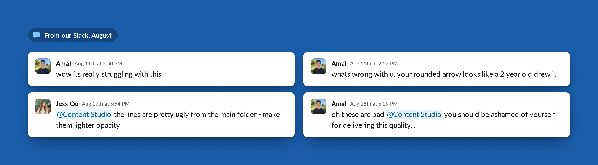

So how did we go from such low quality to this?

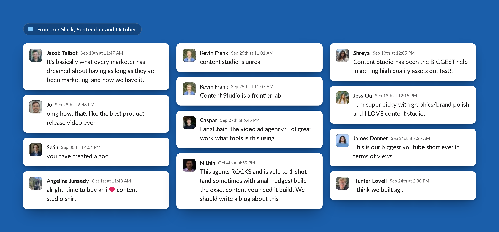

We've spent four months teaching Content Studio our taste and design principles, mostly by watching it get things wrong in front of the whole company.

This post walks through how our GTM Engineering team worked with our design team to build Content Studio from scratch: what good design means to us, how we taught the agent our taste, and the harness that lets it make anything from a still to a launch film.

**We've open-sourced our design agent.** Fork the [open-source repo](https://github.com/langchain-ai/design-agent), add your brand tokens, fonts and skills, and deploy it to your team's Slack with [Managed Deep Agents](https://docs.langchain.com/langsmith/python/managed-deep-agents-overview).

Then join us at[GTM Engineering Live](https://events.langchain.com/gtm-engineering-live-series/design-agent/) on October 28. We'll go under the hood of the harness and the UX, and show the work that didn't fit in this post.

## Building a design agent for scale

LangChain moves fast. We have constant product launch campaigns, webinars, blogs and events. Each initiative needs assets, from blog headers and diagrams to decks, videos and ad creatives. Our design team was stretched thin, with repetitive requests crowding out more strategic and innovative work. As a lean startup, we needed a low-friction way for anyone at the company to create high-quality, on-brand work.

To address these needs, we built Content Studio, a design agent that lives in Slack. A team member describes what they want and attaches accompanying content or briefs, and the agent returns finished, on-brand files. To build Content Studio, we needed three things:

1. **Our designers' expert judgment**, written into the agent's skills and checks so it knows what good looks like.
2. **A custom environment** around the model, including a video editing computer with tools for every layer of the design work.
3. **The right UX**, so a whole team can collaborate on a project that runs for hours from one Slack thread.

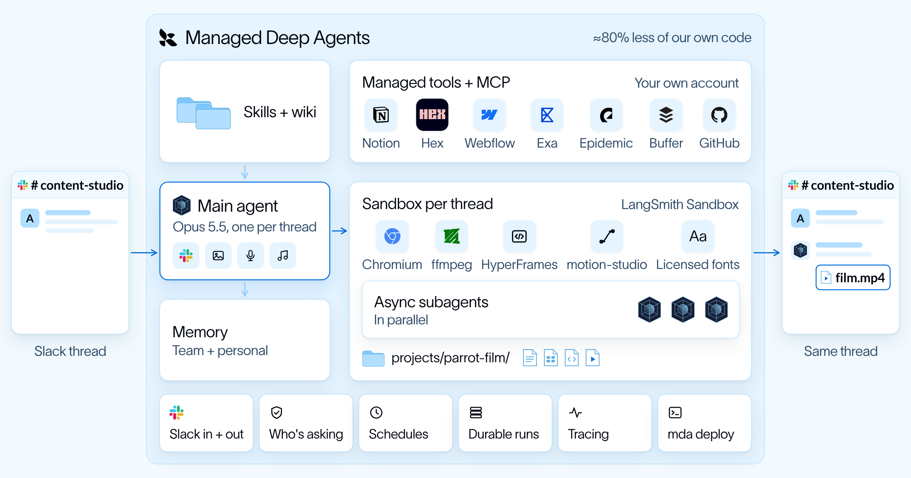

[Managed Deep Agents](https://docs.langchain.com/langsmith/python/managed-deep-agents-overview) gave us everything we needed to productionize Content Studio inside our company: a managed [LangSmith Sandbox](https://www.langchain.com/langsmith/sandboxes), integration with Slack, managed tools, scoped agent memory and scheduling agent runs. This allows a small team to spend its time on the design work, the skills, tools and Slack experience, instead of the plumbing.

## Key results

- Content Studio has delivered over 3,000 assets across the company, including more than 80 slide decks. One of its decks was even used in our most-watched organic YouTube video.
- Posts with its work drew about 4.5M views on X.
- On the LangChain account, posts with its visuals have earned about 2x the likes and 3.7x the bookmarks of other posts.
- Three in four requests now come from outside marketing, and 75% of users are repeat visitors who come back every week.
- The median request now costs about 50 cents in model spend, down from about $8 in mid-September. Our own code shrank by about 80% after the migration to [Managed Deep Agents](https://docs.langchain.com/langsmith/python/managed-deep-agents-overview).

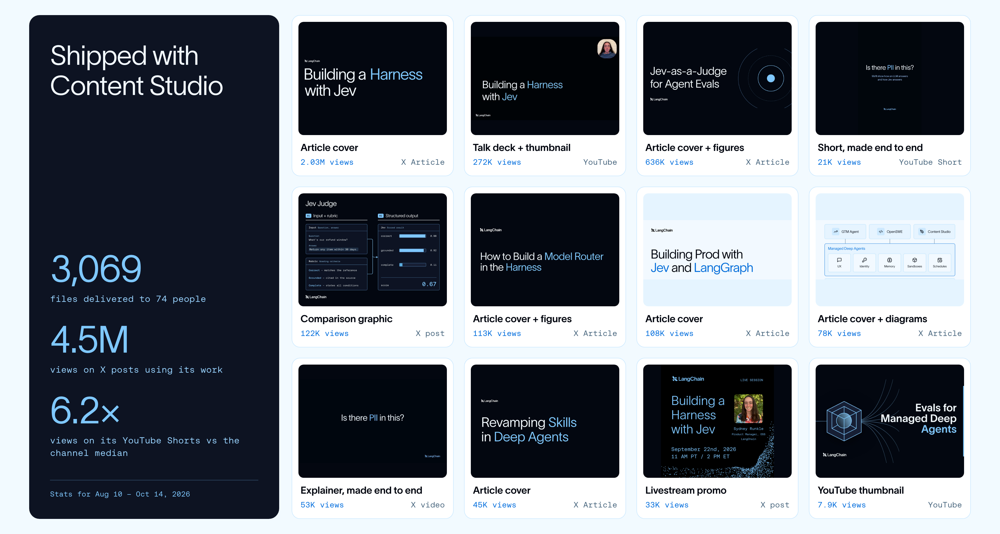

## Is AI actually good at design?

Before jumping into the build, let’s first address the debate of the century: can AI actually produce good design?

The model was already good at execution and could write HTML and CSS, chart specs and animation timelines. However, it didn't have our context, so it reached for familiar patterns, what [Anthropic calls “distributional convergence”](https://claude.com/resources/articles/improving-frontend-design-through-skills). The result could look polished and still look like a hundred others, or be beautifully animated and never get its point across. Familiar isn’t always bad, but we wanted our agent to make choices that followed its purpose.

[Katie Dill](https://www.youtube.com/watch?v=GLvFTMtw4Jk), Head of Design at Stripe, makes a helpful comparison. Under pressure to build quickly after World War II, builders copied the clean shapes and bare surfaces of modernism over and over. The copies kept the look while losing the thought and character behind it. Her warning is that AI can do the same to software. She calls it “zombie UI” and says we need a point of view, because “if you don’t, AI will give it for you.”

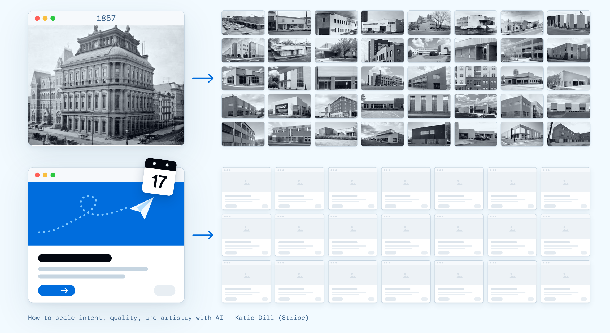

We don't think AI is bad at design. It just doesn't have a point of view unless you provide it, and giving it ours meant teaching it our taste.

## Teaching a design agent taste

Taste is the judgment that separates work that's correct from work that's good. In design, two layouts can use the right fonts, colors and spacing, and only one of them makes its point. Taste comes from what Dill calls "getting really good at noticing."

That noticing is how we learned to spot AI slop, which most often shows up when a brief leaves a decision to the agent.

For example, the image on the left below was created by a local coding agent with our brand skill (which includes colors, fonts, logos, etc.). But the final result missed critical components, such as the correct logo lockup, text alignment, and which colors were our primary vs. secondary brand colors.

The same prompt produced a perfectly on-brand image in Content Studio. This happened because the local agent filled in each decision that the brief didn't cover with what it had seen most. With this methodology, Content Studio filled the same gaps with our choices.

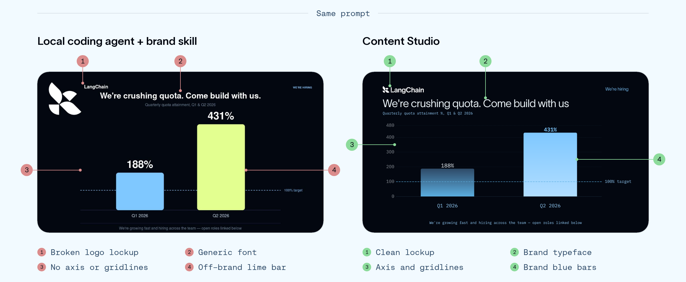

The guidelines we gave Content Studio started with the basics, including color tokens, font weights, spacing, and alignment. But much of the improvement came from what we added on top. We introduced design principles, like having one focal point per frame, guardrails against common AI design patterns, and the reasoning behind each piece of feedback. Combined with better underlying models, these helped Content Studio learn to think and communicate more like a designer.

It didn't start that way. In one of our early motion graphics, a bird flies off screen with a ribbon of light trailing behind it for less than a second. We asked for no sharp edges, but the first pass came back clunky, with harsh, rounded edges. A designer would have understood what we meant. The edges should soften, while the tail tapers and fades in the direction opposite the bird's movement.

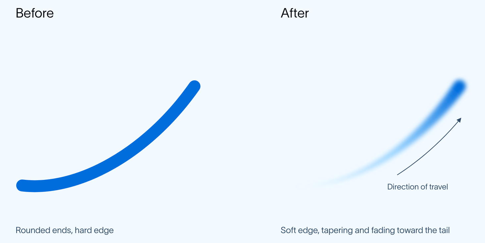

By a later iteration, the agent was evaluating that detail with a designer's eye. Using a quick sketch to identify where the bird's tail should be, it built its own frame-by-frame check to ensure the ribbon stayed attached. Most viewers would never notice the detail consciously, but they'd feel it if something was off.

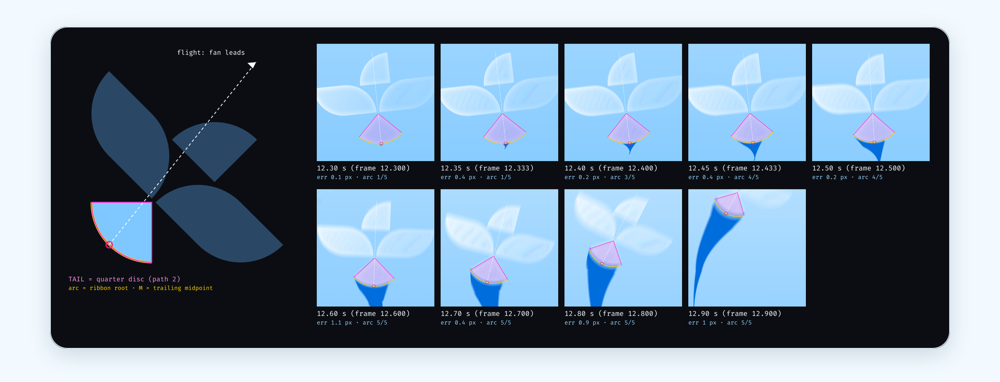

The measurable problems were the easiest to solve. Default capitalization used to come up frequently in reviews, but an automated check now catches every instance. The harder decisions are more subjective, like whether a campaign idea is strong enough, the message comes through clearly, or the execution resonates with the audience. When a designer makes one of those calls, we capture the reasoning in a skill so the agent can apply it to future drafts.

Content Studio changed who can do design work. A PM, engineer, or founder can brief the agent in Slack and walk away with something on brand and ready to ship. Three in four requests now come from outside marketing. For designers, the role has shifted closer to that of a creative director, setting the direction and reviewing the work rather than producing every asset themselves.

Getting the design judgment right was one part of the process. We also needed to give the agent the tools and environment to execute on it.

## Building a media harness

A designer works across several tools, from Photoshop for stills and a video engine for motion to a shared canvas for prototyping and collaboration. They also rely on brand guidelines, design assets, and company documentation.

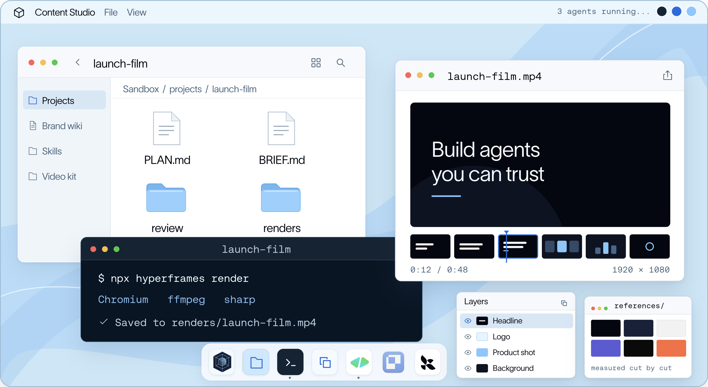

An agent needs a similar setup, with a computer to work on, tools for different parts of the design process, and the context a designer brings to their work. The harness brings these pieces together. [Deep Agents](https://docs.langchain.com/oss/python/deepagents/overview) provides the underlying [harness](https://www.langchain.com/blog/the-anatomy-of-an-agent-harness), including the agent loop, planning, files, subagents, and context management. [Managed Deep Agents](https://docs.langchain.com/langsmith/python/managed-deep-agents-overview) packages and runs it in production. We built the environment around it, giving the agent a computer where it can maintain a project, work across tools, and inspect the results.

### harness\_v1

Our first version of that harness tried to do the designing for the model. The early models needed a lot of help to make a motion graphic or a launch film we'd want to ship. To compensate for what they couldn't yet figure out themselves, our intuition was to put more of our own design judgment into instructions and code.

So, we built a design system with 115 reusable UI components for titles, layouts, and animations, along with guidance on when and how to use them. This gave the model a set of existing designs to work from, reducing the number of creative decisions it had to make from scratch.

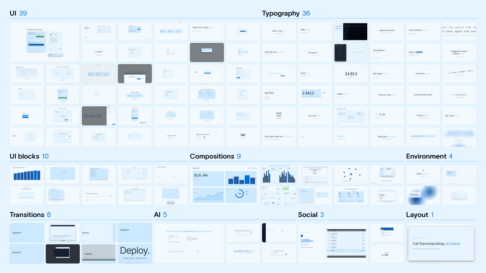

That helped it stay on brand, but the agent would just repeat the same layouts and animations for each frame without much variety:

We knew the models would eventually be great at this task, so we kept building the environment for that moment, experimenting with the skills and tooling along the way. Sometimes we'd add more references or more detailed instructions to help the model. Other times we'd remove them entirely and see what it could do on its own.

But the results still weren't where we wanted them, and closing the gap required increasingly more engineering work. We kept adding rules to the skills, writing more motion code, and building more components to compensate for what the model couldn't do.

Then Opus 5.5 arrived, and we saw an immediate jump in quality. We revisited the skills and removed most of the hard-coded rules, keeping the design principles and high-level guidance. The results improved further, with more variety and less repetition. The model was finally making creative decisions we'd previously tried to prebuild for it.

This was our [Bitter Lesson](http://www.incompleteideas.net/IncIdeas/BitterLesson.html). Rules designed to compensate for a model's weaknesses become less useful as models improve. What lasts is the environment around the model, including the tools it uses, the context it draws from, and how people guide its work. Instead of prebuilding creative decisions, we focused on making the harness flexible enough to take advantage of each new generation of models.

### Designer’s computer

To show the harness in action, we asked Content Studio to make a film about how it works with a video project end to end. The result stars a parrot in a pixel jungle narrated in the style of David Attenborough (voiced with ElevenLabs). Let's use it to walk through the layers of the harness: computer, tools and context behind its work.

Design is iterative. You make something, look at it and change it, often many times. So the agent needs a computer it can keep working on across a whole conversation. Each Slack thread gets its own [LangSmith Sandbox](https://www.langchain.com/langsmith/sandboxes), an isolated Linux machine with a filesystem and a shell, and the project lives there for the life of the thread.

Everything the agent creates is built with code, whether it's an HTML page for a slide, a data spec for a chart, or an animation timeline for a video. This makes it easy to iterate without starting over. If someone asks to bring the parrot in earlier, the agent can change a single timing value and render again without affecting the artwork or copy. With a flat image or generated video clip, even a small edit could mean recreating the entire asset.

The brief, plan, scene code, audio and renders all live in one project folder, which every subagent on the job works from.

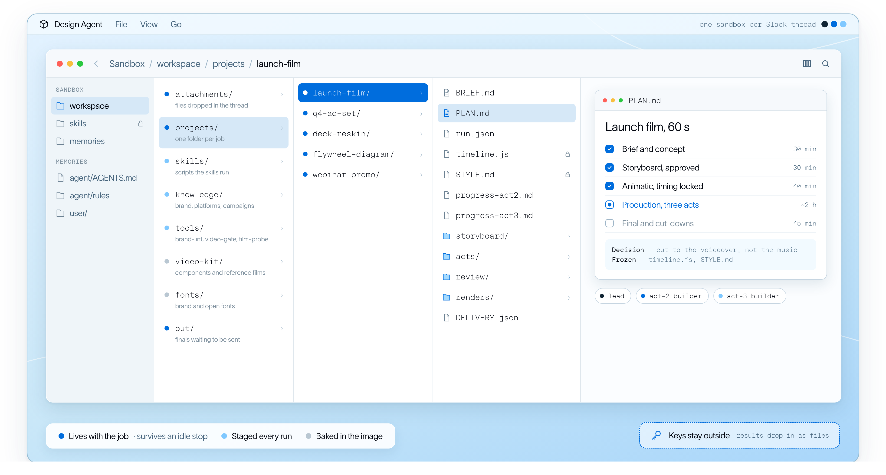

On top of that, we installed the tools a designer would reach for at each layer of the work:

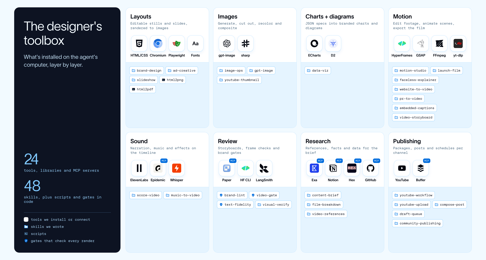

Motion is the most difficult layer. It runs on two engines:

1. **HyperFrames for editing:** [HyperFrames](https://hyperframes.heygen.com/), HeyGen's open-source video framework, turns a video into a web page. Clips, screen recordings, captions and text are just elements on that page, and a [GSAP](https://gsap.com/) timeline moves them around. So when someone asks to caption a webinar or cut a product demo, the agent edits it like a web page. Its CLI is basically the agent's editing suite: lint the composition, pull a frame to check, render the cut. We also install [HeyGen's official skills](https://github.com/heygen-com/hyperframes/tree/main/skills), so the agent learns the format from the people who built it.
2. **`motion-studio` for animation:** A web page can't blur fast motion, make things glow or turn a logo in 3D, and that's the finish we wanted for original animation. So we built our own canvas engine. The agent writes code that draws every pixel of every frame, and the engine blends up to 16 moments into each one, the same way a camera shutter blurs movement. The parrot film was made this way.

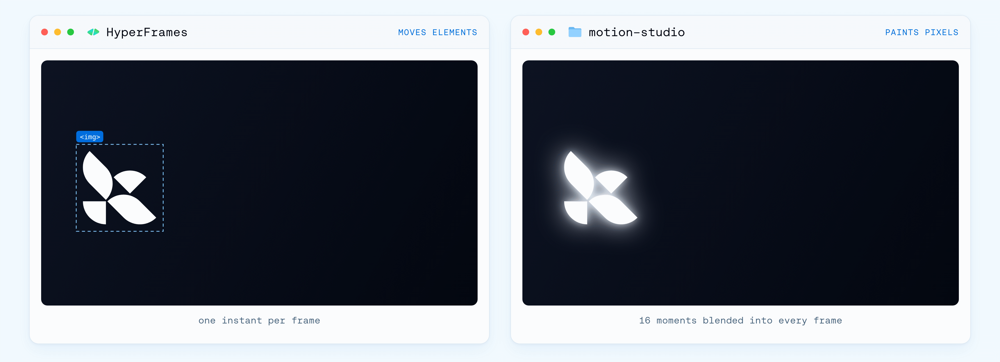

Both engines render each frame based on its timestamp, so a frame at ten seconds looks the same regardless of when it's rendered. This lets the agent inspect individual moments without rendering the entire film, while also allowing us to render multiple frames in parallel. Audio runs on the same timeline, keeping narration, music, and sound effects synchronized with the visuals.

With this setup, the agent can create almost anything. But without further guidance, it defaults to the model's own design choices rather than ours. The next challenge was teaching it to work within our brand and design standards.

### Designer's brain

We organized the agent's knowledge around four distinct functions, each with a clear purpose. Skills guide how to perform specific tasks, while the wiki provides context about our company and what good work looks like. Anything measurable is handled by a gate, a deterministic check written in code. A separate memory layer captures what people teach the agent over time.

#### Skills

The first thing the agent does with a request is work out what kind of job it is. That's handled by our `media-production` skill. We call it a **router skill** because most of it is one table. Each row maps a kind of ask (a campaign, a restyle, a thumbnail, a post, a YouTube package, a launch film, a short animation) to the path and the specialist skill that handle it. The router also decides whether the work needs a shared visual canvas, and it keeps small edits out of the full process.

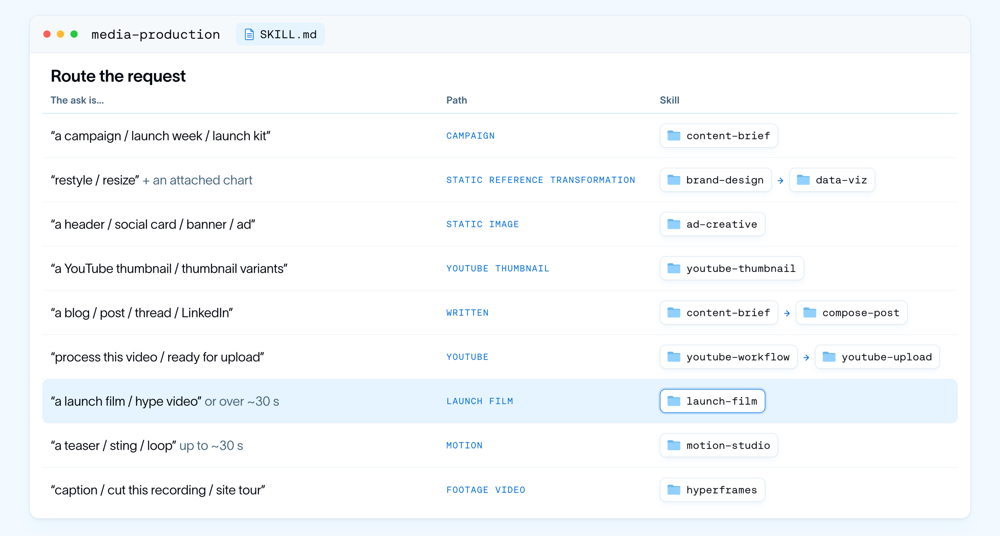

For a film like the one above, the router picks the `launch-film` skill designed for directing a large motion production. Each of our 48 skills, close to 1,000 files in all, is scoped to a job rather than a topic, so its description reads like a routing rule, including when not to use it.

Skills compose instead of repeating each other. `launch-film` directs and `motion-studio` makes the picture and sound, so the craft of animation is written once. `launch-film` also carries role briefs for the subagents it will start, and a case study of a real 88-second launch film we rebuilt shot for shot in code. That case study is where the agent learned how to split a film between subagents. It cuts at hard scene changes, keeps a continuous camera move with one subagent, and freezes shared code before anyone works in parallel.

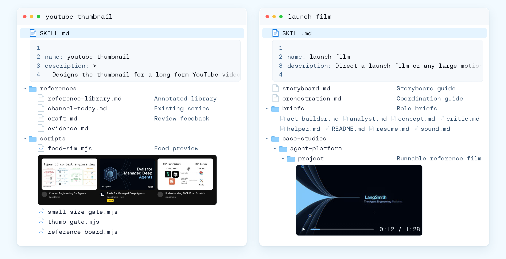

Descriptions matter for tools just as much as for skills. To keep context usage down, we put MCP tools behind a built-in search. The agent starts with only our own tools and loads additional tool schemas as needed, using keyword searches across tool names and descriptions.

#### Wiki

Skills explain how to do a job, while the wiki provides the context and reference material needed to do it well. It covers everything from brand tokens, graphic language, and voice to platforms, campaigns, and product information. A dedicated motion wiki covers directing, craft, sound, and review, alongside breakdowns of 70 reference films.

Rather than duplicating this information across skills, we link directly to the wiki. This keeps shared knowledge in one place and makes updates easier. When something like a font rule changes, we only need to update it once, and every skill can reference the latest version.

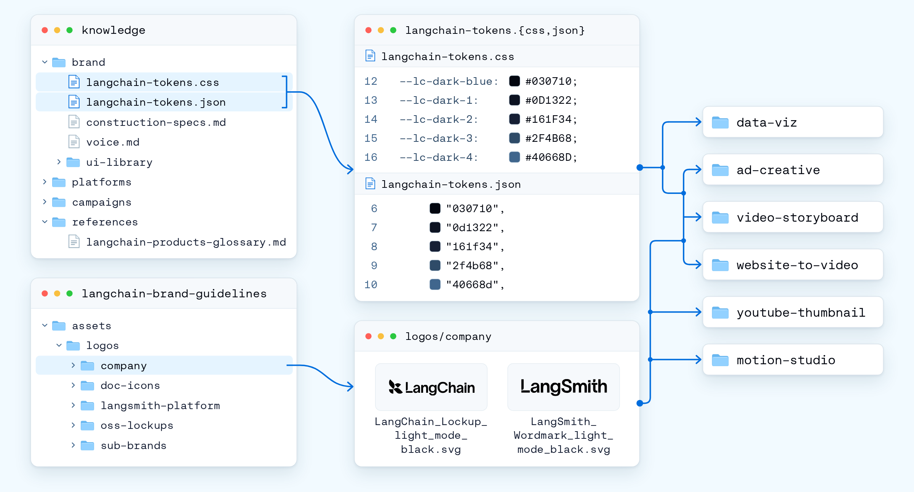

Knowing how we work doesn't necessarily make motion design cheaper. A wrong creative decision can still cost hours of rendering.

### Spec-driven design

Motion is especially expensive to get wrong, both in render time and tokens. A storyboard frame takes about 50 milliseconds to render, compared to 8 to 40 seconds for a single second of finished film. With subagents writing, rendering, and reviewing every act, those costs add up quickly. So the agent develops ideas in the storyboard first, where it can explore different directions cheaply, before moving into full production once a direction is approved.

To support that exploration, we gave the agent a library of reference films to draw inspiration from, much like a designer working from a mood board. When it can't find the right look, it uses an image model to generate new references, starting with quick drafts before refining the most promising options. These images help establish the visual direction, while the storyboard and final film are still built in code using real typography and brand assets.

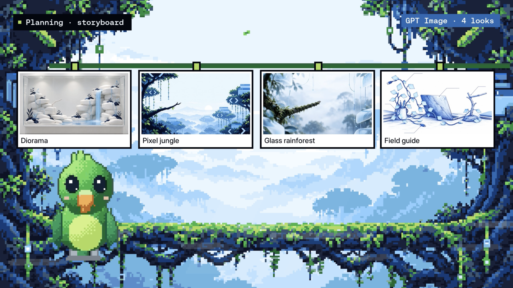

Once we pick a direction, the approved storyboard becomes the spec the rest of the film is built against. Then the project moves through three stages:

1. A storyboard, to agree on the visual idea, the copy and the shots.
2. An animatic, a rough cut timed to the audio, to check the pacing that stills can't show.
3. Production, where subagents build, check and render the approved shots.

We first described this order in the skill's instructions, and the agent sometimes skipped a review to save time. Now the pipeline enforces it in code, so assembly waits until every act passes review, while the instructions still guide the creative calls. The order that must always hold lives in code, and the judgment stays in the prompt.

#### Point, don’t prompt

Picking between those directions is a team decision. Slack works well for asking for work and receiving it, but a thread is linear text and a storyboard is spatial, so feedback ends up describing where something is instead of pointing at it, and every change, even a one-word fix, has to go back through the agent as a new prompt.

[Paper](https://paper.design/) solved this for us. It's a design canvas built with agents in mind, with an MCP server that gives the agent direct control over the file. People can work in that same file, comparing directions side by side, leaving comments on specific frames, or making edits themselves. Because the canvas is shared, the agent can return to the file and use those comments and edits to guide its next iteration.

The challenge was that Paper's agent tools only run inside its desktop app, while our agent operates in a cloud sandbox. To bridge that gap, we run Paper Desktop headlessly on an always-on Linux worker, using a virtual display and an authenticated bridge to connect the two. A single setup supports the entire team.

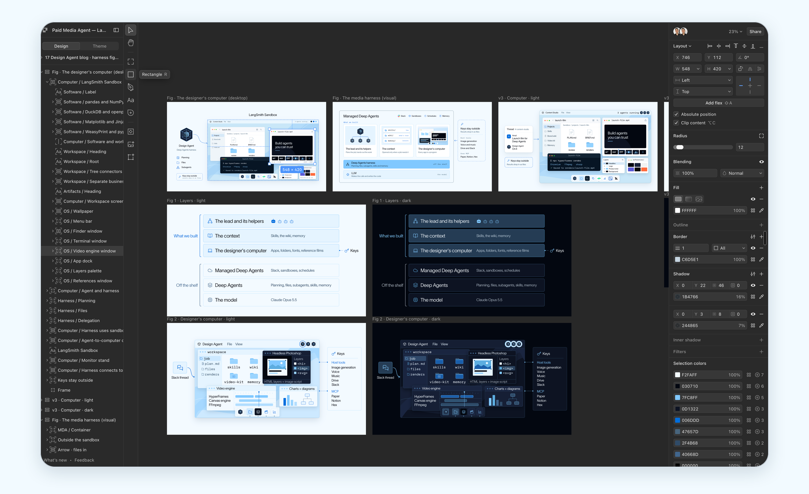

Even after approval, turning a storyboard into a finished film can take hours. By that point, the work resembles a small project, with multiple pieces being built in parallel that need to come together. Coordinating all of this is more than a single agent turn can handle.

### Agent as a chief of staff

Consider the parrot film from earlier, midway through production in Slack. One person shares a reference, another suggests a different opening, and a third leaves feedback on frame four, all while the agent is still building. It's like a brainstorm where the person taking notes is also responsible for making the film. Synchronous subagents don't work well here because the main agent has to wait for them to finish, leaving no way for people to interact with it in the meantime.

To solve this, we made subagents asynchronous and shifted the main agent's role from implementer to chief of staff. It breaks complex projects into smaller, isolated tasks, assigns them to subagents, and runs the work in parallel. Meanwhile, it keeps the team informed as things change, so people can continue giving feedback and steering the project.

For each task, the main agent creates a subagent profile with a clear brief covering its role, relevant context, file ownership, and how to validate the work. It also selects the model and effort level based on the complexity of the task.

We also added a small set of tools for the main agent to coordinate work:

- `start_task` hands a part to a subagent in the background
- `check_tasks` shows what's running and reads finished reports
- `cancel_task` and `resume_task` stop work that no longer fits the brief, or pick it up where it left off
- `report_progress` lets a subagent send updates mid-job
- `schedule_wakeup` gives the main agent a timer to trigger another run and continue the job

Under the hood, each subagent is the ordinary [Deep Agents](https://docs.langchain.com/oss/python/deepagents/subagents) `task` tool running as a background task. When it finishes, our code queues a new run of the main agent carrying the result. People can also steer the main agent mid-run, since a message that arrives while it's working is inserted before its next model call. The subagents coordinate through the project folder, each writing only the files it owns and keeping its progress on disk.

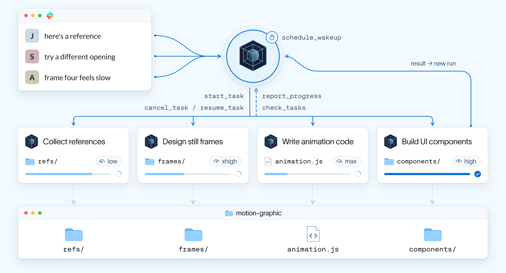

With the work running in the background, the thread has to show what's happening. The main agent keeps it up to date with a plan and ETA, a live status line with running subagents, render progress and spend, an acknowledgment for each edit, and an approval card before anything goes public.

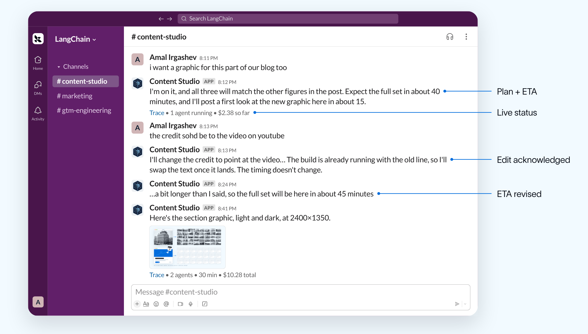

One of the clearest tests of this approach came from an overnight job to reskin a 52-slide presentation. The agent started by creating three sample slides and reviewing its own work before moving through the rest of the deck in numbered batches for approval. It also added two new slides along the way. Overnight, the main agent ran for about an hour while its subagents collectively worked for more than six hours, all without blocking the conversation.

### The self-improving harness

A designer who's worked with a team for months learns its preferences and doesn't need to hear the same feedback twice. Without memory, the agent would start from scratch with every new thread. To avoid this, we built two learning loops. The fast loop captures feedback as people give it, while the slow loop learns from completed projects in the background.

**The fast loop:** When someone shares a rule or preference, the agent saves it in the same turn. [Managed Deep Agents](https://docs.langchain.com/langsmith/python/managed-deep-agents-memory) stores memory as plain files in two layers, one shared across the team and another specific to each person.

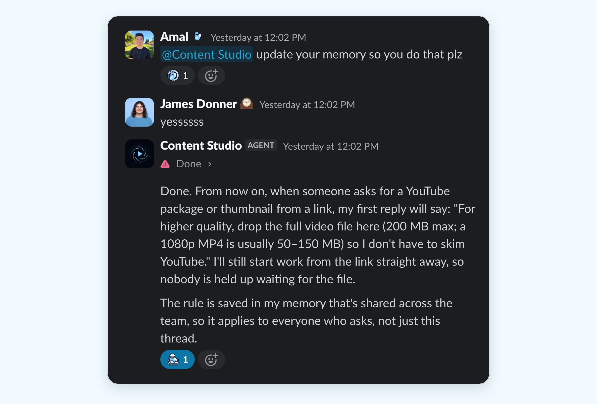

Personal preferences carry across threads, but shared standards take precedence, and anything created for a company channel follows the company voice. Each layer has an `AGENTS.md` file that loads with every model call. We now limit these files to a 200-line index after an early version grew to 500K tokens.

**The slow loop:** After each job, our `learn_from_job` tool launches a lightweight subagent that captures up to five evidence-backed lessons and associates them with the skill used. Future jobs read and rate those lessons, and once a week, a background agent incorporates the ones that prove useful into the skills and wiki.

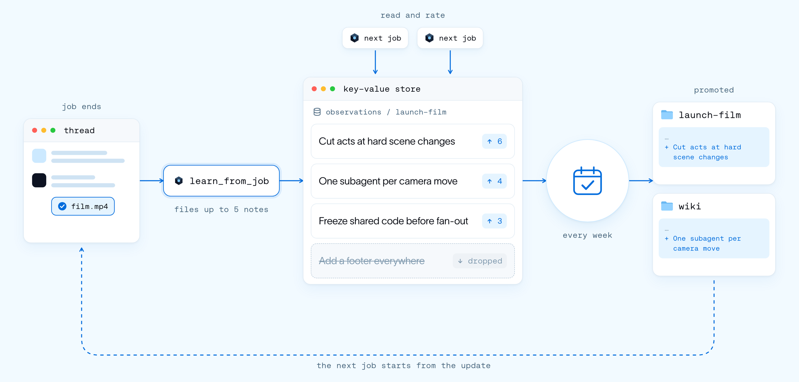

## What’s next

Remember those early reviews? The biggest improvement came from capturing our designers’ judgment in a shared environment the agent could learn from, rather than leaving it scattered across review threads. In the process, we made design work accessible to more people.

Next, we want the agent to manage the entire campaign lifecycle, and some of that is already working. It publishes company social posts through Buffer once an authorized approver signs off, drafts posts for employees to share from their own accounts, and runs scheduled routines, including a daily review that suggests posts worth quoting.

Our goal is to take this further, so a single approved creative direction can carry an entire campaign from one thread. The agent would write the brief, create assets for each channel, schedule posts, help the team amplify them, and use performance data to inform the next campaign. People would still review and approve everything before it goes public.

**Build your own design agent:** The [open-source repo](https://github.com/langchain-ai/design-agent) has the harness from this post: the sandbox computer, skills, wiki and memory, async subagents and the Slack UX. Fork it, add your brand tokens, fonts and skills, and deploy it to your team's Slack with [Managed Deep Agents](https://docs.langchain.com/langsmith/python/managed-deep-agents-overview).

Then join us at[GTM Engineering Live](https://events.langchain.com/gtm-engineering-live-series/design-agent/) on October 28. We'll go under the hood of the harness and UX, and show the work that didn't fit in this post.
