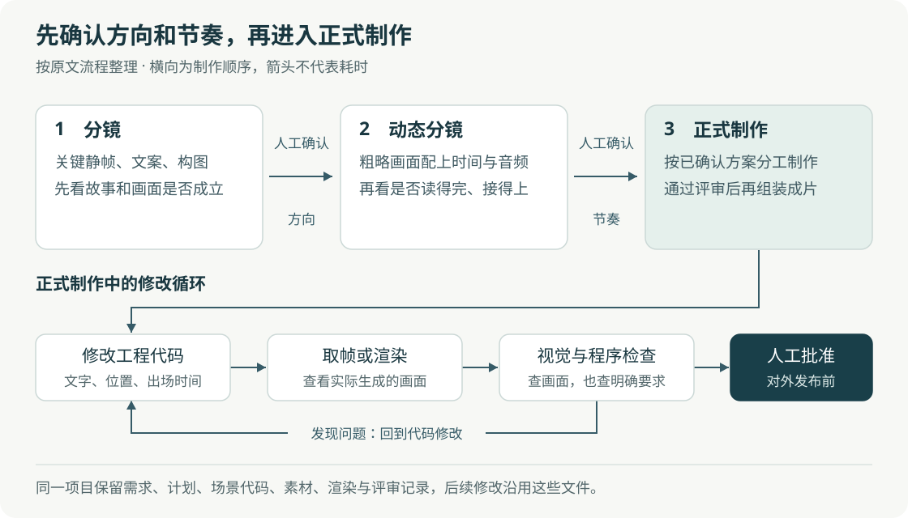
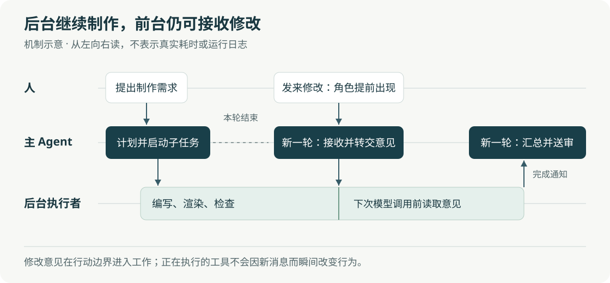

# LangChain 的设计 Agent：让 AI 在反馈中完成一项设计工作

> 来源：[www.langchain.com](<https://www.langchain.com/blog/design-agent>)  
> 作者：Amal Irgashev Shreya Talegaonkar · 发布时间：2026-10-28 00:45（Asia/Shanghai）  
> 翻译正文：[阅读中文正文](article-zh-CN.md)

让 AI 生成一张像样的海报，和让它持续做出符合公司要求的海报，是两个难度不同的问题。后者还要理解宣传重点、沿用品牌规范、接受多人修改，并在几小时的制作过程中保留工程，避免每次修改都从头生成。

LangChain 在 2026 年 10 月 27 日发表的 [《How We Built Our Design Agent》](https://www.langchain.com/blog/design-agent) 介绍了 Content Studio：员工在 Slack 中提出需求，它便能调用工具、编写代码、查看渲染结果，交付图片、演示文稿和视频。这类能分步行动并使用工具完成任务的系统，通常称为 **Agent，或智能体**。这项进展值得关注的地方，是它把设计师的判断、可修改的作品工程和持续的人机协作结合起来，展示了 Agent 如何承担一项反复评审的创作工作。

它目前属于有内部应用和公开仓库支持的工程案例。原文没有提出新的模型训练算法，也没有通过独立对照实验，证明系统已经获得普遍适用的审美能力。理解它，关键是看清哪些步骤使结果变得可控，以及这些步骤还有哪些边界。

## 从“把角色提前出现”看它怎样工作

假设产品团队需要一段发布短片：先说明用户的问题，再展示产品，最后出现品牌标志。初稿完成后，设计师提出“开头太慢，把角色提前出现，标题再留久一点”。这是为解释流程构造的例子，不是实际测量案例。

如果手中只有一段已经生成好的视频，修改角色出场时间，可能要重新生成片段，再处理新旧画面衔接。Content Studio 则保留场景、文字、音频和动画时间线；Agent 可以修改对应的出场时间和标题持续时长，重新渲染受影响的内容，再检查结果。时间线就是一份记录各元素何时出现、移动和消失的安排。

但“可以改代码”还不够。角色提前后，会不会挡住标题？旁白是否还在讲上一件事？这些问题要求系统看到实际画面，也要求人能在制作途中改变方向。因此，它围绕模型提供了一套运行支架：保存工程、调用工具、安排子任务、检查结果并接收反馈。原文把这套支架称为 **harness**；它的作用，是让模型的多次行动接得起来。

这种做法更适合文字、图表、界面和动态图形等能用代码表达、又经常需要修改的内容。对于摄影质感、复杂人物表演或高度依赖手工塑形的创作，代码工程本身并不能保证质量。

## “教会品味”，实际是在补足决策依据

原文描述了一个很具体的失败：团队要求鸟身后的光带“没有锐利边缘”，Agent 却做出了生硬的圆角。设计师真正想要的，是光带沿鸟运动的反方向逐渐变细、变淡，根部仍然接在尾巴上。后来，Agent 根据草图建立了逐帧检查，确认连接位置没有脱开。

这说明，颜色和字体正确，只能解决一部分问题。“没有锐利边缘”没有说清楚形状怎样变化、变化方向是什么，也没有解释这种变化要表达速度。设计师补充这些理由后，Agent 才有依据把模糊反馈变成可执行的修改。

Content Studio 为此区分了四种材料：

| 材料 | 告诉 Agent 什么 | 具体作用 |
| --- | --- | --- |
| 技能 | 这类任务应该怎样做 | 接到短片需求时，先做分镜，再检查节奏，最后制作 |
| 知识库 | 公司和设计工作的背景是什么 | 查询字体、品牌用色、产品信息和参考作品 |
| 程序检查 | 哪些明确要求必须满足 | 检查字体、颜色、文案大小写、文件尺寸等 |
| 记忆 | 过去的反馈中，哪些值得再次参考 | 保留团队惯例或个人偏好，减少重复说明 |

这里的**技能**主要是按需读取的任务说明和配套资源，并不意味着重新训练了一套模型。公开的 [`media-production` 技能](https://github.com/langchain-ai/design-agent/blob/main/skills/media-production/SKILL.md) 就是一张任务分流表：图表、静态图片、分镜和长短视频分别走不同流程，小修改也不必经历完整制作过程。

按需读取很重要。制作图表时需要数据表达规范，裁剪图片时则不必同时读完整套电影制作指南。Anthropic 此前也用[前端设计技能](https://claude.com/resources/articles/improving-frontend-design-through-skills)展示过类似思路。因此，本案例的新意主要在于把任务知识、真实工程和反馈流程结合起来，而不是首次发明用技能指导设计。

程序检查与审美判断也各有边界。仓库的[检查工具说明](https://github.com/langchain-ai/design-agent/blob/main/workspace/tools/README.md)明确指出：品牌检查会扫描生成作品所用的代码；它不能通过扫描压缩图片的二进制内容，可靠判断其中的颜色和字体。系统仍然需要查看渲染后的像素。即便颜色、字号都通过检查，也不能据此断定宣传重点清楚、创意有吸引力。

## 作品为什么要保留成代码工程

原文为每个 Slack 讨论串分配一台隔离的 Linux 工作环境，也就是**沙箱**。需求、计划、场景代码、素材和渲染文件保存在其中，后续对话继续修改同一个工程。[公开架构文档](https://github.com/langchain-ai/design-agent/blob/main/docs/architecture/README.md)也描述了这种按讨论串保存工作文件的方式。

这并不表示所有素材都由代码从零绘制。系统会调用图像、配音和音乐工具；代码负责组织这些素材，并控制文字、布局、运动和输出。可编辑的核心，是作品的构成方式。

视频制作尤其能体现这种区别。原文使用 HyperFrames 处理网页式的视频编排，以 GSAP——用于安排网页元素动画的 JavaScript 库——描述运动；另用自建的 `motion-studio` 绘制原创动画。按照作者介绍，后者可以在一帧内混合多个相邻时刻的画面，产生类似相机曝光时的运动模糊。这是作者对其引擎的说明，本文没有复测其画质或渲染速度。

需要修正原文的一处笼统表述：它说网页无法实现发光或三维标志等效果。HyperFrames 官方资料实际提供了 [Three.js 三维绘制接入方式](https://github.com/heygen-com/hyperframes/blob/main/skills/hyperframes-animation/adapters/three.md?plain=1)。因此，双引擎更适合被理解为该团队对制作方式和画面效果的选择，不能当作网页技术的能力边界。

更关键的共同点是：**给定时间，就能得到对应画面，而不必先从头播放。**

例如，若输出设为每秒 30 帧，第 90 帧对应时间 `90 ÷ 30 = 3` 秒。渲染器把动画定位到这一时刻，让文字、位置和媒体状态就位，再截取画面。Agent 因而可以只检查角色入场或标题离场的瞬间；满足条件时，不同帧也可以交给多个工作进程分别渲染。HyperFrames 的[确定性渲染文档](https://github.com/heygen-com/hyperframes/blob/main/docs/concepts/determinism.mdx)说明了这一机制。“确定性”在这里指同样的输入和渲染条件会产生同样的结果。

这个性质有前提。动画不能依赖电脑此刻的真实时间或未固定的随机数，素材需要提前加载，输出尺寸和帧率也要确定。字体和浏览器版本不同仍可能造成差异。因此，“按时间取帧”是需要遵守约束的工程能力，不是把任意网页保存下来就自动成立。

## 先确认画面和节奏，再支付完整制作的代价

可修改的工程能减少返工范围，但如果故事方向一开始就错了，仍可能白做大量工作。Content Studio 因而把短片制作分成三个阶段：

1. **分镜**：用关键静帧确认要讲什么、画面如何组织、文字放在哪里。
2. **动态分镜**：将粗略画面按时间与音频排列，检查节奏、停留时间和转场。
3. **正式制作**：在获准的方向上完成细节、检查并渲染成片。

分镜能发现标题太挤，却不能判断观众是否来得及读完；动态分镜补上时间维度。这两个阶段分别消除不同的不确定性，之后才值得投入昂贵的精细制作。

图中横向表示制作顺序，下方表示正式制作期间反复发生的修改。它根据原文流程整理，不表示各阶段耗时比例。

原文称，一张分镜约需 50 毫秒渲染，而一秒成片需要约 8—40 秒。这两个数字分别对应一张静帧和一秒视频，工作量不同，而且缺少完整硬件与画面复杂度说明，不能据此计算通用加速比。它们能支持的判断是：在该团队的工作中，先用便宜的草稿讨论方向，有助于减少昂贵的返工。

另一个有代表性的变化，是把必要的评审顺序写进程序。作者最初只在技能里要求评审，Agent 有时为了省时间会跳过；后来改成制作流程必须等各部分通过检查后才能组装。这里没有把所有设计判断固定成模板，而是把“什么时候可以继续”交给程序，把“怎样才更好”留给模型和人。

人在这一过程中也不必只用文字描述位置。系统接入 Paper 共享画布，团队可以并排比较方案，直接修改文字或对某一帧发表评论。**MCP 是让 Agent 以统一方式调用外部工具的协议**；[Paper 官方文档](https://paper.design/docs/mcp)确认，Agent 可以借此读写设计文件。原文所述云端部署还需要把 Paper 桌面程序运行在 Linux 工作节点上，再通过桥接连接沙箱，并非连接一个纯云端接口即可完成。

## 长任务的关键：后台继续做，前台还能改

一部短片或几十页演示文稿，可能需要多个执行者分别制作。这里的**子 Agent**，就是接收局部任务、独立调用模型与工具的执行者。

如果主 Agent 发出任务后一直等待子 Agent 返回，团队的后续意见便难以及时进入正在进行的工作。Content Studio 把这些任务放到后台运行：主 Agent 安排好工作后结束当前轮次，等到有人发来修改、子任务完成或定时检查触发时，再开始下一轮处理。

这张图是机制示意，不对应真实运行日志或耗时。所谓“持续在线”，主要依赖事件触发多轮行动，并不要求主模型在几小时里不停思考。

每个子任务需要明确负责哪些文件、使用什么素材，以及如何验证。原文还给出了一条很实际的拆分经验：在明确的场景切换处分工；连续镜头运动尽量由同一个子 Agent 负责；并行工作前先固定共享代码。原因是多个执行者即便各自做好局部，也可能修改同一段代码，或者让镜头运动在交接处断开。

公开的 [Slack 交互文档](https://github.com/langchain-ai/design-agent/blob/main/docs/architecture/surfaces.md)进一步解释：主 Agent 会在下一次模型调用前读取新消息，也能把意见传给后台执行者。正在运行的工具并不会因此瞬间改变行为。异步协作缩短的是等待和反馈路径，不保证修改立即生效，也不意味着增加子 Agent 就能按比例加速。

## “越用越好”，主要改变的是以后读到的材料

Content Studio 的学习分为快慢两条路径。快路径是在收到明确偏好时保存笔记；慢路径是在项目结束后提炼带证据的经验，供后续任务参考和评价，再定期整理进技能与知识库。

这里的“学习”主要是更新外部文件和参考材料。原文没有描述通过这些反馈更新模型参数，因此不应把它理解成模型在每次使用后自动完成训练。

文件式记忆也要控制体积。[托管服务的记忆文档](https://docs.langchain.com/langsmith/python/managed-deep-agents-memory)区分了每次调用都会加载的简短索引，以及需要时才读取的详细材料。前者越长，每次行动要处理的无关内容就越多。这与“把全部历史对话永久塞进提示词”不同。

而且，一次成功未必能推出通用规则。例如，某次短片用暗背景效果好，不代表所有产品图都该改成暗背景。仓库的[任务协调文档](https://github.com/langchain-ai/design-agent/blob/main/docs/architecture/orchestration.md)说明，经验笔记会接受有用或有害的评价，有害评价占优的笔记可以删除，展示时也只是待权衡的观察。这样的筛选机制有助于避免偶然经验固化，但资料尚未证明它能长期、稳定地提高设计质量。

## 已经有哪些证据，还不能推出什么

原文报告，系统已交付超过 3,000 项素材、80 多份演示文稿，四分之三的请求来自营销部门以外。这些数字与公开作品说明，它的应用范围已经超过单次演示；但它们仍是作者自报，不能替代对失败率、人工修改量和验收质量的完整统计。

| 证据 | 能支持的判断 | 仍然缺少什么 |
| --- | --- | --- |
| 鸟尾光带、发布短片等作者示例 | 系统能完成部分复杂制作，并根据反馈修改 | 随机抽取任务的成功率，以及得到展示作品前的全部尝试 |
| 模型费用中位数从约 8 美元降至约 0.5 美元 | 作者报告模型调用费用明显下降 | 任务结构和模型变化的影响；渲染、工具与人工评审的完整成本 |
| 使用其视觉素材的帖子获赞约为其他帖子的 2 倍，收藏约为 3.7 倍 | 作者观察到内容表现存在差异 | 对选题、发布时间、受众和曝光量的控制，无法据此认定设计造成增长 |
| 公开仓库及评测说明 | 制作流程与客观检查有可查阅的实现资料 | 跨品牌的独立复现，以及稳定的审美质量评测 |

数字均来自原文，不能直接当作其他团队的预期收益。本文核验的是公开说明与关键机制，没有运行完整系统，也没有复现其费用或营销效果。

公开的[评测文档](https://github.com/langchain-ai/design-agent/blob/main/docs/evals.md)列出了 19 项设计任务，并检查文件交付、尺寸、时长、文案、工具调用顺序和费用等。这有助于判断系统是否完成要求，却没有自动回答作品是否有吸引力；文档明确没有用模型为审美打分，并另外保留人工评审记录的位置。

作者还把一次明显改善与升级到 Opus 5.5、删除大量硬编码规则联系起来。这是一项值得参考的工程观察：为补偿旧模型缺陷而增加的模板，可能限制新模型。但原文没有把模型升级和规则删减分别做对照实验，因而无法确定各自贡献。它支持定期重新评估限制性规则，不能推出“规则越少，效果必然越好”。

## 值得跟踪的是反馈能否稳定改变下一次工作

这项案例提示了一种可能更常见的分工：业务人员提出需求，Agent 承担制作与机械检查，设计师花更多时间说明方向和评审关键选择。这个变化在反复生产、品牌规范明确的材料上更容易发挥作用；如果工作主要依赖原创概念探索，人工判断仍可能占据大部分时间。

后续最有价值的信号，是其他品牌能否复现结果，以及同类任务的人工修改量、总成本和验收时间是否持续下降。对“自我改进”的进一步验证，还应比较读取经验笔记前后的表现，观察错误经验会不会扩散。只有把这些变化测出来，才能区分系统在积累有效知识，还是仅仅积累了更多文字。

原文设想进一步连接素材制作、审批、排期和效果反馈；其中获授权审批后发布社交内容等功能，作者称已经使用，完整活动流程仍是发展方向。对读者而言，当前最值得借鉴的动作已经很具体：保留可修改的工程，把设计反馈写清理由，在昂贵制作前确认方向，并让客观检查与人的判断分别承担合适的工作。

本文依据所选原文及截至 2026 年 10 月 28 日查阅的官方资料撰写。正文链接指向原文、公开仓库与相关工具文档；仓库主分支和托管服务仍在变化，实施细节应以使用时的版本为准。
