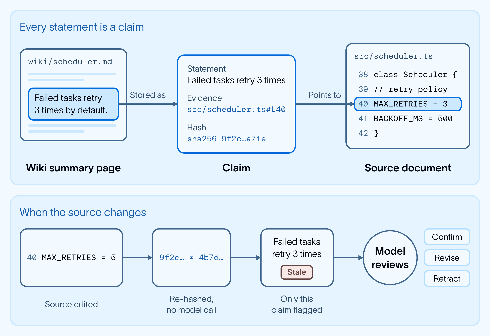
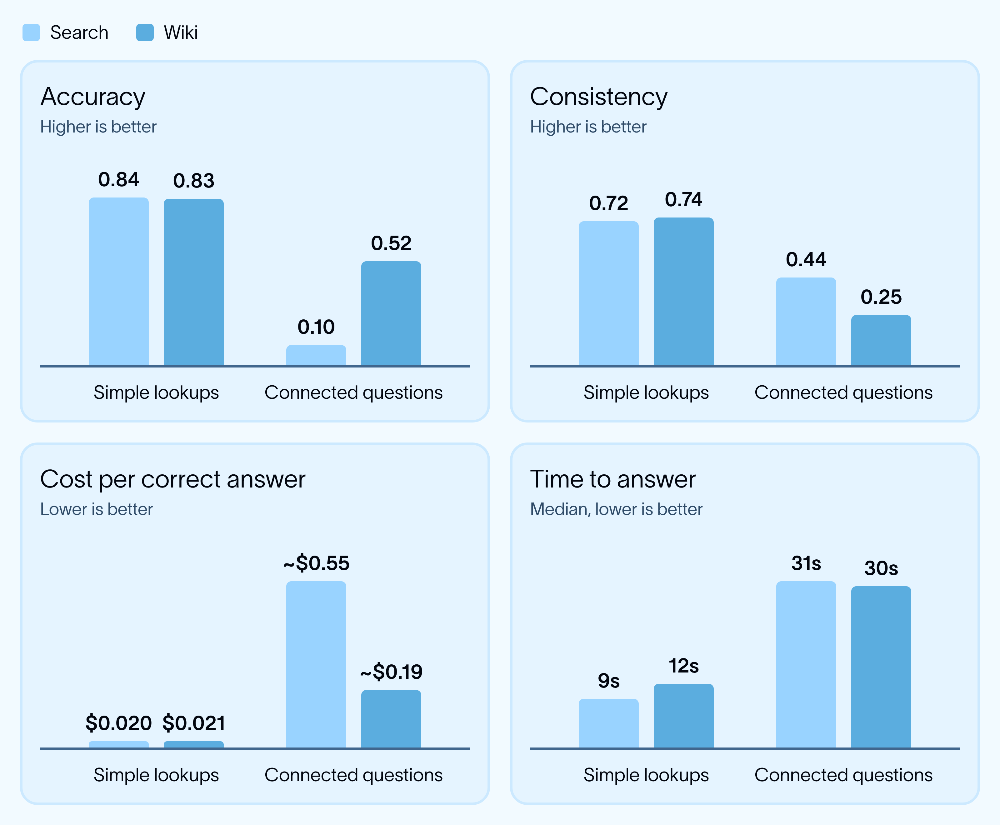
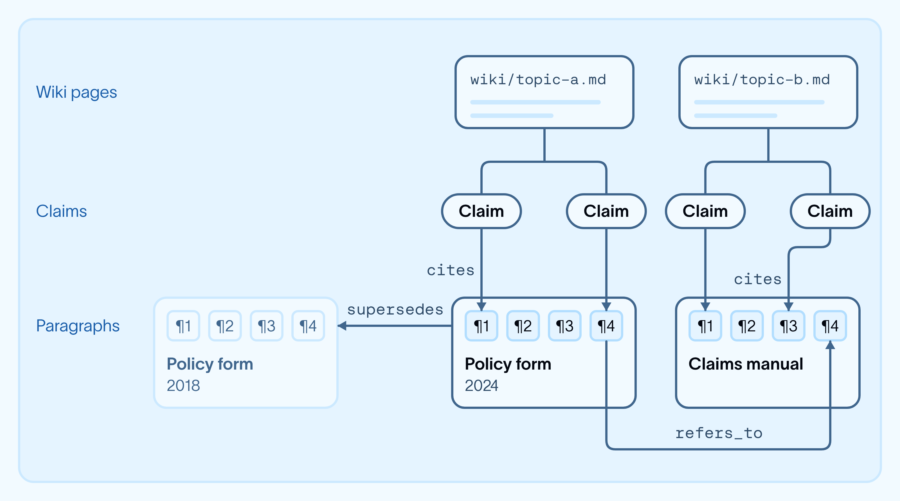
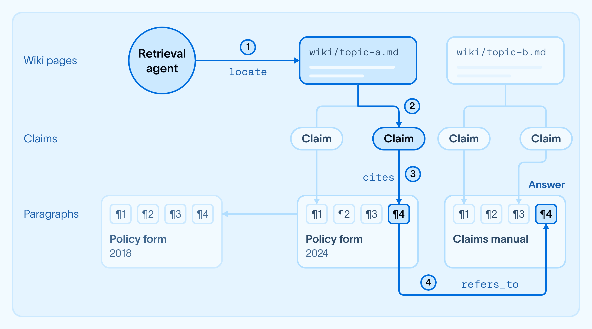
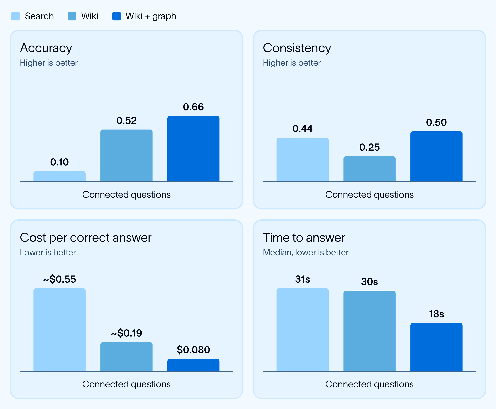

# 如何使用 OpenWiki 和图构建有证据依据的智能体记忆

> **来源**: [https://www.langchain.com/blog/building-agent-memory-openwiki-graphs](https://www.langchain.com/blog/building-agent-memory-openwiki-graphs)  
> **作者**: 未知 | **发布时间**: 2026-10-28T17:24:00+00:00  
> **深度调研**: [查看专题调研报告](research.md)  
> **标签**: OpenWiki, 智能体记忆, 跨文档问答, GraphRAG, 证据溯源, 知识更新, 检索评估

---

## AI 导读

文章讨论智能体在多份文件中寻找适用规则时，如何避免每次重新梳理引用、修订和覆盖关系。作者先用 OpenWiki 将原始资料整理成互相链接、带原文引用的知识页面，供智能体反复使用。页面中的主张绑定来源行及其哈希值，也就是用于识别内容变化的摘要；来源变化后，仅将受影响的主张交给模型复核。

实验使用111份合成保险文档和972条事实记录，设置80道简单查询与50道跨文档问题，每题运行三次。在模型、指令和问题相同的条件下，比较关键词搜索与增加知识页面后的表现。跨文档问题的准确度从0.10升至0.52，每个正确答案的成本从约0.55美元降至0.19美元；简单查询的准确度基本不变，耗时从9秒增至12秒。

知识页面仍存在引用不稳定的问题。作者进一步构建证据图，即把主张、页面和原文段落用注明关系类型的连接组织起来，让智能体直接沿引用或替代关系寻找依据。工具先定位起点，再沿关系展开；遇到分支仍由智能体选择。相较仅使用知识页面，作者报告准确度相对提高27%、引用一致性翻倍、中位回答时间下降40%、每个正确答案的成本下降58%。引用一致性衡量多次回答是否引用相同证据，并不等于答案正确。

这些结果支持将该方法用于反复发生的跨文档推理。回答成本未计入知识页面的初次构建和更新，图中的引用也可能继承模型错误。实验基于合成资料，缺少真实业务验证及完整复现信息，不能据此推定其他领域或更强检索基线下也有相同收益。

---

## 原文整理

## 要点

- **编译生成的 wiki 能为智能体提供领域背景；如果只靠检索，这些背景就需要重新梳理。** 在需要综合多个来源的问题上，将 OpenWiki 作为记忆层的智能体，其准确度是仅使用 grep 工具的智能体的 5 倍。
- **加入证据图，有助于智能体沿着 wiki 中的引用找到支撑证据。** 我们将引用和文档间的参照关系转化为明确的图边，供智能体沿着这些边查找。与仅使用 wiki 相比，这使智能体引用相同证据的一致性翻倍，准确度提高 27%，每个正确答案的成本降低 58%。
- **将编译生成的记忆用于需要反复进行的跨来源推理。** wiki 保存领域知识和复杂关系。加入证据图可以提高准确度和检索一致性。不过，对于简单查询，不使用记忆的智能体准确度相当，而且速度更快。

智能体在处理组织内的政策、手册、wiki、工单和代码时，必须在分散于不同系统和团队的知识中寻找线索。找到相关段落只是第一步。它们还需要判断哪些规则适用、发生了什么变化，以及一个来源会如何影响另一个来源。

持久化的记忆层可以保存知识及其关系，让智能体在不同任务中重复使用。没有记忆层，智能体往往每回答一个问题，都要重新梳理这些知识和关系，导致成本高、容易出错。在银行和保险领域，这个问题尤其棘手，因为政策和指引经常会相互修订或替代。

我们测试了开源 wiki 编译器 [OpenWiki](https://docs.langchain.com/oss/openwiki/overview)，将其用作这一记忆层。对于需要联系多个来源才能回答的问题，使用 wiki 后，智能体的准确度约为仅靠搜索时的 5 倍。在此基础上加入证据图，将 wiki 中的陈述连接到支撑它们的段落，并关联相关来源，准确度又提高了 27%，引用一致性也翻了一倍。

## 为什么要使用编译生成的 wiki？

RAG 流程通常通过语义搜索或混合搜索检索出彼此独立的文本块，再由智能体拼出这些文本块之间的关系。我们曾探索通过[智能体式 RAG](https://www.langchain.com/blog/agentic-rag-with-langgraph) 和[基于图的元数据过滤](https://www.langchain.com/blog/graph-based-metadata-filtering-for-improving-vector-search-in-rag-applications)来改进检索，但找到相关段落只是工作的一部分。跨来源问题还需要追踪引用、处理相互冲突的规则，并理解依赖关系。记忆可以保存这些理解，让智能体不必每次回答问题都重新梳理。

编译生成的 wiki 通过整合源资料，生成相互链接的页面，解释关键概念及其关系，从而提供这样的记忆层。wiki 会随来源的变化而更新，为智能体提供可以重复使用的背景信息。

[OpenWiki](https://docs.langchain.com/oss/openwiki/overview) 是我们基于 [Deep Agents](https://docs.langchain.com/oss/python/deepagents/overview) 构建的开源命令行工具，可以生成这种带有来源引用的 wiki。我们最初开发它，是为了让编程智能体不必在每项任务中重新摸清架构和代码的行为。



OpenWiki 中的每条陈述都基于一项**主张**，也就是一项关联了支撑来源行及其哈希值的断言。当这些行发生变化时，哈希值也会改变，因此 OpenWiki 无需调用模型，就能标记受影响的主张。这既节省了 token 成本，也让内容过时检测更具确定性。只有这些受影响的主张才会交给模型确认、修订或撤回，让记忆层可以随着来源变化自行纠正。我们在[《在 OpenWiki 中构建可自我纠正的记忆》](https://www.langchain.com/blog/self-correcting-memory-openwiki)中介绍了这一机制。

## 构建测试文档库

我们构建了一个包含 **111 份长篇文档**的合成保险文档库。之所以选择保险领域，是因为保单和批单经常会相互**引用、修订，并覆盖原有规定**；正是这类跨文档依赖关系增加了检索难度。

为了给基准测试评分，我们建立了一份包含 **972 条事实的台账**，并控制每条事实应出现的位置、文档之间的引用方式，以及不同版本之间的变化。我们使用大语言模型生成这些事实周围的文本，并通过自动检查确保必要事实都已包含在内。

最后，我们刻意让语料变得杂乱，混入**过时版本、矛盾内容、间接引用链、不同措辞，以及非常长的文档**，以更贴近智能体在真实企业文档库中面临的情况。

## 我们如何配置实验

我们在两种条件下评估了同一个检索智能体：**搜索**（对原始文档进行关键词搜索）和 **Wiki**（同一个智能体可以访问由 OpenWiki 编译生成、带有来源链接的 wiki）。底层模型、指令、文档和问题都保持不变，唯一变化是智能体能否访问编译生成的记忆。

我们测试了 **80 道简单查询题**，以及 **50 道需要关联推理的问题**。后者需要沿着文档之间的依赖关系查找，例如确定哪些内容依赖某项条款，或在该条款变化时会受到影响。每道题都提问**三次**，以衡量不同运行之间的差异。

**指标（如何衡量“更好”）：**

- **准确度（0–1）：** 由评分器依据从 972 条事实台账中整理出的核对清单，检查答案及其引用的证据；包含必要事实得分，出现矛盾则扣分。
- **一致性（0–1）：** 三次运行所引用证据的重合程度，即各次运行的引用集合两两之间的 Jaccard 相似度均值。它衡量的是智能体能否稳定地以*相同*来源为依据，而不是答案是否正确。
- **成本与延迟：** 每道题的模型费用（美元）和实际耗时。

## wiki 在哪些方面有帮助，又在哪些方面遇到了困难



OpenWiki 将包含 111 份文档的文档库编译成一个约为原始大小十分之一的 wiki，花费 4.15 美元。之后再加入 17 份文档，每份成本约为 0.09 美元。**以下分析不包含编译和更新成本，只报告检索与回答的成本。**

我们将简单查询作为对照。这些只需单个段落即可回答的问题，很少需要跨文档的保险领域背景，因此我们并不预期 wiki 会有多大帮助。搜索与 wiki 的结果相近：准确度分别为 0.84 和 0.83，引用重合度分别为 0.72 和 0.74，每个正确答案的成本分别为 0.020 美元和 0.021 美元；但延迟从 9 秒增加到了 12 秒。

需要关联推理的问题，则要求智能体利用领域特有的关系，综合多个来源进行推理。在这类问题上，wiki 将准确度从仅使用搜索时的 0.10 提升到 0.52，约为原来的 5 倍。编译后形成的背景信息帮助智能体运用领域知识，以更少的工具调用找到相关关系，将每个正确答案的成本从约 0.55 美元降至 0.19 美元。

尽管准确度和成本都有改善，使用 wiki 的智能体在检索证据时仍不够一致。引用重合度从简单查询时的 0.74，降到了关联推理问题上的 0.25。引用稳定性并不衡量正确性，但证据变化可能导致答案变化，尤其是在来源相互冲突时。对于关键业务，团队需要的是可以复现、可以审计的答案，而不只是更高的平均准确度。

wiki 帮助智能体跨来源运用领域知识。剩下的挑战，是让寻找支撑证据的路径更容易重复遵循。

## 加入证据图

为了让检索更一致，我们加入了一个轻量的**证据图：它将 wiki 中的引用转化为主张、wiki 页面、段落和主题之间明确且带有类型的边，形成一张关系图。** OpenWiki 的引用原本是 Markdown 文件中的文本参照。证据图将这些引用落实为带类型的边，使它们成为持久保存的连接。这样，智能体就有了可以稳定遵循的路径，不必通过搜索反复发现同样的联系。



我们分两步构建这张图：

1. **将每个段落存储为一种新的基本单元。** 通过确定性的处理流程，将每份文档拆分为段落，并为每个段落分配唯一标识符。这些段落成为信息的原子单元，让主张可以连接到确切的支撑段落，而不是整份文档。
2. **用带类型的边连接段落。** 我们用带类型的边连接段落、主张和 wiki 页面：主张 `cite`（引用）段落，新文档 `supersede`（替代）旧文档，章节 `refers_to`（参照）其他文档。每条边都说明具体关系，而不只是表示两者相连。我们通过两种方式构建边。其中一些是通过确定性方法从文档参照中提取的。由于 wiki 主张已经带有文本引用，我们无需再次调用模型，就能将其转化为 `refers_to` 和 `supersedes` 等带类型的边。

这张图的构建耗时不到一秒，并解析了测试文档库中所有明确的交叉引用，因此智能体可以沿着链接查找，不必每回答一个问题都重新发现这些联系。

证据图的作用是帮助查找证据，而不是对组织知道的一切进行建模。综合整理仍由 wiki 完成。与大量依赖信息提取的知识图谱流程不同，这一层复用已有的参照和引用，而不是用模型提取实体并协调其间的差异。构建过程无需额外调用模型，不过，从 wiki 派生的边仍取决于其中由模型生成的引用是否准确。



智能体通过两个工具在这张图中查找：`locate` 寻找与问题匹配的起点，`expand` 沿着起点的连接查找支撑段落和相关文档。只有一条路径时，`expand` 会自动沿着它前进；出现分支时，则由智能体选择下一步走哪条路。这种先定位相关节点、再收集相连背景信息的模式，也出现在 [Microsoft 的 GraphRAG](https://microsoft.github.io/graphrag/) 等 GraphRAG 系统中。

```
@tool(parse_docstring=True)
async def locate(terms: str, within: str | None = None) -> dict:
    """Find where to start: match the question's words against document titles,
    section headings, wiki pages, and claim statements."""
    ...
@tool(parse_docstring=True)
async def expand(node: str, edges: list[str] | None = None, hops: int = 1) -> dict:
    """Open one node and list its typed edges (cites, refers_to, supersedes,
    amends, attaches_to, and their inverses). With hops > 1 and one edge type,
    walk that edge while there is a single path, and stop at a branch."""
    ...
```

## 更高的准确度、更低的成本、更快的回答



与仅使用 wiki 相比，加入明确的证据路径后，各项指标都有改善。准确度提高了 27%，引用一致性翻倍，回答耗时的中位数下降了 40%，每个正确答案的成本下降了 58%。证据图通过更有针对性的检索，补充了 wiki 提供的背景信息，在提高准确度和一致性的同时，并未使智能体变得完全确定。

## 什么时候加入记忆才值得？

编译生成的 wiki 最适合用于需要反复进行的跨来源推理。在我们的实验中，wiki 帮助智能体直接运用领域关系，而不必通过搜索重新梳理这些关系。但仅靠记忆层，尚不能让证据检索保持一致。加入明确的图边后，引用一致性和准确度都有提高，检索工作量也有所减少。

wiki 为轻量证据图提供了坚实基础。这张图通过确定性方法，从 wiki 已有的引用和文档参照中派生出来。由此，我们无需额外调用模型，也不必对组织知道的一切进行建模，就能加入明确的证据路径。

wiki 是否值得投入，取决于复用程度。我们报告的回答成本不包含编译费用，而每新增一份文档的成本约为 0.09 美元。对于简单查询，单靠搜索就有相同的准确度，而且更快，因此资料导入和持续维护的成本可能超过检索节省的费用，尤其是在企业规模下。

当多个智能体反复回答涉及同一批分散来源的问题时，成本与收益的权衡就会改变。共享 wiki 保存了这些来源之间的关系，图边则引导智能体找到支撑证据。在我们的测试中，这种组合带来了更准确的答案，也降低了每个正确答案的成本。只要复用足够多，避免反复重建背景信息所节省的费用，就能抵消构建和维护记忆的成本。

## 下一步

接下来，我们希望以更动态的方式构建 wiki，只编译并保留智能体回答跨来源问题所需的背景信息，而不是编译整个仓库。

我们还希望探索将主张和带类型的边作为其他智能体记忆的基础。将知识与证据相连，并检测它何时变化，可能有助于为语义记忆（事实）、情景记忆（发生过什么）和程序性记忆（如何做事）提供依据。

想为你的智能体加入 wiki？请查看我们的 OpenWiki 资源：

## 致谢

感谢 Colin Francis 和 Nick Hollon 就 OpenWiki 和评估提出的见解！