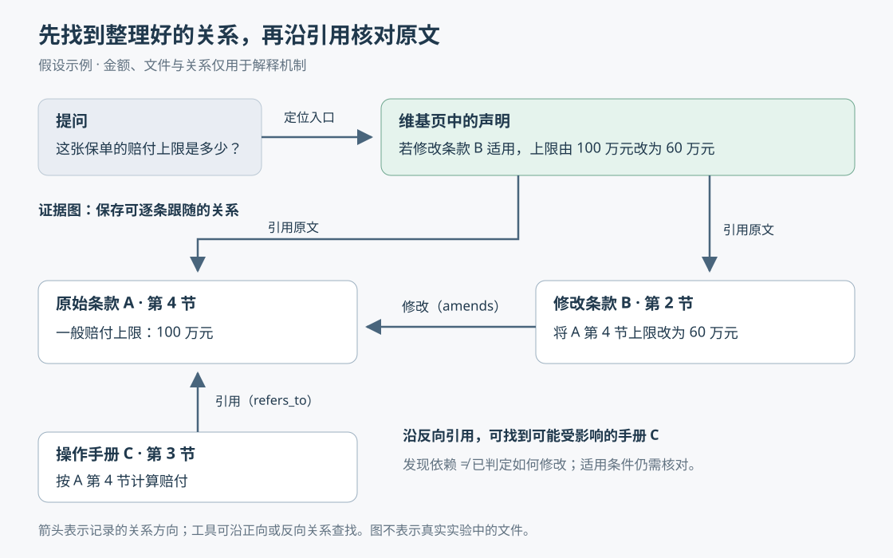

# OpenWiki 与证据图：让智能体记住关系，也找得到依据

> 来源：[www.langchain.com](<https://www.langchain.com/blog/building-agent-memory-openwiki-graphs>)  
> 作者：未知 · 发布时间：2026-10-29 01:24（Asia/Shanghai）  
> 翻译正文：[阅读中文正文](article-zh-CN.md)

智能体能搜到一条规定，却未必知道另一份文件已经修改了它。每次回答都重新翻阅资料、拼接关系，既耗时，也容易漏掉例外。LangChain 在 2026 年 10 月 28 日介绍的做法，是先把资料整理成可复用的维基，再把结论与原始段落之间的引用、修改和替代关系保存成可查询的图。对于反复涉及多份资料的问题，这种组合值得关注；对于查一个电话号码或一条定义，额外整理可能没有收益。[原文：How to build evidence-grounded agent memory with OpenWiki and Graphs](https://www.langchain.com/blog/building-agent-memory-openwiki-graphs)

这里的 **Agent（智能体）**，指能调用搜索、阅读等工具完成任务的模型系统；“记忆”则是保存在模型之外、可供后续任务读取的资料，并不意味着模型参数发生了学习。这项进展的重点，是保存“已经理解过的关系”和“为什么这样理解”，减少下一次从头寻找依据的工作。

## 一个问题，为什么不能只找最相关的段落

假设一家保险公司的资料库中有三份文件：原始条款 A 写着赔付上限为 100 万元；适用于某类保单的修改条款 B，把 A 第 4 节的上限改成 60 万元；操作手册 C 则要求员工按照 A 第 4 节计算赔付。这是解释机制的假设例子，不是原文披露的真实业务案例。

用户问“这张保单的赔付上限是多少”，搜到 A 还不够。智能体还要发现 B，判断 B 是否适用于这张保单，再把两份文件放在一起解释。如果用户改问“修改第 4 节会影响哪些操作说明”，系统还得反向找到引用该条款的 C。

这些问题的困难不只是关键词不匹配，而是**相关资料之间存在有方向、有含义的关系**：修改、替代、引用，以及各自的适用范围。找到“100 万元”和“60 万元”两段文字，不等于已经知道应该采用哪个数字。

常见的 **RAG（检索增强生成）**，会先检索外部资料，再让模型据此回答。检索本身可以做得很复杂，但如果只把若干独立片段交给模型，这些跨文件关系仍需在回答时重新拼出来。OpenWiki 的思路，是把其中可复用的整理工作提前做一次。

## 先把资料整理成可复用的解释

[OpenWiki 官方文档](https://docs.langchain.com/oss/openwiki/overview)将它定位为一个开源命令行工具：读取代码或知识来源，生成并维护相互链接的 Markdown 维基。Markdown 是便于人和程序共同读取的纯文本格式。智能体可以先读整理好的主题页，再按需查看原始资料。

原文称这个过程为“编译”。这里并非把文档变成可执行程序，而是让模型把分散的内容整理成主题、解释和关系，并保存下来。在前面的例子里，一页维基可以说明：一般上限来自 A，特定保单受 B 修改，C 依赖相关条款。下次提问时，智能体便有了查找方向，无须先从所有文件中重新发现这组关系。

但这一步有一个风险：整理后的解释可能写错，或者在来源更新后过时。为此，OpenWiki 使用 **声明（claim）**，也就是一条可以单独检查的事实判断，并将它连接到支持它的来源。比如，“某类保单的赔付上限为 60 万元”应当有对应条款作为依据，而不能只留下一段流畅的总结。

因此，维基的价值不只是缩短材料。它把已经做过的理解保存为可读取的上下文，同时保留回到来源的入口。原文实验中，维基约为原始资料体量的十分之一；这个比例只是该资料库的结果，不能当作通用压缩率。[来源：原文](https://www.langchain.com/blog/building-agent-memory-openwiki-graphs)

## 再把引用变成可以逐步跟随的证据图

只有维基还不够。即使页面已经附上引用，模型仍可能每次选择不同的来源，或花很多次搜索才找齐依据。原文增加的 **证据图**，就是把这些关系保存成程序可以直接查询的连接。

图中的“节点”表示维基页、声明、原始段落等对象；“边”表示对象之间的具体关系。它不是只记录“这两份文件有关”，而是区分“这条声明引用这个段落”“这份文件替代旧版”“这一节引用另一份文件”。关系类型告诉智能体接下来该检查什么。

构建分两步。程序先将原始文档切成段落，为各段分配唯一标识，使引用可以落到具体位置；然后把已有引用和文档中的明确交叉引用转换成带类型的边。原文还展示了修改关系 `amends`、引用关系 `refers_to`、替代关系 `supersedes` 等工具可遍历的类型。[来源：原文](https://www.langchain.com/blog/building-agent-memory-openwiki-graphs)

读图时，先从上方的问题进入维基声明，再沿“引用原文”向下检查 A 和 B。B 指向 A 的修改关系解释了为什么两个上限不能平等对待；从 A 反向查找引用者，可以发现手册 C。图能帮助找到需要检查的对象，却不会自动证明 B 适用于某一张保单，也不会自动决定 C 应如何改写。

智能体通过两个工具使用这张图：`locate` 根据问题中的词，在标题、章节、维基页和声明里寻找入口；`expand` 打开节点，返回它连接的证据与相关对象。按原文展示的接口，当指定一种关系并允许多步遍历时，工具可以沿唯一的路径继续走，遇到分叉再交给智能体选择。这样，程序负责沿已知连接移动，模型负责选择方向和解释内容。

这能解释作者观察到的收益：维基减少重复理解，图减少重复找路。它也解释了为什么系统仍不是完全确定的——入口选择、分支选择和最终解释仍可能变化。

“构图不增加模型调用”需要准确理解：**已有引用转换成边的阶段**不需要再次让模型抽取关系，并非整个记忆构建过程不使用模型。维基本身由模型生成，其中的引用也可能出错。作者报告，在这个测试库中，构图不到一秒并解析了全部显式交叉引用；这不能证明任意格式、任意规模的企业资料也能达到同样效果。[来源：原文](https://www.langchain.com/blog/building-agent-memory-openwiki-graphs)

把图用于检索并非首次出现。微软的 [GraphRAG 官方文档](https://microsoft.github.io/graphrag/)介绍了从文本抽取实体和关系、形成群组并生成摘要的流程。相比这类做法，本次方案更聚焦：复用维基已有的整理结果与引用，主要解决“怎样走回证据”。这是方法侧重点的区别；原文没有提供与微软 GraphRAG 的对照实验，不能据此判断谁总体更好。

## 来源变了，怎样知道哪些记忆需要重查

证据路径解决的是“去哪找”，来源版本解决的是“是否还值得相信”。两者相互配合，但不是同一个机制。

OpenWiki 为声明记录支持它的来源位置和内容版本。更新维基时，程序先读取当前证据，与保存的版本比较。内容不同，就把依赖它的声明标为需要重新核验；随后由模型检查声明是否仍成立，决定保留、修改或撤回。**检测到变化，只说明需要重查，不说明原结论一定错误。**[官方机制说明：Building Self-Correcting Memory in OpenWiki](https://www.langchain.com/blog/self-correcting-memory-openwiki)

稍深入地看，[仓库的声明文档](https://github.com/langchain-ai/openwiki/blob/main/openwiki/concepts/grounded-claims.md)与[证据解析源码](https://github.com/langchain-ai/openwiki/blob/main/src/claims/evidence/repository/resolver.ts)显示，代码证据可指向具体文件和行范围，内容版本使用哈希计算。哈希是由内容算出的指纹，用来检查内容是否变化，不负责理解内容含义。行范围还结合上下文帮助重新定位，减少单纯行号移动带来的影响。

这个机制也有边界。假设新文件新增了一个例外，却没有改动原声明绑定的段落，仅比较那些旧段落的指纹，不能保证发现新例外。这是根据检测方式得出的限制分析，不是原文报告的失败案例：发现新增依赖仍需要额外研究和更新。

还要区分实验设想与现成产品能力。[当前仓库 README](https://github.com/langchain-ai/openwiki/blob/main/README.md#grounded-claims)明确说明，声明追踪适用于代码仓库维基及仓库证据，连接器导入的事实并不在同样的声明覆盖范围内。因此，不能把保险资料实验解读为各种企业资料接入后都已自动获得完整的版本核验能力。

## 实验究竟证明了多少

这篇材料是一份作者团队发布的技术实验报告。它给出了受控语料与对照结果，证据强于单次演示；但它不是独立复现，也不是企业生产应用的验证报告。

作者构造了 111 份长篇保险文档，以 972 条事实作为评分依据，用大语言模型生成周围文字，再自动检查必需事实是否出现。资料中刻意加入旧版本、矛盾、间接引用和不同表述。测试包括 80 道简单查询、50 道跨文档关联题，每题运行三次。搜索与维基对照保持底层模型、指令、文档和问题相同。[实验设置与下表数据均来自原文](https://www.langchain.com/blog/building-agent-memory-openwiki-graphs)

| 问题类型与指标 | 原文关键词搜索 | 增加维基 |
| --- | ---: | ---: |
| 简单查询：准确性评分 | 0.84 | 0.83 |
| 简单查询：回答延迟 | 9 秒 | 12 秒 |
| 简单查询：每正确答案成本 | 0.020 美元 | 0.021 美元 |
| 跨文档题：准确性评分 | 0.10 | 0.52 |
| 跨文档题：每正确答案成本 | 约 0.55 美元 | 约 0.19 美元 |

这里有三个容易误读的地方。

第一，“准确性”是评分器依据事实清单，对答案与引用证据打出的 0—1 分数，包含对缺失事实和矛盾的处理。它不能直接读成“52% 的题完全答对”。原文所谓约 5 倍，来自 0.52 与 0.10 的比值，反映的是这一评分的提高。

第二，原文搜索基线是关键词搜索、使用 grep 一类工具查原文，不能代表所有现代 RAG 系统。实验支持“相对于这个搜索基线，预先整理关系帮助了关联题”，并不支持“所有检索方案都被提高了 5 倍”。

第三，收益集中在跨文档题。简单查询没有显示准确性提升，延迟反而增加；对于一段文字就能回答的问题，整理上下文的额外步骤未必值得。

作者随后报告，在维基之上加入证据图，准确性相对提高 27%，引用一致性约翻倍，回答时间中位数下降 40%，每正确答案成本下降 58%。这些是相对于仅使用维基的改进，27% 不能读成增加 27 个百分点。[来源：原文](https://www.langchain.com/blog/building-agent-memory-openwiki-graphs)

“引用一致性”衡量三次运行是否引用相同的证据。作者采用引用集合两两比较的 Jaccard 相似度：共同引用的数量，除以两次引用合起来去重后的数量，再取平均。维基在关联题上的这一指标为 0.25，加入图后约翻倍。它度量的是证据选择的稳定性，**重复引用同一份错误资料也可以很稳定**；反过来，两组不同但都充分的证据也可能导致低重合度。因此，它需要与答案评分一起看，不能代替正确性。

成本也需要分开计算。111 份文档的首次维基整理花费 4.15 美元，后来新增 17 份文档的整理成本约为每份 0.09 美元。原文的回答成本指标排除了这些编译与更新费用。“每正确答案成本”还同时受到回答开销与答题效果影响，不能把它的降幅直接当作每次调用费用的降幅。实际是否省钱，要把整理、维护与反复使用的收益合起来判断。

## 哪些结论还需要更多证据

本次最有力的观察是：在作者构造的、交叉引用密集的资料库里，保存整理结果并提供明确的证据路径，同时改善了答案评分与检索开销。若把结论扩展到其他场景，还存在几个关键未知。

首先，合成资料的引用关系由实验设计控制，程序也成功解析了所有显式交叉引用。真实文档可能引用不规范，或者只通过上下文暗示例外。这会影响建图是否完整。目前不能由该实验推算真实企业资料上的改善幅度。

其次，正文没有列明足以独立复现的完整配置，例如模型具体版本、全部问题与评分细则，也没有给出置信区间。它展示的 `locate` 与 `expand` 是省略实现的接口片段。本文查阅的公开材料足以核对思路和部分产品机制，但不足以独立复算整组实验数字；本文也没有自行运行该基准。

最后，图会保存关系，也会保存错误关系。若维基引用错误，后续沿边查找可能只是更稳定地走向错误依据。原文承认图中部分边依赖模型生成引用的准确性。这意味着“有证据路径”提供了检查条件，尚不等于“证据足以支持结论”。

## 为什么值得继续关注

这项工作值得关注的方向，是把智能体记忆从“留下更多文字”，推进到“留下可复用解释、可追溯依据和重新检查的触发条件”。它的新意主要体现在这几部分的组合，以及对跨文档问题的受控实验，而非证明图检索或文档摘要本身是全新技术。

如果同一批资料不断被问到相似的跨来源问题，例如“新规定覆盖哪些旧规定”“一个接口行为变化影响哪些说明”，共享维基可能减少重复阅读，证据图可能减少反复寻找依赖的工作。这些是从机制推导的潜在用途，并非原文已经验证的生产效果。若任务主要是一次性查找，或资料几乎没有可复用关系，则没有必要仅因“记忆”这个名称就增加一层系统。

作者计划按问题动态整理需要的上下文，而不是总为整个资料库生成维基；也希望将声明与关系用于事实记忆、事件经过和操作方法。这些属于后续研究方向，尚不能理解为本文实验已经验证的能力。[来源：原文的后续计划](https://www.langchain.com/blog/building-agent-memory-openwiki-graphs)

接下来最值得跟踪的信号，是完整语料和实现能否公开并得到复现；与更强检索基线比较后收益是否仍在；真实资料新增例外、撤销条款时，系统能否及时修正相关结论；以及把持续维护成本算进去后，反复使用是否仍然划算。这些结果将决定：这种“先整理关系，再沿证据回答”的方法，能从有说服力的实验走多远。
