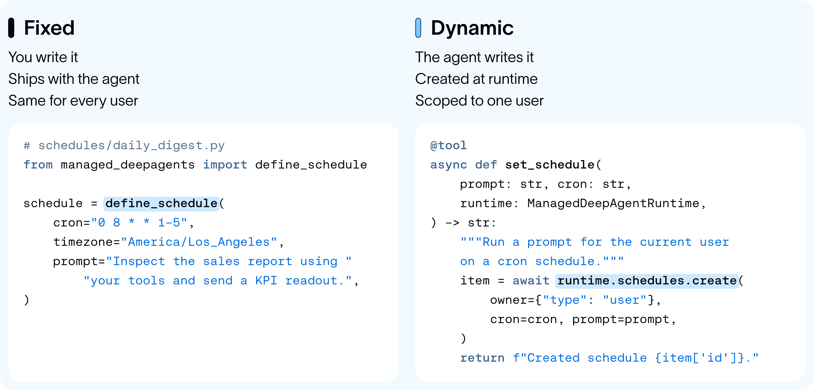

# 如何使用 Managed Deep Agents 的 Schedules SDK 构建主动、持续运行的智能体

> **来源**: [https://www.langchain.com/blog/proactive-agents](https://www.langchain.com/blog/proactive-agents)  
> **作者**: Nathan Drezner | **发布时间**: 2026-10-28T07:15:00+00:00  
> **深度调研**: [查看专题调研报告](research.md)  
> **标签**: 智能体, cron, 任务调度, Managed Deep Agents, LangChain, 长期记忆

---

## AI 导读

智能体若只在用户发消息时运行，就难以定期整理历史对话、检查新信息或按时提醒。文章提出用 cron（按时间规则触发任务的调度机制）周期性启动智能体，把要完成的任务写成提示，并结合用户的对话和记忆执行。文中将这种做法用于记忆整理、目标推进、信息筛选、提醒，以及定期检查多个智能体的任务进度。
实现上，作者认为需要一个支持灵活设定时间、携带所需能力和权限、在集中触发时错峰执行的调度服务，以及供智能体受控创建和修改任务的接口。随后使用 Managed Deep Agents 的软件开发工具包展示三种写法：在文件中定义固定周期任务；通过工具为当前用户创建、查询和删除周期任务；计算未来时间并安排一次性执行。固定周期示例明确指定了时区。
这些示例展示了如何把定时执行接入智能体应用，但没有展示实际执行结果，也没有说明失败重试、避免重复执行或具体权限校验。文章支持的是一种实现思路和平台接口用法，尚不足以验证其长期运行的可靠性；关于普及程度和未来趋势的判断也缺少可核验的统计依据。

---

## 原文整理

你听说过巴德尔—迈因霍夫现象吗？就是你第一次学到一个词后，突然发现到处都能听到它。我觉得软件工程中也有类似的现象：你学会了一种简单而有效的设计模式，随后就突然发现它无处不在。

我们正在主动型智能体领域看到这种现象。我们注意到，你所喜爱的新兴主动型智能体系统，几乎都由一种非常简单的机制驱动：把智能体运行设为 cron 定时任务，将操作系统中已有五十多年历史的原理，用在一个非常现代的场景中。

未来属于主动、持续运行的环境式智能体。Muse、Instinct、Dots、Claude Duet、Hone 等产品的推出，都体现了这一趋势。

cron 定时任务支持几种不同的能力，这些能力结合起来，让智能体具备主动性、个性化，以及[环境式运行](https://www.langchain.com/blog/introducing-ambient-agents)的特点——也就是说，它们可以自行执行任务，无需人手动下达指令。

在这篇博客中，我们会介绍 cron 定时任务能带来哪些能力、构建这类智能体所需的两个核心组成部分，然后通过示例展示如何在 [Managed Deep Agents](https://app.notion.com/p/Proactive-Agents-406808527b1780d2b7b2e31c5fcf7748?pvs=21) 中实现这些能力。

我们已经看到了 cron 定时任务带来的影响。由于主动性能够支持大量新功能，它正在成为智能体行为的新默认模式。**在 LangSmith 上，Managed Deepagent 超过 70% 的运行由定时任务触发**，而非由人输入消息触发。

## cron 定时任务能带来哪些能力？

cron 虽然概念简单，却能支持几种不同的行为，共同塑造出这些主动、持续运行的智能体。

**记忆：**这些智能体都有一个鲜明特点：能够长期记住与你有关的事实。实现这一点，部分工作是通过后台任务，将此前的对话浓缩成信息更密集的记忆。这通常被称为“做梦”。其底层其实只是一个按一定周期（例如每天一次）运行的 cron 定时任务：回顾对话，从中提取所得，再更新长期记忆。

**主动性：**这类智能体之所以能发挥作用，部分原因在于，它们会主动与你交流一些它们认为你可能感兴趣的想法。其底层工作方式是：系统对智能体应该完成什么，有某种“设想”。

对于通用智能体，这个设想可能很简单，就是当好助手：采取行动，提前判断你接下来需要什么，比如提醒即将到来的截止日期、跟进尚未处理完的事项，或找出与你工作相关的新闻。对于 Hone 这样的专用智能体，它们则会朝着明确的目标努力。随后，cron 定时任务按一定周期（每小时一次）运行，提示智能体探索能够推进目标的新行动。这些行动随后会以主动消息的形式呈现给用户。

**智能筛选：**世界上的干扰信息太多了。持续运行的智能体有一个重要用途：监控某个信息来源（Slack、电子邮件等），并在出现相关消息时通知用户。底层可以通过一个按一定周期（每十分钟一次）运行的 cron 定时任务来实现：提示智能体查看事件流，并将值得关注的内容通知用户。

**后续提醒：**cron 定时任务不只用于后台工作。用户常常会要求在某个时间提醒自己某件事。可以用 cron 设定时间，到时唤醒智能体并提醒用户。

**编排：**一组智能体可以由一个编排智能体统一管理，而这个编排智能体能够在未来的某个时间自行唤醒。它可以通过 cron 定时任务监控整个智能体群。在等待异步子任务完成时，它可以休眠，再按固定间隔自行唤醒，检查进度。

## 构建主动型智能体的两个关键部分

我们发现，要构建这类智能体，通常需要两个关键部分。

首先，需要一个可靠的 cron 服务器。这个服务器应让开发者能够轻松添加 cron 定时任务，按所需的任意时间安排运行，并附上运行时要执行的提示词。如果智能体运行时需要特定技能或权限，也应一并配置。如果某个时间点有大量任务要运行，服务器应对执行时间做少量随机偏移，让负载分散开来。

其次，需要一个便于智能体使用的接口。对于后续提醒这样的操作，智能体需要能够操作这些提醒。它需要一种简单、同时受到管控的方式，来设置和修改提醒。

## 使用 MDA 构建

Managed Deep Agents 托管在 [LangSmith Deployments](https://www.langchain.com/langsmith/deployment) 上，内置了一个可以动态触发智能体运行的 cron 服务器。定时运行的机制其实很简单：按设定的时间触发传入的提示词，并根据创建该定时任务的主体，使用相应的会话线程和记忆。上述工具包为构建只需接收提示词和 cron 时间规则的工具提供了基础。

使用 Managed Deep Agents，既可以静态定义定时任务，也可以由智能体动态定义。



例如，如果固定时间运行是智能体核心设计的一部分——比如每天汇报销售情况——只需在 `schedules/` 中放一个文件：

```
# schedules/daily_digest.py
from managed_deepagents import define_schedule
schedule = define_schedule(
    cron="0 8 * * 1-5",
    timezone="America/Los_Angeles",
    prompt="Inspect the sales report using your tools and send a KPI readout.",
)
```

Managed Deep Agents 也支持动态定时任务。最终用户可以通过提示词，让智能体安排开发阶段未曾预想到的周期性任务。要支持这一点，可以将 Schedules SDK 封装为工具：

```
# tools/scheduling.py
from langchain.tools import tool
from managed_deepagents import ManagedDeepAgentRuntime
@tool
async def set_schedule(prompt: str, cron: str, runtime: ManagedDeepAgentRuntime) -> str:
    """Run a prompt for the current user on a cron schedule."""
    item = await runtime.schedules.create(owner={"type": "user"}, cron=cron, prompt=prompt)
    return f"Created schedule {item['id']}."
@tool
async def list_schedules(runtime: ManagedDeepAgentRuntime) -> str:
    """List the current user's schedules."""
    page = await runtime.schedules.list(owner={"type": "user"})
    return str(page["items"])
@tool
async def delete_schedule(schedule_id: str, runtime: ManagedDeepAgentRuntime) -> str:
    """Delete one of the current user's schedules."""
    await runtime.schedules.delete(schedule_id, owner={"type": "user"})
    return f"Deleted schedule {schedule_id}."
```

开发者需要灵活性，Managed Deep Agents 的工具系统在设计时也考虑到了这一点。不同类型的智能体可能需要提供不同的定时任务工具集。在某些情况下，一个封装了单次运行功能的基础 `remind_me` 工具，或一个 `check_in_later` 工具，可能就足够了：

```
from datetime import datetime, timedelta, timezone
from langchain.tools import tool
from managed_deepagents import ManagedDeepAgentRuntime
@tool
async def check_in_later(prompt: str, minutes: int, runtime: ManagedDeepAgentRuntime) -> str:
    """Run a prompt once for the current user, a number of minutes from now."""
    at = datetime.now(timezone.utc) + timedelta(minutes=minutes)
    item = await runtime.schedules.create(owner={"type": "user"}, at=at, prompt=prompt)
    return f"Scheduled a check-in {item['id']}."
```

请参阅我们的文档，开始为你的 Managed Deep Agents 添加定时任务：[langch.in/mda](http://langch.in/mda)。只需执行一次 `mda init` 和一次 `mda deploy`，你就能在组织内部向大家提供一个主动型智能体。
