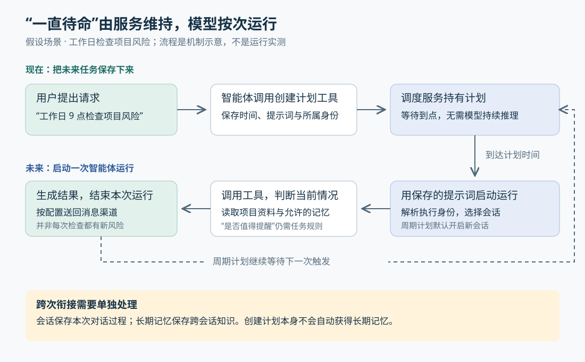

# 智能体怎样主动做事：让一次对话变成未来的任务

> 来源：[www.langchain.com](<https://www.langchain.com/blog/proactive-agents>)  
> 作者：Nathan Drezner · 发布时间：2026-10-28 15:15（Asia/Shanghai）  
> 翻译正文：[阅读中文正文](article-zh-CN.md)

聊天助手通常要等你发消息才开始工作。但检查项目风险、整理每天的新消息、过一小时追踪进展，都需要它在你没有打开聊天窗口时继续办事。LangChain 的 Managed Deep Agents（下文简称 MDA，即托管运行的智能体服务）给出的办法是：保存一条未来要执行的指令，到点启动智能体，让它读取当时的信息并完成任务。

这项进展值得关注的地方，是智能体能够在对话中创建和管理未来任务，并把后续结果送回消息渠道。如果你的需求跨越几小时或几天，这种能力比单次回答更有用。不过，“一直待命”需要服务持续可用，不代表语言模型一直在后台思考。

本文以 [LangChain 原文《How to Build Proactive, Always-On Agents with the Schedules SDK in Managed Deep Agents》](https://www.langchain.com/blog/proactive-agents)为主体，结合官方文档和公开更新日志核验；资料查阅截至 2026 年 10 月 29 日。这是一项产品与开发接口进展，原文没有提出新的模型训练算法，也没有提供论文式对照实验。

## 先看一个例子：让助手明天继续检查

假设你负责一个软件项目，在团队的 Slack 消息工具里告诉助手：“每个工作日上午九点检查本周到期的任务，告诉我哪些还没有负责人。”这里的智能体，指能够根据目标调用工具、读取信息并决定下一步动作的程序。

如果只是普通聊天，助手可能当场查一次任务清单，回答后就结束。支持调度后，它可以调用开发者提供的工具，保存检查时间和具体指令。第二天九点，调度服务启动一次新的运行，智能体查询最新任务，找出符合条件的项目，再按配置把结果送回 Slack。即使你当天没有发消息，这次检查也会发生。

上述场景是机制示例，不是原文报告的客户案例。它也说明了能力成立的条件：助手必须能读取任务系统，知道“本周到期”和“没有负责人”如何判断，并且已经接好结果发送渠道。计划本身只负责安排时间。

如果检查改成“发布完成后一小时再看一次状态”，则适合创建单次计划。原文的 Schedules SDK——供程序创建和管理计划的软件开发工具包——同时提供两种入口：用 `cron` 表达周期性时间规则，用 `at` 指定只执行一次的时刻。



图中上半部分是创建计划，下半部分是未来的一次执行。虚线表示周期计划继续等待下一个时间点，不表示模型在两次执行之间持续推理。

## 新意在哪里：把“以后再做”交给智能体管理

定时启动程序并不新鲜。cron 是一种按日历时间规则执行任务的机制，早已用于备份、报表和系统维护。早于本次文章，LangSmith Deployment 就已经提供定时启动智能体的接口；LangChain 在 2025 年介绍“环境智能体”时，也讨论过不依赖用户发消息、由外部信号触发工作的方式。因此，不能把这次进展理解成首次发明“定时运行 AI”。[定时任务文档](https://docs.langchain.com/langsmith/cron-jobs)、[2025 年的环境智能体介绍](https://www.langchain.com/blog/introducing-ambient-agents)都能确认这条技术脉络。

本次更具体的变化，是把调度能力接到了智能体正在进行的工作里。开发者可以预设每天执行的固定任务；用户也可以临时提出“明天提醒我”，由智能体调用工具创建计划。它还可以通过工具查询、修改或删除计划，而不只是输出一句“好的，我会提醒你”。

这样，未来任务就有了可管理的记录：什么时候执行、执行什么、归谁所有，以及结果回到哪里。语言模型负责把自然语言请求转成具体参数，运行服务负责保存并执行这些参数。两者分工，才让一句对话里的承诺有机会变成实际动作。

这与传统定时报表也有区别。固定脚本通常沿着预先写好的步骤处理数据；智能体收到同一条目标后，可以依据当天的信息选择工具、补查资料，再生成解释。不过，如果任务只是每天复制固定字段，普通脚本就可能足够。引入模型的价值主要在于需要理解内容和作出情境判断的部分。

## 从时间到了，到结果送达，中间发生什么

首先，开发者要把调度接口包装成智能体能调用的工具。原文给出的 `set_schedule` 工具接收提示词和 cron 表达式，内部调用 `runtime.schedules.create(...)`。这里的提示词就是未来那次运行收到的任务说明。智能体并不是直接掌握所有调度权限，它能做什么，取决于开发者开放了哪些工具。

其次，服务保存计划。对于用户所有的动态计划，`owner={"type": "user"}` 表示当前已经通过身份验证的人，而不是允许模型随意填一个用户名；智能体所有的计划则使用服务身份执行。执行身份决定它可以接触哪些资源，但并不意味着所有资料和记忆都会自动可见。[官方调度文档](https://docs.langchain.com/langsmith/python/managed-deep-agents-schedules)说明了这两种归属的区别。

到时间后，服务用保存的提示词启动一次运行。模型读取任务，通过现有工具获取最新数据，再决定如何处理。因此，同一条“检查即将到期的任务”可以每天得到不同答案：指令保持不变，查询到的现实情况已经变化。要让它发现问题，开发者仍需提供足够明确的目标和可用工具。

最后，运行结果需要有去处。原文展示的是托管服务上的智能体；在支持的消息渠道里创建动态计划，后续结果可以沿用该渠道返回。静态计划则需要配置发送目标。仅仅生成一段回答，与用户实际收到消息，是两件需要分别接通的事。

这里还有一个容易忽略的问题：未来那次运行是否仍知道今天聊过什么？“会话”是保存一组对话及其执行状态的容器。官方文档规定，动态周期计划默认新建会话，单次计划默认续接当前会话。这意味着周期任务的提示词需要能独立说明工作，不能想当然地把“继续刚才那个”留给明天的新会话。

## 记忆、筛选和追踪，为什么都能用定时任务实现

原文列举了几种看起来不同的主动行为。它们共同需要的，是让智能体在未来再次获得执行机会；但每种行为还需要自己的内容处理逻辑。

**整理记忆**可以安排在夜间：读取允许访问的历史材料，提取仍有价值的事实，再写入后续运行可以读取的存储。原文把这类后台整理俗称为“做梦”。它不是模型睡眠或重新训练；定时器只安排整理发生，提取什么、如何处理过时信息，仍取决于提示词、工具和存储策略。

尤其要区分会话记录与长期记忆。长期记忆指跨会话仍能读取的知识，MDA 默认并不启用它。官方提供共享的智能体记忆和个人记忆两层：前者适合团队通用知识，后者关联已认证的个人，并受访问策略限制。因此，创建一个夜间任务，不会自动让它拿到所有历史对话，也不会自动让下一次运行记住整理结果。[官方记忆文档](https://docs.langchain.com/langsmith/python/managed-deep-agents-memory)明确区分了这些作用范围。

**筛选消息**可以每隔一段时间读取新邮件或团队消息，让模型判断哪些值得提醒。真正减少噪声的，是判断规则，例如“只报告需要我决定的事项”，以及对已处理消息的记录。定时器本身不知道什么重要；若每次都重新报告相同内容，执行次数增加了，用户负担也会增加。

**推动目标和追踪进展**则是在每次启动时，读取目标与当前状态，再判断还有什么值得做。假设助手每小时检查一次尚未结束的研究任务，它可以发现新结果并汇总；但“值得做什么”仍然需要目标、资料和行动权限。安排检查时间，不等于获得了可靠制定长期目标的能力。

同样，定时检查也不是主动工作的唯一触发方式。消息到达后直接启动处理，也可以不依赖用户发消息。LangChain 早期对环境智能体的描述，本就包括监听事件流。定时检查更适合允许等待、或信息源不能主动通知的场景；需要快速响应时，可以考虑让事件直接触发运行。这是对触发方式的分析，不是原文提供的性能比较。

## 目前有哪些证据，又有哪些尚不能确认

能确认的是，这已经有公开接口和版本记录支撑，不只是一个概念。官方更新日志将运行时 Schedules SDK 列为 2026 年 10 月 7 日发布的 0.9.0 新能力，并在后续版本加入本地定时运行和计划数量限制。官方文档仍将 MDA 标为公开测试阶段。本次核验阅读了文档与更新日志，没有部署服务或执行端到端测试，因此不能把接口存在写成实际运行效果已经得到独立验证。[官方更新日志](https://github.com/langchain-ai/managed-deepagents/blob/main/CHANGELOG.md)

原文声称，LangSmith 上超过 70% 的 Managed Deepagent 运行来自定时任务。这是作者报告的平台内部使用比例，文章没有给出统计时间窗口、用户规模和任务效果等口径。它说明定时运行在该产品中占据较高份额，但不能证明这些运行节省了多少时间，也不能推导整个智能体行业都已采用同样模式。[原文](https://www.langchain.com/blog/proactive-agents)

原文还将多个新兴产品归入相似趋势，但没有逐项公开其实现证据。对于“几乎所有此类系统都由 cron 驱动”的说法，现有材料不足以独立核实。更稳妥的结论是：定时启动是一种简单、可复用的主动行为实现方法。

有一个限制直接影响对未来能力的理解：**官方 0.9.0 更新日志明确写着，定时运行不能再创建更多计划。** 因而，原文描述的“协调者不断安排自己以后醒来”，不能直接视为当前 SDK 支持任意递归安排任务的证明。预先创建一个重复检查进度的计划，与每次执行后自行决定下次何时启动，是两种不同能力；若要后者，需要进一步核实版本和实现支持。

时间精度也有边界：文档规定，动态单次计划按整分钟向上取整。这适合提醒与后续检查，不能据此宣称秒级响应。至于大规模同时触发时的表现，原文建议用小幅错开执行时间的办法分散负载，但没有公布对应的实测数据，不能将这项建议当成已经验证的吞吐保证。

## 怎样理解它接下来的价值

对于使用者，最直接的新工作方式是把一件事交代完整，让助手稍后回来报告，而不是反复记得打开聊天窗口。对于开发者，值得尝试的起点是一个目标清楚、允许延迟、结果容易检查的任务，例如每日检查缺少负责人的事项。先确认它确实发现了新问题，再考虑增加执行频率或允许更多动作。

一个具体配置有助于理解这个边界。下面改写自原文，是开发者预设的周期计划示意，不是完整应用，也未经本次运行验证：

```python
from managed_deepagents import define_schedule

schedule = define_schedule(
    cron="0 9 * * 1-5",
    timezone="Asia/Shanghai",
    prompt="检查本周到期且没有负责人的项目任务，列出任务及其依据。",
)
```

五个时间字段依次表示分钟、小时、日期、月份和星期；这里是上海时区的周一至周五九点，不会自动排除法定节假日。代码只定义何时启动和交代什么工作，任务系统访问、必要上下文及结果发送仍需另外配置。

后续最值得跟踪的信号，是执行次数之外的效果：助手发出的提醒有多少真正需要处理，能否识别已经解决的问题，记忆被纠正后是否影响后续判断，以及长期运行的费用是否与价值相称。这些是本文建议观察的方向，目前原文没有提供答案。

从技术发展看，这套接口为“先交代目标，之后持续得到进展”提供了具体支点。它已经把未来执行变成可创建、可查询、可取消的对象；能否进一步成为可靠的长期助手，还要看每次启动后能否读到合适的信息、作出有用判断，并在恰当的时候打扰用户。
