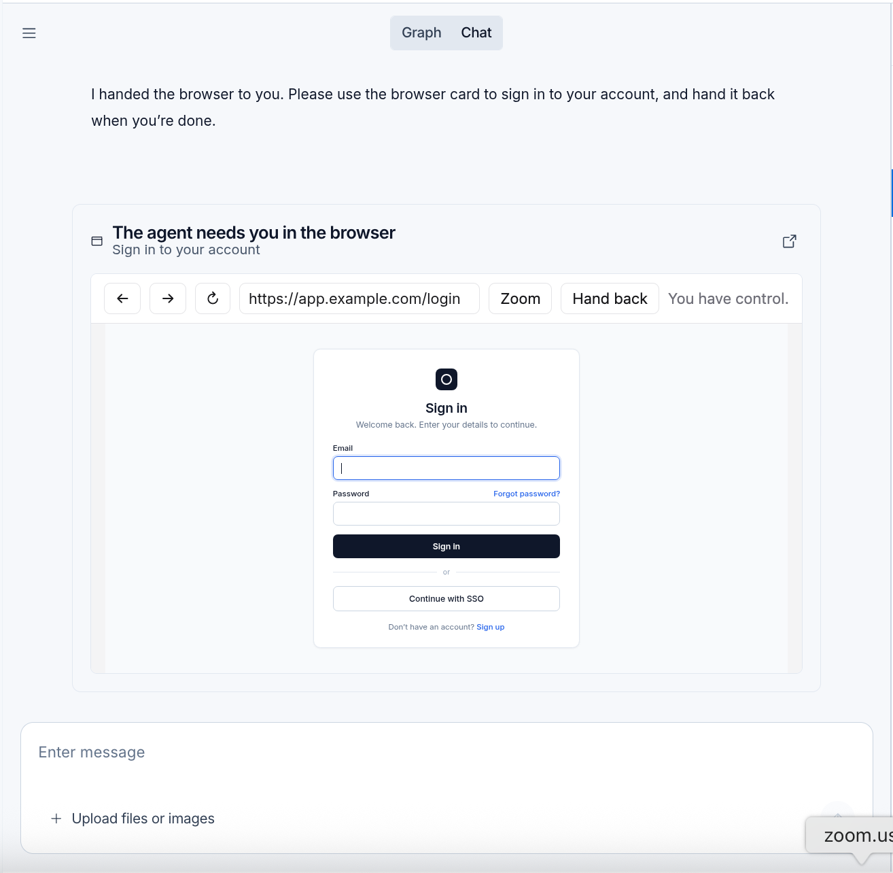

# Managed Deep Agents v0.10：浏览器操作与异步子智能体

> **来源**: [https://www.langchain.com/blog/managed-deep-agents-browser-use-and-asynchronous-subagents](https://www.langchain.com/blog/managed-deep-agents-browser-use-and-asynchronous-subagents)  
> **作者**: Nathan Drezner Sydney Runkle | **发布时间**: 2026-10-29T16:54:00+00:00  
> **深度调研**: [查看专题调研报告](research.md)  
> **标签**: Managed Deep Agents, 浏览器自动化, 异步子智能体, 人机协作, 会话隔离, Slack 集成, 身份映射

---

## AI 导读

文章针对两个问题介绍新版本：智能体无法直接操作只有网页、没有应用程序接口（API）的服务；主智能体等待耗时助手任务时，用户也无法继续交互。第一项做法是给智能体配置浏览器，在隔离运行环境中提供读取页面、点击、截图和人工接管工具。浏览器默认按对话隔离，也可按用户复用登录状态。遇到登录或双重验证时，用户接管远程窗口，完成后交还，智能体检查页面并继续；接管等待不会阻塞其他工作，链接在15分钟后失效。文章称这种方式可避免密码进入模型消息和追踪记录，但未展示验证过程。第二项做法是将子智能体，即使用独立上下文执行分工任务的助手，设为异步运行：它在独立对话线程中执行任务，主智能体可以继续交流，并能检查、调整或取消任务。任务完成后主动通知主智能体；结果何时处理取决于主智能体正在运行、空闲还是等待审批。助手共享主智能体的文件运行环境，相关审批可回到原始 Slack 消息串处理。文章还介绍回复来源记录、停止运行、用户身份映射及升级中的不兼容变更。整体提供了配置入口和预期行为，但没有实测案例、性能对比，也未详述任务失败恢复或共享文件的并发处理，因此更适合作为接入导读。

---

## 原文整理

## 要点

- **浏览器操作：** 你的智能体可以在没有 API 的网站上预订行程或提交理赔申请。当网站要求登录时，智能体会将浏览器窗口交给你操作，让你的密码不会进入模型的消息和追踪记录。
- **异步子智能体：** 耗时任务可以交给子智能体在后台运行，同时你的智能体仍能继续与你交谈。你可以让智能体查看任务进展或调整任务方向；子智能体完成后，结果会回到对话中。
- **对话线程来源与停止运行：** 回复会发回请求最初所在的 Slack 消息串，包括定时运行的回复，以及稍后完成的子智能体所产生的回复。消息串中的“停止”按钮可以取消该线程的运行。

[Managed Deep Agents](https://docs.langchain.com/langsmith/python/managed-deep-agents) v0.10 今天发布。新版本增加了[浏览器操作](https://docs.langchain.com/langsmith/python/managed-deep-agents-browser-use)功能，让你的智能体能够在没有 API 的网站上执行操作；还增加了[异步子智能体](https://docs.langchain.com/langsmith/python/managed-deep-agents-subagents#async-subagents)，可以在后台执行耗时任务，同时你的智能体继续与你交谈。

本文会介绍智能体为什么需要这两项功能、如何启用它们，以及本次发布的其他更新。

## 给你的智能体配一个浏览器

预订行程、取消订阅或提交理赔申请，都需要在面向用户点击操作的网站上完成，而这些网站往往没有智能体可以调用的 API。智能体虽然能推理出完成任务的方法，但如果网站没有 API，它们就无法实际操作。用 `curl` 获取页面也帮不了太多：它得到的是 JavaScript 渲染页面之前的 HTML，而且智能体也无法点击任何内容。

[Instinct](https://instinct.com/) 和 Meta 的 [Muse](https://ai.meta.com/muse/) 等个人智能体能够浏览网站，因此可以处理更广泛的任务。[DataDome](https://finance.yahoo.com/technology/ai/articles/datadome-report-agentic-browser-traffic-130000558.html) 观察到，仅在 9 月，来自智能体的浏览器请求量就增长至原来的 4.7 倍。编程智能体也需要浏览器，以检查应用修改后是否确实能正确显示和正常工作。

我们在《[Managed Deep Agents 中的浏览器操作](https://www.langchain.com/blog/browser-use-in-managed-deep-agents)》中介绍了浏览器能在哪些场景下提供帮助，以及它的底层工作方式。要启用这项功能，请在[项目根目录](https://docs.langchain.com/langsmith/python/managed-deep-agents-project-structure)中声明一个浏览器：

```
# browser.py
from managed_deepagents import define_browser
browser = define_browser(scope="thread", idle_ttl_seconds=600)
```

Managed Deep Agents 会在专属的 [LangSmith 沙箱](https://docs.langchain.com/langsmith/sandboxes)中运行浏览器，并自动为你的智能体添加以下[浏览器工具](https://docs.langchain.com/langsmith/python/managed-deep-agents-browser-use#browser-tools)：

| 工具 | 功能 |
| --- | --- |
| `browser_snapshot` | 读取页面的无障碍树，并为元素分配 ID |
| `browser_run` | 通过 JavaScript，或针对快照中元素 ID 的批量操作，导航和操作页面 |
| `browser_screenshot` | 截取页面，可选择将图片保存到沙箱中 |
| `browser_handoff` | 将窗口的控制权交给用户 |

默认情况下，每个对话都有自己的浏览器。这个浏览器会在多轮交互中复用，初始状态不带有其他线程的 Cookie 或登录信息。使用 [`scope="user"`](https://docs.langchain.com/langsmith/python/managed-deep-agents-browser-use#choose-a-scope) 时，每位[已登录的用户](https://docs.langchain.com/langsmith/python/managed-deep-agents-identity)都有一个浏览器，登录状态会在该用户的所有对话中保留，因此智能体只需要让用户在某个网站上登录一次。

### 将浏览器交给用户操作

大多数浏览器智能体一遇到登录页面或双重验证提示就会停下来。有了 [`browser_handoff`](https://docs.langchain.com/langsmith/python/managed-deep-agents-browser-use#hand-off-the-browser)，智能体就能把窗口交给你操作，这样你的密码就始终不会进入模型的消息或追踪记录。

智能体会调用 `browser_handoff(reason)`，并解释为什么需要你来操作。在 Slack、Studio 等智能体交互渠道中，界面会直接提供接管浏览器控制权的链接。用户打开链接后，即可操作远程浏览器，并看到一个**交还控制权**按钮。自定义客户端可以自行渲染接管组件。你登录并交还控制权后，智能体会检查页面，确认登录是否成功，然后继续执行任务。接管调用会立即返回，因此智能体在等待时还可以做其他工作。接管链接会在 15 分钟后失效。



通过交接控制权，智能体可以替你操作网页，而不必看到你的登录凭据。

[浏览器操作文档](https://docs.langchain.com/langsmith/python/managed-deep-agents-browser-use)介绍了作用域、单次运行配置以及完整的控制权交接流程。

## 在后台运行子智能体

[子智能体](https://docs.langchain.com/oss/python/deepagents/subagents)让智能体可以把一项明确的任务交给拥有独立上下文窗口的助手。此前，Managed Deep Agents 中的子智能体采用同步执行方式：主智能体调用子智能体后，会等待它返回答案。这种方式适合快速查询，目前也仍然受到支持。但如果耗时任务由同步智能体执行，或者需要并行派出多个智能体，与智能体交谈的用户也只能等待，无法继续与负责协调的主智能体交互。

在 Managed Deep Agents v0.10 中，只需在子智能体定义中添加 `async`，就能让子智能体异步运行，不阻塞负责协调的主智能体：

```
from managed_deepagents import define_deep_agent
agent = define_deep_agent(
    name="research-assistant",
    model="openai:gpt-5.5",
    subagents=[
        {
            "name": "researcher",
            "description": "Researches a topic in the background.",
            "system_prompt": "Research the topic and report your findings.",
            "async": True,
        },
    ],
)
```

主智能体会在独立线程中启动异步子智能体，并在一个或多个子智能体运行期间继续与用户交谈。负责协调的主智能体通过一组[异步任务工具](https://docs.langchain.com/langsmith/python/managed-deep-agents-subagents#how-async-subagents-run)来启动、查看、更新和取消这些任务。每个部署为服务的智能体还会获得一个可在后台运行的[通用子智能体](https://docs.langchain.com/oss/python/deepagents/subagents#the-general-purpose-subagent)副本，因此它可以在运行时决定，把委派出去的工作放在前台还是后台执行。

异步子智能体会主动[通知主智能体](https://docs.langchain.com/langsmith/python/managed-deep-agents-subagents#get-notified-when-a-subagent-finishes)，因此主智能体无需不断轮询。接下来如何处理，取决于子智能体完成时主智能体正在做什么：

| 子智能体完成时，主智能体的状态 | 后续行为 |
| --- | --- |
| 忙碌 | 主智能体会在每次调用模型前检查尚未结束的任务，因此可以在运行过程中收到结果 |
| 空闲 | 子智能体会启动一次新的运行，唤醒主智能体 |
| 暂停并等待审批 | 原有审批保持不变；用户回应后，结果才会送达 |

异步子智能体与主智能体共享[沙箱](https://docs.langchain.com/langsmith/python/managed-deep-agents-sandboxes)，因此可以直接使用主智能体已经写入的文件。它的运行会显示在 [LangSmith](https://docs.langchain.com/langsmith/observability) 中主智能体运行记录的下级。在 Slack 中，它的[审批请求](https://docs.langchain.com/langsmith/python/managed-deep-agents-subagents#answer-approvals-in-channels)会发回原始消息串，在那里回应审批即可让子智能体继续运行。

## v0.10 的其他更新

- **`runtime.thread`：** 现在每个线程都会记录其起始位置（例如某个 Slack 消息串）以及参与者。工具可以在任何一次运行中读取 `runtime.thread`。借助这些信息，从 Studio 恢复的运行、定时运行，以及异步子智能体唤醒主智能体时触发的运行，都能在原始 Slack 消息串中回复。[运行时文档](https://docs.langchain.com/langsmith/python/managed-deep-agents-runtime)介绍了工具可以读取的托管字段。
- **停止运行：** Slack 消息串中增加了原生的“停止”按钮，用于取消该线程的运行；Studio 也可以取消 Slack 线程中的运行。
- **Slack 渠道处理器（实验性）：** `onEvent` 决定每个 Slack 事件会触发什么，包括提及、私信、其他消息和按钮点击。`status` 设置运行期间 Slack 显示的状态，`reply: "none"` 则将回复交由智能体处理。请参阅 [Slack 渠道文档](https://docs.langchain.com/langsmith/python/managed-deep-agents-channels-slack)。
- **使用自己的 Slack 应用：** `mda deploy` 会询问新的 Slack 渠道应使用哪个应用。你可以选择由 LangSmith 创建和管理的应用，根据清单创建一个新应用，或使用已有应用。
- **`resolveUser`：** 当有人通过 Slack 等渠道向你的智能体发送消息时，Managed Deep Agents 会验证发送者的身份。`resolveUser` 会将该发送者映射到你自己的系统中对应的用户，让你的工具可以查询这个人的账户和权限。你可以将其编写为函数，也可以指定一个供我们调用的端点。将它设置在[身份声明](https://docs.langchain.com/langsmith/python/managed-deep-agents-identity)中即可覆盖所有渠道，也可以只为单个渠道设置。
- **不兼容变更：** 已移除 `connectors.mcp()` 和 `connectors/` 目录布局。MCP 服务器必须在 `tools/mcp.ts` 或 `tools/mcp.py` 中声明。沙箱的 `scope` 选项也已移除。对于 `LANGSMITH_*` 变量，Shell 环境变量现在会优先于项目 `.env` 文件中的设置。

## 开始使用

Managed Deep Agents v0.10 今天起开放公开测试。你可以从[文档](https://docs.langchain.com/langsmith/python/managed-deep-agents-overview)开始，也可以创建一个新项目：

```
uvx --from managed-deepagents mda init my-agent
cd my-agent
uv run mda deploy
```

和往常一样，我们迫不及待地想听你分享用它做出了什么。

*如果你错过了：v0.9 新增了由智能体创建的定时任务、单次运行配置和 Slack 表情回应。请阅读 v0.9 的介绍文章。*
