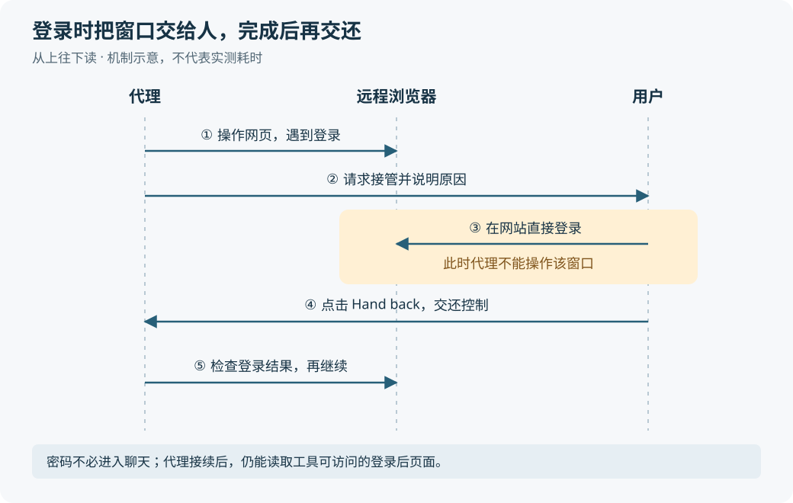
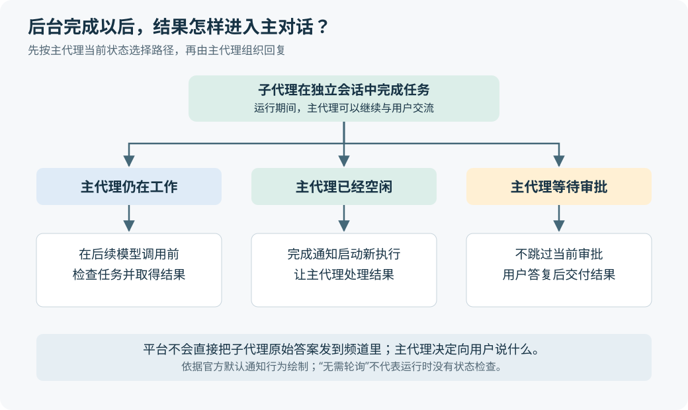

# Managed Deep Agents v0.10：让代理操作网页，也让长任务不再堵住对话

> 来源：[www.langchain.com](<https://www.langchain.com/blog/managed-deep-agents-browser-use-and-asynchronous-subagents>)  
> 作者：Nathan Drezner Sydney Runkle · 发布时间：2026-10-30 00:54（Asia/Shanghai）  
> 翻译正文：[阅读中文正文](article-zh-CN.md)

让人工智能代理替人办事，常会卡在两处：网站只有供人点击的页面，没有可调用的接口；后台工作需要很久，代理一旦等着结果，就顾不上继续回答用户。LangChain 在 2026 年 10 月 29 日发布的 Managed Deep Agents v0.10，给出了两项配套能力：可交给用户临时接管的远程浏览器，以及能够在后台执行、完成后通知主代理的子代理。如果你关注的是“代理怎样持续把事情办完”，而不只是一次回答得好不好，这次更新值得看。[原文](https://www.langchain.com/blog/managed-deep-agents-browser-use-and-asynchronous-subagents)

这里的“代理”（Agent），是能根据任务调用工具、观察结果并决定下一步的软件。Managed Deep Agents 则是 LangChain 提供的托管服务：开发者定义代理的指令和工具，由平台运行相关执行环境。本次进展主要发生在工具和任务运行方式上，并非发布了一个推理能力更强的新模型。

## 先看一个例子：用户登录，代理继续办事

**假设**你让一个差旅助手比较酒店，要求靠近会场、可以免费取消。某个预订网站没有适合这项任务的应用程序接口，也就是供程序直接请求数据和操作的 API，助手只能打开网页、填写日期、选择筛选项。

它遇到登录页面后，把当前浏览器窗口交给你。你在网站里输入密码、完成双重验证，再点击交还控制。助手重新检查页面，确认已经登录，继续读取房型和取消条款。密码不需要作为聊天消息发给模型。

同时，你可能让助手整理一份耗时较长的区域交通资料。主代理把这项工作交给后台子代理后，你仍能补充“只看有直达地铁的区域”。主代理可以向后台任务发送新指令，等资料完成后再把结果整合进回复。

这是解释功能的假设场景，并非官方公布的完整差旅实测。它说明两项能力各自解决什么：浏览器补上“怎样操作网站”，异步任务补上“等待期间怎样继续协作”。至于多个任务怎样共同决定最终预订，仍需要开发者定义规则；这次发布并没有证明任意复杂任务都会自动协调成功。

## 浏览器怎样把“看懂页面”接到“执行动作”

网页源代码与用户实际看到的页面并不总是一回事。网站可能需要运行 JavaScript 才显示价格、搜索结果和表单状态。原文用 `curl` 抓取页面来说明这个差别：普通抓取不会替你完成浏览器里的脚本执行和点击交互。更准确地说，这不意味着所有网页都必须用浏览器读取；静态页面仍可直接抓取，有合适 API 的任务也应优先使用 API。

Managed Deep Agents 会运行远程浏览器，并向代理提供四种工具。关键是把观察、动作和结果检查连起来，而不是只给模型一张网页截图。[原文的工具说明](https://www.langchain.com/blog/managed-deep-agents-browser-use-and-asynchronous-subagents)

| 工具 | 在任务中做什么 |
| --- | --- |
| `browser_snapshot` | 读取页面结构，为可交互元素分配编号，帮助代理找到操作对象 |
| `browser_run` | 按编号执行一批动作，或运行 JavaScript 完成导航、填写和点击 |
| `browser_screenshot` | 获取页面截图，查看实际渲染结果 |
| `browser_handoff` | 把窗口交给人，处理登录等需要人工参与的步骤 |

其中，快照读取的是**无障碍树**：浏览器为屏幕阅读器等辅助技术整理的页面表示。它包含元素的名称、角色和状态，例如“搜索”按钮、“目的地”输入框、是否勾选。模型由此可以按页面含义选择操作对象，不必每次都靠图片猜坐标。它也不是完整的视觉副本；页面布局和图形信息仍可能需要截图补充。[MDN：无障碍树](https://developer.mozilla.org/en-US/docs/Glossary/Accessibility_tree)

以刚才的假设为例，代理先拿到快照，知道哪个编号对应日期输入框；再调用动作工具填写日期、点击查询；页面变化后重新观察，确认结果已经出现。如果跳转使原编号失效，就需要新快照，不能把之前的编号当成永久有效的地址。[官方浏览器文档](https://docs.langchain.com/langsmith/python/managed-deep-agents-browser-use)

官方配套文章还解释，工具基于 Stagehand——Browserbase 开源的浏览器自动化开发工具。动作工具允许一次调用执行多个步骤，并只返回需要的信息。它减少的是模型与工具之间逐步往返、反复传入页面内容的开销；能否正确完成任务，仍取决于页面和代理的判断。[浏览器机制介绍](https://www.langchain.com/blog/browser-use-in-managed-deep-agents)

## 人工接管改变的是控制权，不是把密码塞给模型

登录不是普通的填表步骤。把密码放进提示词，会让它进入模型接收的内容，也可能进入运行记录。此次提供的办法，是让人直接操作同一个远程浏览器，完成认证后再交还。

图中的重点是控制权往返。代理调用 `browser_handoff(reason)` 后会立即返回，因此可以处理其他工作；但用户控制窗口时，代理的浏览器工具不能操作这个窗口。用户点击 **Hand back** 后，系统通知代理，代理再检查当前页面，判断是否可以继续。接管链接在 15 分钟后过期；过期本身不等于登录成功。[原文](https://www.langchain.com/blog/managed-deep-agents-browser-use-and-asynchronous-subagents)、[官方接管说明](https://docs.langchain.com/langsmith/python/managed-deep-agents-browser-use#hand-off-the-browser)

“密码不经过聊天”也不等于“代理看不到登录后的信息”。代理继续操作时，仍能读取其工具可访问的页面内容，并利用已有登录状态办事。因此，这个机制解决的是人工输入凭证的路径，不能理解为对所有页面敏感信息的自动隔离。

浏览器状态保留多久、由哪些对话共享，同样影响体验。默认的 `scope="thread"` 为每个对话提供独立浏览器，在该对话的多轮交流中复用；`scope="user"` 则按经过认证的用户共享登录状态，各对话使用不同窗口。后一种方式减少重复登录，但在一个窗口退出登录或切换账户，会影响其他对话共享的状态。网站会话过期或浏览器被替换，也可能让登录失效，“登录一次”不是永久有效的承诺。[官方会话说明](https://docs.langchain.com/langsmith/python/managed-deep-agents-browser-use#choose-a-scope)

## 后台子代理怎样让主对话继续

子代理是主代理委派出去的助手，有自己的指令和**上下文窗口**，也就是本轮推理能够使用的输入空间。独立上下文适合容纳大量专项材料，避免主对话被研究过程淹没。但如果主代理调用助手后必须一直等待，用户仍然会被一起卡住。

v0.10 在子代理定义中加入 `"async": True`，让它在自己的线程里运行。这里的“线程”指保存任务消息和状态的会话记录，不是操作系统线程。主代理启动任务后拿到任务编号，便可继续回答问题；以后用编号检查状态、补充指令或取消任务。[原文](https://www.langchain.com/blog/managed-deep-agents-browser-use-and-asynchronous-subagents)

这一变化并不直接提高助手的研究速度。它改变的是等待关系：以前是“助手没结束，主代理也不能继续”，现在是“助手独立推进，主代理处理后续交互”。短小且必须立刻得到结果的任务，仍然可以使用原先的同步调用。

更关键的问题是：主代理已经结束当前回复，后台结果回来后由谁处理？发布说明给出了三种行为：

| 子代理完成时，主代理处于什么状态 | 平台怎样交付结果 |
| --- | --- |
| 仍在工作 | 在后续模型调用前检查未完成任务，把结果带入当前执行过程 |
| 已经空闲 | 启动一次新的执行，让主代理处理结果 |
| 正等待用户审批 | 保留审批，等用户答复后再交付结果 |

这也解释了原文所说的“不用轮询”。它指主代理不必反复调用查询工具来消磨等待时间，并不意味着底层完全没有状态查询。官方文档明确写到：每次模型调用前，运行时仍会检查未完成任务；主代理空闲时则由完成通知唤起。最终面向用户说什么，由主代理决定，平台不会直接把子代理原始答案发到频道里。[官方子代理文档](https://docs.langchain.com/langsmith/python/managed-deep-agents-subagents)

子代理与主代理可以共享沙箱，也就是供它们读写文件、执行程序的隔离环境。因此，子代理能接着使用主代理已经写好的材料。不过，独立会话并不等于独立文件副本：共享文件方便合作，也意味着同时改写同一份材料仍需安排好先后顺序。后者是依据共享机制得出的分析，并非本次发布报告的故障现象。

为了让延迟完成的任务仍能回到用户原来的交流位置，v0.10 还增加了 `runtime.thread`，记录会话来源及参与者。按发布说明，即便从 Studio 恢复、由定时任务触发，或因子代理完成而重新运行，回复也能回到最初的 Slack 讨论串；Slack 的停止按钮则用于取消该会话的执行。这些功能让“后台继续做、稍后再回复”成为一个可使用的交互过程，而不只是一段后台计算。[原文](https://www.langchain.com/blog/managed-deep-agents-browser-use-and-asynchronous-subagents)

## 新意在哪里，证据又支持到哪一步

**这次值得关注的是托管平台把现有能力接成了较完整的使用流程。** 浏览器自动化不是新概念，异步子代理也不是 LangChain 此次才提出的：2026 年 4 月的开源 Deep Agents v0.5 已支持后台远程子代理，启动后立即返回任务编号，并允许后续更新指令。v0.10 的区别在于，托管平台可以根据声明构建子代理、管理执行，并处理完成通知和原会话回复，开发者不必为每个助手另行填写远程部署地址。[Deep Agents v0.5 发布说明](https://www.langchain.com/blog/deep-agents-v0-5)、[托管子代理配置说明](https://docs.langchain.com/langsmith/python/managed-deep-agents-subagents#configure-an-async-subagent)

证据需要分开看：

- **已发布的产品能力与作者演示。** 原文宣布 v0.10 进入公开测试，文档列出了工具、会话共享与通知行为，接管演示展示了人登录后代理继续操作。这支持“已有具体产品接口和演示”，尚不足以证明各种网站上的稳定表现。
- **作者自测。** 配套浏览器文章报告，在来自 WebVoyager 的 100 个任务上完成率为 90%，总成本为 1.98 美元，并称这是其测试的七套工具中完成率最高的一套。这是官方团队自己的实验结论，本次调研未独立复现。[测试披露](https://www.langchain.com/blog/browser-use-in-managed-deep-agents)
- **仍然未知的范围。** 该披露没有给出足以复现实验的完整任务清单、模型及配置、重试规则、评判细节和成本构成。不能把 90% 外推为“任意业务成功率”，也不能把 1.98 美元直接当成包含浏览器、平台和人工接管费用的业务报价。异步子代理部分没有提供量化的吞吐量或总耗时结果。

WebVoyager 本身是一项研究，提出了让代理在真实网站上完成任务的评测，并使用模型辅助判断结果。它能检验真实网页交互，但网站会变化，任务与判定方法也会影响结果。因此，只看到同一个基准名称，不足以把不同报告中的数字直接排成名次。[WebVoyager 原始论文](https://arxiv.org/abs/2401.13919)

成熟度还体现在功能边界上。例如，当前文档明确说明，命令行评测入口 `mda eval` 没有运行异步子代理所需的 Agent Server，因此不能直接评测声明了这类子代理的代理。公开测试意味着可以开始试用，但完整异步交互需要在相应服务环境里验证，不能只靠这个评测入口判断。[官方评测限制](https://docs.langchain.com/langsmith/python/managed-deep-agents-subagents#evaluate-an-agent)

## 接下来值得观察什么

对使用者而言，最直接的新用途是把网页办理流程与持续对话结合起来：代理执行可自动完成的部分，人处理登录等必要步骤，耗时资料整理放到后台。另一个方向是编程代理修改网页应用后，自己启动应用、在浏览器中走一遍流程。官方介绍了通过私有连接让独立浏览器访问代理沙箱内应用的做法，并称已在其 Open SWE 编程代理中使用；这属于作者报告的应用，不能据此推断测试覆盖率或缺陷减少幅度。[浏览器应用介绍](https://www.langchain.com/blog/browser-use-in-managed-deep-agents)

从这些机制推断，代理产品会更需要把“正在做什么、现在由谁操作、哪些任务还没完成”展示给用户。因为任务可以跨越多轮对话，用户的要求也可能中途变化，单次回答正确已经不能完整衡量体验。这是本次进展带出的研究与产品问题，不是已经验证的收益。

后续最值得跟踪的信号有三项：浏览器测试是否公开完整配置和失败样例；长任务收到新指令、暂停审批、完成通知之后能否持续正确接续；公开测试是否补上更完整的异步评测支持。这些证据比新增多少工具，更能说明它离日常可依赖的助手还有多远。

如果你的任务经常受阻于网站交互或长时间等待，可以据此选择一个边界清楚的小任务试用。若已有稳定 API，或任务很短且下一步必须等待结果，浏览器和后台子代理并不会天然更合适。这次更新真正扩展的是代理能参与的工作过程；最终结果的准确性与可用性，仍需按具体任务检验。
